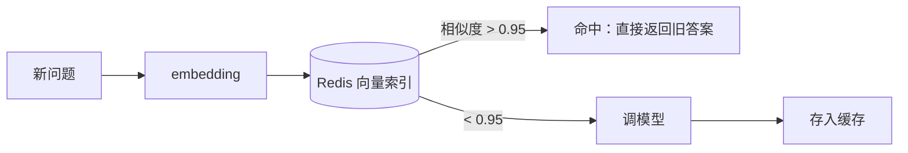

# Java AI 应用工程化

> **优先级：P1（Demo 到生产的分水岭）** — 调通 API 只要半小时；让 AI 服务扛住并发、算得清成本、出得了事故，才是 Java 工程师的主场。

::: tip 背景
[AI 应用工程化实践](/ai-agent/app-engineering) 讲了四大问题（评估/可观测性/成本/安全）的通用框架，本文讲 **Java 侧的具体落地**：流式输出怎么写、token 怎么限流计费、语义缓存怎么实现。前半部分接 [可观测性](/service/common/observability) 的监控体系。
:::

## 一、流式输出：体验的分水岭

同步调用等 5~10 秒才出全文，用户以为卡死。流式（token 逐个吐）是 AI 应用标配。

### WebFlux 方案（推荐）

```java
@GetMapping(value = "/ai/stream", produces = MediaType.TEXT_EVENT_STREAM_VALUE)
public Flux<String> stream(@RequestParam String message) {
    return chatClient.prompt()
            .user(message)
            .stream()
            .content();               // Flux<String>：模型吐一个 token 推一个
}
```

### MVC（Servlet）方案

```java
@GetMapping("/ai/stream")
public SseEmitter stream(@RequestParam String message) {
    SseEmitter emitter = new SseEmitter(60_000L);      // 60s 超时

    chatClient.prompt().user(message).stream().content()
            .subscribe(
                token -> emitter.send(SseEmitter.event().data(token)),  // 逐个推
                emitter::completeWithError,
                emitter::complete
            );

    return emitter;    // 连接保持，直到模型吐完
}
```

**前端接收**（对照你熟悉的写法）：

```js
const res = await fetch('/ai/stream?message=...');
const reader = res.body.getReader();
const decoder = new TextDecoder();
while (true) {
    const { done, value } = await reader.read();
    if (done) break;
    document.getElementById('answer').textContent += decoder.decode(value);  // 打字机效果
}
```

### 三个工程坑

| 坑 | 现象 | 解法 |
|---|---|---|
| **首 token 延迟（TTFT）** | 连上了但 3 秒没反应 |  Prompt 短一点；预热连接；前端先出"思考中"占位 |
| 中途断连 | 用户关页面，服务端还在烧 token | 监听 `onClose`/`onError`，取消上游请求（模型侧也停止计费） |
| 网关超时 | Nginx 默认 60s 掐断长回答 | 流式接口单独 location 配 `proxy_read_timeout 300s` + `proxy_buffering off` |

**Nginx 两个必须配的**：`proxy_buffering off`（不开缓冲，token 实时透传）+ 加大 `proxy_read_timeout`——否则用户看到的是"憋 10 秒一次性出全文"，流式白做。

## 二、Token 级限流：和 QPS 限流是两回事

传统限流按请求数（10 QPS）；AI 接口的成本不在请求数，在 **token 消耗**——一次请求可能烧 500 token，也可能 5 万（长文档问答）。

### 为什么必须按 token 限

```
用户 A：100 次 "你好"            ≈ 2,000 token      ≈ ¥0.01
用户 B：1 次"总结这份 200 页 PDF" ≈ 150,000 token   ≈ ¥3.00
```

按 QPS 限流，两者都只算 1 次请求——**恶意用户可以用最少请求打爆你的账单**。

### 实现：滑动窗口 + token 桶

```java
@Component
public class TokenRateLimiter {

    // 每用户每天 100 万 token 配额
    private static final long DAILY_QUOTA = 1_000_000L;

    private final StringRedisTemplate redis;

    public boolean tryConsume(String userId, int estimatedTokens) {
        String key = "ai:quota:" + userId + ":" + LocalDate.now();
        Long used = redis.opsForValue().increment(key, estimatedTokens);
        if (used != null && used == estimatedTokens) {
            redis.expire(key, 24, TimeUnit.HOURS);      // 首次写入设过期
        }
        return used != null && used <= DAILY_QUOTA;
    }
}
```

**流程**：请求进来先估算 token（输入长度 ÷ 4 粗估，中文约 1 字 ≈ 1 token）→ 扣配额 → 超额返回 429 + 剩余配额。响应头带回 `X-Token-Used`，让客户端知道消耗。

### 并发也要限

token 配额防"烧钱"，不防"打爆"——100 个并发长请求同时占着 100 条模型连接，服务照样挂。用信号量限制同时在飞的请求数：

```java
private final Semaphore modelConcurrency = new Semaphore(50);   // 全局最多 50 个在飞

modelConcurrency.acquire();
try {
    return chatClient.prompt().user(q).call().content();
} finally {
    modelConcurrency.release();
}
```

（原理见 [Java 并发编程](/service/java/java-concurrency) 的 JUC 工具类）

## 三、成本核算与模型分级路由

### 按用户/租户记账

每次调用记录：`userId / model / promptTokens / completionTokens / cost / timestamp`，落库或发 Prometheus 计数器。月底按用户聚合——对内是成本分摊，对外（API 转售）是账单。

### 省钱第一招：模型分级路由

不是所有请求都配用最贵的模型：

```java
public ChatModel route(String question) {
    // 简单问答走便宜模型，复杂推理/长文走强模型
    if (question.length() < 50 && !question.contains("分析")) {
        return cheapModel;      // 如 qwen-turbo / deepseek-chat
    }
    return strongModel;         // 如 deepseek-reasoner / 通义千问 Max
}
```

**实测常见的三七开**：70% 请求是简单问答（分类/摘要/查知识库），30% 需要强模型——路由后总成本降 60%+，用户几乎无感。**先分类再回答**：用一个超便宜模型（甚至正则）判断复杂度，是性价比最高的一招。

### 其他省钱手段

| 手段 | 收益 |
|---|---|
| 语义缓存（下节） | 命中率 30% 场景省 30% |
| Prompt 精简 | 系统提示词别啰嗦，每次都计费 |
| 输出长度限制 | `max_tokens` 按场景设，防模型写小作文 |

## 四、语义缓存：命中即省钱

传统缓存靠 key 精确匹配；"Java 单例模式怎么写"和"单例模式的 Java 实现"问同一个问题，key 不同就 Miss——**语义缓存按意思命中**：



```java
public String answerWithSemanticCache(String question) {
    float[] qv = embedding(question);

    // Redis Stack：按向量相似度查
    List<ScoredValue<String>> hits = redis.opsForValue(stringRedisSerializer)
            .findNearest("ai:semantic-cache", qv, 1, 0.05);   // 距离 < 0.05 ≈ 相似度 0.95

    if (!hits.isEmpty()) {
        cacheHitCounter.increment();                  // 监控命中率
        return hits.get(0).getValue();
    }

    String answer = chatClient.prompt().user(question).call().content();
    redis.opsForValue().set("ai:semantic-cache:" + uuid(), answer);
    return answer;
}
```

**阈值是灵魂**：0.95 以上才认为"同一个问题"——低于它会把"Spring 和 Spring Boot 区别"错配成缓存里某个 Spring 问题的答案，比不缓存更糟。**宁可 Miss 不可错配**。

**适用场景**：知识库问答、客服 FAQ（大量重复提问）；**不适用**：创意写作、每次答案都要新的场景。

## 五、AI 可观测性：接上监控体系

在 [可观测性](/service/common/observability) 的 Prometheus + Grafana 体系上加 AI 专属指标：

```java
// 指标：请求量 / token 总量 / 延迟 / 错误率，按模型分标签
MeterRegistry.counter("ai.requests", "model", modelName).increment();
MeterRegistry.counter("ai.tokens", "model", modelName, "type", "prompt").increment(promptTokens);
MeterRegistry.counter("ai.tokens", "model", modelName, "type", "completion").increment(completionTokens);
aiLatencyTimer.record(Duration.ofMillis(cost));       // 模型调用延迟
```

**看板上墙的五个指标**：

| 指标 | 看什么 | 告警阈值参考 |
|---|---|---|
| `ai.requests` QPS | 流量趋势 | 突增 3 倍查是不是被刷 |
| `ai.tokens` 速率 | **成本速度**（能折算成 ¥/小时） | 成本 > 预算 20% |
| 模型延迟 P99 | 用户体验 | > 10s 检查模型侧/网络 |
| 错误率（5xx + 模型 4xx） | 模型侧故障 | > 5% 触发 fallback |
| 语义缓存命中率 | 省钱效果 | 低于 10% 复查阈值 |

**Prompt 版本管理**：线上 Prompt 是代码资产——进 Git、发布走评审、A/B 测试跑评估集。改坏一个 Prompt 比改坏一行代码影响大得多（全量用户立刻感知），但没有测试网保护它——**评估集回归就是 AI 应用的测试网**（见 [RAG 的 Java 实现](/ai-agent/java/rag-in-java) 的 eval 部分）。

## 六、上线 Checklist

- [ ] 流式接口配好 Nginx：`proxy_buffering off` + `proxy_read_timeout 300s`
- [ ] token 配额限流（按用户/天）+ 并发信号量（防打爆）
- [ ] 请求级 token 记账（用户/模型/类型）落库
- [ ] 模型分级路由 + fallback 链（主模型挂了自动切备用）
- [ ] 语义缓存（FAQ 场景）+ 阈值 0.95 + 命中率监控
- [ ] Prompt 进 Git，改 Prompt 跑评估集回归
- [ ] 看板五指标 + 成本告警 + 错误率告警
- [ ] API Key 走环境变量/密钥管理，**代码和日志里不出现 key**（日志脱敏！）

## 面试题速查

| 问题 | 一句话答案 |
|------|-----------|
| AI 接口为什么要流式 | 首 token 延迟 vs 全量等待，用户体验差 10 倍；SSE/WebFlux 实现 |
| token 限流和 QPS 限流区别 | 成本按 token 算不按请求算；按用户配额 + 估算扣减 |
| 怎么控制成本 | 模型分级路由（70% 简单请求走便宜模型）+ 语义缓存 + max_tokens |
| 语义缓存原理 | 问题向量化，相似度超阈值（0.95）直接返回旧答案 |
| 语义缓存最大风险 | 错配——阈值太低把相似问题配错答案；宁可 Miss 不错配 |
| AI 服务监控什么 | QPS/token 速率（成本）/延迟 P99/错误率/缓存命中率 |
| Prompt 算不算代码资产 | 算——进 Git、走评审、改完跑评估集回归 |

## 延伸阅读

- [可观测性：监控与告警](/service/common/observability) - 本文指标接的监控底座
- [Spring AI 实战](/ai-agent/java/spring-ai) - 本文代码的框架基础
- [Java AI 生态全景与选型](/ai-agent/java/java-ai-landscape) - 多模型路由的选型背景
- [Java 高并发与高可用设计](/service/java/java-high-concurrency) - 限流/熔断/降级的通用手法
- [Nginx 与 Web 容器](/service/common/nginx-web-container) - 流式接口的 Nginx 配置细节
- [AI 应用工程化实践](/ai-agent/app-engineering) - 通用视角的四大问题（本文的前置）
