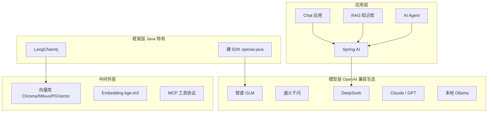
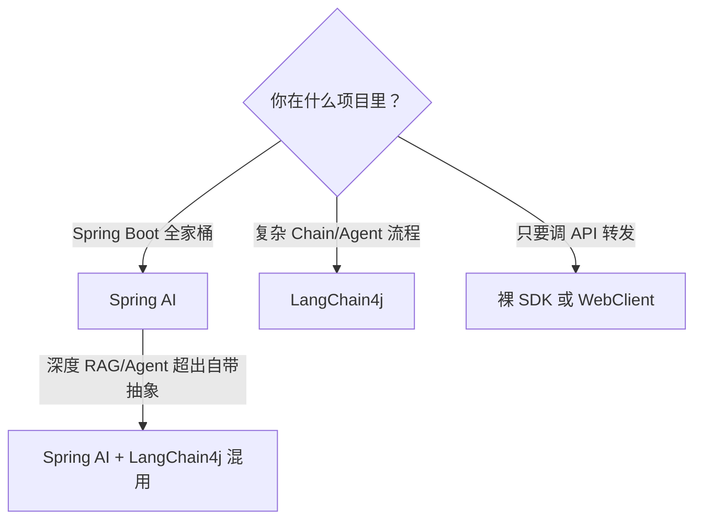

# Java AI 生态全景与选型

> **优先级：P1（2025-2026 Java 岗新要求）** — "会用 Java 调大模型"正在从加分项变成标配。Java 后端的优势不在训模型，在**把 AI 能力工程化**：稳定的服务、鉴权限流、和现有 Spring 体系无缝集成。

::: tip 背景
你已在 [AI 应用架构模式](/ai-agent/app-architecture)、[RAG 入门](/ai-agent/rag/introduction)、[Function Calling](/ai-agent/function-calling) 掌握了通用概念（Python/LangChain 视角）。本文切换到 **Java 视角**：同样的概念，Java 生态用什么落地、三条技术路线怎么选。
:::

## 一、生态全景：四层结构

**读图要点**：Java 侧的核心决策在第一层——**框架选 Spring AI 还是 LangChain4j**；模型层几乎全部 OpenAI 兼容（换个 baseUrl 和 key 就切换，这是 Java 侧最大的便利）；中间件层和语言无关，但 Java 客户端各有封装。

## 二、三条路线对比

| | **Spring AI** | **LangChain4j** | **裸 SDK（openai-java）** |
|---|---|---|---|
| 出身 | Spring 官方（2024 GA） | LangChain 的 Java 移植 | OpenAI 官方 Java SDK |
| 抽象层级 | 高（声明式，Spring 风格） | 中（链式 API，组件全） | 低（就是 HTTP 客户端） |
| Spring 集成 | **原生**（自动配置/Bean/属性注入） | 有 spring-boot-starter | 自己包一层 |
| 多模型支持 | 统一接口（OpenAI/Anthropic/Ollama/通义/智谱…） | 同上，覆盖面略广 | 仅 OpenAI 系（兼容 API 可用） |
| RAG/Agent 抽象 | 内置（`QuestionAnswerAdvisor` 等开箱） | 最全（和 Python 版概念对齐） | 无，全手写 |
| 学习曲线 | 平缓（会 Spring 就会一半） | 中（概念多） | 陡（什么都自己拼） |
| 适用 | **公司项目、Spring 技术栈** | 复杂 AI 流程、非 Spring 环境 | 简单调用、轻量服务 |

### 选型决策（按你的场景）

**团队/公司视角（面试也这么答）**：
- **存量 Spring 系统加 AI 能力** → Spring AI。自动配置、`@Tool` 注解、Advisor 链，和现有 `@Service` 体系一个风格，团队零门槛
- **从零搭建 AI 原生产品、流程复杂** → LangChain4j。组件粒度细，Python LangChain 经验可平移
- **两者不互斥**：Spring AI 的底层模型调用可以换成 LangChain4j 的实现，真实项目混用常见

**个人建议（和本知识库同款路线）**：主力 Spring AI，需要它没覆盖的（比如自定义检索 pipeline）时用 LangChain4j 补——本知识库的 RAG 引擎（kb-core）就是 Java 自己实现的检索全链路，没依赖任何框架，因为要控制切分/混合检索的每个细节。

## 三、模型层：OpenAI 兼容是 Java 的福音

2024 年之后，**国内主流大模型全部提供 OpenAI 兼容 API**——Java 侧只要会一个 SDK，全部模型通杀：

| 厂商 | baseUrl | 模型 | Java 侧接入 |
|---|---|---|---|
| DeepSeek | `https://api.deepseek.com/v1` | deepseek-chat | 改 baseUrl 即可 |
| 通义千问 | `https://dashscope.aliyuncs.com/compatible-mode/v1` | qwen-plus | 同上 |
| 智谱 GLM | `https://open.bigmodel.cn/api/paas/v4` | glm-4 | 同上 |
| Kimi | `https://api.moonshot.cn/v1` | moonshot-v1 | 同上 |
| Anthropic Claude | `https://api.anthropic.com` | claude-sonnet-4 | Spring AI 官方支持 |
| **本地 Ollama** | `http://localhost:11434/v1` | qwen3:8b 等 | Spring AI Ollama 模块 |

**这意味着**：换模型 = 改配置不改代码。Spring AI 里甚至支持多模型 Bean 并存，按场景路由（简单问答走便宜模型，复杂推理走贵模型）——这就是成本控制的第一招。

**本地 Ollama 的特殊价值**：数据不出内网（金融/政企合规要求）、零调用成本、离线可用。本知识库的默认配置就是本地 Ollama（qwen3:8b + bge-m3 embedding），`knowledge.config.mjs` 里注释掉了切 DeepSeek/SiliconFlow 的开关，一个配置项的事。

## 四、中间件层速览

### 向量库（Java 客户端成熟度）

| 向量库 | 特点 | Java 支持 | 适合 |
|---|---|---|---|
| **Chroma** | 轻量、嵌入式、API 简洁 | 官方 Java 客户端 | 原型/中小规模（本知识库在用） |
| **Milvus** | 分布式、十亿级向量 | 官方 Java SDK | 生产大规模 |
| **PGVector** | PostgreSQL 扩展 | SQL 直接用 | 已有 PG、数据量中等（运维最省） |
| Redis Stack | RediSearch 向量索引 | Spring Data Redis | 已有 Redis、要实时性 |
| Elasticsearch | `dense_vector` 字段 | 现有 ES 客户端 | 已有 ES、混合检索一把梭 |

**选型逻辑**：别为新技术栈引入新中间件——**有什么用什么**。有 PG 用 PGVector，有 ES 用 ES，纯新建项目 Chroma 起步、量大了换 Milvus。

### Embedding 模型

| 模型 | 维度 | 特点 |
|---|---|---|
| **bge-m3**（BAAI） | 1024 | 中文最强开源之一，多语言+长文本（8K），**本知识库在用** |
| text-embedding-3-small/large（OpenAI） | 1536/3072 | 质量天花板，按量付费 |
| gte-large-zh | 1024 | 中文场景备选 |

### MCP（Model Context Protocol）

2025-2026 最热的工具调用标准协议——LLM 应用连接外部工具/数据源的"USB-C 接口"，把 M×N 集成变成 M+N。Java SDK 和 Spring AI 的 MCP 支持都已成熟，详见专篇 [MCP 与 Java](/ai-agent/java/mcp-in-java)（协议三原语 + Server/Client 实战 + 安全）。与 [Function Calling](/ai-agent/function-calling) 的区别：FC 是模型能力，MCP 是**工具接入的标准化协议**。

## 五、什么时候还得上 Python

诚实说，Java 不是万能的。以下场景 Python 生态仍是主力：

| 场景 | 为什么是 Python |
|---|---|
| 模型微调/LoRA | transformers/peft 生态，Java 基本没有 |
| 数据处理/标注 pipeline | pandas/llama-index 数据层更顺手 |
| 算法实验/论文复现 | 全部是 Python |
| 最新的 AI 论文 demo | 首发语言 |

**Java 的定位**：**生产服务的承载层**。算法侧用 Python 出原型，工程侧 Java 落地成高可用服务——模型训好/调通后，API 化、限流、监控、和业务系统集成，全是 Java 的主场。这也是"AI 应用开发"岗位里 Java 工程师的真实位置。

## 六、面试/谈资

| 问题 | 答题要点 |
|------|---------|
| Spring AI 和 LangChain4j 怎么选 | 看项目：Spring 栈用 Spring AI（集成深）；复杂流程/非 Spring 用 LangChain4j；可混用 |
| 换模型要改代码吗 | 不用——OpenAI 兼容生态，改 baseUrl + key；Spring AI 多模型 Bean 可按场景路由 |
| 国内模型 Java 怎么接 | 都是 OpenAI 兼容 API，统一 SDK；注意各家限流和计费差异 |
| Java 在 AI 浪潮的位置 | 工程化承载层：原型 Python、生产 Java；微调以下 Java 不缺位 |
| 向量库怎么选 | 有什么中间件用什么（PG→PGVector，ES→ES）；新建 Chroma 起步，大规模 Milvus |

## 延伸阅读

- [Spring AI 实战](/ai-agent/java/spring-ai) - 选完之后的主武器详解
- [RAG 的 Java 实现](/ai-agent/java/rag-in-java) - 向量库 + embedding 的完整落地
- [Java AI 应用工程化](/ai-agent/java/java-ai-engineering) - 流式/限流/缓存/监控
- [大模型全景介绍](/ai-agent/llm-landscape) - 模型层背景（通用视角）
- [LLM API 调用基础](/ai-agent/llm-api-basics) - 协议与概念（通用视角，本文的前置）
- [Python AI 生态入门](/ai-agent/python-ai-ecosystem) - 另一半视角，对照阅读
