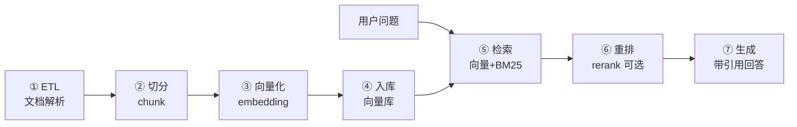

# RAG 的 Java 实现

> **优先级：P1（AI 应用最主流模式）** — RAG（检索增强生成）是 Java 工程师在 AI 领域最有竞争力的方向：不训模型，把"文档 → 检索 → 生成"的全链路工程化。

::: tip 背景
[RAG 入门](/ai-agent/rag/introduction) 讲了概念，[检索优化](/ai-agent/rag/retrieval-optimization) 讲了通用手段。本文讲 **Java 代码怎么落地**——并且全程用**你正在看的这个知识库**做实例：它的 RAG 引擎（kb-core）就是纯 Java 实现的，配置、参数、踩坑全部是一手的。
:::

## 一、全链路七阶段



每个阶段的工程决策，下面用知识库的真实配置逐个说。

## 二、① ETL：文档解析

真实世界的知识不是 txt：PDF、Word、HTML、Markdown、代码文件。**Apache Tika** 是 Java 侧的万能解析器：

```java
// Tika：一个 API 解析所有格式
AutoDetectParser parser = new AutoDetectParser();
BodyContentHandler handler = new BodyContentHandler(-1);   // -1 = 不限制长度
Metadata metadata = new Metadata();
parser.parse(inputStream, handler, metadata, new ParseContext());

String text = handler.toString();                          // 纯文本
String title = metadata.get(TikaCoreProperties.TITLE);     // 元数据（标题/作者/类型）
```

**踩坑点**：
- PDF 扫描件（图片型）Tika 抽不出文字，要 OCR（Tesseract）——先判断要不要做，多数内部文档不需要
- HTML 带导航/页脚噪音，入库前清洗（去 script/style、压空白）
- 代码文件保留结构信息（函数名、路径）——切分时上下文丢失会让检索结果没法用

## 三、② 切分：chunk 的策略

本知识库配置（`knowledge.config.mjs`）：

```js
chunk: { size: 1000, overlap: 200 }
```

**为什么是 1000/200**：

| 参数 | 太小（200） | 太大（4000） |
|---|---|---|
| 语义完整性 | 一句话切成两半，检索到半句没法用 | ✅ 完整 |
| 检索精度 | ✅ 精准命中 | 一个 chunk 多个主题，向量被"平均化"，匹配度虚低 |
| 上下文窗口 | 省 token | 浪费（塞给模型的半是无关内容） |

**1000 字符是中文场景的甜点位**：一个知识点讲清楚的长度， embedding 也能表达准。**overlap 200**（前后重叠）防止"最佳答案恰好横跨两个 chunk 的边界"——重叠让两个 chunk 都包含这段，检索时至少一个能命中。

**进阶：按结构切分**。定长切分是"无脑但稳"；更好的做法是先按 Markdown 标题/代码块/段落边界切，超长的再定长二次切——语义完整性远好于纯定长。本知识库走的是"按结构切 + 定长兜底"的混合策略。

## 四、③ 向量化：embedding 调用

本知识库用 **bge-m3**（中文开源最强之一，1024 维），跑在本地 Ollama：

```js
models: {
  baseUrl: 'http://localhost:11434/v1',   // Ollama 的 OpenAI 兼容端点
  chat: 'qwen3:8b',
  embedding: 'bge-m3'
}
```

Java 侧调用（Ollama 兼容 OpenAI 协议，直接走 HTTP）：

```java
// embedding 请求：一段文本 → 一个 1024 维向量
EmbeddingRequest req = EmbeddingRequest.builder()
        .model("bge-m3")
        .input(List.of("Spring Bean 默认是单例吗？"))
        .build();

List<double[]> vectors = embeddingClient.embed(req);   // double[1024]
```

**要点**：
- **入库和查询必须用同一个模型**——不同模型的向量空间不通用，混用 = 检索全废
- 文本先清洗再向量化（去 markdown 标记、压空白），噪音进向量会稀释语义
- 本地 Ollama：零成本、数据不出内网；要质量上云端（text-embedding-3 / SiliconFlow）

## 五、④ 入库：向量库

本知识库用 **Chroma**（localhost:8000，collection `knowledge_base`）：

```java
// 一条文档 = 文本 + 向量 + 元数据
vectorStore.add(new Document(
    chunkText,
    Map.of("source", "spring-principles.md", "category", "Java")   // 元数据：溯源+过滤
));
```

**元数据是生产关键**：检索结果要告诉用户"答案来自哪篇文档"（引用溯源），还能按目录/分类过滤（只在 Java 分类里搜）。选型对比见 [Java AI 生态全景](/ai-agent/java/java-ai-landscape)，原则是"有什么中间件用什么"。

## 六、⑤ 检索：混合检索是分水岭

这是**整个 RAG 里技术含量最高的一步**，也是本知识库做了实测优化的地方。

### 三种检索方式

| 方式 | 原理 | 强项 | 弱项 |
|---|---|---|---|
| 纯向量 | 语义相似度（余弦） | 同义改写能命中（"单例"≈"唯一实例"） | **精确词最弱**：英文缩写、代码标识符、专有名词 |
| BM25 | 关键词匹配（TF-IDF 家族） | 精确词强（搜 `ThreadLocal` 不会跑偏） | 同义词不行（"车"≠"汽车"） |
| **混合** | 两路结果加权融合 | 互补 | 要调权重 |

### 本知识库的实测数据

```
纯向量检索：  Hit@5 98.4%   Hit@1 87.6%   MRR 0.923
混合检索：    Hit@5 100%    Hit@1 89.6%   MRR 0.944
（vector 0.7 + bm25 0.3，candidates 50，零模型成本）
```

**MRR +0.021、Hit@5 到 100%**——只改了检索融合逻辑，没动模型。这就是工程优化的价值：**RAG 效果差，先查检索，别急着换模型**。

```js
retrieval: {
  hybrid: { enabled: true, candidates: 50, vectorWeight: 0.7, bm25Weight: 0.3 }
}
```

**为什么向量权重 0.7 高于 BM25 0.3**：知识库问答以自然语言提问为主，语义匹配是主路径；BM25 兜底精确词（代码题、缩写词）。**权重不是抄的，是拿评估集跑出来的**——你的知识库有 `eval/` 测试集和 `kb eval` 命令，改任何参数都跑一遍回归。

## 七、⑥ 重排：不是必选项

Rerank（交叉编码器精细打分）能提升相关性，但本知识库**默认关闭**：

```js
// Rerank 重排（实测 bge-reranker-base 弱于 bge-m3 向量本身，默认关闭）
rerank: { enabled: false, candidates: 20 }
```

**教训**：bge-r3 已经很强的场景下，加一道弱 reranker 反而把正确结果排下去了——**每个环节都要用数据验证，不是"先进技术就要上"**。值得上 rerank 的信号：候选集大（召回 50+ 精选 5）、领域术语多（通用向量吃不透）。

## 八、⑦ 生成：带引用的回答

```java
// 检索结果拼进 Prompt
String context = retrievedChunks.stream()
        .map(c -> "【来源：" + c.metadata().get("source") + "】\n" + c.text())
        .collect(Collectors.joining("\n---\n"));

Prompt prompt = new PromptTemplate("""
    基于以下资料回答问题。资料里没有的信息，明确说"知识库未覆盖"，不要编造。

    资料：
    {context}

    问题：{question}
    """).create(Map.of("context", context, "question", question));

String answer = chatClient.prompt(prompt).call().content();
// 回答后附来源：[spring-principles.md]
```

**三个工程细节**：
1. **明确允许说"不知道"**——没有这条约束，模型会拿检索到的边缘内容硬编（幻觉的主要来源）
2. **来源标注进上下文**——用户能点回去看原文，可信度倍增（本知识库站点右下角的 AI 助手就是这个行为）
3. **空结果短路**——检索得分全低于阈值时直接回答"未覆盖"，别浪费 token

## 九、评估：RAG 的度量衡

没有评估集的 RAG 优化是盲人摸象。本知识库的 `eval/` 体系：

| 指标 | 含义 | 用途 |
|---|---|---|
| **Hit@k** | 正确文档是否在前 k 个结果里 | 检索质量主指标 |
| **Hit@1** | 第一个结果就对 | 用户体验（没人翻第二页） |
| **MRR** | 第一个正确结果的排名倒数 | 排序质量 |

**工作流**：改切分/权重/检索策略 → 跑 `kb eval` → 对比基线（`kb eval:baseline` 固化）→ 有提升才合入。上面混合检索的收益就是这么验证出来的。

## 十、本知识库架构复盘（可直接抄的模板）

```
docs/*.md（内容）
   ↓ kb import          收件箱 → docs/imported/
   ↓ Tika 解析
   ↓ 1000/200 切分
   ↓ bge-m3 向量化（Ollama 本地）
   ↓ Chroma（collection: knowledge_base）
   ↑ 检索：向量 0.7 + BM25 0.3，候选 50
   ↑ rerank：默认关（实测负收益）
   ↑ qwen3:8b 生成（带来源引用）
```

**这套配置为什么适合个人/小团队知识库**：全本地（零 API 成本）、单中间件（Chroma 一个容器）、全链路可复现（评估集固化基线）。企业生产再把 Chroma 换 Milvus、本地模型换 API、单机换集群——**架构骨架不变**。

## 面试题速查

| 问题 | 一句话答案 |
|------|-----------|
| RAG 全链路 | ETL → 切分 → embedding → 向量库 → 检索 → （重排）→ 生成 |
| chunk 大小怎么定 | 中文 1000/overlap 200 是甜点；太小断语义、太大稀释匹配；按结构切更好 |
| 为什么混合检索 | 向量弱在精确词（缩写/代码），BM25 弱在同义词；混合互补，实测 MRR +0.021 |
| rerank 一定要上吗 | 不是——实测弱 reranker 有负收益；候选集大/术语多才值得上 |
| 怎么防幻觉 | Prompt 允许说"未覆盖" + 空结果短路 + 来源引用 |
| embedding 注意什么 | 入库查询同模型；先清洗再向量化 |
| RAG 效果差先查什么 | 先查检索（Hit@k），再查切分，最后才考虑换模型 |
| 评估指标 | Hit@k / MRR，配基线回归 |

## 延伸阅读

- [RAG 入门](/ai-agent/rag/introduction) - 概念与动机（本文的前置）
- [检索优化常用手段](/ai-agent/rag/retrieval-optimization) - 通用优化清单
- [RAG vs 微调](/ai-agent/rag/rag-vs-finetuning) - 什么时候不该用 RAG
- [Spring AI 实战](/ai-agent/java/spring-ai) - QuestionAnswerAdvisor 的开箱方案 vs 本文自建 pipeline
- [Java AI 应用工程化](/ai-agent/java/java-ai-engineering) - 语义缓存、token 成本
- [Elasticsearch 入门](/service/common/elasticsearch) - 另一种"倒排索引"引擎，BM25 的娘家
