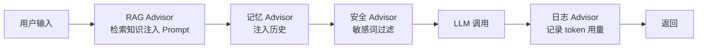

# Spring AI 实战

> **优先级：P1（Java AI 岗主力框架）** — Spring 官方 AI 框架，把"调大模型"变成 Spring 开发者熟悉的样子：自动配置、Bean 注入、注解驱动。会 Spring Boot 的人半天能上手。

::: tip 背景
[LLM API 调用基础](/ai-agent/llm-api-basics) 讲的是协议层（HTTP + JSON）。Spring AI 把这层封装成 Spring 风格 API——本文是其实战篇：从第一次对话到 RAG、函数调用、流式输出的完整代码。
:::

## 一、五分钟起步

### 依赖与配置

```xml
<dependency>
    <groupId>org.springframework.ai</groupId>
    <artifactId>spring-ai-openai-spring-boot-starter</artifactId>
    <version>1.0.0</version>
</dependency>
```

```yaml
spring:
  ai:
    openai:
      base-url: https://api.deepseek.com/v1    # OpenAI 兼容：改这里就换模型
      api-key: ${DEEPSEEK_API_KEY}
      chat:
        options:
          model: deepseek-chat
          temperature: 0.7
```

### 第一次对话

```java
@RestController
public class ChatController {

    private final ChatClient chatClient;

    // 构造器注入（Spring AI 自动装配 ChatClient.Builder）
    public ChatController(ChatClient.Builder builder) {
        this.chatClient = builder.build();
    }

    @GetMapping("/ai/chat")
    public String chat(@RequestParam String message) {
        return chatClient.prompt()
                .user(message)          // 用户输入
                .call()                 // 同步调用
                .content();             // 拿文本
    }
}
```

**就这三行核心**：`prompt() → user() → call() → content()`。其余全是 Spring 开发者熟悉的部分。

**前端对照**：`ChatClient` 像 NestJS 里注入的 service，`.prompt().user().call()` 像链式调用一个 HTTP client——Spring AI 就是把 LLM 当成一个"可注入的 Bean"。

## 二、Prompt：系统提示词与模板

### system + user 双层

```java
String answer = chatClient.prompt()
        .system("你是资深 Java 面试官，回答严格控制在 100 字内，用中文")
        .user("什么是 Bean 的生命周期？")
        .call()
        .content();
```

**system**（系统提示词）定人设和约束，**user** 是用户输入——和 [Prompt Engineering](/ai-agent/prompt-engineering/basics) 通用篇讲的完全一致，Spring AI 只是给了类型安全的 API。

### PromptTemplate：模板化

```java
PromptTemplate template = new PromptTemplate("""
    用{tone}的语气，给{lang}初学者解释{concept}，不超过{words}字。
    """);

Prompt prompt = template.create(Map.of(
    "tone", "幽默",
    "lang", "Java",
    "concept", "多态",
    "words", "50"
));

String result = chatClient.prompt(prompt).call().content();
```

**为什么用模板**：线上 Prompt 是资产，要版本管理、要 A/B 测试。散落在代码里的字符串没法管，模板化（甚至外置到配置/数据库）是工程化第一步。

### 结构化输出：直接拿 Java 对象

```java
record BookInfo(String title, String author, int year, String summary) {}

BookInfo book = chatClient.prompt()
        .user("介绍《深入理解 Java 虚拟机》")
        .call()
        .entity(BookInfo.class);    // 自动 JSON → record，不用手动解析
```

底层用 JSON Schema 约束模型输出格式。**比手动 `JSON.parse` 安全得多**——类型错误直接抛异常，不会拿到半个对象。

## 三、多轮对话与记忆

```java
// 前端每次带 conversationId，服务端按 id 取历史
@GetMapping("/ai/chat/{convId}")
public String chat(@PathVariable String convId, @RequestParam String message) {
    List<Message> history = chatMemoryStore.get(convId);   // 从 Redis/DB 加载

    String answer = chatClient.prompt()
            .messages(history)        // 注入历史消息
            .user(message)
            .call()
            .content();

    chatMemoryStore.append(convId, message, answer);       // 存回去
    return answer;
}
```

**生产要点**：Spring AI 1.0 内置 `ChatMemory` 抽象（`MessageWindowChatMemory` 按窗口保留最近 N 条），存储可插拔（默认内存，生产换 `CassandraChatMemoryRepository` 或自己实现存 Redis）。**对话历史必须服务端存**——和 Session 的教训一样，无状态才能水平扩展。

## 四、Advisor：AI 版的拦截器链

Advisor 是 Spring AI 的特色设计——在 Prompt 发出前后插入逻辑，**像 Servlet Filter / Spring MVC 拦截器**：



```java
// 开箱即用的 Advisor
ChatClient client = ChatClient.builder(chatModel)
        .defaultAdvisors(
            new MessageChatMemoryAdvisor(chatMemory),              // 记忆
            new QuestionAnswerAdvisor(vectorStore)                 // RAG：检索后注入
        )
        .build();
```

**自定义 Advisor**（审计日志场景）：

```java
public class AuditAdvisor implements CallAroundAdvisor {

    @Override
    public AdvisedResponse aroundCall(AdvisedRequest request, CallAroundAdvisorChain chain) {
        long start = System.currentTimeMillis();
        AdvisedResponse response = chain.nextAroundCall(request);      // 继续链
        long cost = System.currentTimeMillis() - start;
        log.info("AI调用: prompt={} 耗时={}ms tokens={}",
                request.userText(), cost, response.response().getMetadata().getUsage());
        return response;
    }
}
```

**前端对照**：这就是 Express/Koa 中间件——请求进模型前过一串 Advisor，响应出来再过一串。RAG、记忆、审计全部做成 Advisor，主流程干净。

## 五、函数调用：让模型用你的工具

```java
public class WeatherTools {

    @Tool(description = "查询指定城市的实时天气")
    public String getWeather(@ToolParam(description = "城市名，如北京") String city) {
        return weatherService.query(city);      // 真实的业务调用
    }
}

// 注册：模型就知道"有这个工具可用"
@Bean
public ChatClient chatClient(ChatClient.Builder builder) {
    return builder
            .defaultTools(new WeatherTools())
            .build();
}
```

用户问"北京天气怎么样" → 模型决定调 `getWeather("北京")` → Spring AI 执行方法把结果喂回模型 → 模型组织自然语言回答。概念全景见 [Function Calling](/ai-agent/function-calling)，这里是 Java 侧最省事的实现（一个注解）。

**安全红线**：`@Tool` 暴露的方法等于给模型一把刀——**别把 `deleteUser` 这类方法注册进去**，注册前想清楚"模型乱调这个方法的后果"。

## 六、RAG 开箱即用

```java
// 灌库：文档 → 向量库（一次性的 ETL）
vectorStore.add(new Document("Spring Bean 默认单例...",
        Map.of("source", "spring-boot.md")));

// 问答：检索 + 注入 + 生成，三行
String answer = chatClient.prompt()
        .user("Spring Bean 默认是单例吗？")
        .advisors(new QuestionAnswerAdvisor(vectorStore))
        .call()
        .content();
```

Spring AI 的 RAG 抽象（`VectorStore` + `QuestionAnswerAdvisor`）覆盖标准流程。**但真实项目往往不够用**——切分策略、混合检索、重排都要自己控制，那时就得上 [RAG 的 Java 实现](/ai-agent/java/rag-in-java) 讲的自建 pipeline（本知识库就是这么干的）。

## 七、流式输出：打字机效果

```java
@GetMapping(value = "/ai/stream", produces = MediaType.TEXT_EVENT_STREAM_VALUE)
public Flux<String> stream(@RequestParam String message) {
    return chatClient.prompt()
            .user(message)
            .stream()                       // 流式调用
            .content();                     // Flux<String>：token 一个个吐
}
```

返回 `Flux<String>`（WebFlux）或 MVC 下用 `SseEmitter`，浏览器用 `fetch + ReadableStream` 逐段渲染——用户体感从"等 5 秒"变成"即时出字"。工程细节（超时、断线重连、限流）见 [Java AI 应用工程化](/ai-agent/java/java-ai-engineering)。

## 八、版本与生态速查

| 组件 | 说明 |
|---|---|
| ChatModel / ChatClient | 模型调用底层 / 流式 Builder API（用 Client） |
| EmbeddingModel / VectorStore | 向量化 / 向量库操作（`add` / `similaritySearch`） |
| ChatMemory | 对话记忆（可插拔存储） |
| Advisor | 拦截器链（记忆/RAG/审计） |
| ToolCallback / @Tool | 函数调用 |
| 多模型 | 不同厂商 starter 并存，Bean 名区分，按场景路由 |

**版本注意**：Spring AI 1.0 之前 API 变动快（`ChatClient` 从类变成 Builder 模式），**跟官方文档的版本来**，网上 0.8 时代的教程大半过期。这也是面试谈资："你知道 Spring AI API 的演进吗"——说明你真用过。

## 面试题速查

| 问题 | 一句话答案 |
|------|-----------|
| Spring AI 是什么 | Spring 官方 AI 框架：ChatClient 流式 API + 自动配置 + Advisor 链 |
| ChatClient 核心调用链 | `prompt() → system/user → call/stream → content()/entity()` |
| 换模型要改代码吗 | 不改，改 base-url + api-key（OpenAI 兼容生态） |
| 结构化输出怎么做 | `.entity(Record.class)`，JSON Schema 约束，类型安全 |
| Advisor 是什么 | Prompt 前后的拦截器链（RAG/记忆/审计做成 Advisor，类似 Koa 中间件） |
| 函数调用怎么实现 | `@Tool` 注解注册 Bean 方法 + `@ToolParam` 描述参数 |
| 对话历史存哪 | ChatMemory 抽象，生产存 Redis，服务端存才能水平扩展 |

## 延伸阅读

- [Java AI 生态全景与选型](/ai-agent/java/java-ai-landscape) - 为什么选 Spring AI（以及什么时候不选）
- [RAG 的 Java 实现](/ai-agent/java/rag-in-java) - QuestionAnswerAdvisor 不够用时的手写 pipeline
- [Java AI 应用工程化](/ai-agent/java/java-ai-engineering) - 流式/限流/缓存/监控的生产化
- [Function Calling 与工具调用](/ai-agent/function-calling) - 通用概念（Spring AI 的前置）
- [Spring Boot 入门](/service/java/spring-boot) - 自动配置原理的背景
- [Koa 入门](/service/node/koa) - Advisor ≈ 中间件的思想同源
