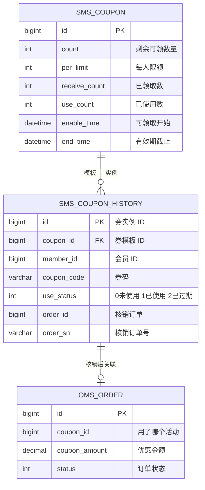
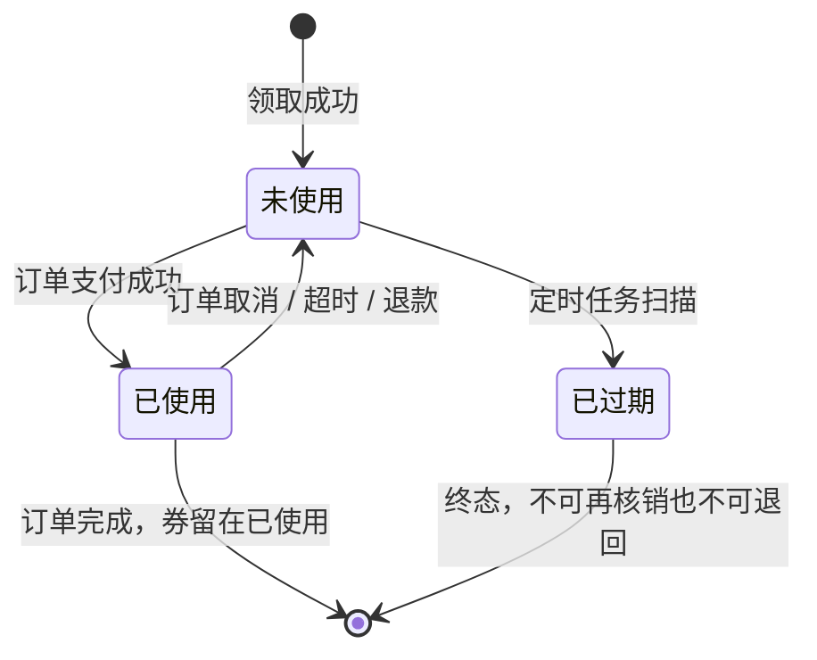

# 从需求到上线：后端开发的完整动作序列

> **定位**：这不是又一篇「教你写 Controller」的教程。阶段 6 已经在讲怎么照着 mall 抄一个 CRUD 模块；本文讲的是**拿到一句需求后，到功能上线之间，后端到底按什么顺序做什么、每一步为什么这么排**。
>
> **写法**：本文以「高级后端的视角」走一遍完整流程。载体是 mall 商城里一个真实存在的半成品模块——优惠券发放与核销。你不需要动手实现它，只需要跟着看**每一步的判断依据**。
>
> **前置**：阶段 1-6 的概念（分层、事务、缓存、鉴权）都学过。IDEA 操作见[阶段 8](/java-practice/08-intellij-idea)，部署细节见[部署实践](/java-practice/09-deployment-practice)。

---

## 一、先对标：前端拿到需求的动作序列 vs 后端的

你熟悉的那套流程是：

```
前端拿到需求
  → 看设计稿，拆组件
  → 写主页面
  → 写子组件
  → 拼装组件 + 写交互逻辑
  → 联调接口
  → 提测
```

后端的对应流程长这样：

```
后端拿到需求
  → 澄清需求（把自然语言拆成名词/动词/约束）
  → 读现有代码，找到同构模块和「反面教材」
  → 设计数据模型（表结构 + 索引 + 状态机）
  → 设计接口契约（和前端约定入参出参错误码）
  → 设计并发与一致性方案（这一步前端没有）
  → 编码实现（按分层落地）
  → 自测（功能 + 并发 + 脏数据）
  → 部署上线（DDL → 打包 → 启动 → 验证）
  → 线上维护与排障
```

### 三个本质差异

| | 前端 | 后端 |
|---|---|---|
| **第一产出** | 页面（看得见的东西） | **表结构 + 接口契约**（看不见但定死的东西） |
| **出错的代价** | 刷新一下就恢复 | **数据已经写进库里了**，可能是钱 |
| **状态在哪** | 组件内部（刷新即丢） | 数据库（**持久、有历史、要一致**） |

第三条是所有差异的根源。前端的状态是**易失**的，后端的状态是**持久且共享**的——两个用户同时操作同一条数据，就会出前端永远不会遇到的问题：超卖、超发、重复扣款、脏读。

> **所以后端第一个要想的不是「接口怎么写」，而是「这份数据会被谁同时改」。**

---

## 二、Step 1：读需求 —— 把自然语言拆成三张表 {#step-1-clarify}

需求原文通常是含糊的。先别急着找代码，把它拆成三类东西。

### 2.1 需求单（本文的载体）

> **【优惠券发放与核销改造】**
>
> **背景**：mall 商城优惠券模块已上线。近期收到以下反馈：
>
> 1. 运营反馈：促销高峰期，券放出 100 张，实际被领走 130+ 张，库存对不上
> 2. 用户投诉：同一账号反复点「领取」能领到多张，违反「每人限领 3 张」的活动规则
> 3. 用户投诉：已过期的券在「我的券」里仍显示「未使用」，下单时又提示不可用，体验割裂
> 4. 客服反馈：订单取消后优惠券没有回到用户账户，用户二次下单用不了原券
>
> **诉求**：修复上述问题。
>
> **验收标准**：
> - ① 并发 100 个请求抢 10 张券，成功领取恰好 10 个
> - ② 同一会员对同一活动券，最多持有 `per_limit` 张
> - ③ 过期券自动变为「已过期」
> - ④ 订单取消/超时后，券原样退回，且退回的是**原来那一张**

注意这份需求单的措辞：**全是现象和期望，没有一条技术方案**。这是真实需求单的样子——运营和用户不会告诉你「请用乐观锁」。

### 2.2 拆名词 → 实体

扫一遍需求单，把所有「看起来是个东西」的词圈出来：

| 需求里的词 | 实体 | 已有还是新建 |
|---|---|---|
| 优惠券 | `sms_coupon`（券模板：面额、限领量、总量、有效期） | 已有 |
| 领取记录 | `sms_coupon_history`（某会员持有的某一张具体券） | 已有 |
| 会员 | `ums_member` | 已有 |
| 订单 | `oms_order` | 已有 |
| 「已过期」这个状态 | `sms_coupon_history.use_status = 2` | **字段有了，没人用** |

**这一步就已经有收获了**：需求 3 说「过期券仍显示未使用」，你在拆名词时就已经发现——状态字段是齐的（`use_status` 的注释写着 `0未使用/1已使用/2已过期`），只是没有任何代码路径去写 `2`。这说明**不需要改表结构**。

> **后端改需求的第一步往往是「确认哪些东西已经存在」**。前端接需求时很少关心这个，因为页面从零画；后端改需求时，80% 的工作在理解存量代码。

### 2.3 拆动词 → 动作

| 需求里的动词 | 动作 | 落在哪 |
|---|---|---|
| 「领取」「领走」 | 创建一条 `sms_coupon_history` + 扣减模板库存 | `UmsMemberCouponServiceImpl.add()` |
| 「被领走 130 张」 | 库存扣减的并发安全问题 | 同上 |
| 「显示未使用 / 已过期」 | 状态机流转 | **缺实现** |
| 「原样退回」 | 状态回退 + 关联订单解绑 | `OmsPortalOrderServiceImpl.updateCouponStatus()` |

### 2.4 拆约束 → 规则

| 约束 | 规则 | 谁来保证 |
|---|---|---|
| 「每人限领 3 张」 | 同一 (会员, 券模板) 持有的券数 ≤ `per_limit` | **DB 计数表 / 唯一索引** |
| 「放出 100 张」 | 券模板 `count` 不能减到负数 | **条件 UPDATE** |
| 「过期」 | 券模板 `end_time` 已过 | 定时任务扫 |
| 「原样退回」 | 退的是同一张券，不是同一活动的另一张 | **状态机 + 主键定位** |

### 2.5 拆出的「待澄清清单」——本文最重要的一张表

上面四张表里，最后一张「约束」有 6 条，但需求单只说了 4 条。**差的 2 条就是真实需求里的隐含假设**。

一个高级后端拿到需求，会先问清楚这些问题再动手：

| # | 歧义点 | 为什么必须问 | 假设错了的后果 |
|---|---|---|---|
| 1 | 「每人限领 3 张」是**活动期内累计**还是**每天**？ | 决定要不要加「领取日期」维度 | 累计算成每天，用户一天领 3 张第二天再领 3 张，比活动规则宽松 |
| 2 | 已过期的券能不能用于**新下单**？ | 决定核销前的校验逻辑 | 放过期的券 = 白送钱 |
| 3 | **订单退款**后券退不退？ | 需求单只提了「订单取消」，退款是另一回事 | 漏处理 = 用户投诉；乱退 = 资损 |
| 4 | 订单**超时自动取消**算不算「取消」？ | 超时取消走的是定时任务，和手动取消是两条代码路径 | 只改手动取消路径，超时场景依旧丢券 |
| 5 | 券在**下单时**被锁住，还是**支付时**才核销？ | 决定核销时机和是否需要「占用中」状态 | 下单即核销但订单超时 = 券被吞 |
| 6 | 券过期后**自动退回**吗？（比如券过期了但订单还没支付） | 涉及交叉场景 | 边界 case 线上才炸 |

> **这一步是本文最想让你记住的**：前端的需求歧义，通常表现为「设计稿没画到某个状态」，改一版设计稿就解决了。后端的需求歧义，表现为「这个字段我按 A 理解还是按 B 理解」，**猜错了要改表、改数据、重新上线**。
>
> 所以：**宁可花 30 分钟问清楚，不要花 3 天返工。**

---

## 三、Step 2：读现有代码 —— 找「同构模块」和「反面教材」 {#step-2-read-code}

需求澄清完，动手前必须先读代码。你在阶段 1-5 已经学过怎么读链路了，这里是**带着目的去读**。

### 3.1 IDEA 里定位「同构模块」——抄它

mall 里跟「券」同构的东西：

| 我要写的 | 抄谁 | 在哪个文件 |
|---|---|---|
| 券的增删改查 | `SmsCouponController` | `mall-admin/.../controller/SmsCouponController.java` |
| 会员端接口写法 | `UmsMemberCouponController` | `mall-portal/.../controller/UmsMemberCouponController.java` |
| 分页查询 | `SmsCouponHistoryServiceImpl.list()` | `mall-admin/.../service/impl/` |
| 「按状态查 + 分页」 | 同上，`useStatus` 条件 | |
| 定时任务 | `OrderTimeOutCancelTask` | `mall-portal/.../component/` |

**IDEA 操作**（如果你阶段 8 练过，这里是复合用法）：

1. **双击 Shift** → 搜 `SmsCouponController` → 打开
2. **Cmd+Shift+F**（全局搜索）→ 搜 `useStatus` → 打开「搜索结果」面板 → **逐个看谁在写这个字段**
   - 这一步是本文 Step 3 的核心动作：**找出所有写 `use_status` 的地方**，才能确定状态机的全部入口
3. 在 `UmsMemberCouponServiceImpl.add()` 里 **Cmd+点击** `couponMapper.updateByPrimaryKey` → 直接跳到 Mapper 接口 → 再 Cmd+点击 跳到 XML → 看真实 SQL
4. **Alt+Enter** → `Call Hierarchy`（调用层级）→ 看 `add()` 被谁调用

### 3.2 定位「反面教材」——这是本文的教学核心

需求 1（超发）指向 mall 里的这段代码。**逐行读它，你会看到四个问题**：

```java
// mall-portal/.../service/impl/UmsMemberCouponServiceImpl.java:43
public void add(Long couponId) {
    UmsMember currentMember = memberService.getCurrentMember();
    SmsCoupon coupon = couponMapper.selectByPrimaryKey(couponId);
    if (coupon == null) {
        Asserts.fail("优惠券不存在");
    }
    // ❌ 问题 1：读-改-写，没有并发保护
    if (coupon.getCount() <= 0) {
        Asserts.fail("优惠券已经领完了");
    }
    Date now = new Date();
    if (now.before(coupon.getEnableTime())) {
        Asserts.fail("优惠券还没到领取时间");
    }
    // ❌ 问题 2：先查后插，两个请求同时通过检查
    SmsCouponHistoryExample couponHistoryExample = new SmsCouponHistoryExample();
    couponHistoryExample.createCriteria().andCouponIdEqualTo(couponId).andMemberIdEqualTo(currentMember.getId());
    long count = couponHistoryMapper.countByExample(couponHistoryExample);
    if (count >= coupon.getPerLimit()) {
        Asserts.fail("您已经领取过该优惠券");
    }
    // ... 生成券码、插入领取记录 ...
    couponHistoryMapper.insert(couponHistory);
    // ❌ 问题 3：库存扣减是读-改-写，并发下会超发
    coupon.setCount(coupon.getCount() - 1);        // :77
    coupon.setReceiveCount(coupon.getReceiveCount() == null ? 1 : coupon.getReceiveCount() + 1);
    couponMapper.updateByPrimaryKey(coupon);      // :79  ← 把整个 coupon 覆盖回去
}
```

#### 问题 1 + 问题 3：超发的成因

「检查 `count > 0`」和「扣减 `count`」是**两个独立的操作**，中间隔了整整 20 行代码。100 个并发请求进来时：

```
时刻 T0：请求 A、B、C 同时读到 coupon.count = 10
时刻 T0：三个请求都通过了「count > 0」的检查
时刻 T1：A 执行 update，count → 9
时刻 T2：B 执行 update，count → 8（B 手里拿的是过期的 count=10，减完还是 9）
时刻 T3：C 执行 update，count → 9
结果：券模板显示 count=9，实际发出去了 3 张
```

更糟的是第 79 行 `updateByPrimaryKey(coupon)`——它把**整个 coupon 对象**覆盖回去。`coupon` 是第 47 行查出来的快照，如果这期间运营在后台改了面额，**这次更新会把运营的修改一起覆盖掉**（lost update）。

> **这就是「读-改-写」在并发下的三种经典后果**：超发、丢更新、状态错乱。解法只有一个方向：**把判断和修改合并成一条原子语句**，交给数据库做。

#### 问题 2：限领失效

`countByExample` 查到 2 张，`per_limit` 是 3 → 通过。下一个请求也查到 2 张 → 也通过。两个请求都插入 → 最终 4 张。

**同样是「先查后写」，同样需要变成原子操作。**

#### 问题 4：券码可能重复

```java
// generateCouponCode()：时间戳后 8 位 + 4 位随机数 + 会员 ID 后 4 位
for (int i = 0; i < 4; i++) {
    sb.append(new Random().nextInt(10));   // 4 位随机数 = 1 万种可能
}
```

`sms_coupon_history.coupon_code` **没有唯一索引**。1 万种组合在同一毫秒内发起请求，撞码概率不低。撞码的后果：两张不同的券有了同一个券码，核销时按券码查会查出两条。

### 3.3 顺带发现：核销也是错的（对应需求 4）

需求 4 说「订单取消后券没回到用户账户」。看核销的实现：

```java
// mall-portal/.../service/impl/OmsPortalOrderServiceImpl.java:496
private void updateCouponStatus(Long couponId, Long memberId, Integer useStatus) {
    if (couponId == null) return;
    SmsCouponHistoryExample example = new SmsCouponHistoryExample();
    example.createCriteria()
            .andCouponIdEqualTo(couponId)          // ← 用券模板 ID
            .andMemberIdEqualTo(memberId)
            .andUseStatusEqualTo(useStatus == 0 ? 1 : 0);
    List<SmsCouponHistory> couponHistoryList = couponHistoryMapper.selectByExample(example);
    if (!CollectionUtils.isEmpty(couponHistoryList)) {
        SmsCouponHistory couponHistory = couponHistoryList.get(0);   // ← 取第一条
        couponHistory.setUseTime(new Date());
        couponHistory.setUseStatus(useStatus);
        ...
    }
}
```

**三个问题叠在一起**：

1. **用 `couponId`（券模板 ID）而不是 `historyId`（券实例 ID）定位**。同一会员同一活动持有多张券时，`get(0)` 拿的是**数据库返回顺序的第一条**，不一定是下单时用的那张。
2. **和下单侧的 ID 语义不匹配**。看下单参数：
   ```java
   // mall-portal/.../domain/OrderParam.java:19
   @Schema(title = "优惠券ID")
   private Long couponId;      // 这是 sms_coupon.id（模板 ID），不是 sms_coupon_history.id
   ```
   `oms_order.coupon_id` 存的也是模板 ID。所以**整条链路都没有「券实例」的概念**——用户有 3 张同一活动的券，下单时根本没法指定用哪一张。
3. **`order_id` / `order_sn` 字段从不被回填**。表里有这两列（`sms_coupon_history`），代码里从没写过。所以「这张券被哪张订单用了」这个信息**丢失了**，自然也无法精确退回。

> **改造点从这三条里长出来了**：要精确定位券，链路必须改成传 `historyId`。这是**接口契约的变更**（`OrderParam.couponId` → `OrderParam.couponHistoryId`），涉及前后端联动——**这就是为什么 Step 3（读代码）必须在 Step 5（设计契约）之前**。你先设计契约再读代码，就会发现设计漏了「券实例」这个概念。

---

## 四、Step 3：设计数据模型 —— 表 → 索引 → 状态机 {#step-3-data-model}

后端的设计产出是**三样东西**：表结构、索引、状态机。顺序不能乱。

### 4.1 先画 ER 图（手画或 Mermaid 都行）



**读图时立刻能发现的问题**：`oms_order.coupon_id` 指向的是**模板**，不是**实例**。订单记的是「这次用了满 100 减 20 这个活动」，而不是「用了用户手上那张具体券」。

### 4.2 表结构要不要改？—— 用「需求倒推」的方式逐条验

**这是关键判断：改造需求 ≠ 一定改表。** 用需求 4 条逐条推：

| 需求 | 需要改表吗 | 理由 |
|---|---|---|
| ① 防超发 | **不用** | `count` 字段已够，改的是「怎么改它」 |
| ② 限领 | **不用** | `per_limit` 已有；改的是「怎么保证不超」 |
| ③ 过期 | **不用** | `use_status = 2` 已定义；改的是「谁去写它」 |
| ④ 精确退券 | **要改** | 链路要传 `historyId`，`oms_order` 需要一个字段记券实例 ID |

所以最终 DDL 只有一处字段新增 + 两个索引：

```sql
-- 1) 订单表加字段，记「用的是哪张券实例」
ALTER TABLE `oms_order` ADD COLUMN `coupon_history_id` bigint(20) NULL DEFAULT NULL
    COMMENT '使用的优惠券实例ID(sms_coupon_history.id)' AFTER `coupon_id`;

-- 2) 券码唯一索引（防撞码，对应问题 4）
ALTER TABLE `sms_coupon_history`
    ADD UNIQUE INDEX `uk_coupon_code` (`coupon_code`);

-- 3) 复合索引：「某会员某活动的券」——限领校验和列表查询都要用
ALTER TABLE `sms_coupon_history`
    ADD INDEX `idx_member_coupon` (`member_id`, `coupon_id`);
```

**索引不是越多越好**，每加一个都要能回答「对应哪个查询」。上面三个索引各有明确归属：

| 索引 | 服务的查询 |
|---|---|
| `uk_coupon_code` (唯一) | 按券码查（唯一性保证） |
| `idx_member_coupon` | ①限领校验 `where member_id=? and coupon_id=?` ②「我的券」列表 ③过期扫描 |
| `oms_order.coupon_history_id` | 需要加索引吗？**暂时不用**——它是写入字段不是查询条件，只有排查时按订单反查才用，量小 |

> **DDL 的纪律**：
> - 加唯一索引前，先查存量数据有没有重复：
>   ```sql
>   SELECT coupon_code, COUNT(*) FROM sms_coupon_history
>   GROUP BY coupon_code HAVING COUNT(*) > 1;
>   ```
>   有重复的话**加索引会直接失败**（线上 DDL 失败是大事故）。先去重，再加索引。
> - 大表加索引要用 `ALGORITHM=INPLACE, LOCK=NONE`（MySQL 8 支持在线加索引），否则加索引期间表被锁住，写请求全部超时。
> - 加字段用 `NULL DEFAULT NULL` 而不是 `NOT NULL DEFAULT 0`——老数据没有这个值，NOT NULL 会让 ALTER 直接失败。

### 4.3 设计状态机 —— 本文最核心的一张图

`use_status` 三个值，真正的语义是**券在生命周期里的位置**：



**读这张图能看出三件事**：

1. **「已过期」是终态**——过期券不能再被核销，也不能被退回。所以核销前必须校验它不是 2。
2. **「已使用 → 未使用」这条边是需求 4 的核心**——退券不是「删除记录」，而是**状态回退**。这意味着**状态回退必须记录原因**（因为下次要查「这张券为什么从已使用变回未使用」），这是后面 Step 6 要加审计字段的理由。
3. **状态流转的入口必须收口**。现在 `updateCouponStatus()` 一个方法承担了「核销」和「退券」两件事，而且**用模板 ID 定位**。改造后要拆成两个语义明确的方法，且**入参必须是 `historyId`**。

### 4.4 顺带补一个字段：状态变更的原因

后端有个通病：**只记「现在是什么」，不记「怎么变成这样的」**。券的状态会反复（用 → 退 → 用 → 退），出问题时你需要知道每次是谁、为什么改的。

```sql
ALTER TABLE `sms_coupon_history`
    ADD COLUMN `status_change_time` datetime NULL DEFAULT NULL COMMENT '最近一次状态变更时间',
    ADD COLUMN `status_change_reason` varchar(64) NULL DEFAULT NULL COMMENT '最近一次状态变更原因';
```

字段名可以是 `remark` 之类的，但**「原因」这个信息一定要有**。这是从「能跑」到「能运维」的分水岭。

---

## 五、Step 4：设计接口契约 —— 和前端约定到「错误码」级别 {#step-4-contract}

### 5.1 契约要写下来的东西

接口契约不是「有个 `/add/{couponId}` 就行」。每一项都要和前端对齐：

| 项 | 说明 |
|---|---|
| URL + 方法 | 语义要对，领取用 POST（幂等性考虑，见下） |
| 入参 | 类型、必填、边界 |
| 出参 | 结构、字段含义 |
| **错误码** | **每个失败场景一个码，前端才能给不同提示** |
| 幂等约定 | 前端重试/重复点击会怎样 |

### 5.2 改造后的接口清单

```java
// mall-portal/.../controller/UmsMemberCouponController.java

// 领取券（语义变了：内部用 historyId，前端仍传 couponId 拿券）
@Operation(summary = "领取指定优惠券")
@RequestMapping(value = "/add/{couponId}", method = RequestMethod.POST)
@ResponseBody
public CommonResult add(@PathVariable Long couponId) {
    memberCouponService.receive(couponId);
    return CommonResult.success(null, "领取成功");
}
```

**URL 没变，但语义变了**：现在 `add` 是「给我一张券」，改造后是「尝试领取，如果已有则按幂等返回」。这个区别很重要——**接口的幂等性要在契约里写清楚**，否则前端会做「失败就重试」的重试逻辑，而重试必须安全。

### 5.3 错误码设计 —— 前端体验的分水岭

现在 mall 的错误处理是 `Asserts.fail("优惠券已经领完了")`，**所有失败都是一个字符串**。前端只能原样弹出来。

但「券被抢光」和「你已领过」对用户是完全不同的两件事，前端要区别处理：

| 场景 | 业务码 | 提示 | 前端该做什么 |
|---|---|---|---|
| 成功 | 20000 | 领取成功 | 刷新我的券列表 |
| 券不存在 | 40400 | 优惠券不存在 | 提示 + 刷新活动列表 |
| **券已抢光** | 40001 | 手慢了，券已被抢完 | 提示 + **刷新库存** |
| **已达限领上限** | 40002 | 您已领过该券 | 提示 + 跳「我的券」 |
| **券已过期** | 40003 | 优惠券已过期 | 提示 + 刷新 |
| 活动未开始 | 40004 | 活动还没开始 | 提示 |
| 未登录 | 40100 | 登录已过期 | 跳登录（**走 axios error 分支**，见阶段 3 的坑） |

在 mall 里落地的方式——`ResultCode` 是枚举，加几个新码：

```java
// mall-common/.../api/ResultCode.java
COUPON_SOLD_OUT(40001, "手慢了，优惠券已被领完", HttpStatus.BAD_REQUEST),
COUPON_LIMIT_REACHED(40002, "您已领取过该优惠券", HttpStatus.BAD_REQUEST),
COUPON_EXPIRED(40003, "优惠券已过期", HttpStatus.BAD_REQUEST),
COUPON_NOT_STARTED(40004, "活动还没开始", HttpStatus.BAD_REQUEST),
```

> **前端联调提醒**：mall 现在用的是语义化 HTTP 状态码（2xxxx/4xxxx/5xxxx 分段，枚举自带 `HttpStatus`）。前端 axios 里 **401/403 走 error 分支而不是 response 分支**，前端改造时记得补 error 分支——这是你在阶段 3 踩过的坑，需求交付时一定会再遇到一次。

### 5.4 契约要写进文档，不是写进脑子

这一步跟前端一样：**契约要有文档**。mall 的 `document/postman` 目录就是干这个的。

一份能用的契约文档包含：接口清单表 + 每个接口的请求/响应示例 + 错误码表 + **幂等性说明**。

---

## 六、Step 5：设计并发与一致性方案 —— 后端的核心战场 {#step-5-concurrency}

这一节是前端完全没有的领域。核心工具是**一条原则**：

> **把「检查」和「修改」合并成一条数据库语句，让数据库的原子性替你保证正确性。**

Java 层不管怎么加锁，都是「先查后写」的变体；只有把判断条件下沉到 SQL 的 WHERE 里，才能拿到原子性。

### 6.0 先补地基：事务**不会**自动帮你加锁 {#mvcc-baseline}

这是新手最容易踩的一个坑，值得单独用一节讲清楚。因为**误解了它**，后面的「条件下沉」就只是记住了结论、不知道原因。

#### 事务提供的是「隔离」，不是「排队」

事务（ACID 里的 I）是**一组语义保证**：别人看不见你未提交的数据、你不会看到别人未提交的数据。至于「怎么实现」，是隔离级别的事。

MySQL InnoDB 默认的隔离级别是 **REPEATABLE READ（RR）**，它实现隔离的方式是 **MVCC（多版本并发控制）+ 行锁**——注意这里有两个东西，而它们的效果是**相反**的：

| 机制 | 作用 | 方向 |
|---|---|---|
| **MVCC** | 读不阻塞写，写不阻塞读 | **提高并发** |
| **行锁** | 写写互斥（同一行） | 保证正确性 |

**所以恰恰相反：事务不是让「只能一个进事务、其他排队」，而是让大部分操作可以同时进行。**如果真按「排队」实现，秒杀场景直接崩掉。

实测（T1 已 INSERT 但未提交，T2 同时操作）：

```text
T1 已 INSERT，未提交
T2 执行普通 SELECT：耗时 18ms，结果【空】← 没被阻塞，且看不到 T1 的数据
T2 执行 UPDATE：    耗时 50155ms            ← 阻塞了（等行锁）
```

**读不阻塞写，写写才互斥。**你的印象大概来自「写」的那一半。

#### 快照读 vs 当前读：同一个事务里，同一个字段能有两个值

RR 隔离级别下，InnoDB 里的读分两类：

| 类型 | 触发方式 | 读到什么 |
|---|---|---|
| **快照读** | 普通 `SELECT` | **事务开始那一刻的快照**（RR 下固定不变） |
| **当前读** | `SELECT ... FOR UPDATE` / `UPDATE` / `DELETE` | **最新已提交版本** |

实测（同一个事务内连查三次，中间有别的事务提交了修改）：

```text
T 事务内第 1 次 SELECT: 5   <- 建立快照
另一个事务已提交，把 count 改成 6
T 事务内第 2 次 SELECT: 5   <- 快照读，还是旧值
T 事务内第 3 次 SELECT: 5   <- 快照固定不变
T 用 SELECT ... FOR UPDATE（当前读）: 6   <- 能看到最新提交值
```

**同一个事务、同一个字段、两个不同的值。**这就是「SELECT 结果不可信」的准确含义——

> 它不是说「读到了脏数据」（那被隔离级别明确禁止了），而是说**读到的值可能已经过时**。

而且**每个事务有自己的快照**。所以「先查再决定」的 N 个线程，全都看到同一个旧值，全都以为还有货。

#### 危害到底在哪：不是「读错」，是「读错后据此写」

这里要澄清一个容易混淆的点：**如果最终裁判是 `UPDATE ... WHERE` 的条件，SELECT 读错并不致命。**

```text
写法一：先 SELECT 判断库存 > 0，再无条件扣减
  → 实际发出 3 张（库存只有 1），最终 count = -2   ❌ 超发

写法二：不查，直接条件扣减（WHERE received_count > 0）
  → 实际发出 1 张，最终 count = 0                ✅ 正确
```

**同样的并发场景、同样的事务配置，结果完全相反。**

差别在于：写法一的判断依据是**快照**（过时的），而它的写操作**没有 WHERE 条件兜底**；写法二把判断放进 WHERE，MySQL 用**当前读 + 行锁**执行这条语句——读到的 count 是最新的，且判断与修改在同一句话里原子完成。

> **所以真正的危险不是「SELECT 读错了」，而是「用 SELECT 的结果去决定要不要执行另一个没有保护的写操作」。**
>
> 换成条件 UPDATE 之所以正确，不是因为它「读得更准」，而是因为它**不再依赖任何一次 SELECT**——判断和修改在同一条语句里，由数据库串行处理。

#### 那为什么还建议不用 SELECT 判断

既然条件 UPDATE 能兜住，多查一次好像也没损失？三个成本：

1. **多一次网络往返**。实测 20 个线程并发时，SELECT **全部**查到「无记录」，一个有用的过滤都没做
2. **判断和修改分离在两条语句**，中间有窗口期，任何后来加的代码都可能绕过保护
3. **误导后来人**——读代码的人看到 `if (count > 0)` 会以为「这里已经判断过了」，这是个隐藏陷阱

#### 小结：三条原则

| 场景 | 该怎么做 |
|---|---|
| 判断「能不能做」 | 条件写进 `UPDATE` / `INSERT` 的 WHERE，看影响行数 |
| 判断「现在是什么」用于**展示** | 普通 SELECT 没问题 |
| 判断「现在是什么」用于**分支决策** | 要么用当前读（`FOR UPDATE`），要么让写操作自己兜底 |

> **一句话**：判断要放在**写操作自己的 WHERE 里**。因为写操作内部天然是「当前读 + 行锁 + 原子」的，而你的 SELECT 只是一份可能过时的快照。
### 6.1 防超发：三个候选方案 {#anti-oversell}

| 方案 | 做法 | 优点 | 缺点 | 适合 |
|---|---|---|---|---|
| **A 悲观锁** | `SELECT ... FOR UPDATE` 锁住券模板行 | 直观，串行执行 | 热点行上所有请求排队，还有锁等待超时风险 | 冲突率极高、必须串行的场景 |
| **B 乐观锁 / 条件更新** | `UPDATE ... WHERE count > 0`，看影响行数 | **无锁，性能好**，数据库保证原子 | 需要重试或放弃 | **本例首选** |
| **C 缓存/分布式锁** | Redis 锁住券 ID | 跨服务可用 | 多一个依赖，锁失效要处理 | 多实例 + 强串行（本例用不上，单库够） |

#### A. 悲观锁：`SELECT ... FOR UPDATE`

完整写法（以真实的 `sms_coupon` 表为例，`id` 是主键、`count` 是剩余库存）：

```xml
<!-- mall-mbg/.../mapper/SmsCouponMapper.xml -->

<!-- 第一步：加锁读。FOR UPDATE 会锁住这一行，直到事务结束 -->
<select id="selectForUpdate" resultType="SmsCoupon">
  SELECT id, count, per_limit, amount, end_time
  FROM sms_coupon
  WHERE id = #{couponId}
  FOR UPDATE
</select>

<!-- 第二步：扣减。因为锁还在手里，读到的 count 就是最新的，不会被插队 -->
<update id="decreaseStockByLock">
  UPDATE sms_coupon
  SET count = count - 1,
      receive_count = IFNULL(receive_count, 0) + 1
  WHERE id = #{couponId}
</update>
```

```java
// Mapper 接口
SmsCoupon selectForUpdate(@Param("couponId") Long couponId);
int decreaseStockByLock(@Param("couponId") Long couponId);

// Service 层（必须是事务！见下面的陷阱）
@Transactional(rollbackFor = Exception.class)
public void receiveWithLock(Long couponId) {
    // 1. 加锁读：拿到最新值，同时把这行锁住
    SmsCoupon coupon = couponMapper.selectForUpdate(couponId);
    if (coupon == null) {
        throw new ApiException(ResultCode.NOT_FOUND);
    }
    if (coupon.getCount() <= 0) {
        throw new ApiException(ResultCode.COUPON_SOLD_OUT);   // 手慢了
    }
    // 2. 扣减：此刻不可能有别人插进来
    couponMapper.decreaseStockByLock(couponId);
    // ... 生成券实例 ...
}
```

**实测（真实 `sms_coupon` 表，20 线程抢 10 张库存）**：

```text
悲观锁：领到 10，抢光提示 10，异常 0，最终 count = 0   耗时 57ms
条件更新：领到 10，抢光提示 10，异常 0，最终 count = 0耗时 39ms
```

**两者结果完全一样**——悲观锁靠「串行化」保证正确，条件更新靠「原子判断」保证正确。

**悲观锁的三个关键特性**（都实测过）：

| 特性 | 实测结果 | 说明 |
|---|---|---|
| **会阻塞其他事务的写操作** | T1 持锁时，T2 的 UPDATE 等了 8s 后超时 | 这就是「串行排队」的来源 |
| **不会阻塞其他事务的普通 SELECT** | T2 的 SELECT 只用 6ms 就返回 | 普通读是快照读，不等锁（见 [6.0](#mvcc-baseline)） |
| **锁的是行不是表** | T1 锁 id=30，T2 读 id=31 只用 4ms | 走主键索引，只锁命中那一行 |

> **⚠️ 陷阱：`FOR UPDATE` 必须在事务里才有效**
>
> 如果连接是 `autocommit = true`，`FOR UPDATE` 的锁**在语句结束就立刻释放**了，后面的读-改-写等于完全没有保护：
>
> ```text
> 已用 autocommit=true 执行 SELECT ... FOR UPDATE
> 另一个事务 UPDATE：耗时 5ms  <- 没被阻塞，证明锁已随语句结束释放
> ```
>
> 所以悲观锁方案里 `@Transactional` 不是「锦上添花」，**是正确性的前提**。这也解释了为什么方案 A 必须把「加锁读 + 判断 + 扣减」放在同一个 Service 方法里。

**A 的代价**（这是它没被选中的原因）：

- 热点券上所有请求**排队**。20 个请求抢 10 张库存，实测 57ms；条件更新只要 39ms
- 排队时间会随并发线性增长。1 万并发抢 1 张券时，悲观锁要排 1 万次
- **锁等待超时是真实故障**：默认 `innodb_lock_wait_timeout = 50` 秒，等不到就抛 `Lock wait timeout exceeded`
- 死锁风险：多个请求以不同顺序锁多行时可能互相等待
>
> 悲观锁适合「冲突率极高、且必须串行」的场景，比如「同一账户的余额扣减」这种天然串行的操作。

#### B. 乐观锁 / 条件更新（本例采用）

**选 B**。写法：

```xml
<!-- mall-mbg/.../mapper/SmsCouponMapper.xml -->
<update id="decreaseStock">
  UPDATE sms_coupon
  SET count = count - 1,
      receive_count = IFNULL(receive_count, 0) + 1
  WHERE id = #{couponId}
    AND count > 0
</update>
```

```java
// Mapper 接口
int decreaseStock(@Param("couponId") Long couponId);
```

**为什么这个写法是对的**：`WHERE count > 0` 和 `count = count - 1` 在**同一条 SQL`里，由数据库的行锁保证这两步之间不会插队。100 个并发请求进来，数据库会串行执行这 100 条 UPDATE，其中**恰好 10 条影响行数为 1**（count 从 10 减到 0），其余 90 条影响行数为 0。

```java
int rows = couponMapper.decreaseStock(couponId);
if (rows == 0) {
    throw new ApiException(ResultCode.COUPON_SOLD_OUT);   // 手慢了
}
```

> **关键点**：判断依据是**影响行数**，不是「先查 count 再判断」。前者是原子的，后者不是。这个 `rows == 0` 的判断就是整个防超发方案的**全部**。
>
> 另外注意 SQL 里用的是 `count = count - 1` 而不是 `count = #{count} - 1`——**绝对不能把查出来的值写回去**，那样就退化成读-改-写了。

**这也顺手解决了另一个问题**：原来第 79 行 `updateByPrimaryKey(coupon)` 会把整个 coupon 覆盖回去（丢更新）。改成 `decreaseStock` 之后，UPDATE 语句**只碰 count 和 receive_count 两列**，运营在后台改的面额、备注**不会被覆盖**。

> 这就是「用精确的 UPDATE 替代全量 UPDATE」的价值——不只是并发安全，还顺带避免了 lost update。

**注意它和悲观锁的差别**：方案 A 的 `decreaseStockByLock` 里 `WHERE` 只有 `id`，**判断在 Java 里做**；方案 B 的 `decreaseStock` 里 `WHERE` 带上了 `AND count > 0`，**判断在数据库里做**。这就是「条件下沉」的具体含义——把判断从 Java 代码搬到 SQL 的 WHERE 里。

#### C. 缓存/分布式锁：本例为什么不用

Redis 分布式锁的写法大致是：

```java
// 伪代码：Redis 分布式锁
String lockKey = "coupon:lock:" + couponId;
if (!redisTemplate.opsForValue().setIfAbsent(lockKey, "1", 5, TimeUnit.SECONDS)) {
    throw new ApiException(ResultCode.COUPON_SOLD_OUT);   // 没抢到锁
}
try {
    // ... 扣库存 + 发券 ...
} finally {
    redisTemplate.delete(lockKey);   // 必须释放
}
```

**本例不用它，两个原因**：

1. **单库够用**。mall 是单体应用，一个 MySQL 实例就能扛住。引入 Redis 锁意味着多一个中间件依赖、多一个「锁挂了怎么办」的故障模式，**收益却接近零**
2. **锁不能替代数据库约束**。Redis 锁可能因为过期、网络分区而失效，**最终防线必须落在数据库**（唯一索引 / 条件 UPDATE）。既然数据库已经能保证原子性，Redis 锁就是多余的一层
>
> 什么时候才需要 Redis 锁？**多实例 + 跨服务的临界区**，且数据库层面无法用一条语句表达。比如 12306 里的「令牌桶削峰」——那需要跨服务协调，本地数据库的锁管不到。
>
> 详见 [12306 幂等设计](/java-practice/12306-design/01-idempotent) 的「四道防线」分层。

### 6.2 防超领：限领怎么原子化

需求 2：同一会员对同一活动券，最多 `per_limit` 张。

**先想清楚难点**：这跟防超发不一样。防超发是「一个总数减到 0」，防超领是「**每个会员各自的计数**不能超过 N」。

**方案 A：唯一索引兜底（最硬，但只适用 per_limit = 1）**

如果 `per_limit = 1`（一人一张），直接加唯一索引就完事：

```sql
ALTER TABLE sms_coupon_history
    ADD UNIQUE INDEX `uk_member_coupon` (`member_id`, `coupon_id`);
```

数据库会保证「同一会员同一活动只能有一张」。重复插入直接抛 `DuplicateKeyException`。

**但 `per_limit = 3` 时这个方案不成立**——唯一索引只能保证「完全相同的一行不能重复」，不能保证「不超过 3 张」。你会得到「3 张之后第 4 张被拒」，但**拦截点在数据库层，业务层拿不到友好提示**（只能 catch 异常再翻译成「已达上限」，能 work 但不够干净）。

**方案 B：计数表 + 条件更新（通用，推荐）**

```sql
CREATE TABLE `sms_coupon_member_count` (
  `id` bigint(20) NOT NULL AUTO_INCREMENT,
  `coupon_id` bigint(20) NOT NULL COMMENT '券模板ID',
  `member_id` bigint(20) NOT NULL COMMENT '会员ID',
  `received_count` int(11) NOT NULL DEFAULT '0' COMMENT '已领取数量',
  PRIMARY KEY (`id`),
  UNIQUE KEY `uk_coupon_member` (`coupon_id`, `member_id`)
) COMMENT='优惠券领取计数表';
```

领取时的两步（**在同一个事务里**）：

```xml
<update id="increaseReceiveCount">
  UPDATE sms_coupon_member_count
  SET received_count = received_count + 1
  WHERE coupon_id = #{couponId}
    AND member_id = #{memberId}
    AND received_count &lt; #{perLimit}     -- 条件下沉：没超限才加
</update>

<insert id="initCount">
  INSERT INTO sms_coupon_member_count (coupon_id, member_id, received_count)
  VALUES (#{couponId}, #{memberId}, 0)
  ON DUPLICATE KEY UPDATE coupon_id = coupon_id   -- 幂等：存在就什么都不做
</insert>
```

**先 `initCount` 再 `increaseReceiveCount`**：第一次领取时计数行不存在，`initCount` 用 `ON DUPLICATE KEY UPDATE` 幂等地建出来（计数 0），然后 `increaseReceiveCount` 靠 `received_count < perLimit` 条件原子地加 1。

> **术语：upsert = UPDATE + INSERT 的合成词**（portmanteau，类似「brunch = breakfast + lunch」）。指「有就更新，没有就插入」这一个动作。
>
> MySQL 的 `INSERT ... ON DUPLICATE KEY UPDATE` 就是 upsert；PostgreSQL 叫 `INSERT ... ON CONFLICT DO UPDATE`，SQL Server 叫 `MERGE`，MongoDB 也有 `upsert` 选项。**它们解决的是同一个问题：用一条语句同时表达「建行」和「行已存在就跳过」，而不用先查再决定。**

判断依据还是**影响行数**：

```java
int rows = countMapper.increaseReceiveCount(couponId, memberId, perLimit);
if (rows == 0) {
    throw new ApiException(ResultCode.COUPON_LIMIT_REACHED);   // 已达限领上限
}
```

**为什么这个方案成立**：`(coupon_id, member_id)` 上的唯一索引保证「每个会员每个活动只有一行计数」，`WHERE received_count < perLimit` 保证「加的条件和修改是同一条语句」。两个请求同时来，都执行同一条 UPDATE，数据库串行处理：一个成功（0→1），另一个看到 1 已经不小于 perLimit 就影响 0 行。

**注意执行顺序问题**：`initCount` 必须先执行。如果先 `increaseReceiveCount`，计数行不存在时影响行数是 0，会被误判成「已达上限」。

#### 为什么不写成「先查，无记录才 init，然后 update」？

这是很自然的想法，我一开始也是这么写的。而且**在事务里它确实能工作**——事务的隔离性保证了并发下不会写坏数据。

但它有一个隐藏前提：**init 这一步不能抛异常**。实测数据如下（20 个线程并发抢 3 张限额，每线程一个事务）：

| 方案 | init 的写法 | 成功数 | 抛异常数 | 最终计数 |
|---|---|---|---|---|
| **A：无条件 upsert + 条件 update**（本文采用） | `ON DUPLICATE KEY UPDATE` | **3** ✅ | **0** | 3 |
| **C-1：先查 → init → 条件 update** | `ON DUPLICATE KEY UPDATE` | **3** ✅ | 0 | 3 |
| **C-2：先查 → init → 条件 update** | 普通 `INSERT` | 1 ❌ | **19 个 DuplicateKeyException** | 1 |
| **C-3：C-2 + 捕获异常重试** | 普通 `INSERT` | 3 ✅ | 0（触发 19 次重试） | 3 |

**C-1 和 A 结果完全一致**——说明那次 SELECT 纯属多余：20 个线程全都在 SELECT 里查到「无记录」（并发下它本来就不可信），于是全部走向 init，最终保证正确性的还是那条条件 update。**多一次查询往返，零收益。**

**C-2 是真正的坑**：普通 `INSERT` 在并发下必然撞唯一键，19/20 的请求直接抛 `DuplicateKeyException`。事务保证了「数据最终没写坏」（这点你说得对），但**用户的请求失败了**——他看到的是 500 错误，而不是「已达限领上限」。

**C-3 能救回来，但代价是整个事务白做**。实测确认：`rollback()` 会把**前面已完成的所有操作**一起回滚。

```text
同事务内 count++ 后，count = 1
捕获 DuplicateKey → rollback()
rollback 后，count = -1   ← 前面那次 +1 也被回滚了
```

放到真实领券流程里，事务里已经有「扣券库存（`count--`）」了。为了重试 init 而回滚，**库存扣减也要重来一遍**，而且重试还可能再撞、再回滚。虽然最终能收敛，但这条路径的复杂度和不确定性都上来了。

所以**决定成败的不是「先查还是先写」，而是「init 会不会抛异常」**：

- **用 upsert** → 并发下异常率为 0，不需要任何重试逻辑
- **用普通 INSERT** → 并发下必然抛异常，必须配套 catch + 回滚 + 重试

而 A 之所以比 C-1 好，就是**用一条不会抛异常的 SQL，换掉了「多查一次 + 多绕一圈」**：

```sql
-- 第一步：upsert，保证行存在（行不存在就建，存在就啥也不改，不会抛异常）
INSERT INTO cnt (coupon_id, member_id, received_count) VALUES (?, ?, 0)
ON DUPLICATE KEY UPDATE coupon_id = coupon_id;
-- 第二步：条件 update，行一定存在，且没超限才 +1
UPDATE cnt SET received_count = received_count + 1
WHERE coupon_id = ? AND member_id = ? AND received_count < ?;
```

**两句话的分工**：upsert 负责「保证行存在」，条件 update 负责「原子地判断 + 加 1」。**判断条件在 update 里，不在 select 里**——这是整个方案的关键。

> **一句话总结**：判断要放在**写操作自己的 WHERE 里**。
>
> - 判断错了会导致**数据错误**（超发、超领）→ 条件下沉到 UPDATE / INSERT 的 WHERE，看影响行数
> - 判断错了只导致**多一次无用操作** → 无所谓，但也没必要
> - 判断错了会导致**请求失败** → 用 upsert 消除异常源，而不是加重试
>
> 原因见 [6.0](#mvcc-baseline)：`SELECT` 读的是快照，而写操作内部是「当前读 + 行锁 + 原子」的。

### 6.3 幂等：重复点击怎么办

需求 2 的原文是「反复点领取能领到多张」。

**先区分两件事**：

| 概念 | 含义 | 本例要不要 |
|---|---|---|
| **幂等** | 同一个请求执行多次，结果和执行一次相同 | **要** |
| **防重** | 限制资源只能被获取 N 次 | **要**（这是限领） |

限领 3 张 ≠ 幂等。用户点 5 次，应该拿到 3 张（而不是 0 张，也不是 5 张）。**限领的语义是「最多 3 张」，重复点击领到 3 张是正确行为！**

用户投诉「反复点能领多张」的真实含义是：限领生效了，**但生效得不对**——他超过了 3 张。所以这**不是幂等问题，是限领的原子性问题**（6.2 解决）。

那什么情况下需要幂等？**领取接口会返回什么？** 如果返回的是「你领到的券」，那用户点了 5 次会拿到 3 张券记录——这是对的。

**真正的幂等需求在核销侧**：用户点「提交订单」，网络超时，用户重试一次 → 如果核销逻辑不幂等，可能核销两次。

mall 现在的核销：

```java
couponHistory.setUseTime(new Date());
couponHistory.setUseStatus(useStatus);
couponHistoryMapper.updateByPrimaryKey(couponHistory);
```

**这是无条件 UPDATE**，改两遍结果一样（幂等）。但真正的风险是「核销 + 写订单」这两步如果只有一步成功怎么办——那是**事务**问题（6.4）。

**所以本例的幂等设计是：**

```java
// 核销：状态条件更新，天然幂等
<update id="markUsed">
  UPDATE sms_coupon_history
  SET use_status = 1,
      use_time = #{useTime},
      order_id = #{orderId},
      order_sn = #{orderSn},
      status_change_time = #{useTime},
      status_change_reason = 'ORDER_PAID'
  WHERE id = #{historyId}
    AND use_status = 0        -- 只有未使用的券能核销
</update>
```

`WHERE use_status = 0` 让这个操作**天然幂等且并发安全**：重复调用第二次时影响行数为 0。而且它顺手解决了「过期券（status=2）被核销」的问题——status=2 也不满足 `use_status = 0`，影响行数自然是 0。

> **「状态条件更新」是后端最常用的一招**：把状态机图上的每条边写成一条带 `WHERE 状态 = 允许的起点` 的 UPDATE。合法转移影响 1 行，非法转移影响 0 行，业务层只看影响行数就知道结果。**不需要额外的锁，也不需要先查状态**。

退券同理：

```java
<update id="markUnused">
  UPDATE sms_coupon_history
  SET use_status = 0,
      use_time = NULL,
      order_id = NULL,
      order_sn = NULL,
      status_change_time = #{now},
      status_change_reason = #{reason}    -- ORDER_CANCEL / ORDER_TIMEOUT / REFUND
  WHERE id = #{historyId}
    AND use_status = 1        -- 只有已使用的券能退
</update>
```

`reason` 参数化传入，**不同场景退券的记录能区分开**——这就是 Step 4.4 那个「状态变更原因」字段的用处。

### 6.4 事务边界：哪些操作必须在同一个事务里

**原则：一次业务操作 = 一个事务。** 事务边界划在「业务语义」上，不是划在「方法」上。

本例有三个事务边界：

| 事务 | 包含的操作 | 为什么必须原子 |
|---|---|---|
| **T1 领取** | 扣券模板库存 + 计数 +1 + 插入券实例 | 扣了库存但没插记录 = 库存蒸发；插了记录但没扣 = 超发 |
| **T2 核销** | 券状态 → 1 + 回填订单号 + 订单状态 → 已支付 | 券用了但订单没支付 = 券被吞 |
| **T3 退券** | 券状态 → 0 + 解绑订单 + 订单状态 → 已取消 | 订单取消了但券没退 = 需求 4 的 bug |

```java
// ⚠️ 两个坑，全在 mall 里真实存在过
@Transactional(rollbackFor = Exception.class)   // ① rollbackFor：受检异常也要回滚
public void receive(Long couponId) {             // ② 注解放实现类方法上，不是接口上
    ...
}
```

**坑 ② 是你阶段 3 学过的 CGLIB 代理坑**：Spring Boot 3 默认 CGLIB 代理（基于类），**接口上的 `@Transactional` 不生效**——注解不被继承，CGLIB 只认类上的注解。

mall 里 `UmsMemberCouponService` 接口上的 `@Transactional` 就是这个情况：

```java
// mall-portal/.../service/UmsMemberCouponService.java:19
@Transactional        // ← 在接口上，Spring Boot 3 下不生效！
void add(Long couponId);
```

**怎么验证事务到底生不生效**（这是必须掌握的技能，harvest 里记过）：

```yaml
logging:
  level:
    org.springframework.transaction.interceptor: trace
```

日志里看到 `Creating new transaction` / `Committing transaction` 才算生效。**没有 `Creating` = 事务没被代理**，别猜。

**坑 ③：自调用**。同类内部 `this.xxx()` 不走代理，事务不生效。所以事务方法必须是**被外部调用的 public 方法**。

### 6.5 过期扫描：定时任务

需求 3（过期券自动置为已过期）用定时任务。mall 里已经有现成范式：

```java
// mall-portal/.../component/OrderTimeOutCancelTask.java
//@Component                                    ← 注意这行是注释掉的！
public class OrderTimeOutCancelTask {
    @Scheduled(cron = "0 0/10 * ? * ?")
    private void cancelTimeOutOrder(){
        Integer count = portalOrderService.cancelTimeOutOrder();
        LOGGER.info("取消订单，并根据sku编号释放锁定库存，取消订单数量：{}",count);
    }
}
```

> **为什么 `OrderTimeOutCancelTask` 的 `@Component` 被注释了？**
>
> 因为超时时同时有**两条路径**在处理同一件事：MQ 延迟消息（精确通道）+ 定时任务扫描（兜底）。两者同时启用会**重复处理**——MQ 消息已经取消了订单，定时任务又把超时订单捞出来处理一遍。
>
> 这正是你在 [12306 延迟关单](/java-practice/12306-design/04-delayed-close-order) 里学过的「精确通道 + 兜底对账」：**两条路径必须互斥，或者接受重复并让操作幂等**。
>
> **本例的过期扫描没有这个冲突**（没有 MQ 路径），所以可以正常启用。但要记得：**你新加的定时任务，要先确认没有别的路径也在做同一件事。**

过期任务的实现：

```java
@Component
public class CouponExpireTask {
    private static final Logger LOGGER = LoggerFactory.getLogger(CouponExpireTask.class);

    @Autowired
    private SmsCouponHistoryMapper couponHistoryMapper;

    /** 每小时扫一次 */
    @Scheduled(cron = "0 0 * * * ?")
    public void expireCoupons() {
        // 条件更新：只处理「未使用 且 已过期」的
        int rows = couponHistoryMapper.expireOverdueCoupons(new Date());
        LOGGER.info("优惠券过期处理完成，处理数量：{}", rows);
    }
}
```

```xml
<update id="expireOverdueCoupons">
  UPDATE sms_coupon_history h
  INNER JOIN sms_coupon c ON h.coupon_id = c.id
  SET h.use_status = 2,
      h.status_change_time = #{now},
      h.status_change_reason = 'EXPIRE'
  WHERE h.use_status = 0
    AND c.end_time &lt; #{now}
</update>
```

**注意这里用的是「一条 UPDATE + JOIN」而不是「先查出来再逐条 update」**：

- 查出来再改：查和改之间有窗口期，可能重复处理
- 一条 UPDATE：数据库内部完成，**没有窗口期**

> **这是「批量状态流转」的通用写法**：能用一条 SQL 完成的，不要在 Java 里循环。循环版本的问题不是慢，是**每条 update 都要开事务**，1000 条就是 1000 个事务。

**扫描范围怎么定？** 上面这条 SQL 会全表扫（`use_status = 0 AND end_time < now`）。数据量大时加索引：

```sql
ALTER TABLE sms_coupon_history ADD INDEX `idx_status_coupon` (`use_status`, `coupon_id`);
```

或者用**游标式分页**（记住上次扫到哪）：

```sql
SELECT ... FROM sms_coupon_history
WHERE use_status = 0 AND id > #{lastId}
ORDER BY id LIMIT 500
```

后者的好处是**不依赖索引**，且天然支持「扫到一半重启不会重复」（从 lastId 继续）。这是 12306 那篇「对账」思路的降级版。

### 6.6 这节的收尾：并发方案的完整清单

| 问题 | 方案 | 判据 |
|---|---|---|
| 防超发（券库存） | 条件 UPDATE `WHERE count > 0` | 影响行数 |
| 防超领（每人限领） | 计数表 + `WHERE received_count < perLimit` | 影响行数 |
| 券码唯一 | 唯一索引 | DB 约束 |
| 核销 | 条件 UPDATE `WHERE use_status = 0` | 影响行数（天然幂等） |
| 退券 | 条件 UPDATE `WHERE use_status = 1` | 影响行数 |
| 过期 | 定时任务 + 单条 UPDATE JOIN | 影响行数 |
| 多步原子性 | `@Transactional` 在实现类 + `rollbackFor` | 日志验证 |
| 缓存一致性 | 本例不涉及（券是强一致的） | — |

**规律：八条里有六条都是「条件 UPDATE + 看影响行数」。** 这就是后端处理并发的主要武器，比加锁简单得多，也快得多。

> **为什么本例一条锁都没用？**
>
> 锁要解决的是「多个操作必须串行」。但本例的每个冲突点，**判断和修改都能压缩进同一条 SQL**——既然一条语句就够，就没必要拆成「加锁读 + 判断 + 写」三步（多一次往返，还多一个「锁没生效」的坑，见 [6.1](#anti-oversell) 的 autocommit 陷阱）。
>
> **什么时候才真的需要锁**：判断和修改**压不进同一条语句**的时候。比如「查库存 → 判断 → 扣库存 → 还要更新另一张表 → 两者必须一致」，这时候你需要锁把中间的窗口期封住。或者冲突率极高、宁可串行也要保证成功率的地方。

> 呼应 [12306 幂等设计](/java-practice/12306-design/01-idempotent) 的分层：那里说「最后一定要落到唯一索引」。这里也一样——唯一索引（`uk_coupon_code`、`uk_coupon_member`）是**兜底防线**，条件 UPDATE 是**第一道防线**。

---

## 七、Step 6：编码实现 —— 按分层落地，每层都有「抄谁」 {#step-6-implement}

设计定完才开始写代码。**顺序：Mapper → Service → Controller**，和前端「先组件再页面」的顺序是反的（因为后端是自底向上依赖）。

### 7.1 Mapper 层：写自定义 SQL

mall 的 Mapper 是 MyBatis Generator 生成的（`mall-mbg`），只提供标准 CRUD。**自定义 SQL 要加在 XML 里**，不能改生成器配置（改了会被下次生成覆盖）。

要加的 SQL（前面设计里已经给出）：

| Mapper 方法 | 作用 |
|---|---|
| `SmsCouponMapper.decreaseStock(couponId)` | 防超发 |
| `SmsCouponHistoryMapper.markUsed(historyId, orderId, orderSn, useTime)` | 核销 |
| `SmsCouponHistoryMapper.markUnused(historyId, reason, now)` | 退券 |
| `SmsCouponHistoryMapper.expireOverdueCoupons(now)` | 过期扫描 |
| `SmsCouponMemberCountMapper.initCount(...)` / `increaseReceiveCount(...)` | 限领 |

**MyBatis XML 的两个坑**：

**坑 1：`&lt;` 会被当成标签起始，必须转义**

```xml
<!-- ❌ 报错：Malformed XML -->
WHERE received_count < #{perLimit}
<!-- ✅ 正确 -->
WHERE received_count &lt; #{perLimit}
```

> IDEA 里写 XML 报红但 Java 侧不报错，就是这个原因。

**坑 2：SQL 里的注释用 MySQL 风格，别用 XML 风格**

XML 注释 `<!-- -->` 在 `<update>` 标签**内部**会被 XML 解析器当成节点剥掉（MyBatis 只取文本节点），所以它不会发给数据库、也不会报错。但这个行为取决于「注释在标签内部还是外部」，很容易踩坑。用 MySQL 的 `--` 更直白，也和 SQL 文件里的习惯一致：

```xml
<update id="initCount">
  INSERT INTO t (coupon_id, member_id, received_count)
  VALUES (#{couponId}, #{memberId}, 0)
  ON DUPLICATE KEY UPDATE coupon_id = coupon_id   -- 幂等：存在就什么都不做
</update>
```

> **`--` 后面必须有空格**（MySQL 的规定）。写成 `--注释` 会被当成 SQL 解析，报 `Unknown column`——这个错很莫名其妙，因为字面看就是一句注释。

### 7.2 Service 层：编排事务

```java
@Service
public class UmsMemberCouponServiceImpl implements UmsMemberCouponService {

    @Autowired private SmsCouponMapper couponMapper;
    @Autowired private SmsCouponHistoryMapper couponHistoryMapper;
    @Autowired private SmsCouponMemberCountMapper countMapper;

    @Override
    @Transactional(rollbackFor = Exception.class)
    public void receive(Long couponId) {
        UmsMember currentMember = memberService.getCurrentMember();

        // 1. 券存在 & 在领取时间内
        SmsCoupon coupon = couponMapper.selectByPrimaryKey(couponId);
        if (coupon == null) {
            throw new ApiException(ResultCode.NOT_FOUND);
        }
        Date now = new Date();
        if (now.before(coupon.getEnableTime())) {
            throw new ApiException(ResultCode.COUPON_NOT_STARTED);
        }
        if (now.after(coupon.getEndTime())) {
            throw new ApiException(ResultCode.COUPON_EXPIRED);
        }

        // 2. 限领：先幂等初始化计数行，再条件 +1
        countMapper.initCount(couponId, currentMember.getId());
        int countRows = countMapper.increaseReceiveCount(couponId, currentMember.getId(), coupon.getPerLimit());
        if (countRows == 0) {
            throw new ApiException(ResultCode.COUPON_LIMIT_REACHED);
        }

        // 3. 扣库存（条件 UPDATE，原子）
        int stockRows = couponMapper.decreaseStock(couponId);
        if (stockRows == 0) {
            throw new ApiException(ResultCode.COUPON_SOLD_OUT);
        }

        // 4. 生成券实例
        SmsCouponHistory history = new SmsCouponHistory();
        history.setCouponId(couponId);
        history.setMemberId(currentMember.getId());
        history.setCouponCode(generateCouponCode(currentMember.getId()));
        history.setMemberNickname(currentMember.getNickname());
        history.setGetType(1);        // 主动领取
        history.setUseStatus(0);      // 未使用
        history.setCreateTime(now);
        couponHistoryMapper.insertSelective(history);
    }
}
```

**读这段代码时注意三件事**：

1. **顺序**：先校验（便宜的检查）→ 再限领 → 再扣库存 → 最后插记录。**失败的检查越靠前越好**——一个已过期的券不该消耗限领计数。
2. **每个失败分支都是抛异常**，不是 `return false`。异常会被 `GlobalExceptionHandler` 接住并翻译成 `CommonResult`。
3. **`@Transactional` 保证了「限领计数 +1」和「扣库存」和「插记录」三步要么全成要么全败**。

> **顺序问题的一个坑**：如果先扣库存再判限领，用户超限领取时会白扣库存（虽然事务回滚了，但并发下白占的行锁会拖慢别人）。**把「只读校验」放最前面，「写操作」放后面，且写操作按「代价从小到大」排**。

### 7.3 Controller 层：薄

```java
@RestController
@RequestMapping("/member/coupon")
@Tag(name = "UmsMemberCouponController", description = "用户优惠券管理")
public class UmsMemberCouponController {

    @Autowired private UmsMemberCouponService memberCouponService;

    @Operation(summary = "领取指定优惠券")
    @PostMapping("/add/{couponId}")
    public CommonResult<Void> add(@PathVariable Long couponId) {
        memberCouponService.receive(couponId);
        return CommonResult.success(null, "领取成功");
    }
}
```

**Controller 的职责就三件**：接参、调 Service、包装返回。**任何 `if` 判断都不该出现在 Controller 里**——那是 Service 的活。

> 前端的对应关系：Controller ≈ 你的「页面组件」——它不该关心业务逻辑，只做「接收用户输入 → 调用业务 → 展示结果」。

### 7.4 顺手把「代码风格」对齐存量

mall 的风格：统一返回 `CommonResult`、业务异常用 `Asserts.fail()` / `ApiException`、Controller 用 `@Controller + @ResponseBody`（不是 `@RestController`）、Swagger 注解用 `@Tag` / `@Operation`。

**你的新代码要和存量风格一致**。原因很实际：review 的人（或者未来的你）读这个模块时，不希望一半是宏大的风格一半是土气的风格。

### 7.5 IDEA 里的具体操作

| 要做的事 | IDEA 操作 |
|---|---|
| 找参考实现 | 双击 Shift 搜类名 → Cmd+点击 跳过去 |
| 看某方法被谁调用 | 光标放方法上 → `Alt+Enter` → Call Hierarchy |
| 看某字段在哪被改 | `Cmd+Shift+F` 搜字段名 → 逐个看 |
| 生成实现类 | 接口上 `Alt+Enter` → Implement Class |
| 快速补全 getter/setter | `Alt+Insert` |
| 格式化 | `Cmd+Option+L` |
| 看 SQL 拼成什么样 | 打断点在 Service，Debugger 里看 `example` 对象 |

> **Debugger 里看对象是后端调试的杀手级功能**。断点停在 `countMapper.increaseReceiveCount(...)` 那行，Debugger 面板展开 `example` 对象，能看到 MyBatis 生成的完整条件——比 print 日志直观十倍。

---

## 八、Step 7：自测 —— 从「能跑」到「跑对了」 {#step-7-test}

写完代码，**「能跑通」和「跑对了」是两件事**。后者的自测清单更长。

### 8.1 正常路径（Swagger）

`mall-portal` 启动（8085），Swagger 里按顺序调：

| 步骤 | 接口 | 期望 |
|---|---|---|
| 1 | `POST /member/coupon/add/{couponId}` | 领取成功 |
| 2 | `GET /member/coupon/list?useStatus=0` | 看到刚领的券 |
| 3 | 再调一次 `add` | **限领 3 张时应该成功**（第 2 张），不是报错 |
| 4 | 领到第 4 张 | 报「已达限领上限」 |
| 5 | `GET /member/coupon/listHistory?useStatus=2` | 过期券在「已过期」列表里 |

### 8.2 边界与脏数据用例

**这张表是后端自测的核心**，前端很少需要（因为前端的状态由用户操作产生，后端的状态可能是历史积累的）：

| # | 用例 | 怎么造 | 期望 |
|---|---|---|---|
| 1 | 券不存在 | 传一个不存在的 couponId | 404 / 「优惠券不存在」，**不抛 NPE** |
| 2 | 活动未开始 | `enable_time` 设成未来 | 「活动还没开始」 |
| 3 | 活动已结束 | `end_time` 设成过去 | 「优惠券已过期」 |
| 4 | 库存为 0 | `count = 0` | 「已被领完」 |
| 5 | `per_limit` 为 null | 手工改库 | **不能 NPE**，要有兜底默认值 |
| 6 | `count` 为 null | 手工改库 | 兜底为 0 或 1 |
| 7 | 已过期的券被核销 | 手动改 `use_status=2` 后下单 | 拒绝，券不变 |
| 8 | 已使用的券再次核销 | 同一张券下两单 | 第二次影响 0 行 |
| 9 | 订单取消退券 | 下单后取消 | 券回 `use_status=0`，`order_id` 被清空 |
| 10 | 超时取消退券 | 下单后不支付，等定时任务 | 同上，且 `reason` 不同 |

> **用例 5、6 是「存量脏数据」**——代码写的时候字段有值，线上跑了半年后历史数据可能为空。后端必须对每一个可空字段做兜底，前端不需要操心这个。

### 8.3 并发验证（本文最关键的一步）

**手写并发测试**，不用压测工具：

```java
// mall-portal/src/test/java/.../CouponConcurrencyTest.java
@Test
public void testConcurrentReceive() throws Exception {
    Long couponId = 30L;          // 一张只剩 10 张的券
    int threads = 100;

    CountDownLatch latch = new CountDownLatch(1);
    ExecutorService pool = Executors.newFixedThreadPool(threads);
    AtomicInteger success = new AtomicInteger();

    for (int i = 0; i < threads; i++) {
        pool.submit(() -> {
            try {
                latch.await();                    // 所有线程同时起跑
                memberCouponService.receive(couponId);
                success.incrementAndGet();
            } catch (Exception e) {
                // 预期：大部分失败
            }
        });
    }
    latch.countDown();                             // 闸门打开
    pool.shutdown();
    pool.awaitTermination(30, TimeUnit.SECONDS);

    // 断言：成功数恰好等于剩余库存
    SmsCoupon coupon = couponMapper.selectByPrimaryKey(couponId);
    assertEquals(coupon.getCount(), 0);           // 库存正好扣完
    assertEquals(success.get(), 10);              // 成功数 = 10
}
```

**关键细节**：

1. **`CountDownLatch` 闸门**：所有线程等在 `await()`，主线程 `countDown()` 后一起冲。不加这个，线程创建有先后，测不出并发。
2. **断言要断两个**：库存 `count` 归零 **且** 成功数 == 10。**只看成功数不够**——可能成功 10 次但库存是 1（内部超发被掩盖了）。
3. **`@Transactional` 会影响测试**：`receive` 有事务，测试方法不加事务的话每个线程各自提交，符合真实场景。**如果测试方法自己加了 `@Transactional`，整个测试在一个事务里，并发就测不出真实效果**（共享连接 + 不真实提交）。

> **这条经验很值钱**：harvest 里记过「`@Transactional` 加在接口上不生效」这类代理坑。同理，**测试方法上的 `@Transactional` 会让并发测试失效**——因为 Spring 的测试事务默认回滚，且所有线程共享同一个事务上下文。

### 8.4 用 IDEA 断点查并发问题

并发问题肉眼难查，IDEA 帮得上：

| 工具 | 怎么用 | 查什么 |
|---|---|---|
| **方法断点** | 在方法名左侧行号点 → 选 Java 方法断点 | 每个线程进来都停 → 看是不是两个线程同时进了临界区 |
| **条件断点** | 右键红点 → 填 `memberId == 5` | 只在特定会员停 |
| **Evaluate Expression**（Alt+F8） | 停在断点时执行任意表达式 | 现场算 `count` 是多少 |
| **Watches** | Debugger 面板的 Expressions | 持续观察某个变量的值 |
| **Thread 面板** | Debugger 面板的 Threads 标签 | 看有几个线程、卡在哪 |

**排查超发的经典手法**：在 `decreaseStock` 之前打断点，看**有多少个线程停在这里**——如果同时停了 50 个，说明它们都通过了前置检查，正在一起冲进临界区。

### 8.5 验证事务真的生效

```yaml
logging:
  level:
    org.springframework.transaction.interceptor: trace
```

期望看到：

```
Creating new transaction for method [receive]
Committing transaction for method [receive]
```

**没有 `Creating` = 事务没被代理**（注解位置错 / 自调用 / 不是 Spring 管理的对象）。

---

## 九、Step 8：提交前 —— 自我 review 清单 {#step-8-review}

**后端的 review 比前端多两项**：并发安全和数据兼容。

### 9.1 改动清单自查

```
□ 数据库变更脚本是否幂等？（重复执行不报错）
□ 加唯一索引前是否查过存量重复数据？
□ 加索引是否用了 LOCK=NONE？
□ 是否有 SQL 用「先查后写」的读-改-写？
□ 状态流转是否都用条件 UPDATE（WHERE 状态 = 起点）？
□ 事务注解是否在实现类方法上？有没有加 rollbackFor？
□ 有没有在事务里调远程接口？（长事务风险）
□ 新增的错误码是否加了全局枚举？
□ 接口文档是否更新？（含错误码表）
□ 存量数据是否兼容？（老数据缺字段会不会 NPE）
□ 有没有改动和需求无关的代码？（review 最讨厌这个）
```

### 9.2 IDEA 里看 diff

右侧 **Git 工具窗口** → 逐个文件看 diff。重点看：

- **有没有误改无关文件**（格式化整个文件、IDE 自动 import）
- **有没有把注释掉的旧代码删了**（有时留着有价值）
- **有没有 debug 残留**（`System.out.println`、`printStackTrace()`）

**提交粒度**：一个需求一个 commit，message 说清「改了什么 + 为什么」。

> 不要 `git add .`——先在 IDEA 里逐个文件 `Ctrl+Shift+A` → `git add` 选中文件，再 commit。

---

## 十、Step 9：部署 —— 代码到线上 {#step-9-deploy}

具体部署命令见[《mall 项目的部署流程 & 最佳实践》](/java-practice/09-deployment-practice)，这里只讲**开发视角的增量**：你的代码从本地到线上要经历什么，以及**顺序为什么重要**。

### 10.1 完整链路

```
本地改代码
  → IDEA 里 mvn package（产出 jar）
  → 打 Docker 镜像
  → 推镜像仓库 / 上传服务器
  → 服务器拉镜像 + 启动容器
  → 健康检查 + 冒烟测试
```

### 10.2 顺序问题：DDL 和代码谁先？

**这是后端部署最核心的决策**，两种顺序各有一种失败模式：

| 顺序 | 失败模式 |
|---|---|
| **DDL 先，代码后** | 新字段有了但代码还没发 → 旧代码不受影响（字段可空，兼容）✅ |
| **代码先，DDL 后** | 新代码查了 `coupon_history_id` 但字段还不存在 → **SQL 报错，接口全挂** ❌ |

**结论：加字段 → 发代码 → 加约束。**

三步走：

```sql
-- 第 1 步：加可空字段（旧代码完全不受影响）
ALTER TABLE oms_order ADD COLUMN coupon_history_id bigint(20) NULL DEFAULT NULL ...;

-- 第 2 步：发新代码（开始写新字段，但允许为 null，兼容存量订单）

-- 第 3 步：确认新字段都有值了，再加约束（如果需要）
```

> **通用原则**：**扩展优先，约束最后**。加字段/加表 → 发代码 → 数据回填 → 加约束/删旧字段。
>
> 反过来（先删旧字段再发代码）就是经典的「上线即故障」。

### 10.3 回滚预案

**代码能回滚，数据能不能回滚？** 这是两个问题。

| 变更类型 | 回滚方式 | 难度 |
|---|---|---|
| 加可空字段 | 代码回滚即可，字段留着无害 | 容易 |
| 加索引 | `DROP INDEX`（大表要 ONLINE） | 中 |
| 改字段类型/删字段 | **需要回填数据才能回滚** | 难 |
| 数据订正（比如去重） | **没有自动回滚**，只能反向操作 | 难 |

**所以设计阶段就要问：**

1. 这个变更怎么回滚？
2. 回滚需要多长时间？（超过 5 分钟就要考虑灰度）
3. 数据回滚有没有丢失风险？

**「删掉重复的券码」这类操作绝对不能放在发布脚本里**——它不可逆，且万一判断错了就永久丢数据。正确做法是：**代码先上线并停止产生新数据，人工确认后再单独执行清理脚本**。

### 10.4 灰度

**单体应用（mall 就是）** 没有真正的灰度，只能按顺序重启：

```
停应用 → 跑 DDL → 起新版本 → 冒烟测试 → 观察日志
```

**停机窗口 = 部署时间**。要缩短它，办法是：

- DDL 提前执行（加字段不锁表，可以提前几小时做）
- 滚动重启（先起新实例再停旧实例，前提是 session 共享——mall 单体不共享 session，所以不行）
- 半夜发版

> **真实项目里灰度是必需的**：多实例 + 负载均衡，先发 1 台，观察 10 分钟再全量。mall 单体够用，但你要知道有这个概念。

### 10.5 冒烟测试清单

**部署完必须验证的最小集合**（不是「启动成功」，是「业务真的能用」）：

```
□ 首页能打开（静态资源、模板引擎正常）
□ 登录能成功（JWT、数据库连接正常）
□ 这次改动的功能能用（本次：领一张券）
□ 老功能没被影响（本次：能正常下单）
□ 日志里没有 ERROR
□ 监控面板的 5xx 比例没上升
```

最后两条是**最重要的**——「接口能通」不代表「服务健康」。很多故障表现为接口部分成功但日志在刷异常。

---

## 十一、Step 10：线上出问题怎么定位 —— 开发期 vs 线上期 {#step-10-troubleshoot}

### 11.1 最本质的差别

| | 开发期 | 线上期 |
|---|---|---|
| **能看到什么** | 断点、单步、任意求值、看对象内部 | **只有日志** |
| **能改什么** | 随便改，改了重启 | 不能随便改，要发版 |
| **数据状态** | 随时可清库重来 | **不能重来** |

**这个差别决定了两个能力必须提前练**：

1. **开发期**：熟练用断点 → 快速定位
2. **线上期**：熟练用日志 → 快速定位

前端只有第一项（浏览器断点）。**后端必须练第二项**，而第二项的载体是日志。

### 11.2 开发期排障：IDEA 断点速查

| 症状 | 断点打法 |
|---|---|
| 想知道参数是什么 | 方法入口断点 → 看 Arguments 面板 |
| 想知道某个值怎么算出来的 | 在计算那行断点 → F8 单步看中间变量 |
| 想知道 SQL 到底长什么样 | Mapper 调用处断点 → Evaluate Expression 里执行 `example.toString()` |
| 想知道是谁调的 | 方法断点（每个调用都停）→ 看 Stack |
| 循环里第几次出问题 | 条件断点 `i == 3` |
| 想知道事务有没有生效 | trace 日志（见阶段 3） |

**「Evaluate Expression」（Alt+F8）是后端最被低估的功能**——停在任意一行，可以执行任意 Java 表达式并看结果：

```
couponMapper.selectByPrimaryKey(30L).getCount()    // 看当前库存
historyMapper.countByExample(example)               // 看 MyBatis 拼出的条件
```

### 11.3 线上期排障：分层收敛

```
第 1 层：看现象   —— 哪个接口、什么错误码、什么时间开始
    ↓
第 2 层：看日志   —— 找到那条异常栈
    ↓
第 3 层：看 traceId —— 串起整条链路
    ↓
第 4 层：看现场   —— jstack / jmap（如果还在）
```

**第 1 层：看现象**

先问三个问题：

1. **是所有请求都失败，还是部分？**
   - 全部失败 → 可能是配置、依赖、DB 连接
   - 部分失败 → 可能是特定数据触发的（**脏数据**）
2. **是所有接口都失败，还是特定接口？**
   - 特定接口 → 大概率是那个接口的代码或数据
3. **什么时候开始的？** 和最近一次发版/配置变更对得上吗？

**第 2 层：看日志**

mall 的日志链路（部署章节里那条）：

```
应用 → Logstash → Elasticsearch → Kibana
```

Kibana 里按 `traceId` 搜，能拿到整条请求链路。

**日志里最该看的三样**：

| 看什么 | 找什么 |
|---|---|
| **最后一个 `Caused by`** | 真正的根因（前面的 Exception 通常只是包装） |
| **SQL 日志** | `Preparing:` + `Parameters:` 两行一起看，能还原实际执行的 SQL |
| **ERROR 级别** | 但别只搜 ERROR——有些问题表现为 WARN（比如「事务回滚了」是 INFO） |

**第 3 层：traceId**

traceId 是「一次请求」的身份证。mall 的 `WebLogAspect` 已经在打 `url/method/参数/耗时/结果` 到 Logstash 了。

**排查时先拿到 traceId，再去日志系统搜**，能直接定位到那次请求。

**第 4 层：JVM 工具**

线上不能打断点，只能看进程现场：

| 工具 | 什么时候用 |
|---|---|
| `jstack <pid>` | 线程卡死、死锁、CPU 飙高 |
| `jmap -heap <pid>` | 内存异常 |
| `jstat -gc <pid> 1000` | GC 频繁 |

完整用法见[《线上问题排查》](/service/troubleshooting)。

### 11.4 常见异常速查表

**这张表是本文最实用的部分之一**——线上排障时，你需要的往往不是「怎么排查」，而是「这个异常我见过，是什么问题」。

| 异常 / 现象 | 根因 | 处理 |
|---|---|---|
| `DuplicateKeyException` | 唯一索引冲突。可能是并发重复插入，也可能是脏数据 | 看是哪个索引；若是业务重复请求，靠幂等键消化 |
| `Lock wait timeout exceeded` | 锁等待超时。两个事务抢同一行，其中一个持锁太久 | 查长事务；把大批量操作拆小 |
| `DataIntegrityViolationException` | 非空/外键约束冲突 | 查插入的数据 |
| `Deadlock found` | 死锁 | `jstack` 能直接检测出；统一加锁顺序 |
| `Too many connections` | 连接池耗尽 | 查慢 SQL；调大连接池只是缓解 |
| 接口 500 + 日志无异常 | 异常被吞了（catch 里没打日志） | 补日志 |
| 接口 401 | token 过期或被踢（改密码/封号） | 正常，重新登录 |
| 接口 403 | 权限不足 | 检查 `ums_resource` 权限点配置 |
| **改了代码不生效** | 进程还是旧的 | 见下方专栏 |
| **事务不生效** | 注解位置错 / 自调用 | 看 trace 日志有没有 `Creating new transaction` |

### 11.5 专栏：「改了代码但不生效」的排查顺序

这是新人最常卡住的问题，固定排查顺序（**按顺序来，别跳**）：

```
1. 我改的是不是正在跑的那个模块？
   → 多模块项目里改 mall-common 但只跑了 mall-admin？先确认依赖关系
2. IDEA 有没有重新编译？
   → Build → Rebuild Project（有时候增量编译没跟上）
3. 进程是什么时候启动的？
   → 改完代码后进程没重启，看到的还是旧 class
4. class 文件到底新不新？
   → javap -p -c target/classes/.../XxxService.class | head 看有没有新方法
5. 有没有多个实例在跑？
   → ps -ef | grep java，看看有几个进程、请求打到了哪个
```

第 4 步是「决定性证据」——harvest 里记过这个手段：**javap 反编译对比 class 内容和进程启动时间**，能一锤定音。

---

## 十二、复盘：这个需求暴露了什么 {#step-11-retro}

**需求做完不是结束。** 高级后端会在需求交付后花 20 分钟做一件事：把这次的经验沉淀下来。

### 12.1 这次需求的三类收获

**技术收获**

- 「读-改-写」在并发下必然出问题，正确的做法是**把判断条件下沉到 SQL 的 WHERE**
- 状态流转用**条件 UPDATE + 影响行数**，比「加锁 + 先查状态」简单且快
- 唯一的并发硬保证是**数据库约束**（唯一索引），应用层的锁都是软的

**流程收获**

- **澄清成本 > 开发成本**。这个需求 6 个歧义点，任何一个猜错都要改表 + 改数据 + 重新上线
- **改存量比新建难**。新建时你能定表结构；改存量时，你得先搞懂别人为什么这么写（有时候他自己也说不清）
- **DDL 变更必须可回滚**。加字段容易，删字段要命

**思维收获**

- 后端的第一产出是**表结构和接口契约**，不是代码
- 前端「改错了刷新一下」，后端「改错了数据已经进库了」——**后端的每个写操作都要想清楚「谁在同时改」**

### 12.2 下次怎么做更快

| 这次花时间的地方 | 下次怎么省 |
|---|---|
| 找现有实现 | 提前把 mall 里「同构模块」的位置记住（券 → `SmsCoupon*`、购物车 → `OmsCartItem*`、订单 → `OmsOrder*`） |
| 查状态机 | 需求一进来就画出状态图，别等设计到一半才发现漏了状态 |
| 定位 bug | 日志埋点提前加（`WebLogAspect` 那套抄一下） |
| 写 DDL | 养成「先想回滚」的习惯 |

### 12.3 这套流程能迁移到哪

**它不只适用于优惠券。** 换成任何需求，骨架都是这七步：

```
1. 读需求 → 拆名词/动词/约束 → 列歧义清单
2. 读代码 → 找同构模块（抄）+ 反面教材（改）
3. 设计表 → 索引 → 状态机
4. 设计接口契约 → 错误码 → 幂等约定
5. 设计并发方案 → 条件 UPDATE + 事务边界
6. 编码 → 自测（正常/边界/并发）
7. 部署 → 验证 → 复盘
```

**唯一真正属于「后端」的部分是第 5 步**（并发与一致性）。第 1、3、4 步和前端的设计阶段是同构的；第 6、7 步和前端的联调、发布是同构的。

**你要跨过去的坎，就是第 5 步。**

---

## 十三、延伸阅读

- [阶段 3：数据访问与事务](/java-practice/03-data-access-transaction) — Example 动态查询、事务边界、代理坑
- [阶段 4：Redis 缓存实战](/java-practice/04-redis-cache) — 什么时候该上缓存（本例不需要：券是强一致的）
- [阶段 5：安全与权限](/java-practice/05-security-auth) — 接口鉴权、权限点登记
- [阶段 8：IntelliJ IDEA 使用指南](/java-practice/08-intellij-idea) — 调试器、Find Usages、Call Hierarchy
- [阶段 9：部署流程与最佳实践](/java-practice/09-deployment-practice) — docker-compose、镜像、nginx、日志链路
- [12306 幂等设计](/java-practice/12306-design/01-idempotent) — 幂等分层、唯一索引兜底
- [12306 延迟关单](/java-practice/12306-design/04-delayed-close-order) — 定时任务与 MQ 的「精确通道 + 兜底」冲突（本例 `OrderTimeOutCancelTask` 被注释掉的原因）
- [RESTful API 设计](/service/restful-api) — 契约设计的方法论
- [线上问题排查](/service/troubleshooting) — jstack / jmap / jstat 工具链
- [Java 实战收获记录](/java-practice/harvest) — 本文涉及的很多坑（事务代理、Example 判空、PageHelper 分页）在那儿有更细的记录
