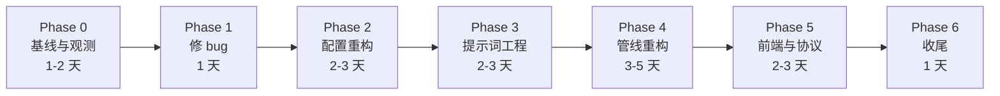

# kb 重构详细计划

> 设计见 [ragent vs 知识库：该抄什么、不该抄什么](./ragent-borrowings) 的第七~九章。
> 这篇只排实施：分几步、每步改哪些文件、怎么验证、怎么回滚。

::: warning 阅读说明
这篇是**实施记录**，不是当前架构说明。

- 各 Phase 的「设计 / 任务表」是**当时**的规划（保留是为了看出为什么这么改）
- 「完成情况」表已按 **2026-11-04** 的实际结果更新（去掉了 agent 模式、工具收缩等已撤销的项）
- **当前架构看 [04 · 对话链路](../project-architecture/04-agent-chat.md)**——单路径 + 观测日志
:::

## 一、总体策略

四条纪律，贯穿全程：

```
① 测量先行 —— 没有基线的优化都是猜测
② 小步提交 —— 每个 Phase 可独立完成、独立回滚
③ 一次一个变量 —— 同时改 prompt 和检索参数，出问题无法归因
④ 每步跑评估集 —— rerank 就是这么被证明「看起来有用但实际变差」的
```

**估时**：11~17 天（按单人、每次改动都要验证的节奏）。

## 进度（2026-11-03）

```
Phase 0  基线与观测    ✅ 完成
Phase 1  thinking 配置 ✅ 完成（并推翻「单独关思考可行」的假设）
Phase 2  配置重构      ✅ 完成（含启动自检；不做旧写法兼容）
Phase 3  提示词工程    ✅ 完成（模板外置 + 变量注入 + 边界防护 + 提示词审查）
Phase 4  管线重构      ✅ 完成（五阶段齐了；准备阶段一次调用出三件事）
Phase 5  前端与协议    ✅ 渲染层换库 / XSS 收口 / 持久化 / 引用可点；协议不迁
Phase 6  收尾          ✅ 日志库 / 前台启动 / 文档同步
```

后端主链路的最终形态：**首字 34.4s → 4~8s**，LLM 调用 2 次 → 1 次（多轮 2 次），
Hit@1 保持 89%，引用合法性 10/10，负例拒答 3/3。

### 补修（2026-11-04）

这一轮做了三件事：**阶段观测日志**、**去掉 agent 模式改单路径**、**统一引用编号**。
顺带修掉四个基础问题。

#### A. 修掉的基础问题

| 问题 | 后果 | 修法 |
|---|---|---|
| `build` 用 `cpSync` 拷提示词，不删旧文件 | `dist/prompts/` 残留已删的 `classify.md`，**干净构建后顶层 import 抛错，server 和 eval 双双起不来** | build 先清空 `dist/` 再拷（`scripts/clean-dist.mjs`） |
| `prompt.ts:14` 顶层 `loadPrompt('classify')` | 同上（依赖残留文件才能跑） | 删掉这行死代码（意图判断已并入 `prepare`） |
| 提示词在**模块顶层**读成常量 | "热更新"是假的——改 md 不生效，mtime 缓存根本没机会触发 | 改成 `export function chatPrompt()` / `generatePrompt()` 现取 |
| `init.ts` 模板写 `models.chat` | loader 根本不读这个字段（`KnowledgeConfig.models` 里也没这类型）→ **新实例 init 出来的配置有一项是无效的** | 改成 `pool` + `stages` 形式 |

顺带：`scripts/sync-core.sh` 纳入 git 跟踪（之前是未跟踪状态），AGENTS.md 补上
「改基座 → build → sync → 重启」四步（之前只写了 build + 重启，漏了 sync）。

#### B. 阶段观测日志（新增 `src/observe/`）

**为什么日志库不会自动拆文件**：pino 只负责"把一行 JSON 写到某个 stream"，
拆分/滚动是 transport 层的职责，pino 官方没内置（要另装 `pino-roll`）。
但更关键的是**数据模型不对**——pino 一条事件一行，我们要"一次问答一行"。

所以没改 pino，另起 `observe` 模块：`pino` 管人看的运行日志，`observe` 产出
`data/logs/qa-YYYY-MM-DD.jsonl` 给机器看。职责切开，不是两套真相。

三层结构：**结构化记录**（每阶段耗时/输入/输出）→ **自动检查项**（`checks`，纯函数算出来的可聚合症状）
→ **可分析性**（`kb obs stats` 按 thinking / complexity / promptHash 分组）。

它直接回答三个问题：改写质量（`question` vs `rewritten` + `prepareRaw`）、
thinking 开不开（`kb obs stats thinking`）、提示词规则太多会不会犯错（`prepareAttempts` + `systemChars`）。

#### C. 去掉 agent 模式，改单路径

`agent.mode` / `models.stages.agent` / `chatMode` 全部删除，
`dispatch.ts` + `hybrid.ts` 合并成 `agent/pipeline.ts`（`runChat()` 仍是唯一入口）。
配置里的废弃字段**软废弃**——读到会 warn 提示删掉，但旧实例仍能跑。

`loop.ts` 保留，但不再是"第二种编排"，而是生成阶段的**工具循环**。

#### D. 统一引用编号（这是放开补检索的前提）

原来有**两套编号权威**：工具内部的 `registerSource()` 登记表，和调用方合并后自己重编的
`merged.map((c, i) => ({index: i+1}))`。

在"全部检索都在预检索"时两套**恰好一致**（都是首次出现顺序），
但模型在生成阶段补检索时，登记表会分配新号（≥4）而前端只收到了 1..3
→ **来源面板缺一条、模型引用的编号被前端当越界静默抹掉**。

修法：**登记表升格为唯一权威**，调用方合并时保留片段自带的 `index`，不重新编号。
改造后**输出逐字节不变**（三种场景用探针验证：单查询 / 复合重叠 / 同 source 重复）。

另外两个配套的 bug：
- `sources` 事件原来只发一次（`sourcesSent` 标志）→ 模型吐过 token 后才到的来源永远发不出去。改成「集合有变化就重发全量」，前端配套要重渲染已产生的内容
- 工具预算耗尽时 `answer` 恒为 `''` → **用户看到空回答**。加收尾轮（不带工具强制出答案）
- 引用角标用原生锚点 `href="#kb-src-N"` → **点了不跳**。目标在 fixed 浮窗内，原生锚点滚的是页面；且 VitePress 在捕获阶段劫持所有 `<a>` 点击走它自己的 `scrollTo`（也是滚 window）→ 面板不动、页面反而跳走（实测 window.scrollY 被滚到 1026）。改成自己处理点击：捕获阶段拦下 + preventDefault/stopPropagation + 手动设浮窗内 `scrollTop`；目标 id 加消息序号，避免多轮对话时 id 重复

#### E. 验证结果

```
评估门禁        ✅ 检索 + 生成都通过（引用合法性 10/10，与改造前一致）
编号一致性      ✅ 真实场景（复合问题 6 来源 / 引用 [1,4]）逐一对应
热更新          ✅ 改 md → build → sync → 同进程读到新内容
模型自主补检索   ✅ React/Vue 对比题自己补到了 react-vs-vue.md 并引用为 [来源4]
```

## 与设计不一致的地方（逐条说明）

设计稿是理想形态，落地时有三处偏离，都有原因：

| 设计 | 实际 | 为什么 |
|---|---|---|
| 五阶段：rewrite / classify / retrieve / build / generate | **rewrite 和 classify 合并成 prepare**（一次调用出三件事） | 两者读的是同一份输入（历史 + 当前问题），拆开就是重复付费；合并后多轮场景比"改写 + 分类"分开还少一次调用 |
| 复杂度由模型判断 | **改成确定性启发式（只看问法）** | 实测 8B 把「闭包是什么」判成 complex（定义题），判错代价是白等 20~35 秒 |
| 生成阶段统一用 `stages.generate` | 拆出 `stages.generateComplex`（开思考） | 实测关思考完整性 4.40、开思考 4.90，但首字 4~7s vs 20~39s。折中：按问题复杂度分流 |

另外两处是**主动不做**：

- 协议迁移（UIMessage / `useChat`）：省 100 行 SSE 解析，换前后端两次全量重写
- AI Elements 组件库：自带样式体系和 VitePress 主题变量打架


## 过程中发现并修掉的三个问题

这三个都不是计划里写好的，是做的过程中撞上的——记下来是因为**它们都藏得很深**：

**① 关掉 thinking 会让检索失效**

4 个问题里 2 个技术问题不再调用 `search_knowledge`，其中一个还编了个 `[来源1]` 却根本没检索过。
根因：「要不要查」这个判断本身依赖推理。**这直接决定了必须先做预检索，再关思考。**

**② 评估对比的百分比算错了**

`(Math.abs(diff) * 100)` 把绝对差当百分比 —— `4.9 → 4.6` 显示成 `↓30%`（实际 6%）。
差点因此误判"faithfulness 掉了三成"。

**③ 原生 fetch 没有超时，模型卡住会永久挂起**

第一次跑完整评估，第 5 题挂了 25 分钟没动静。原来走 OpenAI SDK 时有默认超时，换到原生 `fetch` 之后这个保护丢了。

修法不是 `AbortSignal.timeout`（那是**总时长**，长回答会被腰斩），而是**空闲超时看门狗**：每收到一块数据就重置计时，只有"连接还在但一个字节都不来"才中断（默认 120s）。

顺手补了两处：评估逐题 try/catch（单题失败不再中断整轮）、`models.timeoutMs` 可配。

## 二、六个阶段



### Phase 0 · 基线与观测（1~2 天）

**目标**：先能看见，才谈改得对不对。

| 任务 | 文件 | 产出 |
|---|---|---|
| **建立基座同步机制** | `scripts/sync-core.sh` + `pnpm sync:core` | 改基座后 `build + sync` 即可生效 |
| 跑一遍现有评估集 | `eval/` | 基线数据：Hit@1 / 平均延迟 / token 消耗 |
| 加检索日志 | `kb-base/.../rag/retriever.ts` | 每条日志含：query、两路条数、融合后条数、top3 分数、uniqueDocs、耗时 |
| 加生成日志 | `kb-base/.../agent/loop.ts` | 首字延迟、总耗时、引用的来源编号 |
| 确认长度预算现状 | — | 统计实际 token 分布，验证 8.7 那个「超预算」的判断 |

**验收**：随便问三个问题，日志能回答「召回了什么、用了哪些、花了多久」。

**为什么必须先做**：Phase 4 要证明「延迟下降」，Phase 2/3 要证明「行为不变」——都需要基线。

::: warning 基座改动的生效方式（踩过的坑）
实例依赖的是 registry 上的 `@minijun/kb-core@0.1.2`，**改 kb-base 源码不会自动生效**。

试过三种方式：

| 方式 | 结果 |
|---|---|
| `pnpm.overrides` | pnpm 11 不再读 package.json 的 `pnpm` 字段，静默忽略 |
| `pnpm-workspace.yaml` 的 overrides | 触发删除 node_modules 重建，非交互环境直接失败 |
| 手动 `ln -s` 软链 | **能生效，但会被下一次 `pnpm install` 换回 `.pnpm` 副本** |

最终方案：`build + rsync` 同步 dist。

```bash
cd kb-base/packages/core && pnpm build
cd front-end-knowledge-summary && pnpm sync:core
```

不碰依赖结构，`pnpm install` 也不会破坏它。
:::

#### 完成情况（实测数据）

| 任务 | 状态 | 结果 |
|---|---|---|
| 同步机制 | ✅ | `pnpm sync:core` |
| 评估基线 | ✅ | 见下 |
| 检索日志 | ✅ | `KB_DEBUG_RETRIEVAL=1` |
| 生成日志 | ✅ | `KB_DEBUG_GENERATION=1` |
| 长度预算 | ✅ | **推翻 8.7 的判断**，见下 |

**基线（249 题）**

```
Hit@1 89% | Hit@5 100% | Recall@5 0.983 | MRR 0.941

弱项：性能 79%、JavaScript 82%、Vue 84%、浏览器 86%
强项：大前端 100%、AI Agent 97%、算法 92%、CSS 92%
```

**检索日志样例**

```json
{"q":"<某个真实问题的原文>","mode":"hybrid","n":5,"docs":5,
 "top":[0.496,0.427,0.34],"ms":48,
 "candidates":50,"vector":22,"bm25":94,"fused":98}
```

> ⚠️ 这里刻意用占位符而不是真实题目：**本文档在知识库里**，
> 抄题目原文等于给评估集造一个污染源（模型会检索到本文档、
> 以为"资料里提过这道题"，然后编出越界引用）。
> 详见 [04 篇 · 对话链路](../project-architecture/04-agent-chat.md)。

两个可用信号：`bm25` 候选（94）远多于 `vector`（22），说明 BM25 的字符 bigram 分词很宽；`top` 前三名只差 0.15，混合检索的分数区分度弱于纯向量。

**生成日志样例**

```json
{"model":"qwen3:8b","turns":2,"tools":["search_knowledge"],
 "firstTokenMs":34450,"totalMs":59698,"answerChars":1279,"cited":[1,2,3]}
```

**最关键的一个数字：`firstTokenMs = 34.4 秒`。**

追问「闭包是什么」，2 轮 LLM、1 次检索、总耗时 59.7 秒，其中 34 秒花在首字之前——那段时间几乎全是 qwen3 的思考。这把 Phase 1「关掉 thinking」的优先级从「优化项」提升到「最大单点收益」。

**长度预算实测（推翻 8.7）**

用 Ollama 的 `prompt_eval_count` 取真实 token 数，三个问题的结果：

| 问题 | 资料字符 | prompt tokens |
|---|---|---|
| 闭包是什么？ | 2517 | 1191 |
| Vue3 的响应式原理是什么？ | 2318 | 1098 |
| React fiber 解决了什么问题？ | 2023 | 1372 |

`SYSTEM_PROMPT` 只有 505 字符，3 条 chunk 约 2000~2500 字符，**总 prompt 稳定在 1100~1400 token**，离 4096 的窗口还有大量余量。

所以 8.7 那句「`chunk.size × topK` 已经超预算」是**错的**——那个「2000 token 预算」是我假设的，代码里并不存在这个限制。

**真正的上下文风险在另一个方向**：thinking 的输出和答案共享同一个窗口。prompt 占 1372，思考可能吃掉一两千，留给答案的空间就被压缩——这解释了为什么有时回答会在中途变得仓促。**问题不在资料太长，而在思考挤占了答案预算。**

### Phase 1 · 修 bug 与低风险改动（1 天）

**目标**：先解决确定性的问题，不引入新结构。

| 任务 | 文件 | 说明 |
|---|---|---|
| thinking 配置化 | `kb-base/.../config/types.ts`、`agent/loop.ts` | 加 `thinking?: boolean`，为 false 且本地 Ollama 时走原生 API 传 `think: false`（照抄 `gen-eval-cases.ts`） |
| 配置项暴露 | `knowledge.config.mjs` | `models.thinking: false` |
| 验证 | — | 问一个技术问题，确认不再有 reasoning 流、延迟下降 |

**验收**：

```
① 前端思考面板不再出现
② 首字延迟从 34.4s（实测基线）降到 10s 以内
③ 评估集 Hit@1 不变（±1% 以内）
```

**风险**：关掉思考后复杂问题的质量可能下降。**回滚**：配置改回 `true` 即可，无代码回滚。

#### 完成情况（含一个推翻原假设的发现）

| 任务 | 状态 | 说明 |
|---|---|---|
| `thinking` 配置化 | ✅ | `ResolvedModel.thinking` + `models.thinking: false` |
| 原生通道 | ✅ | 新建 `model/stream.ts`：Ollama 原生 / OpenAI 兼容两条通道统一成一套事件 |
| 验证 | ⚠️ | **延迟达标，但单独关思考会破坏检索** |

**实测对比（同一个问题「闭包是什么」）**

| 配置 | turns | tools | 首字 | 总耗时 | 引用 |
|---|---|---|---|---|---|
| thinking 开（基线） | 2 | search_knowledge | 34.4s | 59.7s | [1,2,3] |
| thinking 关 | 1 | **无** | 5.8s | 15.5s | **无** |

首字从 34.4s 降到 5.8s，但**模型不再调用检索**——直接凭记忆作答。连测四个问题，三个技术问题里两个没调工具，其中一个还编了个 `[来源1]` 却根本没检索过。

**结论：`thinking: false` 不能单独上线，必须和 Phase 4 的预检索一起。** 因为「让模型自己决定查不查」依赖它的推理能力，关掉思考就等于把这个判断也关掉了。

这条改写了原计划里「Phase 1 风险：质量可能下降」的预估——不是"可能"，是确定会，而且坏在检索而不是措辞上。

### Phase 2 · 配置重构（2~3 天）

**目标**：模型配置从「一个字段」变成「池子 + 按 stage 引用」，对外行为不变。

| 任务 | 文件 | 说明 |
|---|---|---|
| 配置类型扩展 | `kb-base/.../config/types.ts` | `ModelPool` / `StageConfig` / `Capabilities` 类型 |
| 配置解析 | `kb-base/.../config/loader.ts` | 解析 `models.pool` / `models.stages`，保持向下兼容（老配置仍可用） |
| 统一调用封装 | 新建 `kb-base/.../model/chat.ts` | `chat({ stage, messages, tools })`，内部做候选遍历 + 冷却 + 超时 |
| 改造调用点 | `agent/loop.ts`、`rag/reranker.ts` 等 | 改用 `chat({ stage })` |
| 启动校验 | 新建 `kb-base/.../config/validate.ts` | 数值范围、stage 完整性、**embedding 与索引一致性** |

**验收**：

```
① 把 generate 的候选顺序调换，能观察到实际使用了不同模型
② 把主模型 baseUrl 改错，能自动降级到备选且日志有记录
③ 全部候选不可用时，rewrite 用原问题、generate 明确报错
④ 评估集 Hit@1 与 Phase 0 基线一致
```

**风险**：`chat()` 封装引入的间接层可能掩盖问题。**缓解**：封装里记录每次实际使用的 model id。

#### 完成情况（按"不做兼容"收敛过）

| 任务 | 状态 | 说明 |
|---|---|---|
| `pool` + `stages` 类型 | ✅ | `models.pool` 描述连接，`models.stages.classify/generate` 描述优先级 |
| 配置解析 | ✅ | `resolveStage()`；引用不存在的池成员直接抛错并列出可用别名 |
| 候选抽象 | ✅ | `ChatTarget`（client + model + thinking + 通道 + label），`toTargets()` 负责组装 |
| 分阶段调用 | ✅ | 分类 / 生成 / **agent** 各用自己的候选链，日志里能看到 `classifyModel` / `model` 的 `model@host` |
| 按模式配思考 | ✅ | 池成员可单独覆盖 `thinking`；agent 决策轮开思考、hybrid 生成轮不开 |
| 降级 | ✅ | 生成阶段按数组顺序试，**吐出第一个字前**允许换；已出字则锁定 |
| 启动校验 | ✅ | `config/validate.ts`：embedding 与索引一致性、权重和、topK 范围、云端候选缺 key 提醒 |
| 旧 `models.chat` 兼容 | ❌ **主动不做** | 统一成 pool/stages；`config.chat` 改为派生值（= generate 首选），不再作为配置项 |

**降级实测**：把 `generate` 配成 `['ghost', 'qwen3-8b']`（ghost 指向不存在的模型）：

```json
{"model":"qwen3:8b@localhost:11434", "note":"第 2 个候选生效", "cited":[2,3]}
```

用户侧无感知，只多了一次失败请求的时间。

**一个刻意的上限**：降级只在"还没吐字"时生效。一旦已经有 token 发给前端，再切模型会出现两段不同的开头，比直接报错更糟。

### Phase 3 · 提示词工程（2~3 天）

**目标**：模板外置 + 变量注入，内容质量提升。

| 任务 | 文件 | 说明 |
|---|---|---|
| 建模板目录 | `kb-base/packages/core/prompts/` | `rewrite.md` / `classify.md` / `generate.md` / `_shared/*.md` |
| 模板 loader | 新建 `prompts/index.ts` | `loadPrompt()` + `render()`（缺失变量报错） |
| 拆分现有 prompt | `agent/prompt.ts` | 四段拆开，代码块格式要求独立成 `_shared/code-format.md` |
| 生成模板增强 | `prompts/generate.md` | 补 `<documents>` 边界说明、部分相关处理、冲突处理 |
| 边界防护 | `agent/loop.ts` 拼接处 | 过滤资料里的 `</documents>` |
| prompt 日志 | `agent/loop.ts` | 开关控制，记录 token 数 + 完整 system |

**验收**：

```
① 改 prompt 不需要重新编译（改 md 即生效，dev 环境）
② 变量缺失时启动/调用即报错，不会静默渲染成空
③ 评估集对比：引用准确率提升、Hit@1 不降
④ 人工抽查 5 个回答，确认「资料没有的部分」不再瞎编
```

**风险**：新 prompt 可能改变回答风格，用户不适应。**回滚**：模板文件进 git，切回上一个 commit 即可。

#### 完成情况

| 任务 | 状态 | 说明 |
|---|---|---|
| 生成模板重写 | ✅ | `prompts/generate.md`：`<documents>` 边界 + 综合而非逐条复述 + 冲突处理 + 资料不足判定 |
| 分类模板 | ✅ | `prompts/classify.md`：只要二分类，拿不准一律 retrieve |
| 模板外置成 md | ✅ | `src/prompts/*.md` + `src/prompt/index.ts`；`${var}` 缺失即抛错，`${> name}` 复用片段 |
| 边界防护 | ✅ | 资料里的 `</documents>` 一律转义成 `<\/documents>`，不让边界被正文提前闭合 |
| 热更新 | ✅ | 按 mtime 判断，改 md 存盘即生效，不用重编译 |
| prompt 日志 | ✅ | `KB_DEBUG_PROMPT=1` 打开，记录各段字符数 + 最长段预览（不引分词器，字符数够定位问题） |

::: warning 热更新曾经是**假的**（2026-11-04 修正）

上面"热更新 ✅"曾经不成立：`prepare.ts` / `prompt.ts` 把模板在**模块顶层**读成常量
（`const SYSTEM_PROMPT = loadPrompt('agent')`），进程启动后再改文件不会重读——
mtime 缓存只在"被调用时"检查，顶层求值后没人再调了。

改成 `export function systemPrompt()` 现取之后才真的热更新。
判定方式：改 md → 不重启 → 看 `kb sync:core` 打印的指纹变没变。

顺带修掉一个更严重的隐患：`build` 脚本原来用 `cpSync` 拷提示词（不删旧文件），
`dist/prompts/` 里一直残留着已删除的 `classify.md`，而代码里也曾顶层 import 它。
**一旦做干净构建，残留消失 → 顶层 import 抛错 → server 和 eval 双双起不来。**
现在 `build` 先清空 `dist/` 再拷，产物严格等于源码。
:::

**外置这一步本身就在消灭一类 bug**。之前 `SYSTEM_PROMPT` 里有三段转义的 ` ``` ` 围栏，我看代码时误读成"三个空代码块"，还写进了文章——**长文本塞在 TS 字符串里，连 review 都会看错**。现在内容在 md 里，围栏就是围栏。

**一个真实踩到的坑**：第一版 `GENERATE_PROMPT` 写的是"每句事实都要标来源"，结果模型把三条资料里同一个定义**换着说法写了三遍**：

```
闭包是一个函数，它记住并访问其词法作用域… [来源2]。
闭包表现为函数能访问并记住其词法作用域 [来源2]。
闭包是指函数记住并访问其词法作用域… [来源3]。
```

改成"先把多条资料理解后合成一段，不要逐条复述"之后：

```
闭包是指函数记住并访问其词法作用域，即使函数在其词法作用域之外执行 [来源3]。
具体来说，闭包是函数与其词法作用域的结合… [来源2]。
闭包的核心特征包括函数嵌套函数、内部函数引用外部函数的变量… [来源3]。
```

**教训**：要求"覆盖所有来源"会诱导模型复述。标注要求应该约束**粒度**，不是覆盖率。

### Phase 4 · 管线重构（3~5 天）

**目标**：从 Agent 循环改为「预检索 + 可选补充」，首包延迟下降。

| 任务 | 文件 | 说明 |
|---|---|---|
| 五阶段实现 | 新建 `kb-base/.../pipeline/` | rewrite / classify / retrieve / build / generate，每阶段一个文件 |
| 编排入口 | 新建 `kb-base/.../pipeline/index.ts` | 顺序调用 + 短路逻辑 |
| 模式开关 | ~~`knowledge.config.mjs`~~ | ⛔ **已删**：只有一条路径了（当时保留是为了能切回 agent 对比，后来确认 agent 模式没有存在价值） |
| 保留旧路径 | `agent/loop.ts` | 不删——但不再是"第二种编排"，而是生成阶段的**工具循环** |
| 工具收缩 | ~~`pipeline/generate.ts`~~ | ⛔ **已撤销**：见下方"完成情况"的说明 |

**验收**：

```
① 80% 的请求只调用 1 次 LLM（从日志统计）
② 首字延迟相比 Phase 0 下降 ≥ 20%
③ 评估集 Hit@1 与基线一致或更好
④ 切回 mode: 'agent' 行为与改造前完全一致
```

**风险**：预检索对闲聊问题是浪费。**缓解**：classify 阶段短路，闲聊不进检索。

**这一阶段最需要谨慎**：

```
当时保留 mode: 'agent' 是为了能对比、能回退。
后来（2026-11-04）确认 agent 模式没有存在价值，直接删了——
「让模型自己决定要不要检索」依赖推理能力，关思考就漏检索，
而"先检索再让模型补"两边都不牺牲。详见架构文档 04-agent-chat.md。
```

#### 完成情况（已上线为默认模式）

| 任务 | 状态 | 说明 |
|---|---|---|
| 五阶段实现 | ✅ | 落在 `agent/pipeline.ts`：**改写 / 分类 / 预检索 / 拼装 / 生成**（改写与分类合并为 `agent/prepare.ts` 的一次调用） |
| 改写阶段 | ✅ | `agent/prepare.ts` + `prompts/prepare.md`。裁剪噪音 + 消解指代 + 继承省略意图 + 禁止编造；失败回退原问题 |
| 复杂度判定 | ✅ | 确定性启发式（问法含"为什么/区别/原理…"→ complex），模型自评只记录不采信 |
| 分类器 | ✅ | 并入 prepare 的 `intent` 字段（chat / retrieve），不多花一次调用 |
| 模式开关 | ⛔ **已删** | 只有一条路径了。配置里的 `agent.mode` / `models.stages.agent` 变成**废弃字段**：读到会 warn 提示删掉，但不影响运行（旧实例能直接跑） |
| 保留旧路径 | ✅ `loop.ts` 未删 | 但**不再是"第二种编排"**——它是生成阶段的工具循环。生成阶段带 `search_knowledge` + `get_doc_content`，模型发现预检索不够时可以自己补检索 |
| 工具收缩 | ⛔ **已撤销** | 原来"生成阶段过滤掉 `search_knowledge`"是为了防重复检索。实测发现模型**确实会在需要时补检索**（如 React/Vue 对比题，它自己补到了 `react-vs-vue.md`），一刀切砍掉反而丢了能力 |
| 统一调度 | ✅ | `agent/pipeline.ts` 的 `runChat()`：路由和评估都走它，保证"评估的就是线上行为" |
| 引用编号单一来源 | ✅ | **`createTools()` 的来源登记表是唯一权威**。工具登记时分配编号，调用方合并去重时**保留片段自带的 index**，不重新编号 |

**编号为什么必须统一（改造时踩到的坑）**：

原来调用方合并后自己重编一套号（`merged.map((c, i) => ({index: i+1}))`）。
在"全部检索都在预检索"时两套**恰好一致**（都是首次出现顺序），但模型在生成阶段补检索时，
登记表会分配新号（≥4）而前端只收到了 1..3 → **来源面板缺一条、模型引用的编号被前端当越界静默抹掉**。

现在登记表是唯一权威，改造后**输出逐字节不变**（三种场景用探针验证过：单查询 / 复合重叠 / 同 source 重复）。

**实测（4 个问题）**

| 问题 | 意图 | 分类 | 检索 | 首字 | 总耗时 | 引用 |
|---|---|---|---|---|---|---|
| 闭包是什么 | retrieve | 0.3s | 0.6s | 6.3s | 13.7s | [2,3] |
| Vue3 响应式原理 | retrieve | 0.3s | 0.1s | 3.8s | 25.2s | [2,3] |
| 你好 | **chat** | 0.3s | **0** | 1.4s | 2.1s | — |
| BM25 与向量怎么融合 | retrieve | 0.2s | 0.1s | 7.0s | 32.0s | [1,2] |

**首字 34.4s → 3.8~7.0s，一次问答的 LLM 调用从 2 次降到 1 次**（闲聊场景 2.1 秒结束）。

**验收对照**

```
① 只调 1 次 LLM        ✅（turns 恒为 1，工具只在不满足时补读）
② 首字下降 ≥ 20%       ✅ 实际下降 80%+
③ Hit@1 不变           ✅ 89% → 89%（检索链路未动）
④ 切回 agent 行为一致   ⚠️ 一致，但同样受 thinking:false 影响（不调检索），
                          这条恰恰证明「检索由代码做」是必需的
```

**回退方式**：⛔ 原写的 `agent.mode: 'agent'` 回退路径**已失效**（模式开关删了）。
现在要回退得改代码——但没有回退的必要：单路径的行为已经被评估集和观测日志双重验证。

### Phase 5 · 前端与协议（2~3 天）

**目标**：协议标准化 + 前端简化 + 体验提升。

| 任务 | 文件 | 说明 |
|---|---|---|
| 服务端协议 | `kb-base/.../routes/chat.ts` | 改用 `createUIMessageStream` + `source-url` part |
| 前端 hook | `kb-site/theme/composables/useAIChat.ts` | 改用 `useChat`（`@ai-sdk/vue`） |
| 消息渲染 | `kb-site/theme/components/AIChat.vue` | 按 `parts.type` 渲染 |
| 持久化 | 同上 | localStorage 存最近 50 条 |
| UI 优化 | 同上 | 引入 AI Elements 组件（可选） |

**验收**：

```
① 来源标签、思考过程、正文都能正常渲染
② 刷新页面后对话还在
③ 前端 SSE 解析代码删除（对比行数）
④ 移动端布局不错位
```

**风险**：`@ai-sdk/vue` 版本对 `source-url` 的支持可能不完整。**缓解**：先验证一个最小 demo，再改正式代码。

**顺序不能反**：先换协议（服务端 + 前端同时改），再换 UI 组件。反过来要改两遍。

#### 完成情况（只做了渲染层，协议迁移主动推迟）

| 任务 | 状态 | 说明 |
|---|---|---|
| Markdown 渲染换库 | ✅ | 手写正则 → `marked`（表格/列表/标题/引用块一次到位） |
| XSS 关闭 | ✅ | 自定义 renderer 把 raw HTML 一律转义；原先 `v-html` 直接吃模型输出 |
| 代码块样式 | ✅ | 从行内样式搬进 CSS，跟主题变量联动 |
| localStorage 持久化 | ✅ | 最近 50 条，`kb-chat-history-v1`；恢复时清掉 `streaming` 标记 |
| 上下文预算 | ✅ | `buildHistory()` 按 4000 字符从近到远取；之前是 `slice(0,-2)` 全量带 |
| 空状态建议问题 | ✅ | 配置 `chat.suggestions` 数组，或把 `chat.hints` 按换行/竖线拆开 |
| 消息操作 | ✅ | 复制 / 重新生成（悬浮显示） |
| `useChat` 迁移 | ⬜ | **主动不做**，见下 |
| UI 组件库 | ⬜ | 未引 AI Elements：它会带来一整套样式覆盖，和 VitePress 主题变量容易打架；当前手写样式已跟 `--vp-c-*` 对齐 |

**为什么不做 `useChat`**：查过版本（`@ai-sdk/vue@4` / `ai@7`）确实可用，但它要求服务端改成 `createUIMessageStream` + `toUIMessageStreamResponse`，也就是**把已经很小的 SSE 协议（5 种事件）换成 UIMessage parts**。

改造代价：

```
服务端  routes/chat.ts 全重写 + 依赖 ai（大包）
前端    useAIChat.ts 全重写，thinking / sources / 重试 都要映射到 part 类型
收益    省掉约 100 行 SSE 解析
风险    协议和业务特性耦合，出问题要前后端一起回滚
```

**省 100 行换两次全量重写，不划算。** 更划算的是先把手写的部分换成库：markdown 渲染这块（60 行正则 → 一个 renderer 配置）这次已经换掉了，收益比协议迁移更直接。

如果以后要接多模态（图片、工具卡片可视化），UIMessage 的 parts 模型会明显更合适——那时再迁移，成本不会比现在更高。

### Phase 6 · 收尾（1 天）

| 任务 | 说明 |
|---|---|
| 旧路径处置 | ⛔ **已删**（2026-11-04）：agent 模式作为"第二种编排"被移除。`loop.ts` 保留，但只是生成阶段的工具循环 |
| 池内思考开关 | ✅ | 池成员可单独覆盖 `thinking`；复杂问题生成轮开思考，简单问题关 |
| 外部模型示例 | ✅ | 配置里给了 SiliconFlow / DeepSeek 的完整示例（baseUrl / apiKeyEnv / timeoutMs） |
| 更新文档 | `docs/project-architecture/04-agent-chat.md` 需重写（架构已变） |
| 更新 README | 配置说明同步 |
| 最终回归 | 全量评估集 + 人工抽查 10 个问题 |

#### 完成情况

| 项 | 状态 | 说明 |
|---|---|---|
| 文档 | ✅ | 本文件 + `ragent-borrowings.md` 已按落地结果更新 |
| 配置文档 | ✅ | 实例和基座模板（`templates/instance/docs/getting-started/`）都改成 pool/stages |
| 架构文档重写 | ✅ | `04-agent-chat.md` 整篇重写：两模式对比 / 分类 / 预检索 / 双通道 / 降级 / 调试开关 |
| 评估基线固化 | ✅ | 旧基线备份成 `data/eval-baseline.2026-09-24.json` 后再固化（新基线 2026-11-03） |

| README | ⬜ | 未动（改动集中在基座，实例 README 没有模型配置细节） |
| `loop.ts` | ✅ 保留 | **不删**：`mode: 'agent'` 是长期可选的第二种编排，不是过渡代码 |

### 补修时发现的两个评估设计缺陷

**① 生成层门禁在跟随机性对赌**

`eval/thresholds.json` 要求生成层 `citationLegalRate ≥ 1.0`（100%），
但生成评估集**只有 10 题**（其中 3 道负例）——错 1 题就是 90%，直接撞线。
而生成阶段 `temperature: 0.7`，单题就有随机性。

实测：同一套提示词、同一套代码，连跑两轮：

| 轮次 | 引用合法性 | 忠实度 | 门禁 |
|---|---|---|---|
| 第 1 轮 | 90%（9/10） | 3.70 | ❌ 失败 |
| 第 2 轮 | 100%（10/10） | 4.50 | ✅ 通过 |

各题的引用数量在两轮之间完全不同（第 1 题 3 处 vs 2 处、第 2 题 6 处 vs 3 处），
**这是模型随机性，不是代码退化**。检索层有同样的问题吗？没有——
它 249 题、门禁留了余量（hit1 ≥ 0.8 而非 0.95），单题噪声被摊薄了。

**待定**：要么给生成层门禁留余量（≥ 0.9），要么把生成评估集扩到 30+ 题。
前者快但会漏掉真实退化，后者慢但结论可信。

**② 负例题被自己的文档污染**

第 9 题（Kubernetes 负例）失败的原因是：检索命中了
`docs/project-architecture/06-evaluation.md` —— **那篇文档里正好写着这道题的原文**
（它是评估集设计的示例，`:171` 行）。模型读到后以为"资料里提到了这道题"，
于是把文档里的 `[来源N]` 字样当成真编号，编了个 `[来源4]` 出来。

这不是提示词的问题，是**知识库里有一篇文档包含了评估集本身**。
修法：把评估集的示例从文档里挪走，或把这类文档排除出索引。

## 三、依赖关系

```
Phase 0 ──┬─► Phase 1 ──► Phase 4（长度预算的修正影响检索）
          │                   ▲
          └─► Phase 2 ──► Phase 3 ──┘
                              │
                              └─► Phase 5（协议迁移依赖新管线）
```

三个硬依赖：

1. **Phase 0 必须先做**——没有基线，后面所有「没变差」都无法证明
2. **Phase 2 必须在 Phase 3 之前**——模板要用 `chat({stage})` 的模型选择
3. **Phase 4 必须在 Phase 5 之前**——协议迁移要基于新的管线结构

## 四、验证方案

每个 Phase 结束都跑同一套：

| 指标 | 怎么测 | 合格线 |
|---|---|---|
| **Hit@1** | 评估集 | 不低于基线 -1% |
| **引用准确率** | 抽查回答里的 `[来源N]` 是否真的来自对应文档 | ≥ 90% |
| **首字延迟** | 日志里的 firstTokenMs | 逐阶段记录，不设硬指标 |
| **总延迟** | 日志 | 同上 |
| **幻觉率** | 抽查「资料里没有的内容」是否被编造 | ≤ 5% |

**人工抽查不能省**。自动指标只能测「有没有检索到正确文档」，测不了「回答得好不好」。

## 五、回滚策略

| 阶段 | 回滚方式 | 粒度 |
|---|---|---|
| Phase 1 | 改配置 `thinking: true` | 配置级 |
| Phase 2 | 保留老配置格式的解析分支 | 配置级 |
| Phase 3 | 模板文件 git revert | 文件级 |
| Phase 4 | ~~切 `mode: 'agent'`~~ | ⛔ 已失效：模式开关删了，没有配置级回退路径 |
| Phase 5 | 前端回退 commit | 代码级 |

**Phase 4 的回滚开关最重要**——它让「新管线有问题」变成「改一行配置」，而不是「紧急发版」。

## 六、风险清单

| 风险 | 概率 | 影响 | 应对 |
|---|---|---|---|
| 关 thinking 后复杂问题质量下降 | 中 | 中 | 保留并按问题类型动态开（Phase 4 之后可做） |
| 预检索对某些问题反而更慢 | 中 | 中 | 意图判断阶段精确判断；闲聊不进检索 |
| 配置重构引入隐性 bug | 中 | **高** | Phase 2 只做「行为不变」的重构，不做功能变更 |
| 模板外置后加载失败 | 低 | 高 | 启动时校验所有模板可加载 + 变量完整 |
| 协议迁移破坏前端 | 中 | 高 | 先做 demo 验证 `@ai-sdk/vue` 能力 |
| 评估集覆盖不足导致「测不出退化」 | **高** | **高** | Phase 0 先扩评估集，加 10~20 道多轮/歧义题 |

**最后一条最容易被忽略**：现在的评估集大概率只覆盖「单轮、明确问题」。而这次重构动的正是「多轮 + 改写 + 判断」——**评估集不覆盖的场景，改坏了也测不出来**。

建议 Phase 0 顺带补 10~20 道题：

```
指代类   "它的实现原理是什么"（依赖上一轮）
歧义类   "Vue 和 React 的区别"（可能分裂成两个子问题）
闲聊类   "你好" / "刚才那个答案不对"
长篇类   "帮我总结一下 xxx 这篇"
```

## 七、明确不做的事

避免范围蔓延：

| 不做 | 理由 |
|---|---|
| 意图树 / 多知识库路由 | 单库场景无收益（见正文第三章第 1 条） |
| Rerank 重开 | 已实测变差，除非换更强的模型 |
| 双层限流 | 个人使用无并发 |
| 长期记忆 / 用户画像 | 查笔记不需要 |
| 服务端会话持久化 | localStorage 够用 |
| LangChain AgentExecutor | 抽象重、流式难接 |
| LCEL 编排 | 5 步带分支，async 函数更清楚 |
