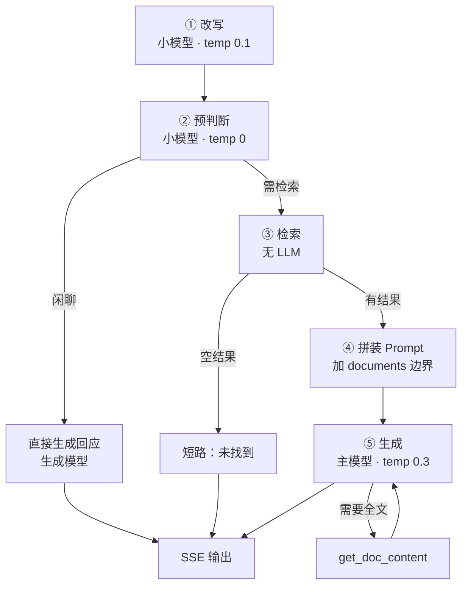

# ragent vs 知识库：该抄什么、不该抄什么

> 读完 ragent 的源码后，回头对照自己的知识库项目，记一下哪些设计能直接用、哪些试过没用、哪些是场景不同不成立。
>
> 结论先行：**值得补的有 3 条，明确不抄的有 4 条，还有 1 条是「反过来别丢」。**

## 一、两个项目的坐标不同

先把差异摆出来，不然容易得出"它更完整所以都该学"的错误结论。

| | 知识库（本项目） | ragent |
|---|---|---|
| 定位 | 个人笔记的问答入口 | 企业内部知识助手 |
| 语言/栈 | TypeScript + Koa + LangChain.js | Java + Spring Boot 4 |
| 编排 | **只有 Agent**（工具循环，最多 3 轮） | **双模式**：workflow 管线 / Agent |
| 检索 | 向量 + BM25 **加权融合**（0.7 / 0.3） | 多通道 + RRF（默认只开向量） |
| Rerank | **实测变差，已关闭** | qwen3-rerank（本地退化 noop） |
| 模型 | 本地 Ollama，零成本 | 候选池 + 熔断 + 首包探测 |
| 用户规模 | 一个人 | 多用户，有并发控制 |
| 评估 | **有 Hit@1 基线和调参记录** | 有 eval 目录 |

两个最容易被忽略的事实：

1. **kb 已经是 Agent 架构**，不是"先检索再回答"的固定管线——这一点和 ragent 的 agent 模式是同一类
2. **kb 的检索参数是测出来的**（0.7/0.3 权重、rerank 关闭都有 Hit@1 数据支撑），而 ragent 的 20/40/10、k=20、0.25 是经验值 + 注释说明

第 2 点决定了：**不能盲目抄 ragent 的检索参数**，因为 kb 手里有更硬的数据。

## 二、值得补的三条

### 1. 查询改写（最该补的一块）

::: tip 已实现（2026-11-03）
落在 `agent/prepare.ts` + `prompts/prepare.md`。和 ragent 的差别是**不只做指代消解**，
还做「裁剪噪音 / 继承省略意图 / 禁止编造 / 拆分复合问题」，并把"要不要检索"和
"复杂不复杂"合并进同一次调用。复合问题会分路检索后合并去重，编号统一分配。
:::

**kb 现状**：用户问什么就检索什么。

**ragent 的做法**：

```
「它的扩容呢」        → 「HashMap 的扩容呢」        （指代消解，依赖历史）
「A 和 B 有什么区别」 → 拆成两个子问题分别检索
```

这一步解决的是 **BM25 和向量都救不回来的问题**：

```
用户："它怎么实现的"
向量检索：这句话本身没有实体，embedding 出来是个模糊方向
BM25：一个有效词都没有
→ 两路全部召回垃圾，后面融合、rerank 都无从补救
```

**为什么值得抄**：

- kb 已经有 BM25 了，但 BM25 依赖字面命中，代词会让它完全失效
- 改写是**唯一能在检索前修好这个问题**的环节
- 成本可控：走 fast 档（或本地小模型），一次调用几秒

**要抄的部分**（ragent 的做法里最值得学的）：

```java
// 失败兜底：LLM 挂了或 JSON 解析不出来，直接用原问题
RewriteResult fallback = new RewriteResult(normalizedQuestion, List.of(normalizedQuestion));
try {
    result = parse(llmService.chat(req, Tier.FAST));
} catch (Exception e) {
    result = fallback;      // 不阻塞、不报错、不重试
}
```

改写是"锦上添花"的环节，**绝不能因为它失败就让整个问答挂掉**。

**别抄的部分**：喂历史时 ragent 只留最近 2 条助手回答（用户提问全留）。如果 kb 不做多轮，这一步直接跳过。

### 2. 引用编号的单一来源

::: tip 已实现（2026-11-03）
工具现在只返回**原始 chunk**（source / title / text / score），不带编号；
编号由调用方合并后统一分配一次（1..N），提示词里的 `[来源N]`、来源面板的序号、
答案里可点击的角标三处共用同一份。详见 [04 · 对话链路](./../project-architecture/04-agent-chat) 的「引用编号只分配一次」。
:::

**kb 现状**：每个工具自己拼编号。

```ts
// tools.ts
.map(([doc], i) => `[来源${i + 1}: ${doc.metadata.source}]\n${doc.pageContent}`)
```

```ts
// routes/chat.ts —— 前端把多个工具返回的 sources 合并
for (const s of event.sources) {
  if (!allSources.some((x) => x.source === s.source)) allSources.push(s)
}
```

**问题**：编号是**工具内部各自编的**。如果一个对话里调了 `search_kb` 又调了 `read_file`，两份结果都从 `[来源1]` 开始，合并后编号就冲突了——模型写的 `[来源2]` 到底指哪个？

现在只有两个工具且很少同时用，所以没暴露。但这是结构性隐患。

**ragent 的做法**：编号**在检索之后统一分配一次**，之后三处共用。

```
SourcesAssembler.assemble(intentChunks)
  → List<SourceRef> { index: 1, docId, docName, excerpt }
       ├─ SSE 来源面板
       ├─ prompt 里的 ref="1"
       └─ 落库的历史消息
```

**移植到 kb 的形态**（不用照搬 Java 结构）：

```ts
// 工具返回原始 chunk，不带编号
{ content: string, chunks: Chunk[] }

// loop 里统一编号后再喂给模型
const sources = assignIndices(allChunksFromAllTurns)   // 全局唯一
```

代价是要改 `LoopEvent` 的类型（`sources` 从"工具产出"变成"统一产出"）。但如果以后工具变多，这一步迟早要做。

### 3. 首包超时的显式处理

**kb 现状**：本地 Ollama，没有超时探测。

**ragent 的做法**：流式请求发出去后，等第一个非空 chunk 到达，超过预算就判定这个模型不可用。

```java
ProbeResult result = awaitFirstPacket(bridge, target.timeoutMs());
if (!result.isSuccess()) {
    healthStore.markFailure(target.id());
    handle.cancel();
    continue;      // 换下一个候选
}
```

**为什么 kb 也需要**（虽然场景不同）：

```
Ollama 的故障模式和云端不同：
  云端：HTTP 200 然后不吐字节（限流/排队/网关半死）
  本地：模型没加载完，请求挂在 ollama 里，几十秒后才开始吐字

共同点：都表现为「请求发出去但一直没有响应」，用户只看到转圈。
```

kb 不需要"切换候选模型"那么复杂，但**至少该有个首字超时**：

```ts
// 简化版：超过 N 秒没收到第一个 token，主动断开并提示
const firstTokenTimeout = setTimeout(() => {
  controller.abort()
  yield { type: 'error', message: '模型响应超时，请重试' }
}, 30_000)
```

**别抄的部分**：熔断器（`healthStore`）、半开探测、多候选降级。kb 只有一个本地模型，没有"备选"可切。

## 三、明确不借鉴的四条

### 1. 意图树

**ragent 为什么需要**：多知识库场景，要决定"去哪个库查"，并收窄范围。

**kb 为什么不需要**：

- 只有一个库，收窄等于不收窄
- 更根本的：**kb 是 Agent 架构，路由由模型自己完成**——它决定调 `search_kb` 还是 `read_file`，本身就是"意图判断"，只是实现方式不同

```
ragent：先分类（一次 LLM）→ 收窄 → 检索
kb：    Agent 直接决定调哪个工具 → 工具内部检索
```

后者少一次调用，但路由能力受限于工具描述写得好不好。两种方式各有代价，**没有"必须升级成意图树"的理由**。

### 2. Rerank

**这一条 kb 已经验证过了**：

> `reranker.ts` 用本地 cross-encoder（`bge-reranker-base`）对 `(query, doc)` 一起编码打分，精度理论上高于向量。但**实测在本项目里反而变差**（Top1 83% → 58%），因此 `config.rerankEnabled = false`。

原因大概率是：本地 reranker 模型太小，中文短文本上不如 bge-m3 的向量召回可靠。

ragent 里的 rerank 也是 noop（本地）——**两个项目在这件事上得出了相同结论**，只是 ragent 保留了接口。

真要重新开，前提是**换一个更强的 rerank 模型**（bge-reranker-v2-m3 或云端 API），并且用现有评估集重新测一遍。不是"补一个缺失的环节"。

### 3. 双层限流

ragent：Redis 公平队列（10 个许可）+ 本地线程池（10 个线程）。

kb：一个人用，没有并发。

**唯一可能用得上的场景**：本地 Ollama 同时处理多个请求会互相拖慢。但那是"排队"问题，一个 `p-limit(1)` 就够，不需要 Redis。

### 4. 三层记忆

ragent：会话消息 / 会话摘要 / 跨会话长期事实。

kb：**没有多轮对话**（每次问答是独立的）。所以三层记忆全部用不上。

如果以后要做多轮，第一步也只是"把历史消息带上"，不需要摘要和长期记忆——那是给"几百轮对话 + 用户画像"准备的。

## 四、反过来：kb 有一点比 ragent 强

**评估驱动 vs 经验驱动。**

同样的决策，两个项目的依据完全不同：

| 决策 | kb 的依据 | ragent 的依据 |
|---|---|---|
| 向量/BM25 权重 | 实测：等权 RRF 让 Hit@1 从 87.6% → 86.4%，所以改成 0.7/0.3 | 经验值 + 注释说明 |
| 要不要开 rerank | 实测：Top1 83% → 58%，关掉 | 保留接口，本地用 noop |
| topK 取多少 | 有基线可对比 | 10（主配置）/ 4（local，为了不撑爆上下文） |

**kb 的每个参数都能回答"为什么是这个数"，ragent 有些只能回答"经验上这么设"。**

这不是 ragent 的问题——企业项目往往没有评估集，只能靠线上反馈慢慢调。但 kb 既然已经建了评估体系，**这个优势要保持住**：

> 以后从 ragent 抄任何东西，都要用现有评估集测一遍再决定留不留。
> 尤其是改写这种"看起来一定有用"的环节——它同样可能引入噪音。

## 五、一个值得想的方向：要不要加"快路径"

kb 现在**每次问答都走 Agent 循环**，最多 3 轮 LLM 调用：

```
轮 1：模型决定调 search_kb → 拿到结果
轮 2：模型决定直接回答（不再调工具）→ 输出
```

对于「Vue3 diff 为什么用 LIS」这种**单轮就能答的知识型问题**，第 1 轮的"决策"其实没有信息量——它必然要调检索，没有第二个工具可选。

ragent 的 workflow 模式正是为这类问题准备的快路径：

```
改写 → 意图 → 检索 → 生成      （固定 3 次调用，没有决策轮）
```

**要不要加**，取决于实测：

```
如果 Agent 的"决策轮"平均多花 5 秒，而 80% 的问题是单轮知识型
→ 加一条快路径，按问题特征分流（比如含"是什么/为什么/怎么"且无工具关键词）
→ 收益明显

如果本地模型决策很快（1 秒以内），或者问题类型混杂
→ 不值得，两条路径的维护成本更高
```

**先测，再决定。** 这正是上一节说的"评估驱动"要用上的地方。

## 六、如果只做一件事

**做查询改写。**

理由：

- 它解决的是**检索前**的问题，属于"源头治理"——后面所有环节（融合、rerank、prompt）都补救不了代词和复合问句
- 它不依赖新基础设施（不用换模型、不用加组件）
- 失败可以完全兜底（用原问题），风险为零
- 效果可以立刻用现有评估集验证

其余两条（引用编号、首包超时）属于"结构性完善"，等工具变多、或者真的遇到卡住的情况再做也不迟。

---

## 七、kb 的重构设计：从 Agent 循环到分阶段管线

> 核心思路来自 ragent 的 workflow 模式：**每个阶段一次独立的 LLM 调用**，
> 用干净的上下文和专属参数换掉"一个模型干所有事"。

::: tip 已经落地（2026-11-03）
这一节的设计已按 [kb 重构详细计划](./kb-refactor-plan) 实现，代码落点：

| 设计 | 实现位置 |
|---|---|
| 两通道统一（Ollama 原生 / OpenAI 兼容） | `kb-base/.../model/stream.ts` |
| 改写 + 意图 + 复杂度（一次调用） | `kb-base/.../agent/prepare.ts` + `prompts/prepare.md` |
| 预检索管线 | `kb-base/.../agent/pipeline.ts` |
| 按模式调度 | `kb-base/.../agent/pipeline.ts`（唯一入口 `runChat`） |
| 阶段选择 | `knowledge.config.mjs` 的 `models.stages` |

实测：首字 34.4s → 4~8s，一次问答 LLM 调用 2 次 → 1 次（多轮时 2 次），Hit@1 保持 89%，
引用合法性 10/10、负例拒答 3/3。

**三处偏离设计的地方**（原因见 [重构计划](./kb-refactor-plan) 的「与设计不一致的地方」）：

1. 改写和分类合并成一次调用（输入几乎一样，拆开是重复付费）
2. 复杂度改用确定性启发式，不信模型自评
3. 生成阶段按复杂度分流：简单的关思考、复杂的开思考
:::

### 7.1 为什么要改

现在的 `runAgentLoop` 是「一个模型 + 两个工具 + 最多 3 轮」，三个问题：

| 问题 | 表现 |
|---|---|
| **首轮决策没有信息量** | 系统提示词已经规定"技术问题必须调 search_knowledge"，模型只是照做，这次调用的产出只有几十 token |
| **上下文混杂** | 决策、生成、工具结果全在同一个 messages 里累加，模型既要判断又要写作 |
| **参数无法分阶段调** | 判断类任务要 temperature 0，生成要 0.3~0.7，同一个模型只能取一个值 |

分阶段之后，每个阶段可以配**不同的模型、不同的温度、不同的超时**，这是 workflow 相对 Agent 的最大好处。

### 7.2 五个阶段



| 阶段 | 用什么模型 | 温度 | 失败怎么办 |
|---|---|---|---|
| ① 改写 | 小模型（3B 级） | 0.1 | **用原问题兜底**，绝不中断 |
| ② 预判断 | 小模型 | 0 | 判断失败 → **当需要检索**处理 |
| ③ 检索 | 无 LLM | — | 空结果短路；单通道失败降级 |
| ④ 拼装 | 无 LLM | — | — |
| ⑤ 生成 | 主模型（7B 级） | 0.3 | 报错 + 前端提示重试 |

**所有阶段的失败都往「保守方向」倒**：改写失败用原问题、判断失败按需检索、生成失败才报错。

### 7.3 三个关键决策

#### ① 第 2 步只判断「闲聊」，不判断「模糊」

原设计里"模糊场景打回去重新收集"，但个人知识库场景下：

```
问题模糊的概率低      —— 用户知道自己想问什么
反问的收益低          —— 多一轮交互，用户可能直接关掉
误判的代价高          —— 把明确的问题判成模糊，体验很差
```

更实际的做法：**模糊时照常检索，检索不到就回"没找到"**。让用户自己调整问法，比系统主动打断更顺。

所以第 2 步简化成二分类：

```json
{"intent": "chat" | "retrieve"}
```

提示词只有几行，输出一个字段，**成本几乎为零**：

```markdown
判断用户输入属于哪类：
- chat：问候、感谢、对上一轮的评价、与知识库无关的闲聊
- retrieve：询问技术概念、原理、代码、配置等可以从知识库找到答案的问题

只输出 JSON：{"intent": "chat"} 或 {"intent": "retrieve"}
拿不准时输出 retrieve。
```

#### ② 第 5 步不做「决策轮」，把工具减到 1 个

这是对「决策怎么优化」的回答：**不是调参数，是别让它决策**。

```
现在：2 个工具（search_knowledge / get_doc_content）→ 模型要选
改后：预检索已经做了 → 只剩 get_doc_content 一个可选动作
```

模型的决策空间从「调 A 还是调 B 还是直接答」变成「要不要读全文」，判断难度大幅下降。

具体做法：**把检索结果直接拼进 user message，tools 里只留 `get_doc_content`**：

```ts
const messages = [
  { role: 'system', content: systemPrompt },
  {
    role: 'user',
    content: `<documents>\n${retrieved}\n</documents>\n\n${rewrittenQuestion}`,
  },
]

const result = await chat({
  model: 'generate',
  messages,
  tools: [getDocContentTool],     // ← 只留一个
  temperature: 0.3,
})
```

这样：

```
80% 的问题  → 1 次调用，直接生成答案
需要全文     → 2 次调用（生成 → 读全文 → 再生成）
闲聊         → 1 次调用（走第 ② 步的短路）
```

从"固定 2 次"变成"1 次为主"，而且没有决策轮。

**为什么不调 `temperature` 来"优化决策"**：决策质量的问题不在随机性，在于选择空间太大。把选项从 3 个减到 2 个，比把温度从 0.7 调到 0 更有效。

#### ③ 检索为空立即短路

```ts
if (fused.length === 0 || topScore < minScore) {
  yield { type: 'error', message: '知识库中未找到相关内容' }
  return                                     // 不调生成模型
}
```

省一次最贵的调用（生成），而且避免模型拿着空上下文编答案。

**顺带解决一个现有问题**：现在 rerank 关闭 + 无阈值，任何问题都能"检索到" 4 条，模型只能硬着头皮答。加一个 `topScore < 0.3` 的闸门，就能挡住大部分无关问题。

### 7.4 多模型切换

不能写死模型，要按**用途**而不是**模型名**调用。

```ts
// 配置
export const models = {
  rewrite:  { provider: 'ollama',     model: 'qwen2.5:3b',        temperature: 0.1 },
  classify: { provider: 'ollama',     model: 'qwen2.5:3b',        temperature: 0 },
  generate: { provider: 'ollama',     model: 'qwen2.5:7b',        temperature: 0.3 },
  // 备选：云端
  // generate: { provider: 'siliconflow', model: 'Qwen/Qwen2.5-72B-Instruct', temperature: 0.3 },
}

// 调用：只传用途
await chat({ stage: 'rewrite', messages })
await chat({ stage: 'generate', messages, tools })
```

三个设计要点：

**① `stage` 决定一切**

```ts
async function chat({ stage, messages, tools }) {
  const cfg = models[stage]
  const client = providers[cfg.provider]
  return client.chat({ model: cfg.model, temperature: cfg.temperature, messages, tools })
}
```

上层不需要知道底下是 Ollama 还是云端，换模型只改配置。

**② embedding 必须锁定**

```ts
// 这个不能跟 generate 一起换
embedding: { provider: 'ollama', model: 'bge-m3' }
```

换 embedding 模型 = 所有向量失效，必须重建索引。所以它**不参与"切换"**，是独立配置。

**③ 降级只在 generate 阶段做**

```
rewrite / classify 失败 → 用规则兜底（原问题 / 默认检索），不换模型
generate 失败          → 可以切云端备选
```

因为前两个阶段"失败也能继续"，后一个阶段失败就整条链路断了。

**暂不做的事**：熔断、首包探测、多候选轮询——那是给多用户并发准备的企业级能力，个人使用不需要。先保证"能换模型"就够了。

### 7.5 提示词工程

每个阶段一个独立模板，各管一件事。现有 `SYSTEM_PROMPT` 里混了四件事（检索要求、引用规则、拒答、代码格式），要拆开。

| 阶段 | Prompt 要包含 | 不该包含 |
|---|---|---|
| **① 改写** | 把口语转成检索式；保留专有名词和版本号；不改变原意；输出单行 | 引用规则、回答格式 |
| **② 预判断** | 两类判定标准 + 边界例子 + "拿不准选 retrieve" | 任何领域知识 |
| **⑤ 生成** | 角色定位、`<documents>` 边界说明、引用规则、拒答规则、部分相关的处理、多来源冲突的处理 | 检索要求（已经不归它管了） |

**先说一个写法问题**：现有 `SYSTEM_PROMPT` 是模板字符串，里面又要嵌代码块示例，所以必须转义反引号：

```ts
export const SYSTEM_PROMPT = `**重要**：返回代码时必须使用 Markdown 代码块语法，指定语言：
\`\`\`javascript
// 代码内容
\`\`\`
\`\`\`html
<!-- HTML 代码 -->
\`\`\`
\`\`\`vue
<!-- Vue 代码 -->
\`\`\``
```

两个后果：

1. **易读性差**——转义后很难一眼看出渲染结果（我 review 时就把 `\`\`\`` 误读成"只有开头没有正文的空壳"）
2. **易错**——漏一个反斜杠就破坏整个模板，而 TS 不会报错

**这本身就是"prompt 该外置成 .md"的最强论据**：外置之后完全不需要转义。详见第八章。

```markdown
代码块必须标注语言（javascript / typescript / vue / html / css），
不要省略语言标记，不要输出空代码块。
```

**生成阶段的 prompt 建议骨架**：

```markdown
你是知识库助手，基于 <documents> 中的资料回答问题。

## 资料与问题的边界
<documents> 标签内是检索资料，每个片段以 [来源N: 路径] 开头；标签外是用户问题。

## 引用规则
- 只有引用了 <documents> 中的内容，才能标注 [来源N]
- 没有引用的段落不要编造来源
- 不要单独列"参考来源"（前端会显示）

## 回答要求
- 先给结论，再展开细节
- 资料只覆盖部分问题时：回答能回答的，明确说明哪部分资料未涉及
- 多份资料矛盾时：指出矛盾并分别标注来源，不要自行裁决
- 资料完全没有相关内容时：如实说"知识库中未找到"，不要用常识补充
```

对比现有版本，多了三样：**边界说明、部分相关的处理、冲突处理**。

### 7.6 框架的边界

「能用框架就不要手搓」——这条要分清哪些该用：

| 层 | 用什么 | 理由 |
|---|---|---|
| **工具调用协议** | **Vercel AI SDK**（`streamText` + `stopWhen`） | 多轮工具调用 + 流式 + 停止条件，框架封装完整，手搓容易漏 delta 拼接 |
| **业务编排** | **自己写**（5 个函数） | 五个阶段的业务语义框架抽象不了，硬套 graph 框架反而绕 |
| **模型接入** | 自己封装 `chat({stage})` | 只是配置分发 + 参数透传，很简单 |
| **SSE 输出** | 复用现有 `routes/chat.ts` | 事件协议已经稳定，不用动 |

具体到第 ⑤ 步的多轮工具调用，Vercel AI SDK 的写法：

```ts
import { streamText, stepCountIs } from 'ai'

const result = streamText({
  model: getModel('generate'),
  system: systemPrompt,
  messages,
  tools: { get_doc_content: getDocContentTool },
  stopWhen: stepCountIs(2),        // 最多 2 步：生成 + 一次补读
})

return result.toDataStreamResponse()
```

`stepCountIs` 替代现在的 `for (let turn = 0; turn < maxIterations; turn++)`，而且自动处理 tool_calls 的 delta 拼接——那正是现在手写 loop 里最容易出错的部分（注释里专门写了"函数名和参数 JSON 会被切成很多块"）。

**不建议引入 LangGraph**：它是状态机/图框架，适合"条件分支复杂的多步流程"。这 5 步是**线性**的，用图框架属于杀鸡用牛刀。

### 7.7 落地顺序

```
① 修 prompt 残骸 + 补 `<documents>` 边界      （1 小时，纯收益）
        ↓
② 加检索日志（条数 / 分数 / uniqueDocs / 耗时）  （半天，为后面所有改动提供依据）
        ↓
③ 抽 `chat({stage})` 封装 + 把模型配置化        （半天，为多模型做准备）
        ↓
④ 改五阶段管线（先保留原有 loop 作为回退）        （1~2 天）
        ↓
⑤ 用评估集回归，对比 Hit@1 和平均延迟            （半天）
```

**③ 必须在 ④ 之前**——如果先改架构再抽封装，五处 LLM 调用会散在各处，改模型要改五个地方。

**⑤ 不能省**：kb 的 rerank 就是"看起来该有用、实测变差"的例子。这次重构动了检索前和生成两处，变好的概率大，但必须验证。

### 7.8 四个配套优化项

#### ① thinking 配置化（改基座，不换模型）

现状：`qwen3:8b` 默认开思考，`delta.reasoning` 一路传到前端面板。但"查笔记"不需要推理——基座自己的注释写着「开启 thinking 会比关闭慢约 30 倍」。

**能力其实已经有了，只是没接到对话链路**：

```ts
// config/types.ts —— 能判断是否本地 Ollama
export type ResolvedModel = {
  ollamaNative: boolean   // 决定能否走原生 /api/chat 的 think 参数
}

// eval/gen-eval-cases.ts —— 出题场景已经这么干了
think: false,   // OpenAI 兼容接口不支持 think 参数，所以走原生 API
```

但 `agent/loop.ts` 的对话调用没传：

```ts
const response = await client.chat.completions.create({
  model, messages, tools, stream: true, temperature: 0.7,
  // ← 少了 think 开关
})
```

改动约 20 行：

1. `knowledge.config.mjs` 加 `models.thinking: false`
2. `loop.ts` 当 `ollamaNative && thinking === false` 时切原生 API 并传 `think: false`，直接照抄 `gen-eval-cases.ts` 的写法

**前端面板不删**：零成本保留，以后接 DeepSeek-R1 之类还能用。

#### ② UI 优化（等引入组件库后一起做）

现在 `AIChat.vue` 是手写样式，三个问题：消息气泡/来源标签/思考面板各写一套 CSS；代码块高亮靠主题，和聊天区风格不统一；移动端适配要单独处理。

引入 AI Elements 之后，`Conversation` / `Message` / `Sources` / `Reasoning` 都有现成实现，只需适配主题色。

**顺序不能反**：先换数据协议（UIMessage + parts），再换渲染层。反过来要改两遍。

::: tip 实际做法：没引组件库，先把"手搓"的部分换成库
上一段的前提是「先换协议」，但协议迁移评估下来不划算（见重构计划的 Phase 5）。最终做的是：

| 改了什么 | 之前 | 现在 |
|---|---|---|
| Markdown | 60 行手写正则 | `marked` + 自定义 renderer |
| 代码块样式 | 拼在 JS 字符串里的行内样式 | 独立 CSS，跟 `--vp-c-*` 变量联动 |
| 原始 HTML | 直接进 `v-html` | renderer 里一律转义（安全项） |
| 空状态 | 两行文字 | 图标 + 可点击的建议问题 |
| 消息操作 | 只有重试 | 复制 / 重新生成 |

**引组件库的顾虑**：AI Elements 自带一套样式体系，和 VitePress 的主题变量容易打架，而聊天面板是个浮层、需要跟站点配色一致。手写 CSS 反而更容易贴合——这次补的样式全部用 `--vp-c-*` 变量。
:::

#### ③ JS → TS

基座（`kb-base`）已经是 TS，实例层的 `knowledge.config.mjs` 和 `theme/index.js` 还是 JS。

优先级不高：

- `knowledge.config.mjs` 加 `// @ts-check` + JSDoc，就能获得大部分类型提示
- `theme/index.js` 只有一行 re-export，不值得改

**真正该 TS 化的是新写的管线代码**（第七章那 5 个阶段），从第一天就写 TS，别等以后补。

#### ④ 对话持久化：L1 localStorage

现状 `messages` 是 `ref([])`，刷新即丢。

```ts
watch(messages, (v) => {
  localStorage.setItem('kb-chat', JSON.stringify(v.slice(-50)))
}, { deep: true })
```

只做"刷新不丢"，不做多会话管理——个人查笔记不会回看历史对话。

**为什么不上服务端**：kb 现在零数据库（Chroma 只存向量），为存对话引入 SQLite 是新增基础设施；而 L1 和 L3 的数据格式一样（`{role, content}[]`），以后要迁移直接批量 POST 即可。

::: tip 已实现
`useAIChat.ts` 里加了 `localStorage` 存档（`kb-chat-history-v1`，最多 50 条），
只在对话结束后合并写一次（6 秒防抖），不在流式 token 上逐字写盘；恢复时清掉 `streaming` 标记。

同时补了上下文预算：发给后端的 history 按 4000 字符从近到远取。之前是 `slice(0, -2)` 全量带，
聊久了必然撑爆 prompt——这个问题在持久化之后会立刻暴露，所以一起改了。
:::

## 八、提示词工程设计

> 这一章回答：**怎么让 prompt 可维护、可测试、可演进**。
> 写什么（内容）靠理解业务，怎么写（工程）有章可循。

### 8.1 现状的四个问题

| 问题 | 表现 |
|---|---|
| **硬编码** | `SYSTEM_PROMPT` 是 `prompt.ts` 里的一个常量，改一次要重新编译发版 |
| **转义地狱** | 模板字符串里嵌代码块示例，必须写 `\`\`\`` |
| **单块巨石** | 检索要求、引用规则、代码格式、拒答规则全在一个字符串里 |
| **无法注入** | 没有变量机制，动态内容只能靠字符串拼接 |

有一个优点要保住：**chat 路由和 eval 脚本共用同一个常量**，保证"评估的就是线上行为"。任何改造都不能破坏这点。

### 8.2 模板外置：内容与代码分离

::: tip 实际落地的形态（比下面这版更简单）
实现时没有引入 `definePrompt`，而是：

```
src/prompts/
  agent.md  classify.md  generate.md  generate-user.md
  _shared/code-format.md
src/prompt/index.ts        读文件 + 展开 ${> name} + 替换 ${var}
```

两个取舍：

- **变量校验放在运行时**（缺变量抛错并提示已提供哪些），不做编译期声明。少一层类型体操，错误信息也更直接。
- **按 mtime 缓存**：改 md 存盘即生效，不用重编译——这一条比编译期校验更有用。

下面这版 `definePrompt` 是设计初稿，保留作对比。
:::

```
packages/core/prompts/
  rewrite.md          改写
  classify.md         闲聊/检索二分类
  generate.md         生成
  _shared/
    citation-rules.md 引用规则
    code-format.md    代码块格式
```

每个模板由 **TS 声明 + MD 内容**组成：

```ts
// prompts/index.ts
export const rewritePrompt = definePrompt({
  id: 'rewrite',
  file: 'rewrite.md',
  vars: ['question', 'history'],     // ← 变量名写错，编译期报错
})

export const generatePrompt = definePrompt({
  id: 'generate',
  file: 'generate.md',
  vars: ['documents', 'question'],
  includes: ['citation-rules'],      // ← 片段复用
})
```

分工：

| 放 TS | 放 MD |
|---|---|
| 变量声明（有类型检查） | 提示词正文（不用转义） |
| 版本号 | 少样本示例 |
| 引用哪些片段 | 规则条目 |

### 8.3 变量注入

语法 `${var}`，三条硬规则：

```ts
function render(tpl: string, vars: Record<string, string>): string {
  return tpl.replace(/\$\{([\w-]+)\}/g, (_, key) => {
    if (!(key in vars)) {
      throw new Error(`模板缺少变量: ${key}`)   // ① 缺失即报错
    }
    return vars[key]
  })
}
```

**① 缺失变量必须报错**，不能渲染成空字符串。静默变空是最难查的 bug——模型收到缺了上下文的 prompt，输出莫名其妙，而日志里一切正常。

**② 用户输入不进 system prompt**。`question` 只拼进 user message，否则就是 prompt 注入口。

**③ 变量内容里的 `${` 要转义**（罕见但会发生，比如用户问"`${name}` 怎么渲染"）：

```ts
const escapeVars = (s: string) => s.replace(/\$\{/g, '$\u200b{')
```

### 8.4 分段组装：三段固定结构

```
┌─ system ───────────────────────────────┐
│ 角色 + 规则（固定，可缓存）               │
│ 引用规则（固定，可独立开关）              │
└────────────────────────────────────────┘
┌─ user ─────────────────────────────────┐
│ <documents>                            │
│   [来源1] ...                           │  ← 每次变
│ </documents>                           │
│ <question>用户问题</question>            │  ← 每次变
└────────────────────────────────────────┘
```

**前缀稳定原则**：不变的放前面。以后接云端 API 时，固定的 system 部分能命中 Prompt Caching，成本降一个数量级。

这也是"引用规则单独成段"的理由——它是可开关的固定部分，开关时不改变前面的内容。

### 8.5 每个阶段的模板要点

#### 改写（`rewrite.md`）

```markdown
把用户问题改写成适合检索的独立问句。

## 规则
- 消解指代：把"它/这个/上面的"换成历史里明确的实体
- 保留专有名词、版本号、代码标识符的原样写法
- 不改原意，不添加用户没说的条件
- 独立完整的问句原样输出

## 输入
历史：${history}
当前问题：${question}

## 输出
只输出改写后的问句，不要解释，不要加引号。
```

**输出格式极简**（一行文本，不是 JSON）——改写结果要直接进检索，JSON 反而多一层解析失败的风险。

#### 预判断（`classify.md`）

```markdown
判断用户输入属于哪一类：

- chat：问候、感谢、对上一轮的评价、与知识库无关的闲聊
- retrieve：询问技术概念、原理、代码、配置等能从知识库找到答案的问题

只输出 JSON：{"intent": "chat"} 或 {"intent": "retrieve"}
拿不准时输出 retrieve。

用户输入：${question}
```

**`拿不准时选 retrieve`**——判断错的代价不对称：把检索误判成闲聊，用户拿不到答案；把闲聊误判成检索，最多多看几秒。

#### 生成（`generate.md`）

```markdown
你是知识库助手，基于 <documents> 中的资料回答问题。

## 边界
<documents> 内是检索资料，每段以 [来源N: 路径] 开头；标签外是用户问题。

## 引用
- 只有引用了 <documents> 的内容才能标注 [来源N]
- 没有引用的段落不要编造来源
- 不要单独列"参考来源"（前端会展示）

## 回答
- 先给结论，再展开细节
- 资料只覆盖部分问题时：回答能回答的，明确说明哪部分未涉及
- 多份资料矛盾时：指出矛盾并分别标注来源，不要自行裁决
- 资料完全无关时：如实说"知识库中未找到"，不要用常识补充

${code-format}
```

### 8.6 边界标记与注入防护

`<documents>` 是给模型的**结构信号**，但如果资料本身含 `</documents>`，结构就被打穿了：

```
资料原文："关于 XML，</documents> 表示结束"
→ 模型看到：<documents>...</documents> 表示结束"</documents>
→ 后面的资料被当成正文，模型分不清哪是资料哪是问题
```

两种处理：

```ts
// ① 过滤标签（简单，轻微改变原文）
const safe = chunk.replace(/<\/?documents>/gi, '')

// ② 转义尖括号（保留原文）
const safe = chunk.replace(/</g, '&lt;')
```

推荐 ①——知识库里出现 `<documents>` 的概率极低，过滤掉无害。

**同理适用于 `[来源N]`**：如果资料正文里有 `[来源99]`，模型可能当成合法引用。拼接时校验编号范围即可。

### 8.7 长度预算

本地 Ollama 默认 4096 上下文，必须算清楚。下面这份是**设计时的假设**：

```
system     ≤ 500 token   （固定）
documents  ≤ 2000 token  （4 条 × 500）
history    ≤ 800 token   （约 3 轮）
question   ≤ 100 token
────────────────────────
留给输出     ≈ 700 token
```

::: tip 实测修正（Phase 0 用 `prompt_eval_count` 测过）

假设和事实有出入，实测三个问题：

| 问题 | 资料字符 | 真实 prompt tokens |
|---|---|---|
| 闭包是什么？ | 2517 | 1191 |
| Vue3 的响应式原理是什么？ | 2318 | 1098 |
| React fiber 解决了什么问题？ | 2023 | 1372 |

`SYSTEM_PROMPT` 只有 505 字符，默认 `top_k = 3`（不是 4），单条 chunk 上限 1000 字符——**总 prompt 稳定在 1100~1400 token**，离 4096 还有大量余量。

所以原先那句「`chunk.size × topK` 已经超预算」**不成立**：那个 2000 token 的预算是我拍的，代码里没有这个约束。

**真正的上下文压力来自另一个方向**：thinking 的输出和答案共享同一个窗口。prompt 占 1200，思考可能吃掉一两千，留给答案的空间就被压缩。实测一次「闭包是什么」的生成日志：

```json
{"turns":2,"firstTokenMs":34450,"totalMs":59698,"answerChars":1279,"cited":[1,2,3]}
```

首字等 34 秒（几乎全是思考），总耗时 60 秒。**问题不在资料太长，而在思考挤占答案预算 + 拖慢首字**——结论指向"关掉 thinking"，而不是"缩小 chunk"。

:::

改法（如果将来真的超了）：优先降 `top_k`，其次减 `chunk.size`，最后才考虑换长上下文模型。减小 chunk 会影响检索粒度，**必须用评估集验证**。

### 8.8 版本与回归

prompt 也是代码：

1. 模板文件进 git，commit message 写清"为什么改"
2. 改完存盘即生效，不用重启（模板按 mtime 现取，见 8.9）
3. 改动后跑评估集，对比 Hit@1 和引用准确率
4. 保留 baseline（`eval/` 已经有）

**一次只改一个变量**——同时改 prompt 和检索参数，出问题无法归因。

::: tip 落地修正：不搞人工版本号，改用内容指纹

上面第 2 条原本写的是"每个模板带版本号（v1 / v2）"。实现时改成了**内容指纹**：

- **不用人工版本号**：提示词已经进 git，commit 就是版本。再维护一个手写编号，
  必然会"改了正文忘了改号"，编号和内容对不上——**两套真相**。
  指纹是 `sha256(渲染后的正文)` 算出来的，不存在忘记更新的可能。
- **ragent 自己也没做**：它的 `t_agent_prompt` 只有一张表存当前内容 + `update_time`，
  没有历史表、没有版本列。做的是**槽位化**（`AgentPromptSlot` 按功能切分），
  而且注释写明"生效范围会随 v1/v2 演进变化，不编码进标识符"。

指纹落在评估记录的 `env.promptHash` 里。改了提示词再跑评估，对比时会多打一行：

```
较基线：忠实度 4.00 (↓9%) | 引用合法性 100% (持平)
  ⚠️  提示词已变（2a6ce674 → 14cc7fb1）：分数变化可能来自提示词改动，不是模型或检索退化
```

没有它的话，"提示词改了"和"模型退化了"长得一模一样，只能靠记忆猜。
:::

### 8.9 调试可观测

出问题时最需要知道"模型到底看到了什么"：

```ts
if (config.debugPrompts) {
  logger.debug('[prompt]', {
    stage: 'generate',
    systemTokens: countTokens(system),
    userTokens: countTokens(user),
    system,
    userPreview: user.slice(0, 500),
  })
}
```

三个要点：开关控制（默认关）、记录 token 数（判断是否超预算）、记录完整 system + 截断的 user（user 里有资料，可能很长）。

### 8.10 改造清单

| 项 | 改动 | 优先级 |
|---|---|---|
| 模板外置为 .md | 新建 `prompts/` + loader | P0 |
| 变量注入 + 缺失报错 | `render()` 约 20 行 | P0 |
| 按阶段拆模板 | 4 个 md 文件 | P0 |
| 边界标记 + 转义 | 拼接时处理 | P1 |
| 片段复用（`${code-format}`） | includes 机制 | P1 |
| token 预算校验 | 启动时或请求时 | P1 |
| 完整 prompt 日志 | 开关控制 | P2 |
| 内容指纹 + 回归流程 | `promptFingerprint()` 落进 `env.promptHash` | P2 |

### 8.11 框架选型：三个各管一摊

「能用框架就不要自己写」这条要落到具体层，否则容易变成「什么都往框架里塞」。

现状是 **kb-core 已经依赖了整套 LangChain**：

```json
"@langchain/core": "^0.3.0",
"@langchain/community": "^0.3.0",
"@langchain/openai": "^0.3.0",
"langchain": "^0.3.0"
```

所以问题不是「要不要引入」，而是「哪些该用、哪些不该用」：

| 需求 | LangChain 提供什么 | 建议 | 理由 |
|---|---|---|---|
| 向量检索 / embedding | `@langchain/community` + Chroma | ✅ 已在用，别动 | 成熟、换实现只改配置 |
| **提示词模板 + 变量** | `ChatPromptTemplate` | ✅ **用** | 变量缺失会报错，省掉自己维护 loader |
| **管线编排** | LCEL（`RunnableSequence`） | ⚠️ **不用** | 见下 |
| **工具循环** | `AgentExecutor` | ❌ **不用** | 抽象重、流式难接、reasoning 支持差 |
| **流式 UI** | 无官方 Vue hooks | 用 Vercel AI SDK | `useChat` + `UIMessage.parts` |

最终分工：

```
检索层    LangChain（Chroma + OllamaEmbeddings，已在用）
模板层    LangChain ChatPromptTemplate
编排层    普通 async 函数（5 个阶段）
交互层    Vercel AI SDK（streamText + UIMessage + useChat）
```

三个东西各管一摊，不重叠，所以引入 Vercel AI SDK 不会和 LangChain 打架。

#### 为什么不用 LCEL 编排

五个阶段是**带分支的**，LCEL 表达起来要 `RunnableBranch` + `RunnablePassthrough.assign`，可读性反而下降：

```ts
// 普通 async 函数，一眼看懂
const intent = await classify(q)
if (intent === 'chat') return reply(q)

const docs = await retrieve(await rewrite(q))
if (!docs.length) return notFound()

return generate(q, docs)
```

**普通 async 函数就是最好的编排**。框架只在「步骤多到手动管状态很痛苦」时才有价值，5 步还没到。

#### 为什么不用 AgentExecutor

三个原因：

1. **抽象太重** —— 要定义 `tools` / `prompt` / `outputParser` / `agentType`，而实际只需要「生成 + 可选读全文」一个动作
2. **流式难接** —— 中间步骤事件格式固定，把 `sources` 塞进去很别扭
3. **reasoning 支持差** —— qwen3 的 `delta.reasoning` 它不认识，得自己 patch

#### 为什么不自己写模板 loader

能省 20 行代码，但失去 TS 编译期检查（LangChain 是运行时校验）。

**判断：用 LangChain**。理由是有现成依赖、变量校验开箱可用，而自己写还要维护转义、片段复用这些细节。

如果哪天想去掉 LangChain 的模板层，8.3 那 20 行 `render()` 就是完整替代，迁移成本很低。

## 九、配置重构设计

> 这一章回答：**哪些东西该进配置、配置怎么组织、改配置的代价是什么。**
> 原则一句话：**配置回答「变不变」，代码回答「怎么变」。**

### 9.1 现状：模型被写死在一个字段里

```js
// knowledge.config.mjs 现在长这样
models: {
  baseUrl: 'http://localhost:11434/v1',
  apiKeyEnv: 'OPENAI_API_KEY',
  chat: 'qwen3:8b',        // ← 所有阶段共用这一个模型
  embedding: 'bge-m3',
}
```

两个限制：

1. **无法分阶段**：改写要快（3B 够）、生成要准（7B+），但只有一个字段
2. **无法降级**：模型挂了没有备选

第七章的「按 stage 选模型」直接卡在这里。

### 9.2 模型配置：模型池 + 按 stage 引用

**不要每个 stage 内联一份连接信息**，那样同一个模型会被配好几遍，改 baseUrl 要改多处。

更清晰的结构是「池子 + 引用」：

```js
models: {
  // ① 模型池：只定义「连哪」
  pool: {
    'qwen25-3b':      { baseUrl: 'http://localhost:11434/v1', model: 'qwen2.5:3b',
                        apiKeyEnv: 'OPENAI_API_KEY', timeoutMs: 30_000 },
    'qwen3-8b':       { baseUrl: 'http://localhost:11434/v1', model: 'qwen3:8b',
                        apiKeyEnv: 'OPENAI_API_KEY', timeoutMs: 60_000 },
    'deepseek-flash': { baseUrl: 'https://api.deepseek.com/v1', model: 'deepseek-chat',
                        apiKeyEnv: 'DEEPSEEK_API_KEY', timeoutMs: 20_000,
                        capabilities: { tools: true, thinking: false, contextWindow: 64_000 } },
    'bge-m3-local':   { baseUrl: 'http://localhost:11434/v1', model: 'bge-m3',
                        apiKeyEnv: 'OPENAI_API_KEY' },
  },

  // ② 各阶段：选谁 + 怎么调（数组顺序 = 优先级 = 降级顺序）
  stages: {
    rewrite:  { candidates: ['qwen25-3b', 'deepseek-flash'], temperature: 0.1, maxTokens: 200 },
    classify: { candidates: ['qwen25-3b'],                  temperature: 0 },
    generate: { candidates: ['deepseek-flash', 'qwen3-8b'], temperature: 0.3 },
  },

  // ③ embedding 单选，不参与降级
  embedding: 'bge-m3-local',
}
```

三个层次各管一摊：

| 层 | 管什么 |
|---|---|
| `pool` | 连接信息（baseUrl / model / key / 超时 / 能力） |
| `stages` | **用哪几个**（数组顺序即优先级）+ **怎么调**（temperature / maxTokens） |
| `embedding` | 单独一个，固定不变 |

**核心洞察：`candidates` 数组的顺序同时表达了两件事——优先级和降级顺序。**

```js
generate: { candidates: ['deepseek-flash', 'qwen3-8b'] }
//                         ↑ 优先云端，挂了回本地
```

配置文件本身就是优先级文档，不需要额外的 `fallback` 配置——注释会过期，数组不会。

### 9.2.1 降级探测的四个细节

**① 必须有冷却，否则全挂时每次请求都等满超时**

```ts
for (const id of candidates) {
  if (isCoolingDown(id)) continue          // 60 秒内失败过，跳过
  try {
    return await call(resolve(id), params)
  } catch (e) {
    markFailure(id)                        // 记一次失败
    lastErr = e
  }
}
throw new AllModelsFailed(lastErr)
```

如果只是 `try { ... } catch { continue }`，三个模型全挂时**每次请求都要串行超时三轮**（3 × 30s = 90 秒）。

不需要完整的熔断器（半开探测那套），一个「失败标记 + 60 秒冷却」够用了。

**② 超时分层**

```js
'qwen3-8b':       { timeoutMs: 60_000 },   // 本地：慢但稳定
'deepseek-flash': { timeoutMs: 20_000 },   // 远端：快或挂
```

远端挂了要快速失败，不能拖累整条链路。

**③ 不同阶段的「全挂」兜底不同**

| 阶段 | 全挂时 | 用户感知 |
|---|---|---|
| `rewrite` | 用原问题 | 无感 |
| `classify` | 默认走检索 | 无感 |
| `generate` | 回「模型暂时不可用，请稍后重试」 | 明确失败 |

前两个阶段失败不影响链路能走通，只有 `generate` 才需要打扰用户。**统一说"如实回复"是错的**。

**④ embedding 必须单选**

```js
embedding: 'bge-m3-local'      // 字符串，不是数组
```

如果它也做成 candidates，出现"降级到另一个 embedding"，检索会**静默返回垃圾结果**——因为向量空间不兼容，但不会报错。

### 9.2.2 能力声明

```js
capabilities: { tools: true, thinking: false, contextWindow: 64_000 }
```

代码靠它判断能不能传某些参数：

```ts
if (cfg.capabilities.tools) params.tools = definitions
if (cfg.capabilities.thinking) params.extraBody = { thinking: { type: 'enabled' } }
```

否则只能写 `if (model.includes('qwen3'))` 这种字符串判断，换个云端模型就踩坑。

**API Key 只存变量名**：

```js
apiKeyEnv: 'DEEPSEEK_API_KEY'   // ✅
apiKey: 'sk-xxx'                // ❌ 永远不要写进配置文件
```

### 9.3 编排模式：不做三选一，只留两条路径

「决策轮要不要做成开关」——**要，但别做成三个选项**。

```
agent:    决策 → 检索 → 生成            （2 次，灵活但慢）
pipeline: 检索 → 生成                   （1 次，快但固定）
hybrid:   预检索 → 生成（可选工具补充）   （默认 1 次，需要时 2 次）
```

`pipeline` 其实就是 `hybrid` 且 `tools = []`，没必要单独存在。所以只留两条：

```js
agent: {
  topK: 3,             // 预检索条数（生成阶段模型还能自己补检索）
}
```

::: tip 落地修正（2026-11-04）：只留一条，`mode` 开关删了

上面写的"保留 agent 作为回退路径"**没有兑现成长期方案**——实施时发现它不值得留：

| 理由 | 说明 |
|---|---|
| 「让模型自己决定要不要检索」依赖推理能力 | 关掉 thinking 就漏检索（实测 3 个技术问题 2 个不调）；开着 thinking 首字要 34 秒。**这是模型能力的限制，不是架构的问题**——留着这条路径只是把限制固化下来 |
| 补检索的能力不需要靠"第二种编排"实现 | 生成阶段**保留** `search_knowledge` 即可：预检索保证「至少有资料」，模型只判断「够不够」——这是弱得多的判断，实测它做得对（React/Vue 对比题自己补到了 `react-vs-vue.md`） |
| 两条路径的评估成本翻倍 | 每条路径都要独立的评估集和基线，而 10 题的评估集本身就有随机性（见 8.8） |

所以最终是**一条路径**：`改写 → 意图判断 → 检索 → 拼装 → 生成`，
生成阶段带全部工具。`agent.mode` / `models.stages.agent` 变成废弃字段
（读到会 warn 提示删掉，旧实例仍能跑）。

**教训**：「留一条回退路径」听起来稳妥，但如果那条路径本身有已知缺陷（agent 模式关思考就不工作），
留着它只是把缺陷保留下来，而且要付两倍的评估成本。**该删的架构要删掉，
把能力（补检索）挪到留下的那条路径里。**

**为什么不给 `pipeline` 单独开一个值**：三个值意味着三条代码路径，而 `pipeline` 只是 `hybrid` 的一个退化配置（`tools: []`），多一个值就多一套测试。

### 9.4 行为开关：为了归因，不是为了灵活

```js
features: {
  queryRewrite:   true,    // 查询改写
  intentClassify: true,    // 闲聊/检索二分类
  citation:       true,    // 引用编号注入
  thinking:       false,   // 模型思考（qwen3）
  toolCall:       true,    // 是否允许模型调工具（false 时等价 pipeline）
}
```

**每个开关的真正用途是排查，不是给用户选择**：

```
回答不准 → 先关 rewrite，看是不是改写把问题改偏了
         → 再关 intentClassify，看是不是误判成闲聊
         → 最后关 thinking，看是不是思考占满上下文
```

**开关组合要能互不干扰**。比如关掉 `citation` 后，`enrich` 只清 docId 不注入编号（第七章说的"必须过一道"），不能因为关了引用就漏掉内部 ID。

### 9.5 启动校验：把配置错误挡在启动时

配置写错最怕的是**运行到一半才发现**。启动时集中校验：

```ts
function validateConfig(cfg) {
  const errors = []

  // ① 数值范围
  if (cfg.search.topK < 1) errors.push('topK 必须 >= 1')
  if (cfg.chunk.size <= 0) errors.push('chunk.size 必须 > 0')

  // ② 预算单调性（8.7 算过的那笔账）
  const docBudget = cfg.search.topK * cfg.chunk.size
  if (docBudget > cfg.context.maxTokens * 0.6) {
    errors.push(`检索内容 ${docBudget} 字符可能超出上下文预算，建议降低 chunk.size 或 topK`)
  }

  // ③ stage 引用完整
  for (const stage of ['rewrite', 'classify', 'generate']) {
    if (!cfg.models.stages[stage]) errors.push(`缺少 stage 配置: ${stage}`)
  }

  // ④ embedding 变更
  if (cfg.models.embedding.model !== readIndexMeta().embeddingModel) {
    errors.push('embedding 模型与索引不一致，需要执行 kb index --rebuild')
  }

  if (errors.length) {
    throw new Error('配置校验失败:\n' + errors.map(e => '  - ' + e).join('\n'))
  }
}
```

第 ④ 条最值钱——**它是"检索静默失效"的唯一防线**。改了 embedding 模型但没重建索引，检索会返回一堆无关结果，但不会报错。

### 9.6 配置组织与默认值

现在的顶层是平铺的（`models` / `chunk` / `rerank` / `retrieval` / `chroma` / `port`...），
建议按"关注点"分成五组：

```
knowledge.config.mjs
  ├── site       站点（name、categories、onlyLocal）
  ├── models     模型（defaults / stages / embedding / fallback）
  ├── features   行为开关
  ├── search     检索（chunk / topK / hybrid / rerank）
  └── agent      编排（mode / maxIterations）
```

**默认值策略**：

```
代码里给保守默认（能跑起来就行）
配置文件只写"和默认不同"的项
敏感项走环境变量（API Key 永远不进配置文件）
```

好处是：新实例最小配置只有几行，老实例改动也只 diff 出变化的字段。

### 9.7 配置变更的影响矩阵

**配置不是随便改的**，不同字段的代价差别很大：

| 改什么 | 影响 | 要做什么 |
|---|---|---|
| `thinking` | 只影响下次请求 | 重启 |
| `models.stages.*.model` | 只影响下次请求 | 重启 |
| `models.stages.*.baseUrl` | 换 provider（本地 ↔ 远端） | 重启 + **冒烟测试连通性 + 确认 key** |
| `features.*` | 只影响下次请求 | 重启 |
| `search.topK` | 只影响查询 | 重启 |
| `search.hybrid.weights` | 检索排序 | 重启 + **跑评估集** |
| `chunk.size` / `chunk.overlap` | **索引失效** | 重建索引（耗时最久）+ 跑评估集 |
| `models.embedding` | **索引失效** | 重建索引 + 跑评估集 |
| `collectionName` | 换库 | 重建索引 |

**两条纪律**：

1. **改检索相关的一定要跑评估集**——8.8 说过，一次只改一个变量
2. **改索引相关的先备份**——重建失败还能回滚

### 9.8 配置改造清单

| 项 | 改动 | 优先级 |
|---|---|---|
| `models` 按 stage 拆分 | 配置结构 + `chat({stage})` 封装 | P0 |
| `agent.mode` 开关 | ⛔ **已删**（2026-11-04）：只留单路径，详见 9.3 的落地修正 | ~~P0~~ |
| `features` 开关组 | 5 个布尔值 | P1 |
| 启动校验 | 校验函数 + 预算检查 | P1 |
| embedding 一致性检查 | 读索引元信息比对 | **P0** |
| 配置分组重组 | 五组结构 | P2 |
| 影响矩阵文档化 | 本文 9.7 | P2 |

**`embedding 一致性检查` 给了 P0**，因为它能防住一类"改完配置检索变差但查不出原因"的事故。

## 附：这份对比的局限

- ragent 的 agent 模式我没细读（只看了记忆和工具注册），所以"双模式"那条只对比了 workflow
- kb 的评估数据引用自 `03-server-rag.md`，没有重新跑一遍确认
- 两边场景差异大（单用户 vs 多租户），有些"不适用"的结论只在当前阶段成立
