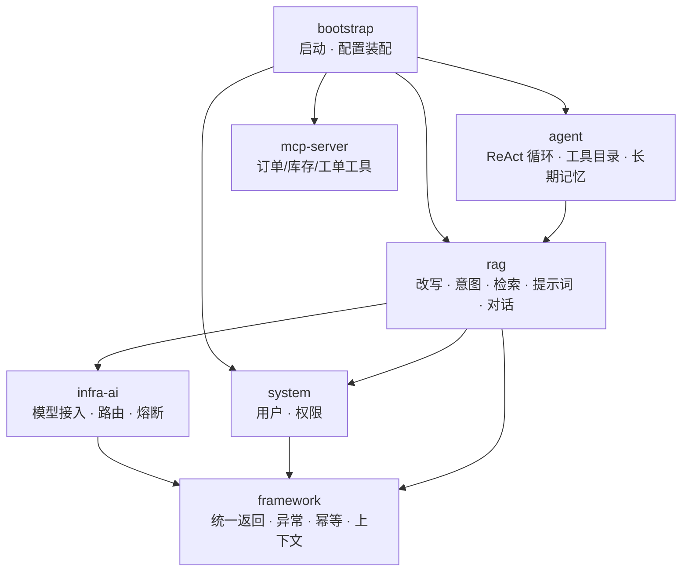

# ragent · 总览与架构

> 目标：读完这一篇，你能说清 ragent 是什么、由哪些模块组成、两条编排链路怎么切换。
> 下一篇进入 **Workflow 模式**的完整链路（目前只写了这一条，Agent 模式待补）。

## 一、它是什么

一个**双模式**的 RAG 智能体：同一套知识库能力，可以用固定管线跑（Workflow），也可以交给模型自主调度跑（Agent）。

```
用户提问
   ↓
┌──────────────────────────────────────────┐
│  ragent.engine.type 决定走哪条链路         │
│                                          │
│  workflow：代码编排                        │
│   改写 → 意图 → 检索 → Prompt → 流式生成   │
│                                          │
│  agent：模型编排（ReAct）                  │
│   LLM 决定调哪个工具、调几次、什么时候停     │
└──────────────────────────────────────────┘
   ↓
SSE 逐字返回 + 来源引用
```

**核心能力**：

- 知识库问答，回答带 `[N]` 行内角标与来源面板，可点开原文核对
- 意图树路由：把问题分到"知识库 / 闲聊 / MCP 工具"，并收窄检索范围
- 多通道检索 + RRF 融合 + Rerank
- 三层记忆：会话消息、会话摘要、跨会话的长期事实
- 流式输出 + 首包探测 + 模型熔断降级

## 二、七个模块



| 模块 | 职责 | 关键类 |
|---|---|---|
| `framework` | 与业务无关的基础设施：统一返回体、异常体系、幂等注解、用户上下文、SSE 工具、参数校验 | `IdempotentSubmit`、`UserContext`、`StreamTaskManager` |
| `infra-ai` | 模型接入层：把"调哪个模型"从业务里抽出来，含候选选择、首包探测、熔断 | `RoutingLLMService`、`ProbeStreamBridge` |
| `system` | 用户、租户、权限（Sa-Token） | — |
| `rag` | RAG 的**全部能力**：改写、意图树、检索、提示词、记忆、对话编排 | `StreamChatPipeline`、`IntentGuidanceService`、`MultiChannelRetrievalEngine` |
| `agent` | Agent 模式的实现：ReAct 循环、工具注册、MCP 客户端、长期记忆 | `AgentChatService`、`AgentToolCatalog`、`AgentMemoryFlusher` |
| `mcp-server` | 一个**独立进程的 MCP Server 示例**，把订单/库存/工单包装成工具 | `OrderMapper` + 工具定义 |
| `bootstrap` | 主类、`application.yaml`、跨模块装配 | `RagentApplication` |

**依赖是单向的**：`bootstrap → agent → rag → infra-ai → framework`。没有循环依赖，`rag` 不知道 `agent` 的存在。

## 三、两条编排链路

同样是"用知识库回答问题"，两种模式的差别不在"调不调 LLM"，而在**谁决定下一步**：

| | Workflow | Agent |
|---|---|---|
| 谁决定流程 | Java 代码写死 | 模型临场决定 |
| LLM 的角色 | 执行器（改写 / 生成） | 决策者（选工具 / 判停） |
| 一次问答的 LLM 调用次数 | 固定 3 次左右 | 不确定（5~9 次都正常） |
| 延迟 | 稳定 | 波动大 |
| 可预测性 | 高 | 低 |
| 能做的事 | 预设链路 | 任意组合工具（检索 + 查订单 + 写记忆） |
| 适合 | 单轮知识库问答 | 跨系统的多步任务 |

**关键：两条链路共享同一批能力组件**。

```java
// Workflow：StreamChatPipeline 按顺序调
loadMemory → rewriteQuery → resolveIntents → retrieve → streamLLMResponse

// Agent：KnowledgeSearchFacade.search() 也调同样的 Service
rewriteWithSplit → intentResolver.resolve → retrievalEngine.retrieve → promptService → llmService
```

所以改改写的规则、改意图树的判定、改 rerank 策略，两种模式同时生效。

**切换只需要一行配置**：

```yaml
ragent:
  engine:
    type: workflow   # 或 agent
```

## 四、四层抽象

```
┌─ 接入层 ────────────────────────────────────┐
│ RAGChatController / AgentChatController      │
│   · SseEmitter（5 分钟超时）                  │
│   · @IdempotentSubmit 防连点                  │
└──────────────────────────────────────────────┘
                    ↓
┌─ 编排层 ────────────────────────────────────┐
│ Workflow: StreamChatPipeline（固定 7 阶段）   │
│ Agent:    AgentChatService + ReAct 循环      │
│   · 决定"这一轮做什么"                        │
└──────────────────────────────────────────────┘
                    ↓
┌─ 能力层 ────────────────────────────────────┐
│ QueryRewriteService   改写 + 拆分             │
│ IntentResolver        意图分类                │
│ RetrievalEngine       多通道检索 + 融合 + 精排 │
│ ConversationMemory    消息 / 摘要 / 长期记忆   │
│ RAGPromptService      结构化 Prompt 组装      │
└──────────────────────────────────────────────┘
                    ↓
┌─ 模型层 ────────────────────────────────────┐
│ RoutingLLMService                             │
│   · 候选选择（按档位 fast/standard/deep）      │
│   · 首包探测（不出字就切下一个）                │
│   · 熔断（连续失败就跳过）                     │
└──────────────────────────────────────────────┘
```

这样分层的好处：**换模型不用动业务，换编排不用动能力**。`infra-ai` 对上层只暴露 `LLMService` 接口，上层不知道底下是 DeepSeek 还是 Ollama。

## 五、配置驱动的骨架

大部分行为由 `application.yaml` 决定，代码里没有硬编码：

```yaml
ragent:
  engine:
    type: workflow          # 编排模式

ai:
  chat:
    candidates: [...]       # 候选模型（含 provider / model / 能力标记）
    tiers:                  # 三档：短任务 / 主回答 / 深度思考
      fast:     { candidates: [...], timeout-ms: 60000 }
      standard: { candidates: [...], timeout-ms: 180000 }
      deep:     { candidates: [...], timeout-ms: 300000 }

rag:
  search:
    recall-budget: 20       # ① 每通道召回
    fusion:
      strategy: rrf
      rrf-k: 20
      rerank-candidate-limit: 40   # ② 融合后进精排的候选池
    default-top-k: 10       # ③ 最终进 LLM
    scope:
      min-intent-score: 0.4      # 低于此分不参与收窄判定
      confidence-threshold: 0.6  # 最高分不达标就退全库
      supplement-ratio: 0.25     # 兜底名额
  rate-limit:
    global:
      max-concurrent: 10    # 同时处理的问答数
      max-wait-seconds: 15  # 排队上限
```

三个数字构成**检索漏斗**：`20 → 40 → 10`，每段独立配置、逐段收窄。

## 六、和「教科书 RAG」的差别

最常见的 RAG 教程是：`问题 → 向量检索 topK → 拼进 Prompt → 生成`。ragent 在每一步都加了东西：

| 环节 | 教科书做法 | ragent |
|---|---|---|
| 提问 -> 检索 | 直接用原问题 | **改写 + 拆分**（消解指代、拆复合问题） |
| 检索范围 | 全库 | **意图树收窄**到目标库，另留 25% 兜底 |
| 检索方式 | 单路向量 | **多通道 + RRF 融合 + Rerank** |
| 闲聊 | 也会去检索 | 意图树识别后**直接回答，不检索** |
| 回答引用 | 拼接原文 | **编号闭环**：Prompt 里的 `[1]`、SSE 来源面板、落库消息共用一份列表 |
| 多轮对话 | 全量塞历史 | **三层记忆**：近期消息 + 会话摘要 + 跨会话长期事实 |
| 模型调用 | 单模型直连 | **候选池 + 首包探测 + 熔断**，自动降级 |
| 并发控制 | 线程池 | **Redis 公平队列 + 本地线程池** 双层 |

这些"多出来的东西"，大部分不是为了更准，而是为了**在真实网络环境里稳住**：模型会超时、会卡住不出字、会被限流、会被用户连点。

## 七、阅读顺序

| 篇目 | 内容 |
|---|---|
| [01 · Workflow 链路](./01-workflow) | 一次问答从 HTTP 到 SSE 的完整过程，以及六个关键设计决策 |

> Agent 模式（ReAct 循环、工具目录、长期记忆）尚未整理，后续补齐。
