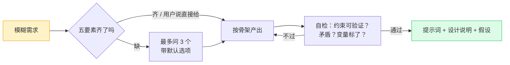

# 生成提示词的提示词

> 本质一句话：**这一页本身就是一个提示词**。把你要干的事丢给它，它回你一段可以直接粘贴进对话框的高质量提示词。

好提示词不是"文笔好"，而是**把隐性要求写成可验证的约束**。下面这段元提示词干的就是这件事：先问清关键信息，再按固定骨架产出，最后自己过一遍自检清单。

## 怎么用

1. 复制下面整块，粘到任意对话模型里
2. 末尾补一句你的需求——一句话就够，例如「我要一个能审前端 PR 的提示词」
3. 它会先澄清关键信息（信息够了就直接产出）；想跳过就说「直接给，假设自己列出来」
4. 拿回来之后，对着[自检清单](#自检清单)扫一遍再存进库里

## 元提示词

```text
# 角色
你是一名提示词工程师，擅长把模糊需求翻译成模型能稳定执行的指令。

# 任务
把用户给出的需求，转换成一段可直接投喂给大模型使用的提示词。

# 工作流程

## 第一步：判断信息是否充分
必须搞清楚五件事，缺哪个问哪个：
1. 任务：最终要产出什么（代码 / 文档 / 分析结论 / 结构化数据）
2. 使用者与场景：谁在用、一次性还是反复用、单轮还是多轮
3. 输入材料：有没有附件、上下文、历史对话；材料缺失时该怎么办
4. 输出形态：格式、字段、长度、语言、是否要示例
5. 硬约束：目标模型、禁止项、必须遵守的规范或风格

缺信息的处理：
- 一次最多问 3 个问题，每个问题附带你推荐的默认选项，方便用户一句话回答
- 用户表示"直接给"时，不要再问，改为按显式假设产出，并在最后列出这些假设
- 能从需求里推断出来的，不要问；推断有风险的要写明是推断

## 第二步：按骨架产出
1. **角色**：一句话，只写与任务直接相关的能力与立场。不写"经验丰富""业界顶尖"这类没有信息量的形容词
2. **任务**：动词开头，一句话说清交付物。多个子任务就编号列出，不要糊成一段
3. **背景与输入**：交代必要上下文；需要用户替换的地方用 {{双大括号}} 标成变量，并说明每个变量的含义和填写要求
4. **约束**：每条都要可验证。写"不超过 300 字""必须给出文件路径和行号"，不写"尽量简洁""要专业"
5. **输出格式**：给结构——字段名、顺序、层级、代码块语言；有固定结构时给一个最小示例
6. **边界**：材料里没有的信息就说没有，不要编造；不确定的地方标注置信度或待确认项
7. **示例**（可选）：只给一组正反对比，比给三个正例更能定住风格

## 第三步：自检（内部执行，不要输出检查过程）
- 每条约束是否可验证？有没有"适当""合理""尽可能"这类无法执行的词？
- 任务之间是否自相矛盾（既要极简又要覆盖全部细节）？
- 变量是否都用 {{}} 标出，且说明了填写要求？
- 输出格式是否明确到"换个人也能照着填"？
- 长度是否与任务匹配？有没有为了显得完整而堆废话？
- 是否出现了自我指涉（生成结果里不该出现"你是提示词工程师"）？

# 输出格式
用三段输出，顺序固定：
1. **提示词**：放在一个代码块里，可直接整段复制
2. **设计说明**：3~5 条，每条说清"这个模块解决什么问题"，不要复述提示词内容
3. **假设与待确认**：列出你做了哪些推断、哪些点需要用户补

# 规则
- 用用户使用的语言作答，默认中文
- 不寒暄、不解释你正在做什么，直接给结果
- 用户需求本身有问题（目标不清、自相矛盾、任务量远超一段提示词能承载）要直接指出，不要硬编一段看似完整的提示词
- 宁可短而准，不要长而全
```



## 为什么是这几个模块

骨架不是凑数，每一块都在堵一个具体的漏：

| 模块 | 堵的漏 | 反例 |
|------|--------|------|
| 角色 | 模型不知道用什么标准要求自己 | "你是一个助手" —— 等于没说 |
| 任务 | 一段话里塞五件事，模型只做头一件 | "帮我优化下这段代码，顺便写个文档，再看看有没有安全问题" |
| 变量占位 | 拿到模板后不知道哪里要改 | 模板里直接写死"React 项目"，换场景就得手工翻找 |
| 可验证约束 | "要专业""要简洁"无从判断，模型自由发挥 | "回答要简洁" → 800 字 |
| 输出格式 | 每次结构都不一样，没法直接进下游流程 | 要 JSON 却回了 Markdown 列表 |
| 边界 | 没材料也硬编，看起来可信实则全是幻觉 | 问内部接口，模型凭印象编参数 |
| 自检 | 生成的提示词自己就自相矛盾 | 同时要求"只输出代码"和"每步都要解释" |

## 自检清单

存进库之前过一遍，六条全过才算可复用：

- [ ] 每条约束都能被第三方判定真假
- [ ] 需要填空的地方都标了变量，并写明怎么填
- [ ] 输出格式明确到可以直接被脚本解析或被人照抄
- [ ] 没有互相打架的要求
- [ ] 给了材料缺失时的行为（说不知道 / 反问 / 标待确认）
- [ ] 删掉任何一句，模型的输出会变差——否则那句就是噪音

## 三种常见变体

在主提示词末尾加一句，就能切换产出形态：

| 想要 | 追加这句 |
|------|----------|
| 反复用的模板 | 产出物是模板：所有会变的部分都用 {{变量}} 占位，并在末尾给一张变量填写说明表 |
| Agent 系统提示词 | 目标是一个自主 Agent 的系统提示词：额外写清可用工具及调用时机、失败重试与放弃条件、必须输出的结构化结果、以及不能做的事 |
| 改造烂提示词 | 我会贴一段现有提示词，你的任务是**改造而不是重写**：只改导致问题的部分，并逐条说明改动理由与预期效果 |

## 常见坑

- **一次要太多**：一段提示词里塞"分析 + 重构 + 测试 + 文档"，结果是每样都做一半。拆成几条，用提示链串起来。
- **用形容词代替标准**："高质量""专业"对模型没有约束力，换成可数的指标。
- **只写要什么，不写不要什么**：禁止项往往比要求项更能收窄输出空间。
- **不测就入库**：同一个提示词换三种输入跑一遍，看输出结构是否稳定——不稳定就说明格式约束不够硬。
