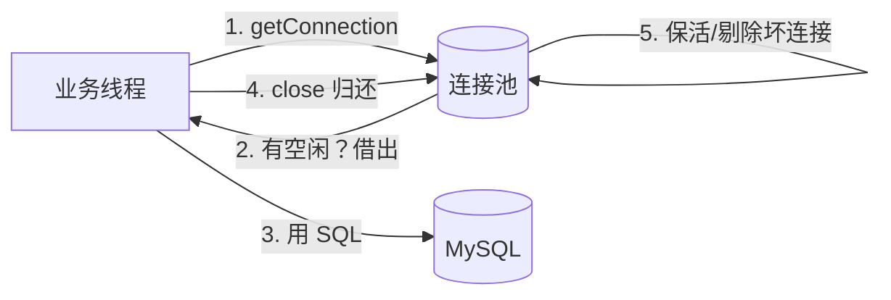

# 数据库连接池与数据源

> **优先级：P0（面试必问 + 线上事故高发区）** — "你们项目连接池怎么配的"是 Java 后端面试固定题；连接池耗尽是生产故障 TOP 榜常客。

::: tip 背景
前端每个请求都 `fetch` 一下，成本约等于零。Java 里每次查库都要"拿一个数据库连接"——**创建连接的代价是三次握手 + MySQL 认证（毫秒级）**，高并发下直接崩。连接池就是把连接借出来用、用完还回来的"连接回收站"。
:::

## 一、没有连接池的世界

```java
// 每个请求都这么干 = 灾难
Connection conn = DriverManager.getConnection(url, user, password);  // ① TCP 握手 + MySQL 认证 ~5-20ms
Statement stmt = conn.createStatement();
ResultSet rs = stmt.executeQuery("SELECT ...");                       // ② 真正干活 ~1ms
conn.close();                                                          // ③ 断开
```

一次查询总耗时 6~21ms，其中 **90% 花在建立连接上**。秒杀 1000 QPS → 每秒要建 1000 个连接，MySQL 的 `max_connections`（默认 151）瞬间打满，报 `Too many connections`。

**前端类比**：连接池 ≈ 浏览器对同一域名的 TCP 连接复用（keep-alive），省掉反复握手的开销——数据库侧这个"复用池"就是连接池。

## 二、连接池工作原理



| 环节 | 做什么 |
|---|---|
| **借**（getConnection） | 有空闲连接直接给；没有且没到上限 → 创建新的；到了上限 → 等 `connection-timeout`，超时报错 |
| **还**（close） | 不是真关！是把连接标记为空闲放回池子（`Connection.close()` 在池里被包装过） |
| **保活** | 空闲连接定期发测试语句（或 JDBC4 `isValid()`），防被 MySQL 的 `wait_timeout` 单方面掐断 |
| **剔除** | 坏连接（被 DB 关闭/网络断了）直接丢弃重建，不借给业务 |

**核心指标**：`HikariPool` 日志里的 `Total/Active/Idle/Waiting`——Active 长时间打满 + Waiting 堆积 = 池子不够用，在告警。

## 三、HikariCP：默认之选

Spring Boot 2.x 起默认连接池从 Tomcat JDBC Pool 换成了 **HikariCP**（日文"光"的意思），因为它是当时 benchmark 最快的（比 BoneCP/Druid 都快，作者因此写了它）。生产用 HikariCP 或 Druid 都行，**别用 C3P0/DBCP（老、慢、坑多）**。

### 核心参数（application.yml）

```yaml
spring:
  datasource:
    url: jdbc:mysql://localhost:3306/mall?useUnicode=true&characterEncoding=utf8&serverTimezone=GMT%2B8
    username: root
    password: xxx
    hikari:
      # ① 池大小：公式 (CPU核数 × 2) + 有效磁盘数，IO 密集可适当加大
      maximum-pool-size: 10
      # ② 最小空闲：低于此数会补建连接（应对突发流量前的预热）
      minimum-idle: 10
      # ③ 获取连接超时：等不到连接的排队时间，默认 30s 太长（故障时全挂住），建议 3-5s 快速失败
      connection-timeout: 5000
      # ④ 连接最长寿命：必须小于 MySQL 的 wait_timeout（默认 8h），防 DB 单方面断开后池子还用
      max-lifetime: 1800000        # 30 分钟
      # ⑤ 空闲保活：10 分钟不用就 ping 一下
      keepalive-time: 600000
      # ⑥ 连接泄漏检测：借出超过 60s 没还，打 WARN 日志（含借出点的堆栈）
      leak-detection-threshold: 60000
      pool-name: MallHikariPool
```

### 参数逐个说（面试就这么答）

**`maximum-pool-size` 怎么定？**
经典公式（PostgreSQL 官方给的，MySQL 同样适用）：

```
连接数 = ((核心数 × 2) + 有效磁盘数)
```

一台 4 核机器 → 约 10。**不是越大越好**：超过这个数，MySQL 的上下文切换开销反而让总吞吐下降（连接在 DB 侧也要占线程）。IO 密集型业务（大量时间等 DB 返回）可以在压测后适当加大，但**调大前先看 DB 的 CPU**——瓶颈常在数据库，不在池子。

**`max-lifetime` 为什么必须小于 `wait_timeout`？**
MySQL 默认 8 小时没请求就单方面断开连接。如果池子不知道，业务借到一条"其实已断"的连接 → 报 `Communications link failure`。设 30 分钟，池子主动到期重建，永远比 MySQL 先行动。

**`minimum-idle` 该配多少？**
固定池大小场景（推荐）：`minimum-idle = maximum-pool-size`，连接常驻，无创建开销。流量波动大可让 `minimum-idle` 小一些省资源。

**`connection-timeout` 为什么建议缩短？**
默认 30s 意味着故障时（DB 卡住），每个业务线程傻等 30s，Tomcat 200 个线程全部耗尽 → 整个服务雪崩。设 3-5s 快速失败，让上游限流/降级接管（见 [高可用设计](/service/java/java-high-concurrency)）。

## 四、连接泄漏：最常见的生产事故

### 现象

```
HikariPool-1 - Connection is not available, request timed out after 5000ms.
```

日志刷屏 → 接口全挂 → DB 连接数正常（池子内部没泄漏到 DB，是借出不还）。

### 根因

```java
// 反面教材：try 里抛异常，finally 没了 → 连接永不归还
Connection conn = dataSource.getConnection();
Statement stmt = conn.createStatement();
stmt.executeQuery("SELECT ...");   // 这行抛异常 → conn 泄漏一个
conn.close();
```

```java
// 正确姿势：try-with-resources，自动 close（归还）
try (Connection conn = dataSource.getConnection();
     PreparedStatement ps = conn.prepareStatement("SELECT ...")) {
    ps.setLong(1, orderId);
    ResultSet rs = ps.executeQuery();
    // 处理结果
}   // 自动 conn.close() → 归还池子，异常也不漏
```

### 排查

1. `leak-detection-threshold` 已经打出 WARN：**`Connection leak detection: connection was not closed within 60 seconds`**，堆栈直接指到哪行代码没关
2. 没配泄漏检测 → `jstack <pid>` 看业务线程卡在哪（常见：连接借出后进了死循环/慢查询）
3. 事后复盘看监控：`HikariPool` 的 Active 曲线是否只涨不跌（不回落就是泄漏的指纹）

## 五、Druid：国产替代

阿里开源的数据库连接池，功能比 HikariCP 多，代价是稍微重：

| | HikariCP | Druid |
|---|---|---|
| 性能 | 最快 | 略慢（可忽略） |
| 监控 | 日志 + 自己接 Micrometer | **内置 StatFilter 监控页**（SQL 耗时/慢 SQL 统计） |
| SQL 防火墙 | 无 | 有（防删库跑路） |
| 加密配置 | 无 | 数据库密码可加密存储 |
| Spring Boot 默认 | ✅ | 手动引入 `druid-spring-boot-starter` |

**选型**：追求性能用 HikariCP（默认）；要 SQL 监控页面和防火墙用 Druid。国内老项目（ especially 阿里系）Druid 很常见，面试两个都要了解。

## 六、容易混淆的概念

| 概念 | 是什么 |
|---|---|
| **连接池**（本文） | 数据库 TCP 连接的复用池 |
| 线程池 | 干活线程的池，和连接池是"消费者-生产者"关系（见 [Java 并发编程](/service/java/java-concurrency)） |
| MyBatis 连接管理 | MyBatis 每次执行从连接池借连接，事务内用同一条，结束归还 |
| `@Transactional` 和连接 | 事务开启时借一条连接绑到当前线程，事务结束归还——**事务里嵌慢查询 = 长时间占着连接不还** |

**黄金搭配**：Tomcat 200 线程 ↔ 连接池 10~20。线程远大于连接数是正常的——大部分线程在等连接（IO 等待），这正是连接池存在的意义。

## 面试题速查

| 问题 | 一句话答案 |
|------|-----------|
| 为什么需要连接池 | 建连接 = TCP 握手 + 认证（毫秒级），占单次查询 90% 耗时；复用摊薄成本 |
| 连接池的 close 是真关吗 | 不是，是归还池子标记为空闲（包装过的 Connection） |
| maximum-pool-size 怎么定 | `(核数×2)+磁盘数` 起步，压测后按 DB 负载微调；不是越大越好 |
| max-lifetime 为什么要小于 wait_timeout | 防 MySQL 单方面断开后池子还拿着死连接，到期前主动重建 |
| 连接超时 30s 的问题 | 故障时业务线程全傻等，线程池耗尽雪崩；建议 3-5s 快速失败 |
| 连接泄漏怎么排查 | leak-detection 打堆栈；jstack 看卡住的线程；监控 Active 只涨不跌 |
| HikariCP 和 Druid 区别 | Hikari 快而简；Druid 功能多（监控页/SQL 防火墙/密码加密） |
| 连接池和线程池关系 | 200 个业务线程抢 10 条连接，大部分在等——IO 密集的正常形态 |

## 延伸阅读

- [MySQL 进阶](/service/common/mysql-advanced) - 连接的另一端：锁、MVCC、慢查询
- [Java（Spring Boot）高并发与高可用设计](/service/java/java-high-concurrency) - 快速失败后的限流降级兜底
- [Spring Boot 入门](/service/java/spring-boot) - 数据源自动配置原理
- [HTTP 与网络基础](/service/common/http-network-basics) - 连接复用的协议层原理（keep-alive 同款思想）
- [数据访问与事务实操](/java-practice/03-data-access-transaction) - mall 里的 MyBatis 事务与连接
