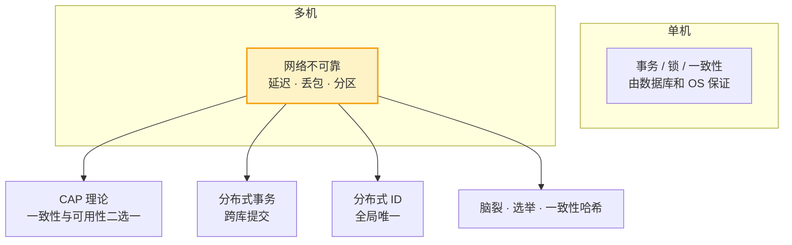
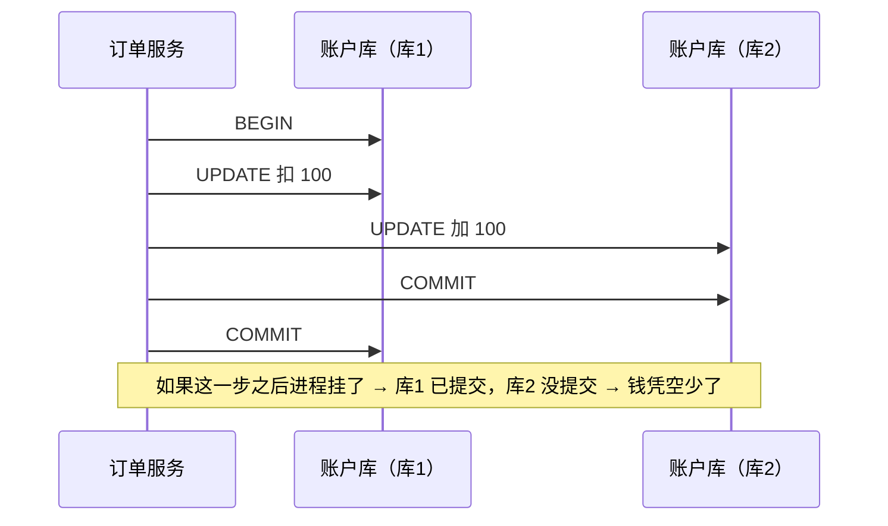

# 分布式基础（CAP / 分布式事务 / 分布式 ID）

> 本质一句话：**分布式的一切难题都源于一件事——网络不可靠**。你以为的"分布式问题"（数据不一致、事务失效、ID 重复），本质上都是"两台机器之间的一次对话可能失败"。

**优先级 P1（中高级岗必问）**：单机 → 分布式时才会遇到的问题。面试常考概念题：CAP、分布式事务方案、分布式 ID 方案。

::: tip 这篇的定位
你已有微前端、BFF、权限设计的应用层经验（**这些都是分布式系统的应用层**），这篇补**理论层**：分布式为什么难、一致性怎么权衡、事务跨库怎么做。

纯理论，不需要跑代码。涉及实操的部分（本地消息表怎么写、雪花算法怎么用）会给出可直接落地的结构。
:::

## 0. 全景：三分钟看懂这篇

> 难度：了解

**它在哪**：不是某个组件，是**所有分布式组件的理论底座**。



**读法**：单机时代那些"白送"的能力（事务、锁、有序），到了多机全部要**自己重新实现一遍**——因为它们原本是靠"同一台机器的同一块内存/磁盘"实现的。

**分五块**：

| 块 | 内容 | 读到什么程度 |
|---|---|---|
| 1 用途 | 什么情况下你会遇到这些问题 | 能识别"这是分布式问题" |
| 2 最小可用 | 一个"两阶段提交"的最小模型（不用写代码） | 能画出来 |
| 3 用法 | CAP / BASE / 分布式事务 / 分布式 ID | 能答面试 |
| 4 原理 | 为什么 CAP 是"二选一"、脑裂怎么解决 | 能解释设计取舍 |
| 5 边界与坑 | 概念被滥用的地方 | 不会被话术带偏 |

**学完你能**：① 说清 CAP 到底在什么前提下二选一（**这是最容易被问穿的点**）；② 把本地消息表讲透（原理 + 结构）；③ 画出雪花算法的 64 位；④ 解释"为什么 MySQL 主从是 AP"。

**本篇讲什么、不讲什么**：

| 知识点 | 档位 | 处理 |
|---|---|---|
| CAP 定理与前提 | 核心 | 正文 3.1、4.1 |
| BASE | 核心 | 正文 3.2 |
| 分布式事务四方案 | 核心 | 正文 3.3 |
| 本地消息表（讲透） | 核心 | 正文 3.3、5.2 |
| 分布式 ID | 核心 | 正文 3.4 |
| 脑裂与选举 | 进阶 | 正文 4.2 |
| 一致性哈希 | 进阶 | 正文 4.3 |
| 限流算法 | 进阶 | 见 [高并发高可用设计](/service/java/java-high-concurrency) |
| Raft / Paxos 协议细节 | — | 不写（理解"多数派"这个思想即可） |
| 分布式存储、NewSQL | — | 不写 |

---

## 1. 用途：什么时候会撞上这些问题

> 难度：了解

### 1.1 单机时代是"白送"的

| 能力 | 单机怎么来的 | 多机为什么没了 |
|---|---|---|
| **事务** | 同一个数据库，同一个连接 | 跨库 → 没有全局事务管理器 |
| **锁** | `synchronized` 在同一个 JVM 生效 | 多进程 → 各锁各的 |
| **一致性** | 同一个内存/磁盘，天然可见 | 多副本 → 同步有延迟 |
| **唯一 ID** | 数据库自增 | 多库各自自增 → 撞号 |
| **时钟** | 同一个系统时钟 | 多机器时钟有偏差 |

**注意最后两行**：分布式 ID 和时钟问题，跟"网络"关系不大——它们来自"**机器多了、时间不统一**"。这也是分布式问题的两大来源。

### 1.2 你已经在用的分布式系统

| 你做过的事 | 涉及的分布式问题 |
|---|---|
| 微前端 / BFF | 多服务调用 → 超时、重试、幂等 |
| 权限设计 | 认证中心与业务服务分离 → 令牌、时钟 |
| 多环境部署 | 配置一致 → 配置中心 |
| 前后端分离 + CDN | 静态资源分发 → 一致性缓存 |

**所以你缺的不是"新知识"，是这些经验背后的理论名字**。CAP 不是什么高深理论，它就是"**网络会断，所以你要选：断的时候宁可报错，还是宁可数据旧**"。

### 1.3 什么时候该动用这些理论

| 症状 | 对应理论 |
|---|---|
| 服务间调不通 / 偶尔超时 | 重试 + 幂等 + 熔断 |
| 主从切换后读到旧数据 | CAP 的 A（最终一致） |
| 两个服务各写一半，状态对不上 | 分布式事务方案 |
| 多库插入撞 ID | 分布式 ID |
| 集群分区后有两个"主" | 脑裂 + 选举 |

---

## 2. 最小可用：一个能画出来的模型

> 难度：了解

不需要写代码，但**必须能徒手画出来**。这是后面所有概念的地基。

### 2.1 场景：两个库，一次转账

```text
场景：用户 A 从「账户库」(库1) 扣 100 元，给用户 B 的「账户库」(库2) 加 100 元
要求：要么都成功，要么都失败
```

单机上这叫一个事务（`@Transactional` 就完事）。现在两个库在两台机器上：



**问题**：两个库**各自**能保证"我的这个事务要么成要么败"，但**没有谁能同时管住两个库**。

**根因**：单机事务靠的是"**一个事务管理器 + 一个连接**"，跨库就没有这个中心了。

### 2.2 三种应对思路

```text
思路一：想办法有一个中心管住所有库   → 2PC（协调者）
思路二：承认不能同时成功，改成"最终会一致" → 本地消息表 / Saga（补偿）
思路三：把强一致的那部分留在一个库里   → 分库策略：按用户维度分库，同一用户的数据在同一库
```

**第三条值得单独记住**——它是最省事的：

```text
按用户 ID 哈希分库：
  用户 A 的所有数据 → 库1
  用户 B 的所有数据 → 库2

转账：A → B 是跨库的 ✘
但 A → C（同在库1）就是本地事务 ✓
```

**业务上能接受"同用户转账不走这个系统"，就绕开了分布式事务。** 很多真实系统就是这么设计的。

> **自检**：为什么"两阶段提交"里，协调者挂掉会导致所有参与方卡住？

::: details 参考答案
因为 2PC 分两个阶段：

```text
阶段一（Prepare）：协调者问所有参与者"能不能提交？"
  → 参与者把数据写好但【不提交】，回复"可以"
阶段二（Commit）：协调者收到全部"可以"后，通知所有人"提交"
```

**卡住点在阶段一和阶段二之间**：参与者都进入了"已写入、未提交"的状态，在**等协调者的一声令下**。

如果协调者在此时挂了（宕机、网络分区），参与者就面临一个无法自己决定的问题：

- **提交** → 万一协调者已经决定回滚了呢？（数据错了）
- **回滚** → 万一协调者已经决定提交了呢？（数据也错了）

因为**参与者不知道协调者的决定**，只能一直等（这就是"阻塞"）。协调者恢复后才能继续。

**改进**：给协调者加一个**超时 + 参与者自己查询决策记录**的机制（参与者定期问"你到底决定了吗"），这样协调者挂了也不会永久卡住——但实现复杂度上来了。

所以 2PC 的问题不是"不正确"，而是**性能差（两次往返 + 阻塞）+ 协调者是单点**。这也是为什么互联网场景更常用"最终一致 + 补偿"。
:::

---

## 3. 用法：四个必会概念

> 难度：会用

### 3.1 CAP 定理

| 字母 | 含义 |
|---|---|
| **C**（Consistency） | 一致性：所有节点同时看到同一份数据 |
| **A**（Availability） | 可用性：任何请求都有响应（不报错、不超时） |
| **P**（Partition tolerance） | 分区容错：网络分区（节点失联）时系统仍能工作 |

**定理**：网络分区**必然发生**（P 是必选项，不是可选项），所以只能在 **C 和 A 之间二选一**：

| 类型 | 分区时的选择 | 例子 |
|---|---|---|
| **CP** | 拒绝服务，保证一致 | ZooKeeper、etcd、HBase |
| **AP** | 继续服务，允许短暂不一致 | Eureka、Cassandra、绝大多数业务系统 |

**⚠️ 最容易被问穿的一点**：CAP 的"二选一"**只在"分区发生"的前提下成立**。没有分区时，C 和 A 可以同时满足——MySQL 单库既一致又可用。

**业务系统的实际答案**：平时一致（不分区），分区时选 A（可用性），然后用**最终一致性**（消息队列、异步补偿）把 C 补回来。

**常见追问：MySQL 主从是 CP 还是 AP？**

**答：AP + 最终一致。** 主从复制是**异步**的 → 主库刚写完还没同步到从库，从库可能读到旧值 → 这就是"牺牲 C 换 A"。但复制最终会追上 → 最终一致。

（对比：MySQL Group Replication / 半同步复制可以做出"强一致的主从"，但那牺牲了可用性——主库挂了就要等副本选主。）

### 3.2 BASE 理论

CAP 是"必须放弃一个"，BASE 是"**我怎么绕过这个取舍**"：

| 字母 | 含义 | 例子 |
|---|---|---|
| **B**asically Available | 基本可用：允许降级、限流（不是完全不可用） | 大促时关闭推荐位 |
| **S**oft state | 软状态：允许中间状态 | 订单状态"支付中" |
| **E**ventually consistent | 最终一致：异步同步最终会一致 | 同步到 ES 的商品副本 |

**BASE 是 CAP 的落地方案**：用"基本可用 + 允许中间状态"换取"分区时仍能工作"，代价是"一致性靠异步补偿补"。

### 3.3 分布式事务（四种方案）

| 方案 | 思路 | 优缺点 |
|---|---|---|
| **2PC（两阶段提交）** | 协调者先问所有参与者"能提交吗"，全同意才提交 | 强一致但**阻塞**（协调者挂了全卡住）、性能差（两次往返） |
| **TCC** | Try（预留资源）→ Confirm（确认）→ Cancel（回滚），业务自己实现三个方法 | 性能好，但**业务侵入大**（每个方法写三份逻辑） |
| **本地消息表** | 事务内写业务 + 消息表（同库提交）；后台任务扫消息表发 MQ；消费者幂等 | 简单可靠，**业界常用**（RocketMQ 事务消息就是这个思想的封装） |
| **Saga** | 长事务拆成多个本地事务 + 补偿（逆操作） | 无锁高性能，但**无隔离性**（中间状态对外可见） |

**本地消息表流程**（**这是面试要讲透的那个**）：

```text
① 业务事务（订单库，同一个本地事务）：
     写订单表 + 写消息表（status = 待发送）   → 要么都成功要么都失败

② 后台任务：扫描消息表里 status = 待发送 的记录 → 发到 MQ → 改 status = 已发送

③ 消费者：消费消息 + 幂等处理（防重复消费）
```

**它为什么能解决一致性问题**：第 ① 步把"业务数据"和"要发的消息"放在**同一个本地事务**里提交了——**要么都在，要么都不在**。不会出现"订单建了但消息没发"。

**它的问题**（也要讲得出来）：

| 问题 | 说明 |
|---|---|
| **消息表无限增长** | 要清理已发送的记录 |
| **有延迟** | 后台任务扫表有间隔（通常秒级） |
| **需要幂等** | 第 ③ 步可能重复消费（MQ 是至少一次语义） |
| **扫表要加锁** | 多实例同时扫会重复发送（用状态机 + 乐观锁更新解决） |

**面试策略**：**把本地消息表讲透**（原理 + 表结构 + 三个问题），再提一句"TCC 是最终一致场景下的强一致变体"。**别每个方案都讲一半**。

**表结构长这样**：

```sql
CREATE TABLE message_log (
  id          BIGINT PRIMARY KEY,
  biz_id      VARCHAR(64)  NOT NULL,      -- 业务 ID（订单号）
  topic       VARCHAR(128) NOT NULL,
  payload     TEXT        NOT NULL,      -- 消息体（JSON）
  status      TINYINT     NOT NULL DEFAULT 0,   -- 0 待发送 / 1 已发送
  retry_count INT         NOT NULL DEFAULT 0,
  create_time DATETIME    NOT NULL,
  update_time DATETIME    NOT NULL
);
```

### 3.4 分布式 ID

| 方案 | 原理 | 特点 |
|---|---|---|
| **UUID** | 全局唯一字符串 | 无序、太长、**影响索引性能**（B+ 树需要有序插入） |
| **数据库自增** | 单点自增 | 简单但单点、性能低 |
| **雪花算法（Snowflake）** | 64 位：时间戳 + 机器 ID + 序列号 | **业界主流**：趋势递增、无外部依赖、高性能 |
| **Redis INCR** | 原子自增 | 依赖 Redis 可用性 |
| **美团 Leaf / 号段模式** | DB 分配号段，内存发号 | 无依赖，DB 压力小 |

**雪花算法 64 位结构**（面试要能画出来）：

```text
0 | 41 位时间戳（毫秒） | 10 位机器 ID | 12 位序列号
符号位   约 69 年（可自定纪元）   1024 台机器   每毫秒 4096 个
```

**三个必须知道的点**：

| 点 | 说明 |
|---|---|
| **趋势递增** | 因为高位是时间戳 → **生成顺序 ≈ 时间顺序** → 对 B+ 树友好（不像 UUID 那样随机插入导致页分裂） |
| **依赖机器时钟** | **时钟回拨会生成重复 ID** → 回拨时等待追平，或用备用机器号 |
| **位数是配置死的** | 机器 ID 位数决定集群规模，序列号位数决定单机器并发量 |

> **自检**：为什么 UUID 不适合做数据库主键？

::: details 参考答案
因为 **B+ 树索引需要"有序插入"**。

UUID（如 `a0eebc99-9c0b-4ef8-bb6d-6bb9bd380a11`）是**随机**的：
- 随机插入会**频繁触发页分裂**（新值插到中间 → 拆页）→ 索引页碎片化、写入变慢
- 随机主键会让**写入无法顺序落盘** → 随机 IO → SSD 性能浪费
- UUID 太长（36 字符 / 16 字节），索引体积大

雪花算法是**趋势递增**的（高位时间戳），插入基本在尾部追加 → 页利用率高、顺序 IO → 性能接近自增。

**所以"自增 ID 性能最好"但"分布式会撞号"，雪花算法正好取了两者的优点**：全局唯一 + 趋势递增。
:::

---

## 4. 原理：为什么是这样

> 难度：懂原理

### 4.1 CAP 的"二选一"到底在什么前提下

很多人把 CAP 讲成"三选二"，这是**错**的。准确版本：

```text
前提：网络分区发生（这是必然的，只是时间问题）

此时：
  要 C（一致） → 拒绝无法确认的请求 → 分区期间不可用 → 放弃 A
  要 A（可用） → 继续返回可能旧的数据 → 分区期间不一致 → 放弃 C
```

**所以准确的说法是**：

- **分区没发生时**，C 和 A 可以同时做到（MySQL 单库既一致又可用）
- **分区发生时**，只能在 C 和 A 里选一个

**为什么"分区必选"**：因为 P 不是"要不要"的问题，而是"**网络一定会出问题**"这个客观现实。任何声称"3 个都选"的系统，实际都是因为它**假设分区不会发生**（比如单机部署）。

### 4.2 脑裂与选举

**脑裂（split-brain）**：集群网络分区，导致**同时出现两个"主"**，两边都接受写入 → 数据分叉。

```text
        ┌──── 网络分区 ────┐
   节点1（自认为主）      节点2（也自认为主）
        │                    │
    接受写入              接受写入
        └──── 恢复后数据分叉 ────┘
```

**解法：多数派（quorum）**。

| 概念 | 说明 |
|---|---|
| **多数派同意才提交** | 5 个节点里至少 3 个同意 → 少数派（2 个）无法单独提交 → 不会同时出现两个主 |
| **Raft / Paxos** | 这类共识算法的核心思想：**用多数派达成一致** |
| **ZooKeeper / etcd** | CP 系统的代表，用多数派保证一致性 |

**为什么必须是"过半"而不是"任意"**：3 个节点分成 2+1 时，2 那边算多数派。如果允许"任意两个同意"，2+1 分裂时两边都能提交 → 又脑裂了。**过半保证了任意两个多数派必然有交集**，不可能同时存在两个。

### 4.3 一致性哈希

**问题**：普通哈希取模分片，节点增减会导致**大量 key 重新映射**。

```text
hash(key) % 3 → 节点 0/1/2

节点从 3 个扩到 4 个：几乎所有 key 的取模结果都变了 → 全部迁移 ❌
```

**一致性哈希**：把节点和数据都放在一个**环**上。

```text
key 顺时针找到环上的第一个节点 → 归属它

节点增减时：
  只有环上相邻区间的 key 需要迁移 → 影响面小 ✓
```

**虚拟节点**：真实节点少时，环上只放几个点 → 数据分布不均。**给每个物理节点放几十个虚拟节点**在环上 → 分布均匀。

**用在哪**：Redis Cluster 的槽位分配（其实用的是变种）、分片缓存的路由。

### 4.4 为什么"最终一致"是互联网的默认选择

因为**强一致的代价太高**：

| | 强一致（CP） | 最终一致（AP） |
|---|---|---|
| 分区时的行为 | 拒绝服务 | 继续服务（数据可能旧） |
| 延迟 | 高（要等多数派确认） | 低（本地写完就返回） |
| 可用性 | 分区期间受损 | 分区期间正常 |
| 适合 | 配置、选主、锁 | 业务数据、社交feed、订单最终态 |

**业务现实**：绝大多数业务场景下，"**下单后库存显示慢 1 秒**"是可以接受的，"**下单时服务不可用**"是不可接受的。

所以互联网系统普遍选 AP + 最终一致，用**补偿机制**（对账、重试、消息重发）把 C 补回来。

---

## 5. 边界与坑

> 难度：会用 + 懂原理

### 5.1 一张表先过一遍

| 症状 / 说法 | 见 |
|---|---|
| "我们系统是 CAP 里的 CA" | 5.2 |
| 用了本地消息表，但消息还是丢了 | 5.3 |
| 雪花 ID 偶尔重复 | 5.4 |
| 主从切换后读到旧数据，代码没bug | 5.5 |
| 集群脑裂、数据分叉 | 5.6 |

### 5.2 "CAP 里三选二"是错的说法

**这是最常见的概念误用**。如果你在面试里说"我们的系统是 CA"，面试官会立刻追问：**"分区发生的时候你怎么办？"**——然后你就答不上来了。

**正确说法**：

```text
❌ "CAP 三选二，我们选 CA"
✅ "分区必然发生，所以真正的选择是分区时保一致还是保可用。
   我们选可用（AP），用最终一致性补偿——
   具体是：写 MySQL 后发 MQ，消费者异步更新 ES"
```

**另一个常见误解**：把 CAP 的 C 当成"强一致"。CAP 的 C 是**线性一致性**（所有节点看到同一份数据，且顺序一致），比"数据库 ACID 里的 C"严格得多。**MySQL 单库的 ACID 事务并不满足 CAP 的 C**（因为它没有多副本）。

### 5.3 本地消息表的三个坑

**坑一：消息表无限膨胀**

已发送的记录如果不清理，几个月后表会有几亿行。

**解法**：定时清理（保留 7~30 天）+ **按时间分区/分表**。

**坑二：多实例重复发送**

后台任务被部署了 3 个实例 → 三个都扫到同一条待发送记录 → **消息发 3 次**。

**解法**：用**状态机 + 乐观锁**更新：

```sql
-- 只有状态还是"待发送"时才发送，并锁住这一行
UPDATE message_log
SET status = 1, update_time = NOW()
WHERE id = ? AND status = 0
-- 影响行数为 0 → 说明别人已经处理过了，跳过
```

**更稳的做法**：用 `SELECT ... FOR UPDATE SKIP LOCKED`（MySQL 8.0+）直接跳过被锁的行，多实例并行扫不重不漏。

**坑三：忘了消费端幂等**

消息表方案是**至少一次**语义（可能重复发送）→ 消费者必须幂等（唯一索引 / 状态机），否则重复扣款。

### 5.4 雪花 ID 重复

**症状**：极少数情况下 ID 重复。

**原因**：**时钟回拨**——NTP 校时把机器时间往回调了，导致同一毫秒内生成的 ID 与之前重复。

**解法**：

| 方案 | 说明 |
|---|---|
| **回拨等待** | 检测到回拨就 sleep 直到时钟追上（最常见，代价是短暂卡顿） |
| **备用机器 ID** | 检测到回拨就切换到下一个 workerId（要求 workerId 足够用） |
| **单调时钟** | 用 `System.currentTimeMillis()` 的单调化版本（Java 9+ 的 `System.nanoTime()` 基准 + 持久化最后时间戳） |
| **切数据库发号** | 放弃雪花，用号段模式 |

**顺带一个配置坑**：workerId 分配必须**全局唯一**（用 Redis / ZooKeeper / 配置中心分配）。两台机器配了同一个 workerId + 同一毫秒 → 必然重复。

### 5.5 主从读到旧数据不是 bug

**症状**：刚写完的数据，从库查不到。

**原因**：MySQL 主从复制是**异步**的——主库写完立刻返回，从库还没来得及同步。

**这是 CAP 里选了 A 的直接后果**，不是缺陷。

**什么时候会读到旧数据**：

```text
写请求 → 主库（成功，立即返回）
读请求 → 从库（还没同步） → 旧值
```

**解法（按场景）**：

| 场景 | 解法 |
|---|---|
| 写完立刻读自己写的数据 | **读主库**（或粘住 session 路由到主） |
| 半同步复制 | 主库等至少一个副本确认 → 延迟略增，但不会丢 |
| 强一致要求高 | 用 Group Replication / 类似 Paxos 的方案 |

**别为了"强一致"就换主从**——主从的价值是**读扩展 + 高可用**，为此牺牲可用性不划算。

### 5.6 脑裂：真实事故长什么样

**典型场景**：ZooKeeper 集群 3 台，其中 2 台网络抖动。

```text
正常：ZK 集群（3 节点）
故障：节点 1 和 2 之间网络分区
  → 节点 1 单独活着（少数派）
  → 节点 2、3 组成多数派（2/3）→ 选出新主
  → 节点 1 认为自己是主（但它只有 1 票，不够多数派）
  → 多数派规则让节点 1 的写请求失败 → 它自动降为只读 ✓
```

**这就是多数派机制的价值**：**少数派那一侧自动失去写能力**，不会产生第二个主。

**预防要点**：

| 措施 | 说明 |
|---|---|
| **集群节点数必须是奇数** | 3 / 5 / 7。偶数（4 台）容错能力和 3 台一样，但多花一台资源 |
| **配置心跳超时合理** | 太敏感 → 频繁选举；太迟钝 → 长时间不可用 |
| **客户端要重试** | 会话失效（SessionExpired）后重连到新主 |
| **应用层也要防** | 即使有 ZK，业务代码也要处理"拿到的地址可能已经下线" |

> **自检**：一个 4 节点的 ZooKeeper 集群，容忍几台故障还能正常工作？改成 5 台呢？

::: details 参考答案
**4 节点容忍 1 台，5 节点也容忍 1 台。** 偶数节点不增加容错能力。

因为多数派要求是"超过半数"：
- 4 台：需要 3 台才能构成多数派 → 挂 1 台剩 3 台（3 > 4/2 ✅ 能工作），挂 2 台剩 2 台（2 > 2 ❌ 不能工作）
- 5 台：需要 3 台 → 挂 1 台剩 4 台 ✅，挂 2 台剩 3 台 ✅（3 > 2.5），挂 3 台剩 2 台 ❌

**所以 4 台和 5 台都是"容忍 1 台故障"**。偶数节点唯一的好处是投票时更容易出现平票（2:2），某些实现会因此浪费一票。

**结论：节点数一律取奇数**。3 台容忍 1 台、5 台容忍 2 台、7 台容忍 3 台。

同理，**副本数也是奇数好**（3 副本容忍 1 台挂，2 副本容忍 0 台——因为 2 副本挂 1 台就凑不出多数派了）。这就是为什么 ES/Redis 都建议副本数设 3 而不是 2。
:::

---

## 6. 延伸

> 难度：了解

### 面试题速查

| 问题 | 一句话答案 |
|---|---|
| CAP 是什么 | 分区必然发生的前提下，一致性与可用性二选一 |
| CP / AP 例子 | ZooKeeper=CP；Eureka=AP；业务系统=AP + 最终一致 |
| BASE 是什么 | 基本可用 + 软状态 + 最终一致 |
| 分布式事务方案 | 2PC（阻塞）/ TCC（侵入大）/ 本地消息表（常用）/ Saga（无隔离） |
| 本地消息表怎么解决一致性 | 业务表和消息表在同一个本地事务里提交 |
| 雪花算法 | 时间戳 + 机器 ID + 序列号；趋势递增；防时钟回拨 |
| 一致性哈希 | 环映射 + 虚拟节点，节点变动影响最小化 |
| 脑裂怎么解 | 多数派同意才提交（过半机制） |
| 为什么节点数要奇数 | 偶数不增加容错能力（4 台和 5 台都只容忍 1 台故障） |
| MySQL 主从是 CP 还是 AP | AP + 最终一致（异步复制，从库可能读旧值） |

### 相关篇目

| 篇目 | 关系 |
|---|---|
| [消息队列（Kafka）入门](/service/common/mq-intro) | 最终一致的载体 |
| [Redis 入门](/service/common/redis-intro) | 分布式锁、缓存一致性 |
| [数据分布场景与锁设计](/service/common/data-distribution-locks) | 单库/主从/分片/分布式库的锁设计 |
| [Spring Cloud 微服务](/service/java/spring-cloud) | 分布式组件落地 |
| [高并发高可用设计](/service/java/java-high-concurrency) | 限流、熔断、容量估算 |
