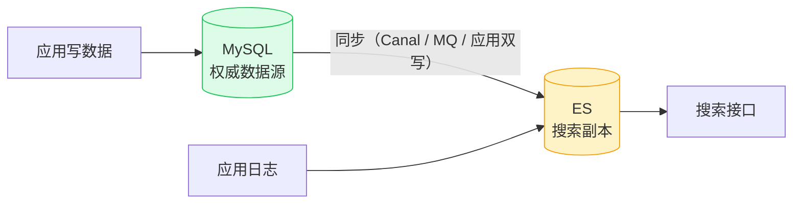

# Elasticsearch 入门

> 本质一句话：**ES 是"倒排索引"的服务**——它按**词**存数据，所以能秒级搜出"任意位置包含关键词"的记录。这是 MySQL 的 B+ 树索引做不到的事。

**优先级 P1**：搜索引擎是后端中间件三件套（Redis / Kafka / ES）之一。学习重点是"**它解决什么问题、和 MySQL 什么区别、什么时候不该用它**"，而不是背 API。

::: tip 这篇的定位
面向有前端经验、正在补后端的读者。

你可能已经在 mall 里见过它两次而没意识到：**mall-search 服务**（商品搜索）和 **ELK 日志平台**（logstash.conf 输出到 ES）。这篇讲清楚三件事：ES 是什么、为什么它快、什么时候**不该**用它。

Java 侧接入代码在 [中间件全景](/service/java/middleware)。
:::

## 0. 全景：三分钟看懂这篇

> 难度：了解

**它在哪**：**MySQL 的搜索副本**，不是主存储。



**这张图是全篇最重要的东西**：ES 在**写入链路的下游**。它是副本，随时可以重建；真数据在 MySQL。

**分五块**：

| 块 | 内容 | 读到什么程度 |
|---|---|---|
| 1 用途 | 什么时候该用、**什么时候不该用** | 能做选型判断 |
| 2 最小可用 | 起一个 ES + 导入数据 + 搜出来 | 能跑通 |
| 3 用法 | 术语体系 + 两种查询方式 | 能读懂别人写的查询 |
| 4 原理 | 倒排索引、text vs keyword、近实时 | 能解释"为什么快"和"为什么搜不到" |
| 5 边界与坑 | 症状 → 原因 → 解法 | 线上能对上号 |

**学完你能**：① 解释倒排索引为什么让 `LIKE '%x%'` 变快；② 说出 ES 的三个硬伤（没事务、近实时、不能当主存）；③ 区分 `text` 和 `keyword`；④ 解释"刚写进去为什么搜不到"。

**本篇讲什么、不讲什么**：

| 知识点 | 档位 | 处理 |
|---|---|---|
| 倒排索引、术语体系 | 核心 | 正文 3、4.1 |
| 与 MySQL 的对比与选型 | 核心 | 正文 1.2、1.3 |
| `text` vs `keyword` | 核心 | 正文 4.2 |
| 近实时与 refresh | 核心 | 正文 4.3 |
| Java 侧查询写法 | 进阶 | 正文 3.2 |
| 双写一致性（MySQL → ES） | 进阶 | 正文 5.4 |
| 分片 / 副本 / 集群原理 | 进阶 | 正文 4.4 |
| 聚合分析、评分算法 | — | 不写，用到再查 |
| ELK 部署运维 | — | 不写，见 [Docker 入门](/service/docker) |

---

## 1. 用途：什么时候该用 ES

> 难度：了解

### 1.1 ES 是什么

```text
本质：基于 Lucene 封装的分布式搜索引擎 + 文档存储
擅长：全文模糊搜索、海量数据聚合分析
不是：关系型数据库（没有事务、没有 JOIN、没有强一致）
```

**为什么叫"搜索引擎"而不是"数据库"**：它确实存数据，但存储模型是"**文档 + 倒排索引**"，和 MySQL 的"行 + 表 + 外键"是两套完全不同的设计。

### 1.2 什么时候该用

**唯一判断标准：你的查询能不能被 MySQL 的索引接住。**

| 需求 | MySQL 行不行 |
|---|---|
| 精确匹配、范围查询、排序、分组 | ✅ **完全够，别上 ES** |
| 前缀匹配（`LIKE 'abc%'`） | ✅ 能走索引 |
| **任意位置包含**（`LIKE '%abc%'`） | ❌ 走不了索引 → **上 ES** |
| **分词搜索**（搜"手机壳"能搜到"保护壳"） | ❌ MySQL 不分词 → **上 ES** |
| 相关性排序（越相关越靠前） | ❌ → 上 ES |
| 海量日志检索 | ❌ → 上 ES |
| 多维度聚合分析（按品牌/价格区间/时间统计） | ❌ → 上 ES |

**最容易犯的错**：**用 ES 做业务主存储**。理由通常是"ES 查询快"——但 ES 没有事务、没有强一致，写入还有 1 秒延迟。**它只能当副本。**

### 1.3 什么时候**不该**用

| 场景 | 为什么 | 该怎么做 |
|---|---|---|
| **业务主数据**（订单、账户） | ES 无事务、无强一致、可能丢数据 | MySQL 当主存 |
| **精确匹配 + 简单查询** | MySQL 更快、更简单、还省一个组件 | MySQL |
| **强一致要求**（写完立刻读到） | ES 是**近实时**（约 1s 延迟） | MySQL，或读走 MySQL |
| **数据量不大**（几万条） | 运维成本 > 收益 | MySQL 加个全文索引 |
| **需要 JOIN / 事务** | ES 根本没有 | MySQL |

**黄金法则**：**MySQL 做主存储，ES 做搜索副本**——写走 MySQL，读（搜索类查询）走 ES。这套叫 **CQRS**（读写分离）。

```
业务数据 → MySQL（权威）
    └→ 同步 → ES（搜索/分析用副本）
```

mall-search 就是这个模式：商品在 MySQL，同步一份到 ES 供搜索。

### 1.4 两大用途

**① 业务搜索**（mall-search 服务）

```yaml
# mall-search/application-dev.yml
spring:
  elasticsearch:
    uris: localhost:9200
```

商品数据同步进 ES → 搜索接口查 ES → 毫秒级返回。

**② 日志收集（ELK）**

```text
应用 logback → TCP → Logstash → ES
索引：mall-record-2026.09.02（按天分索引）
   → Kibana 可视化查日志
```

**同一个 ES，两个用途**：搜索用（业务）+ 日志用（ELK）——一个是"查数据"，一个是"查日志"，底层都是"**全文搜得快**"。

---

## 2. 最小可用：十分钟跑通

> 难度：会用

### 2.1 起一个 ES

```bash
docker run -d --name elasticsearch -p 9200:9200 \
  -e discovery.type=single-node \
  -e xpack.security.enabled="false" \
  -e ES_JAVA_OPTS="-Xms512m -Xmx512m" \
  elasticsearch:8.15
```

```bash
curl localhost:9200                # 返回集群信息
curl localhost:9200/_cat/indices  # 看有哪些索引
```

**两个必须知道的参数**：

- **`discovery.type=single-node`**：单机模式（不组集群）。生产必须去掉。
- **`ES_JAVA_OPTS`**：ES 是 JVM 程序，默认要 1G 堆。设小了会被 OOM Kill。**这是本地起 ES 最常见的失败原因。**

### 2.2 灌数据 + 搜一下

```bash
# 造一条数据
curl -X POST 'localhost:9200/product/_doc/1?pretty' -H 'Content-Type: application/json' -d '{
  "title": "华为手机保护壳",
  "category": "手机配件",
  "price": 29.9
}'

# 搜"手机"（全文检索）
curl 'localhost:9200/product/_search?pretty' -H 'Content-Type: application/json' -d '{
  "query": { "match": { "title": "手机" } }
}'

# 搜"手机"但只匹配整个字段值（keyword）
curl 'localhost:9200/product/_search?pretty' -H 'Content-Type: application/json' -d '{
  "query": { "term": { "category": "手机配件" } }
}'
```

**注意 `match` 和 `term` 的区别**（4.2 会细讲）：`match` 会分词后匹配，`term` 是**精确匹配整个字段值**。搜"手机配件"用 `term` 能查到，用 `match` 反而查不到（因为它会分成"手机"和"配件"两个词）。

### 2.3 Java 侧连上

```xml
<dependency>
    <groupId>org.springframework.boot</groupId>
    <artifactId>spring-boot-starter-data-elasticsearch</artifactId>
</dependency>
```

```yaml
spring:
  elasticsearch:
    uris: http://localhost:9200
```

```java
@Document(indexName = "product")
public class ProductDoc {
    @Id private Long id;
    private String title;
    private String category;
    private BigDecimal price;
}
```

完整查询代码见 [中间件全景 · ES 一节](/service/java/middleware)。

> **自检**：为什么 `spring-boot-starter-data-elasticsearch` 连的是一个"集群地址列表"（`uris`），而 MySQL 只需要一个 `url`？

::: details 参考答案
因为 **ES 天然是分布式的**——它由多个节点组成（分片 + 副本），客户端要知道自己该把请求发给谁。

更根本的原因是**ES 不用"选主"那套逻辑**：客户端拿到节点列表后，会**自己挑一个节点发请求**（轮询或按 sniffing 发现的节点），那个节点再负责把请求转发到持有目标分片的节点（称为 coordinate node 协调）。

所以 `uris` 是一个**种子列表**，客户端会自动发现集群里其他节点。对比一下：
- **MySQL**：一个地址代表一个库，主从要配 VIP 或代理
- **ES**：一个列表代表整个集群，扩容只是加节点 + 列表里加地址（甚至不用改，`discovery.seed_hosts` 会自动发现）

这个差异反映了两者不同的设计取向：**MySQL 是"一个强一致的核心"，ES 是"一堆可以水平拼起来的节点"**。
:::

---

## 3. 用法：术语与查询

> 难度：会用

### 3.1 一套"类数据库"术语

| ES 术语 | 类比 MySQL | 说明 |
|---|---|---|
| **Index（索引）** | Database / Table | 一类文档的集合（如 `product`） |
| **Document（文档）** | Row | 一条数据（JSON 格式） |
| **Mapping（映射）** | Schema | 字段类型定义（**建索引时确定，不能随便改**） |
| **倒排索引** | 无（B+ 树） | **核心**：词 → 文档列表的映射 |
| **Analyzer（分析器）** | 无 | 分词器 + 过滤器，决定怎么切词 |
| **Shard（分片）** | 分表 | index 的横向切片 |
| **Replica（副本）** | 主从 | index 的拷贝，保证高可用 |

**⚠️ Mapping 的特殊性**：ES 的字段类型是**建索引时确定的**（类似 MySQL 的 DDL），但**写入时不会自动加新字段**（除非提前开动态映射）——所以生产建索引要**显式写 mapping**，别依赖动态推断。

### 3.2 两种查询方式

**① Spring Data ES：接口即操作**（像 JPA）

```java
public interface ProductRepository extends ElasticsearchRepository<Product, Long> {
    List<Product> findByTitleContaining(String keyword);   // 方法名即查询
}
```

**② 原生 API 拼 Query DSL**（灵活，复杂查询用这个）

```java
NativeQuery query = NativeQuery.builder()
        .withQuery(q -> q.bool(b -> {
            b.must(m -> m.multiMatch(mm -> mm
                    .query(keyword)
                    .fields("title^2", "description")));   // title 权重更高
            b.filter(f -> f.term(t -> t.field("category").value(category)));
            return b;
        }))
        .withPageable(PageRequest.of(0, 10))
        .build();

List<ProductDoc> hits = es.search(query, ProductDoc.class).getSearchHits()
        .stream().map(SearchHit::getContent).toList();
```

**Query DSL 的两类子句（记住这个区分，排查时很有用）**：

| 子句 | 作用 | 例子 |
|---|---|---|
| **`must` / `should`** | **影响评分**（算相关性） | 关键词匹配 |
| **`filter` / `must_not`** | **不影响评分**，只做过滤（还能被缓存） | 分类、价格区间、状态 |

**`filter` 不算分 = 快**。所以"关键词用 must，其余条件用 filter"是性能最佳实践。

**前端类比**：ES 的 Query DSL ≈ 你给搜索接口传的一堆参数，后端把它翻译成 ES 查询。TS 里用官方 client（`@elastic/elasticsearch`）也是同一套东西。

---

## 4. 原理：为什么是这样

> 难度：懂原理

### 4.1 倒排索引：为什么快

```text
文档："华为手机真不错"  → 分词：华为 / 手机 / 真不错
倒排表：华为 → [doc1, doc5]     手机 → [doc1, doc9]
搜索"手机" → 直接查倒排表 → 秒回 doc1, doc9
```

对比 MySQL：`LIKE '%手机%'` → **全表扫描**（前导 `%` 让索引失效）。

**本质区别**：

| | MySQL（B+ 树） | ES（倒排索引） |
|---|---|---|
| 索引方向 | **值 → 位置**（按前缀找） | **词 → 文档列表**（按词找） |
| 适合 | `WHERE name = 'abc'`、`LIKE 'abc%'` | `LIKE '%abc%'`、分词搜索 |
| 不适合 | 任意位置包含 | 精确匹配（也能做，但不是优势） |

**"模糊搜索场景 ES 碾压 MySQL"的根本原因就在这一条**——不是 ES 更快，是**它把 MySQL 做不到的查询变成了索引查找**。

**代价也要知道**：倒排索引让**写入变贵**（每次写入都要更新倒排表）+ **占内存**（这是 ES 吃内存的原因）。所以 ES 不适合高频更新。

### 4.2 text vs keyword：最常踩的坑

**同一个字段，两种索引方式**：

| 类型 | 行为 | 能做什么 | 典型字段 |
|---|---|---|---|
| **`text`** | **分词后存倒排** | 全文检索、相关性评分 | 商品标题、描述 |
| **`keyword`** | **整体存，不分词** | 精确匹配、排序、聚合 | 分类、标签、状态码 |

**实测一下就明白**：

```bash
# 写入：title 是 text，category 是 keyword（推断出来的）
{"title": "华为手机保护壳", "category": "手机配件"}

# 查 "手机"（会分词成 手机 / 保护壳 / ...）
{"query": {"match": {"title": "手机"}}}     → ✅ 查到

# 查 "手机配件"（keyword 不分词，要整体相等）
{"query": {"match": {"category": "手机配件"}}}   → ❌ 查不到（被分成 手机 + 配件 两个词）
{"query": {"term": {"category": "手机配件"}}}    → ✅ 查到
```

**规则**：

- **用 `match` 查 `text` 字段**（分词后匹配）
- **用 `term` 查 `keyword` 字段**（整体相等）
- 同一个字段两种都要 → **建两个字段**（`title` + `title.raw`）

**⚠️ 写入和查询必须用同一个分析器**。写入用 `ik_max_word`（细粒度）、查询用 `ik_smart`（粗粒度）→ 部分情况下搜不到。这是中文搜索的经典坑。

### 4.3 近实时：为什么"刚写完搜不到"

ES 是**近实时（near real-time）**的：写入的数据先在内存里，要等 `refresh_interval`（默认 1 秒）才刷新成可搜索的 Lucene 段。

```text
写入 → 内存（不可搜） → refresh（默认 1s）→ 可搜
```

**所以"写完立刻查不到"是正常行为，不是 bug**。

| 场景 | 做法 |
|---|---|
| 正常业务 | **等 1 秒** |
| 测试 / 要求立即可见 | `POST /product/_refresh` 手动刷新 |
| 需要"写完立刻能查" | 这不是 ES 的强项 → **真数据放 MySQL** |

**另一个原因**：**分词不一致**（见 4.2）——写入和查询用了不同分析器。

### 4.4 分片与副本

```text
Index（逻辑集合）
  ├── Shard 0（分片，存放一部分文档）
  │     ├── Primary（主分片）
  │     └── Replica（副本）
  ├── Shard 1
  │     ├── Primary
  │     └── Replica
  └── ...
```

| 概念 | 说明 |
|---|---|
| **主分片（Primary）** | 负责写入，**分片数建索引后不能改**（要改得 reindex） |
| **副本（Replica）** | 主分片的拷贝，可读可写（主挂了可提升为主） |
| **文档路由** | `hash(docId) % 分片数` → 决定文档落在哪个分片 |

**ES 的扩展性来自这里**：加节点 → 分片分布到更多节点 → 容量和吞吐一起涨。**这是它和 MySQL 主从最本质的区别**——MySQL 主从是"多份拷贝"，ES 是"数据切开分摊"。

---

## 5. 边界与坑

> 难度：会用 + 懂原理

### 5.1 一张表先过一遍

| 症状 | 见 |
|---|---|
| 刚写进去搜不到 | 5.2 |
| 搜"手机配件"搜不到，但数据确实在 | 5.3 |
| ES 内存爆了 / 被 OOM Kill | 5.4 |
| MySQL 和 ES 数据对不上 | 5.5 |
| 查询很慢 / 深分页报错 | 5.6 |
| 集群状态飘红，节点反复重启 | 5.7 |

### 5.2 刚写进去搜不到

**症状**：写完立刻查，查不到；等一两秒又能查到。

**原因**：**近实时**（4.3）——数据在内存里，要等 refresh。

**解法**：

| 场景 | 做法 |
|---|---|
| 正常业务 | 等 1 秒，别在写完立刻查 |
| 测试 | `POST /product/_refresh` |
| 要求强一致 | **读走 MySQL** |

### 5.3 搜不到明明存在的数据

**症状**：`match` 查 "手机配件" 无结果，`term` 查却有。

**原因**：**`match` 会分词**。字段是 `keyword`（不分词）时，`match` 把查询词也分成了"手机"+"配件"，去匹配"手机配件"这个完整值 → 匹配不上。

**解法**：

| 字段类型 | 用什么查 |
|---|---|
| `text` | `match`（或 `multi_match`） |
| `keyword` | `term` |

**排查顺序**：① 看 mapping 里的字段类型 → ② 看写入和查询用的分析器是否一致 → ③ 看是不是 refresh 还没到。

### 5.4 ES 内存爆了

**症状**：ES 进程被 OOM Kill，或者响应极慢。

**原因**：ES 把**倒排索引放在内存里**（这是它快的代价），加上 Lucene 的 segment 合并也需要额外内存。

**解法**：

| 手段 | 说明 |
|---|---|
| **调小堆** | `-Xms` 和 `-Xmx` **必须相等**（设成不同会卡在 resize） |
| **关掉不需要的功能** | `xpack.security.enabled=false`（本地）、`_source` 禁用、`doc_values` 关闭 |
| **分片别太多** | 每个分片都有 overhead（堆里几十 MB 起步） |
| **用 `ilm` 删旧数据** | 日志场景必须按天分索引 + 定期删（别在一个索引里塞一年的日志） |
| **监控** | `/_cat/nodes?v&h=heap.percent` |

**日志场景的黄金实践**：**按天/周分索引**（`mall-log-2026.11.06`），过期直接删整个索引——**比 `delete by query` 快几个数量级**。

### 5.5 MySQL 和 ES 数据对不上

**症状**：MySQL 里有的商品，ES 里搜不到。

**原因**：**同步链路断了或延迟了**。ES 不参与 MySQL 的事务，所以两边**必然可能不一致**。

**三种同步方案**：

| 方案 | 做法 | 优缺点 |
|---|---|---|
| **应用双写** | 写 MySQL 后同步写 ES | 简单，但**两个写不是原子的**（一个成功一个失败就不一致） |
| **MQ 异步** | 写 MySQL + 发消息 → 消费者写 ES | 解耦，但有延迟 |
| **订阅 binlog（Canal / Debezium）** | 监听 MySQL 变更 → 写 ES | **不侵入业务代码**，最彻底，但要引入组件 |

**配套要做的事**：

- **补偿**：定时全量比对 / 对账任务，修复漏同步的
- **幂等**：ES 写入按主键 upsert，重复写不会产生重复文档
- **版本控制**：ES 文档带 `version`，用 MySQL 的 version 字段做乐观锁，防旧数据覆盖新数据

> **自检**：应用双写 MySQL 和 ES，写 MySQL 成功、写 ES 失败。请给出三种处理方式，并说明哪种最好。

::: details 参考答案
三种方式：

1. **只记日志，等补偿任务修**：最简单，但用户短期内搜不到；必须有对账任务兜底
2. **写 ES 失败就回滚 MySQL**：保证一致，但 ES 抖动会拖垮主业务——**把搜索的可用性绑到了主流程上**，方向错了
3. **写 MySQL 成功后发 MQ，消费者写 ES**：主流程只管 MySQL + 发消息（可靠的话），ES 最终一致；配合幂等 + 对账

**第 3 种最好**，理由：把"ES 暂时搜不到"这个降级状态限制在搜索功能内，**不影响下单这种核心链路**。这正是 MQ 存在的意义——用异步换解耦和可用性。

**但第 3 种要配套两件事**：① 消费者写 ES 必须**幂等**（用主键 upsert，重复消费不会产生脏数据）；② 必须有**对账补偿**（MQ 丢消息、消费者永久失败时靠它修复）。没有补偿的最终一致方案等于"数据慢慢漂移"。
:::

### 5.6 深分页报错 / 查询很慢

**症状**：查第 10000 条往后，报 `Result window is too large`；或者 `from + size` 很大时特别慢。

**原因**：ES 要把 `from` 之前的**所有文档都收集并排序**才能取出这一页——`from=10000` 意味着要处理 1 万条。

**解法**：

| 方案 | 说明 |
|---|---|
| **`search_after`** | ✅ 正确解法：用上一页最后一条的排序值继续查，**没有深度限制** |
| **限制 from+size** | 默认最大 10000（`index.max_result_window`），**别改成很大** |
| **scroll** | 批量导出全部数据用（不是分页） |
| **直接用 ES 的聚合** | 要"第 10 页"不如让用户改筛选条件缩小结果集 |

**`search_after` 的用法**：查询时带上上一页最后一条文档的排序值：

```json
{
  "sort": [ {"createTime": "desc"}, {"_id": "asc"} ],
  "search_after": [ 1700000000000, "doc-123" ],
  "size": 20
}
```

**⚠️ 排序字段必须有唯一性**（加 `_id` 做第二排序键），否则值相同的文档可能漏掉或重复。

### 5.7 集群状态飘红

**症状**：集群状态 yellow / red，节点反复重启。

| 状态 | 含义 | 常见原因 |
|---|---|---|
| **green** | 所有主分片和副本都已分配 | 正常 |
| **yellow** | 所有主分片已分配，部分副本没分配 | 节点数 < 分片数+副本数（**单节点集群起 3 个副本必然 yellow**） |
| **red** | 有主分片未分配 | 磁盘超水位（`flood stage`）、节点挂了 |

**最常见的一个**：**单节点集群 + 多副本 = 永远 yellow**。本地测试用 `number_of_replicas: 0` 就正常了。

```json
PUT /product/_settings
{ "index": { "number_of_replicas": 0 } }
```

**另一个常见原因**：磁盘超过 85% 会被 ES **强制置为只读**（`read_only_allow_delete`），日志里会明确写 `flood-stage disk watermark exceeded`。

---

## 6. 延伸

> 难度：了解

### 学习建议

1. **先想清楚"为什么用"**：全文模糊搜索、海量日志检索 → 用 ES；事务型业务 → 别用
2. **在 mall 里看实际**：`mall-search` 模块（搜索用）+ `document/elk/logstash.conf`（日志用）
3. **概念优先**：倒排索引（为什么快）、Index/Document/Mapping（术语）、**MySQL 主存 + ES 副本**（架构）
4. **不背 API**：查询语法用的时候查文档，重点是"**该不该用它**"

### 面试题速查

| 问题 | 一句话答案 |
|---|---|
| ES 是什么 | 基于 Lucene 的分布式搜索引擎 + 文档存储 |
| 为什么快 | 倒排索引（词 → 文档列表），按词查而非按行扫 |
| ES vs MySQL | MySQL 事务/强一致/精确查询；ES 全文检索/聚合/近实时 |
| 倒排索引 vs B+ 树 | B+ 树按值找（适合前缀匹配），倒排按词找（适合任意位置包含） |
| `text` vs `keyword` | text 分词存倒排（全文检索）；keyword 整体存（精确匹配/聚合） |
| 为什么刚写完搜不到 | 近实时，refresh 默认 1 秒 |
| ES 能当主存储吗 | 不能：没事务、近实时、可能丢数据；只当搜索副本 |
| 怎么保证 MySQL 和 ES 一致 | 应用双写 / MQ 异步 / 订阅 binlog；配幂等 + 对账补偿 |
| 深分页怎么解决 | `search_after`（别硬调大 `index.max_result_window`） |
| 怎么减少内存压力 | 按天分索引 + 定期删、`number_of_replicas: 0`（本地）、监控 `heap.percent` |

### 相关篇目

| 篇目 | 关系 |
|---|---|
| [中间件全景与 Java 实战](/service/java/middleware) | ES 在 Java 服务里的接入与双写一致性 |
| [Redis 入门](/service/common/redis-intro) | 另一种"数据不一定放 MySQL"的思路 |
| [消息队列（Kafka）入门](/service/common/mq-intro) | 数据同步/削峰的中转站 |
| [Spring Boot 入门](/service/java/spring-boot) | 日志链路（logback → Logstash） |
| [Docker 入门](/service/docker) | 本地起 ES / ELK |
