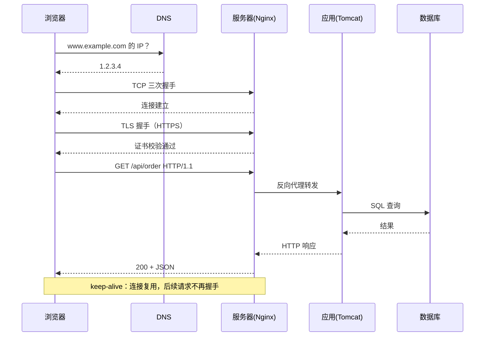
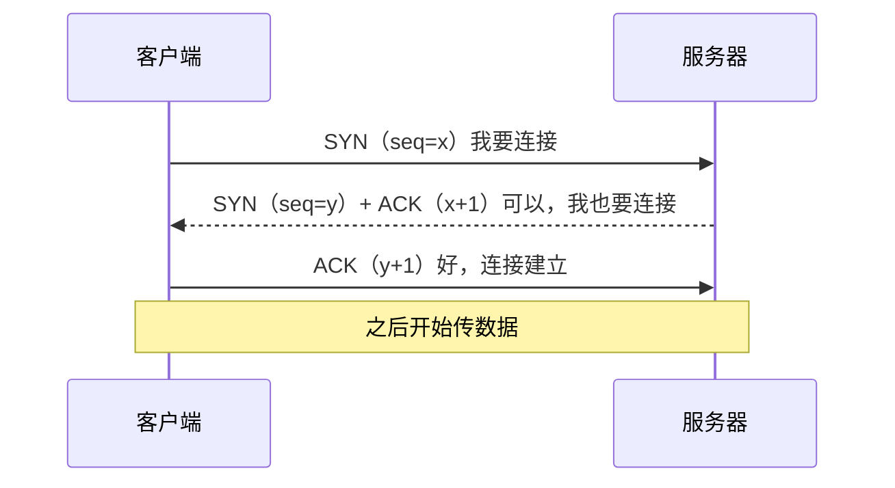
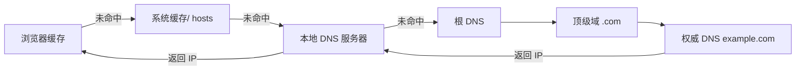
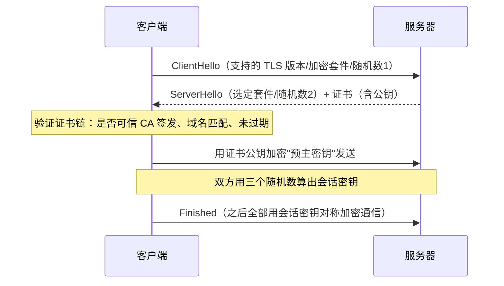
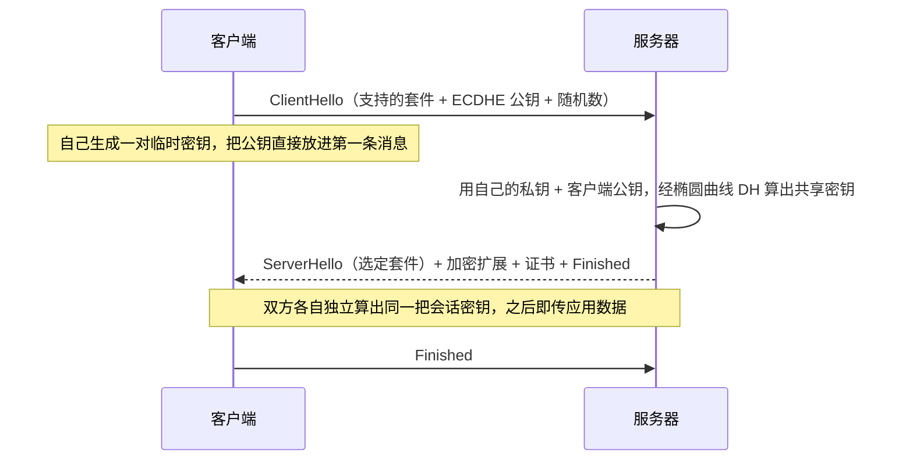
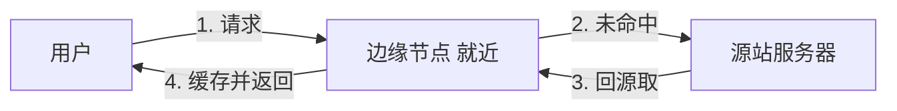
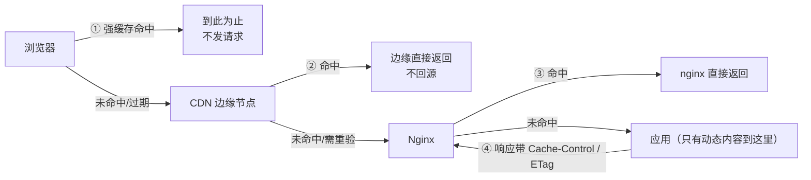

# HTTP 与网络基础

> **优先级：P0（后端上岗必备）** — "输入 URL 回车后发生什么"是前端转后端面试的第一题，也是理解连接池、Nginx、Netty 的地基。

::: tip 背景
前端天天发请求，但请求出了浏览器之后发生了什么，通常是知识盲区。本文按"一次请求的完整旅程"组织：DNS → TCP → TLS → HTTP → 响应，每一步都回答"后端为什么要关心它"。
:::

## 全景：一次请求的完整旅程



面试答这道题的结构：**DNS 解析 → TCP 握手 →（HTTPS 则 TLS 握手）→ 发 HTTP 请求 → 服务器处理（Nginx → 应用 → 数据库）→ 响应渲染**。每一层能展开一层，就是深度。

## 一、HTTP 协议层

### 请求与响应的结构

```
请求行:  GET /api/orders?page=1 HTTP/1.1
请求头:  Host: api.example.com
         Cookie: token=xxx
         Content-Type: application/json
空行
请求体:  {"name": "..."}          # GET 没有，POST/PUT 有

响应行:  HTTP/1.1 200 OK
响应头:  Content-Type: application/json
         Cache-Control: max-age=60
空行
响应体:  {"data": [...]}
```

### HTTP/1.1 keep-alive：连接复用

**默认开启**（HTTP/1.0 要显式 `Connection: keep-alive`）。一次 TCP 连接可以传多个请求响应，省掉反复握手的开销。

- **前端视角**：浏览器对同一域名默认保持 6~8 个 TCP 连接，`fetch` 发起的请求在底层被复用
- **后端视角**：这是**连接池存在的原因**——握手成本高（见 [TCP 三次握手](#二tcp可靠传输的基石)，连接必须复用

### HTTP/2：多路复用

HTTP/1.1 的队头阻塞：同一连接上请求必须排队。HTTP/2 用**二进制分帧 + 多路复用**，一个连接上并行多个请求，互相不阻塞。

| | HTTP/1.1 | HTTP/2 |
|---|---|---|
| 传输格式 | 文本 | 二进制帧 |
| 并发 | 一连接一请求排队 | 一连接多请求并行 |
| 头部压缩 | 无 | HPACK（头部差异压缩） |
| 服务端推送 | 无 | 支持（已逐渐弃用） |

**后端要知道的**：Nginx/Spring Boot 默认支持 h2，配置 `listen 443 ssl http2;` 即可，业务代码无感。

### 缓存头速查（前后端联调高频）

| 头 | 含义 | 典型用法 |
|---|---|---|
| `Cache-Control: max-age=3600` | 缓存 1 小时，期间不问服务器 | 静态资源（JS/CSS/图片） |
| `Cache-Control: no-cache` | **可以缓存，但每次用前问服务器**（不是"不缓存"） | HTML 入口、API 数据 |
| `Cache-Control: no-store` | 真正不缓存 | 敏感数据（余额、token） |
| `ETag` + `If-None-Match` | 资源指纹，没变返回 **304**（不传 body，省流量） | 协商缓存 |
| `Last-Modified` + `If-Modified-Since` | 按时间协商（精度到秒，ETag 更准） | 同上 |

**强缓存 vs 协商缓存**：`max-age` 没过期 → 直接用本地（200 from disk/memory cache）；过期了 → 带 `ETag` 问服务器，没变 304、变了 200。

### 幂等性与安全性（后端设计必知）

| 方法 | 幂等 | 安全 | 说明 |
|---|---|---|---|
| GET | ✅ | ✅ | 只读，不应有副作用 |
| POST | ❌ | ❌ | 创建/提交，重复调用产生多条 |
| PUT | ✅ | ❌ | 全量替换，重复调用结果一样 |
| DELETE | ✅ | ❌ | 删一次和删多次效果一样 |
| PATCH | ❌ | ❌ | 部分修改，`{"count": +1}` 不幂等 |

**后端应用**：重试机制（Feign/Ribbon 自动重试）必须设计成对幂等方法重试，否则重复下单。

## 二、TCP：可靠传输的基石

### 三次握手（必考，会画）



**为什么是三次不是两次**：防止历史失效连接请求。客户端第一个 SYN 在网络里堵了很久突然到达服务端，两次握手会让服务端白建一条连接浪费资源；第三次握手让客户端确认"我连的是当前有效的服务端"。

**前端类比**：类似 WebSocket 建立前的 HTTP Upgrade 往返，只不过 TCP 是更底层的"建立可靠信道"。

### 四次挥手（必考）

```
客户端: FIN（我发完了）→  服务端: ACK
服务端: FIN（我也发完了）→ 客户端: ACK + TIME_WAIT 等待 2MSL
```

服务端收到 FIN 后可能还有数据要传，所以 ACK 和 FIN 分开发（比握手多一次）。客户端最后要等 **2MSL**（最长报文寿命的两倍）确保服务端收到最后一个 ACK。

### TIME_WAIT（线上高频）

主动关连接的一方进入 TIME_WAIT（Linux 默认 60s）。**TIME_WAIT 堆积**（几万个）有两个后果：本地端口被占满，新连接建不起来；内核内存吃紧——高并发短连接场景的经典故障。

**先搞清两个前提**，解法才对症：

- **为什么等 2MSL**：① 确保最后一个 ACK 到达对端——对端没收到会重发 FIN，这边还没消失才能重传；② 让这条连接"迟到"的旧报文在网络里自然消散，不污染复用同一四元组的新连接
- **谁主动关**：HTTP keep-alive 场景下通常是**服务端**先关（keepalive_timeout 到期），所以堆积发生在服务端。Nginx 反代、Java 服务间调用（HttpClient/Feign/OkHttp）不配连接复用时，服务端会堆出一片 TIME_WAIT

**解法（按有效性排序）**：

| 解法 | 具体做法 | 说明 |
|---|---|---|
| ① 复用连接（根治） | Nginx `upstream keepalive` + `proxy_http_version 1.1` + `proxy_set_header Connection ""`；Java 侧 HttpClient/Feign/OkHttp/DB 全走连接池 | 连接不频繁新建关闭，TIME_WAIT 根本不会产生。后端服务间调用必配 |
| ② `net.ipv4.tcp_tw_reuse=1` | `sysctl net.ipv4.tcp_tw_reuse` | **只对主动发起连接的一端（客户端）有效**，服务端堆积别指望它——面试常考的坑 |
| ③ `net.ipv4.tcp_max_tw_buckets` | 调大或设上限兜底 | 超限后内核丢弃并告警，防止内存耗尽，是"保命"不是"治病" |
| ④ 扩大临时端口 | `net.ipv4.ip_local_port_range` | 端口耗尽时的应急手段，治标 |

**排查命令**：

```bash
ss -s                            # 各状态连接总数概览
ss -tan state time-wait | wc -l  # TIME_WAIT 数量
ss -tan state close-wait | wc -l # CLOSE_WAIT：对端关了、你还没 close
```

**必须区分 CLOSE_WAIT**：TIME_WAIT 堆积多半是配置/架构问题（没复用连接）；**CLOSE_WAIT 堆积是代码 bug**——连接被对端关了，你这边还没调 `close()`，查连接泄漏（排查手法衔接 [数据库连接池](/service/common/database-connection-pool) 的泄漏检测）。

- **面试题**：TIME_WAIT 在哪一端？——主动关的一方（keep-alive 场景通常是服务端）；线上堆了几万个怎么解？——优先复用连接治本，`tcp_tw_reuse` 只救客户端。

### TCP 为什么可靠

| 机制 | 一句话 |
|---|---|
| 序列号 + 确认应答 | 每个字节编号，丢了知道丢哪 |
| 超时重传 | 等不到 ACK 就重发 |
| 流量控制 | 滑动窗口，接收方说了算发多快 |
| 拥塞控制 | 网络说了算：慢启动 → 拥塞避免 → 快重传快恢复 |

**TCP vs UDP**：TCP 可靠有序有拥塞控制（HTTP/数据库连接都基于它）；UDP 无连接快但不保证送达（视频直播、DNS 查询、游戏）。

## 三、DNS：域名到 IP



**查找顺序**：浏览器 DNS 缓存 → 操作系统缓存（hosts 文件）→ 本地域名服务器（LDNS，运营商/公司提供）→ 根 → 顶级域 → 权威域名服务器。**逐级缓存**，所以换域名/IP 后要等 TTL 过期才全网生效。

**后端要知道的**：
- **DNS 缓存导致发布不生效**：改了域名解析，用户这边还有旧 IP（等 TTL，或本地 `sudo dscacheutil -flushcache` 强制刷新，Mac）
- **DNS 轮询**：一个域名配多个 A 记录，是最简陋的负载均衡（没有健康检查，挂了也返回）
- 排查手段：`dig example.com` / `nslookup example.com` 看解析到哪

## 四、HTTPS 与 TLS 握手

HTTPS = HTTP + TLS。TLS 解决三件事：**加密**（防窃听）、**完整性**（防篡改）、**身份认证**（防冒充，靠证书链）。

### TLS 1.2 握手（两次 RTT，面试常考）



**三个随机数**：客户端随机 + 服务端随机 + 预主密钥 → 生成对称会话密钥。为什么不用证书公钥直接加密数据：**非对称加密慢**，只用来协商密钥，后续用对称加密（AES）传输。

**TLS 1.3** 简化成 1-RTT，且默认前向安全，Nginx 现在默认启用。

### TLS 1.3 握手（1-RTT，现在的主流）



**为什么 1.3 能压到 1-RTT（关键在 ECDHE）**：1.2 里客户端必须**等服务端回 ServerHello**（拿到服务端的 ECDHE 参数和公钥）之后才能算密钥、发 Finished，所以握手要两个来回。1.3 把这个依赖砍掉了——客户端在 ClientHello 第一条消息里就带上自己的 **ECDHE 公钥**，服务端收到后立即用椭圆曲线 Diffie-Hellman 算出共享密钥（各自的私钥 + 对方的公钥 → 同一把密钥，公钥可以明文传播），一个来回就够开始传数据。

ECDHE 的数学直觉：双方各自用私钥和"对方的公钥"做同样的椭圆曲线运算，结果必然相同；而别人只有两个公钥，推不出私钥。算法细节（油漆类比、`a·G`）见 [浏览器篇 HTTPS](/browser/https)——两篇口径一致，可对照阅读。

**1.2 → 1.3 改了什么**：

| 维度 | TLS 1.2 | TLS 1.3 |
|---|---|---|
| 握手 RTT | 2 | 1（老客户端重连可 0-RTT） |
| 密钥交换 | RSA 密钥传输 + ECDHE 并存 | 只剩（EC）DHE——默认前向安全 |
| 前向安全 | 看套件选没选 | 强制 |
| 握手内容 | Finished 之后才加密 | ServerHello 之后的扩展、证书就已经加密 |
| 被砍掉的 | — | RSA 密钥传输、RC4/3DES/SHA-1、压缩（CRIME 攻击的根源）、重新协商 |

**前向安全（PFS）**：每次握手独立协商会话密钥。服务端私钥就算泄露，攻击者也解不了**已经录下来的历史流量**——历史流量用的密钥不是私钥直接加密的。这是 1.3 把 RSA 密钥传输砍掉的核心理由。

**0-RTT 是什么**：老客户端重连时带着上次的会话票据，第一个数据包就发应用数据，零握手。代价是**可被重放攻击**（同一请求被重发一次），所以只适合 GET 这类幂等请求——Nginx 的 `ssl_early_data on;` 默认关闭就是这个原因。

### 证书与部署

- **证书链**：服务器证书 → 中间 CA → 根 CA（浏览器内置）。任何一环不被信任就红色警告
- **Let's Encrypt**：免费证书，90 天有效期，`certbot` 自动续期
- **Nginx 配置**：见 [Nginx 与 Web 容器](/service/common/nginx-web-container) 的 HTTPS 终止

## 五、CDN：离用户最近的缓存



**原理**：把静态资源（JS/CSS/图片/视频）缓存到全国各地的边缘节点，用户就近取，不回源站。

**回源**：边缘没缓存 → 回源站拉 → 缓存 → 返回。源站要被回源流量保护（CDN 厂商的带宽质量比源站高，能挡大部分攻击）。

**刷新/预热**：发布了新版本但 CDN 还是旧文件 → 提交刷新 URL（少量）或预热（大版本前主动推）。

**前端视角**：构建产物文件名带 hash（`app.a3f2b.js`）是 CDN 友好的根本原因——内容变文件名才变，可以放心配 `max-age=31536000`（一年）。

## 六、"输入 URL 发生什么"完整答法

按这个顺序讲，每层能展开：

1. **浏览器**：查缓存（强缓存命中直接渲染，不发请求；未命中才发）→ 拼请求（cookie、UA、Accept 头）
2. **DNS**：域名解析成 IP（逐级缓存，见上）
3. **TCP**：三次握手建立连接（复用则跳过）
4. **TLS**：HTTPS 握手协商密钥（证书校验）
5. **HTTP**：发送请求，Nginx 反向代理到应用
6. **服务端**：应用处理（鉴权 → 业务 → DB/Redis/MQ）→ 拼响应（含缓存头）
7. **浏览器渲染**：HTML → DOM/CSSOM → 渲染树 → 布局绘制 → JS 执行 →（异步请求再走一轮）
8. **收尾**：TCP 连接 keep-alive 保活，或四次挥手关闭

**加分项**（说一个就够）：HTTP/2 多路复用让第 5 步的多个请求并行；CDN 让静态资源在第 1 步就命中边缘节点。

### 缓存分层：静态和动态要分开看

面试答"输入 URL"时，缓存这一段最容易只说一半。**先分内容类型**——不同内容走的链路不一样，缓存策略的"定的人"也不一样：



| 内容 | 走到哪 | 缓存策略谁定 |
|---|---|---|
| **静态资源**（js/css/图片） | 浏览器 → CDN → **nginx 读文件即止**，到不了应用 | **nginx 定**（`expires` / `add_header Cache-Control`，见 [Nginx 篇动静分离](/service/common/nginx-web-container)） |
| **HTML 入口** | 看项目形态：**SPA 的 index.html 是静态文件**，和 js/css 一样放 nginx root 目录，nginx 直接给（`location = /index.html` 或 try_files 兜底）；只有 **SSR/模板页**（Thymeleaf 等）才是应用生成 | SPA：**nginx 定**；SSR：应用定 |
| **API 响应** | 浏览器 → CDN → nginx `proxy_cache` → 应用 | **应用定**（响应头在 Controller/拦截器里写） |

**协商缓存到底能走到哪——分清场景**：

- **静态资源和 SPA 的 HTML**：都在 nginx 层闭环。nginx 静态文件默认带 `Last-Modified` / `ETag` 响应头，浏览器带 `If-None-Match` / `If-Modified-Since` 问回来，nginx 按文件状态直接回 **304**——**请求连 Tomcat 都到不了，更别说应用代码**
- **API 响应**：缓存头由应用说了算，`ETag` + `If-None-Match` 的 304 **可以一路穿透 CDN 和 nginx 的 proxy_cache，问到源站应用**——这才是"协商缓存走到源站"的正确语境

所以 mall 这种 SPA 项目，**前端侧全部内容（js/css/图片/HTML）的缓存协商都在 nginx 层闭环**，没有一个是走到 Java 应用的；只有 API 响应才可能问到应用。

再强调一次维度区分：**"缓存命中与否"和"请求能走到哪"是两回事**。静态资源哪怕浏览器、CDN、nginx 层层都没命中，也只是继续往下穿透到 nginx 读文件返回 200，**依然到不了应用**——见 [Nginx 篇动静分离](/service/common/nginx-web-container)列的三种例外（proxy_pass 的 API、文件不存在时的兜底转发、以及让 Spring Boot 自己服务静态资源的反模式）。

**两个关键认知**（面试高频追问）：

- `Cache-Control: no-cache` **不是"不缓存"**——是"每次用之前必须先协商"；`no-store` 才是真不缓存
- 所以经典分工是：带 hash 的前端产物配 `max-age=31536000, immutable` 走强缓存；HTML 入口配 `no-cache` 每次都协商——发布新版本时用户立刻能拿到新引用，同时长缓存资源一点不浪费

## 面试题速查

| 问题 | 一句话答案 |
|------|-----------|
| 三次握手为什么不是两次 | 防止历史失效连接请求让服务端白建连接；第三次确认连接有效 |
| 四次挥手为什么多一次 | 服务端收到 FIN 后可能还有数据要发，ACK 和 FIN 分开发 |
| TIME_WAIT 是什么 | 主动关连接一方等待 2MSL，确保对方收到最后 ACK；大量出现在高并发短连接服务端 |
| HTTP 和 HTTPS 区别 | HTTPS = HTTP + TLS：加密、完整性、身份认证 |
| 强缓存和协商缓存 | max-age 没过期直接用；过期带 ETag 问服务器，304 不传 body |
| HTTP/2 改进 | 二进制分帧 + 多路复用（一连接并行多请求）+ 头部压缩 |
| DNS 解析过程 | 浏览器缓存 → 系统缓存 → LDNS → 根 → 顶级域 → 权威 |
| TCP 和 UDP 区别 | TCP 可靠有序有拥塞控制；UDP 快但不保证送达 |
| 为什么 TCP 连接要复用 | 握手 1 个 RTT + 系统开销，高并发下不可接受；连接池同理 |

## 延伸阅读

- [Nginx 与 Web 容器](/service/common/nginx-web-container) - 请求旅程的下一站：反向代理与 Tomcat
- [Java IO/NIO 与序列化](/service/java/java-io) - TCP 握手在 NIO 多路复用里的位置
- [Netty 入门](/service/java/java-netty) - 基于 NIO 的网络编程框架
- [数据库连接池与数据源](/service/common/database-connection-pool) - "连接必须复用"的最典型案例
- 前端视角对照（同一协议的浏览器侧）：[TCP 通信](/browser/tcp)、[DNS 域名解析](/browser/dns)、[HTTPS](/browser/https)、[浏览器缓存](/browser/storage-cache)、[HTTP 方法](/browser/http-methods)
