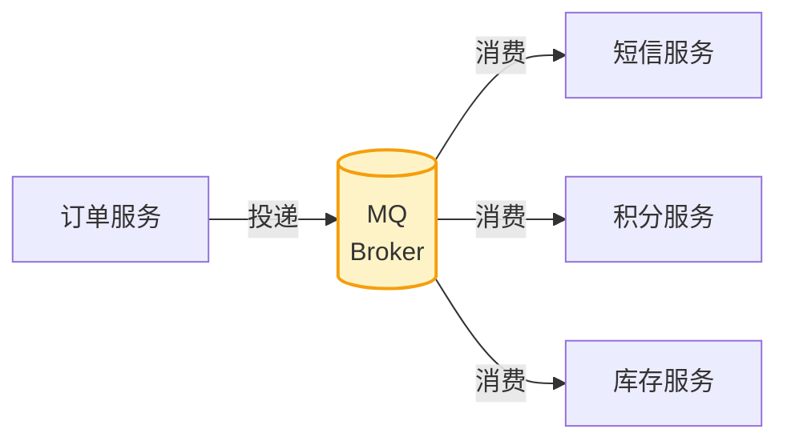

# 消息队列（MQ）入门

> 本质一句话：**MQ 是"把必须做的事和可以晚点做的事拆开"的中间环节**。它换来解耦和削峰，代价是**消息可能丢、可能重、可能乱序**——这三个词是 MQ 面试的全部。

**优先级 P1（中高级岗必问）**：核心三问——为什么用 MQ、消息怎么不丢、怎么不重复消费。

::: tip 这篇的定位
面向有前端经验、正在补后端的读者。**不按产品手册讲**（Kafka/RabbitMQ/RocketMQ 的 API 差异不大），只讲**MQ 的通用模型 + 三个必答问题**。

产品选型见文末；Java 侧接入代码在 [中间件全景](/service/java/middleware)。
:::

## 0. 全景：三分钟看懂这篇

> 难度：了解

**它在哪**：你的服务和"别的服务"之间的**异步管道**。



**读法**：左边是"生产者"，右边是"消费者"，中间那个 MQ **只负责存和转**。它不理解消息内容——这是它能通用的原因，也是它不能替你做业务逻辑的原因。

**三个必答问题**（这篇的主线）：

| 问题 | 答案在哪 | 难度 |
|---|---|---|
| **为什么要用 MQ？** | 正文 1 | 送分题，但要说清代价 |
| **消息怎么不丢？** | 正文 4.1 | 三段分别防 |
| **怎么不重复消费？** | 正文 4.2 | **接受重复 + 业务幂等** |

**分五块**：

| 块 | 内容 | 读到什么程度 |
|---|---|---|
| 1 用途 | 三个价值 + 什么时候**不该**用 | 能做选型判断 |
| 2 最小可用 | 起一个 Kafka / RabbitMQ + Java 收发 | 能跑通 |
| 3 用法 | 核心概念（Topic/Partition/Consumer Group） | 能画图解释 |
| 4 原理 | 不丢 / 不重 / 有序 / 堆积 | 能答面试 |
| 5 边界与坑 | 症状 → 原因 → 解法 | 线上能对上号 |

**学完你能**：① 画出"生产 → 分区 → 消费组"的关系图；② 说清"消息为什么会重复"（不是"可能丢"）；③ 写出幂等消费；④ 判断一个场景该不该上 MQ。

**本篇讲什么、不讲什么**：

| 知识点 | 档位 | 处理 |
|---|---|---|
| 三个价值（异步/削峰/解耦） | 核心 | 正文 1.1 |
| Topic / Partition / Consumer Group / Offset | 核心 | 正文 3 |
| 消息不丢（三段） | 核心 | 正文 4.1 |
| 重复消费与幂等 | 核心 | 正文 4.2 |
| 顺序保证 | 核心 | 正文 4.3 |
| 消息堆积 | 核心 | 正文 5.2 |
| 延迟队列 / 死信队列 | 进阶 | 正文 4.4 |
| Kafka vs RabbitMQ vs RocketMQ 选型 | 进阶 | 正文 6 |
| 事务消息、本地消息表 | 进阶 | 见 [分布式基础](/service/common/distributed-basics) |
| 集群运维、分区再均衡 | — | 不写 |

---

## 1. 用途：为什么用 MQ

> 难度：了解

### 1.1 三个核心价值

| 价值 | 场景 | 不用 MQ 的问题 |
|---|---|---|
| **异步** | 下单后发短信/发通知，不用等它完成 | 同步调用链路长，用户等所有下游 |
| **削峰填谷** | 秒杀、大促瞬间流量打 DB | 数据库被瞬时流量冲垮 |
| **解耦** | 订单和库存通过消息通信 | 强耦合，改一个牵动全链路 |

**削峰填谷怎么实现**——核心是"**生产不设防 + 消费恒速**"：

```java
// 生产端：直接发，不设防（MQ 扛得住高并发写入）
kafkaTemplate.send("order-topic", orderId, orderJson);

// 消费端：固定并发数限速，落库速率恒定（削峰的关键）
@KafkaListener(topics = "order-topic", concurrency = "3")
public void consume(String orderJson) {
    orderService.save(orderJson);   // 永远最多 3 个线程在落库
}
```

```text
同步调用：订单 → 短信 → 库存 → 积分（串行，全等）
MQ 异步：订单 → MQ →（短信/库存/积分各自消费）
```

**代价是延迟**：秒杀场景可以接受——先返回"已受理"，后异步落库。

**为什么用 MQ 而不是直接开异步线程？**

| | 进程内线程 | MQ |
|---|---|---|
| 跨进程 | ❌ | ✅ |
| 持久化 | ❌ 进程挂消息就没了 | ✅ 落盘 |
| 失败重试 | 自己写 | ✅ 内置 |
| 积压能力 | 无 | ✅ 消息堆在 broker |
| 可追溯 | ❌ | ✅ 能查消息流 |

一句话：**线程是"我不阻塞你"，MQ 是"我保证你迟早会处理到"。**

### 1.2 什么时候**不该**用

| 场景 | 为什么不该 | 该怎么做 |
|---|---|---|
| **同步返回结果给用户**（下单后要立刻知道有没有库存） | MQ 是异步的，拿不到结果 | 直接同步调用 |
| **强一致要求**（转账：A 扣钱必须确认 B 到账） | MQ 提供的是最终一致 | 数据库事务（同库）或分布式事务 |
| **量小**（每天几百条） | 引入 broker 的运维成本 > 收益 | 同步调用 + 异步线程 |
| **同一服务内部的异步** | 不需要跨进程通信 | `@Async` 就够 |

**判断标准**：**"我能不能接受最终一致？"** 能接受 → MQ；不能 → 同步调用。

### 1.3 MQ 的三个固有代价

| 代价 | 表现 |
|---|---|
| **消息可能丢** | 三段都有丢的可能（4.1） |
| **消息可能重** | **必然会重**，不是"可能"（4.2） |
| **消息可能乱序** | 只保证分区内有序（4.3） |

**引入 MQ 前，先确认你的业务能接受这三条**。接受不了就别上。

---

## 2. 最小可用：十分钟跑通

> 难度：会用

### 2.1 起一个 Broker

```bash
# Kafka（KRaft 模式，不需要 ZooKeeper）
docker run -d --name kafka -p 9092:9092 apache/kafka:3.8.0

# RabbitMQ（带管理界面 15672）
docker run -d --name rabbitmq -p 5672:5672 -p 15672:15672 \
  rabbitmq:3.13-management
```

### 2.2 Java 侧收发

```xml
<!-- Kafka -->
<dependency>
    <groupId>org.springframework.kafka</groupId>
    <artifactId>spring-kafka</artifactId>
</dependency>

<!-- RabbitMQ -->
<dependency>
    <groupId>org.springframework.boot</groupId>
    <artifactId>spring-boot-starter-amqp</artifactId>
</dependency>
```

```yaml
spring:
  kafka:
    bootstrap-servers: localhost:9092
    consumer:
      group-id: order-group          # ← 消费组，决定谁消费这份消息
      auto-offset-reset: earliest    # 无 offset 时从最早开始
  rabbitmq:
    host: localhost
    port: 5672
```

```java
// 生产者
@Service
@RequiredArgsConstructor
public class OrderService {

    private final KafkaTemplate<String, String> kafka;

    public void create(Long orderId) {
        // 第一个参数是 key：相同 key 会进同一分区，从而保证同 key 有序
        kafka.send("order-topic", String.valueOf(orderId), orderJson(orderId));
    }
}
```

```java
// 消费者
@Component
@RequiredArgsConstructor
public class OrderListener {

    private final OrderService orderService;

    @KafkaListener(topics = "order-topic", groupId = "order-group")
    public void onMessage(String json) {
        orderService.handleOrder(json);
    }
}
```

```bash
# 看消息（Kafka）
docker exec -it kafka /opt/kafka/bin/kafka-console-consumer.sh \
  --bootstrap-server localhost:9092 --topic order-topic --from-beginning
```

> **自检**：`@KafkaListener` 的 `groupId` 改成另一个值，会发生什么？

::: details 参考答案
**同一个 topic 的消息会被消费两遍**——新组名 = 新消费组 = 从头消费一份。

因为 Kafka 的消费是**按组记录的**：每个消费组在每个分区上各有一个 offset（消费位置）。组名不同 → offset 独立 → 新组从 `auto-offset-reset` 指定的位置（这里是 `earliest`）开始消费。

所以：
- **同一个组**多个实例 → 分摊分区，一条消息只被组内一个实例处理（**负载均衡**）
- **不同组** → 各消费一份（**广播**）

用途上：日志采集用"每种日志类型一个组"（不同组各拿一份完整日志）；业务处理用"一个组"（分摊干活）。

如果希望**同一条消息被多个业务各处理一次**，应该发到**不同的 topic**，而不是靠多个消费组——多个组会各自完整拉一遍全量数据，浪费带宽。
:::

---

## 3. 用法：四个核心概念

> 难度：会用

### 3.1 整体结构

```text
Producer（生产者）
   ↓ 发送消息
Topic（主题 = 消息分类，对应"表"）
   ├── Partition 0 ──> Consumer Group A（组内分摊）
   ├── Partition 1 ──> Consumer Group A
   └── Partition 2 ──> Consumer Group B（不同组各消费一份）
```

| 概念 | 说明 | 前端类比 |
|---|---|---|
| **Topic** | 消息分类 | 一张"消息表" |
| **Partition** | Topic 的分片，**顺序写 + 并行消费**的基础 | 表的分区（sharding） |
| **Consumer Group** | 组内分摊（一条消息组内只消费一次）；**不同组各消费一遍** | 同一批任务的执行者池 |
| **Offset** | 分区内消息的消费位置 | 游标 / 断点续传的位置 |
| **Broker** | Kafka 节点 | 集群成员 |

### 3.2 关键推论：三个"能不能"

| 问题 | 答案 | 原因 |
|---|---|---|
| **能不能一条消息只被处理一次？** | 组内能，**跨组不能** | offset 按组记录 |
| **能不能保证消息顺序？** | **只能保证分区内有序** | 不同分区并行消费，无全局顺序 |
| **能不能水平扩容消费者？** | **能，但上限 = 分区数** | 一个分区同一时刻只被组内一个消费者占用 |

**第三条是很多人在生产上踩的坑**：消费者从 3 个扩到 10 个，但 topic 只有 3 个分区 → **多出来的 7 个消费者全闲着**。想多消费，先加分区。

### 3.3 分区键（key）的设计

```java
kafka.send("order-topic", String.valueOf(orderId), payload);   // key = orderId
```

**相同 key → 同一分区 → 分区内有序**。所以 key 的选择直接决定顺序保证的范围：

| key 选什么 | 保证什么 |
|---|---|
| **订单 ID** | 同一订单的消息有序（状态流转不会乱） |
| 用户 ID | 同一用户的消息有序 |
| **空/null** | **完全无序**，轮询进各分区 |

**⚠️ 副作用**：如果所有消息的 key 分布不均（比如 key 都是同一个值），**一个分区会积压，其他分区空闲**。这是"消息堆积但扩容无效"的常见原因。

### 3.4 消费端的两种模式

| 模式 | 行为 | 用在哪 |
|---|---|---|
| **推（push）** | broker 主动推给消费者（Kafka 的 `poll` 本质也是拉，只是客户端封装成推） | 常规业务 |
| **拉（pull）** | 消费者自己控制拉取节奏 | 需要自己控制消费速度、或批量处理 |

Kafka 的 `poll` 是拉，但 Spring 的 `@KafkaListener` 把它封装成了"看起来像推"。

---

## 4. 原理：三个必答问题

> 难度：懂原理

### 4.1 消息怎么不丢

**消息丢了 = 生产者丢 / Broker 丢 / 消费者丢**，三段分别防：

| 阶段 | 丢失原因 | 解决 |
|---|---|---|
| **生产者 → Broker** | 发送失败但没确认 | **`acks = all`**（等所有 ISR 副本写入才确认）+ 重试 |
| **Broker 存** | 宕机后内存数据丢 | **副本机制**：`replication-factor = 3` |
| **Broker → 消费者** | 先提交 offset 再处理，处理中挂了 | **先处理业务，再提交 offset**（手动提交） |

**必考题：消费者怎么保证不丢？**

> 禁止自动提交 offset；业务处理成功后再 `commitSync()` 手动提交。

**但这里有个权衡**——手动提交的代价是：

```text
先提交 offset，再处理业务  →  宕机时消息已标记消费完成 → 消息丢了（at-most-once）
先处理业务，再提交 offset  →  宕机时 offset 没提交 → 消息重投（at-least-once）
```

**工程上默认按 at-least-once 设计**（宁可重，不可丢），重复靠幂等兜住（4.2）。

### 4.2 怎么不重复消费

**先接受一个事实：重复消费是必然的，不是意外。**

原因：消费者处理完业务、**还没来得及提交 offset** 就挂了 → 重启后从上次 offset 继续 → **同一条消息再消费一遍**。

```text
offset=100 提交
  → 消费消息 101
    → 处理业务成功
      → 【此刻宕机】← offset 还是 100
重启后 → 从 100 开始 → 101 再来一遍
```

**所以解法不是"让 MQ 不重复"，而是"让消费端幂等"**：

| 方案 | 做法 | 可靠性 |
|---|---|---|
| **唯一键 + DB 去重**（最常用） | 消息带唯一业务 id，消费时 `INSERT IGNORE` / `ON DUPLICATE KEY` | ✅ 落在 DB 上，最可靠 |
| **状态机** | 只允许 `待支付 → 已支付`，重复执行时状态不匹配就跳过 | ✅ 业务语义清晰 |
| **Redis 幂等** | `SETNX` 业务 id，已存在则跳过 | ⚠️ Redis 可能丢数据，标记丢了就又重复了 |

**关键提醒**：**幂等要落在数据库上**。用 Redis 记"已处理"是常见但不可靠的做法——Redis 挂了/数据被淘汰，消费就会重复执行。

**投递语义对照**：

| 语义 | 怎么来的 | 特点 |
|---|---|---|
| at-most-once（至多一次） | 先提交 offset 再处理 | 可能丢 |
| **at-least-once（至少一次）** | **先处理再提交** | **可能重（工程默认）** |
| exactly-once（精确一次） | 事务消息 / 幂等消费 | 代价高，跨系统难真正做到 |

### 4.3 顺序怎么保证

| 场景 | 方案 |
|---|---|
| **全局有序** | 1 个分区 + 1 个消费者线程（牺牲吞吐，基本不用） |
| **部分有序**（常用） | 按业务 key 分区（订单号 hash），同 key 同分区 → 分区内有序 |

**Kafka 只保证分区内有序，不保证跨分区有序。** 要全局有序只能单分区，也就等于放弃并行。

**消费端兜底**：消息里带递增序号，消费时比对——发现乱序就等待或丢弃。这是"补救"，不是"解决"。

### 4.4 延迟队列与死信队列

| 概念 | 是什么 | 典型场景 |
|---|---|---|
| **延迟消息** | 延迟指定时间后才可消费 | 订单 30 分钟未支付自动关闭 |
| **死信队列（DLQ）** | 消费失败多次的消息进这里 | 人工排查 |

**各产品的实现方式**：

| 方案 | 说明 |
|---|---|
| **RocketMQ 定时/延迟消息** | 原生支持等级延迟（1s 5s 10s … 2h），**国内项目做延迟任务首选** |
| **RabbitMQ TTL + 死信队列** | 每条消息设 TTL，过期后进死信队列；**有队头阻塞问题**（后面的消息要等前面的过期） |
| **RabbitMQ 延迟插件** | `x-delayed-message` 插件，直接指定延迟毫秒数 |
| **Redis + ZSet** | 时间轮 / ZSet 自行实现 |

---

## 5. 边界与坑

> 难度：会用 + 懂原理

### 5.1 一张表先过一遍

| 症状 | 见 |
|---|---|
| 消息积压，消费越来越慢 | 5.2 |
| 同一个业务被执行了两次 | 5.3（重复消费） |
| 消息丢了 / 下游一直没收到 | 5.4（丢失） |
| 数据库改了，消息没发出去 | 5.5（本地事务与消息） |
| 消费报错，消息卡在那不动 | 5.6（重试与死信） |
| 加了消费者没用，积压照旧 | 5.7（分区数是上限） |

### 5.2 消息积压

**症状**：队列深度持续上涨，消费速率跟不上生产速率。

**原因**（按常见度排）：

| 原因 | 判断方法 | 解法 |
|---|---|---|
| **消费能力不足** | 单条耗时 × QPS < 生产速率 | **扩消费者**（受分区数限制）+ **扩分区**；或优化单条耗时 |
| **某个消息卡住** | 队头不动，后面全堵 | 定位那条消息；配死信队列跳过 |
| **下游挂了** | 消费端在等下游超时重试 | 加超时；降级；熔断 |
| **没开并发** | 消费端单线程串行 | 调 `concurrency` |
| **key 分布不均** | 某个分区积压、其他空闲 | 检查 key 设计（见 3.3） |

**加消费者前先看分区数**：**分区数是消费并行度的上限**。3 个分区配 10 个消费者 → 7 个闲着。

**紧急处理手法**（先止血，再治本）：

```text
1. 临时扩分区 + 扩消费者（如果 broker 还有资源）
2. 紧急转储：把积压消息导到另一个 topic，用更多消费者处理
3. 消费端临时降级：跳过非核心逻辑，只做最关键的事
4. 事后复盘：为什么消费能力跟不上？下次容量怎么估？
```

### 5.3 同一个业务被执行了两次

**症状**：积分加了两遍、短信发了两条、库存扣了两次。

**原因**：见 4.2——**处理完没提交 offset 就宕机**，重启后重投。

**解法**：消费端幂等（4.2 的三种）。**首选唯一键 + DB 去重**，因为它落在最终数据的地方。

```java
@Service
@RequiredArgsConstructor
public class PointService {

    private final PointMapper pointMapper;

    public void addPoints(Long orderId, int amount) {
        try {
            // 唯一索引 (order_id) 兜住重复
            pointMapper.insertIgnore(new PointRecord(orderId, amount));
        } catch (DuplicateKeyException e) {
            log.info("订单 {} 积分已加过，跳过", orderId);
        }
    }
}
```

**排查时先确认一件事**：**是不是"至少一次"语义下的正常重复**，而不是代码 bug。看消费日志里同一个消息 ID 是否出现了两次——是的话就是重复消费，加幂等；不是的话要查是不是有多个消费者组在消费同一个 topic。

### 5.4 消息丢了

**症状**：下游一直没收到消息；或收到了但内容不全。

**按三段排查**（对应 4.1）：

| 段 | 检查 |
|---|---|
| 生产者 → Broker | 生产端有没有收到 send 的确认？失败有没有重试？`acks` 是不是 `all`？ |
| Broker 存 | 副本数够不够？Broker 有没有挂过？ |
| Broker → 消费者 | **是不是自动提交 offset 的？**（自动提交 = 先提交后处理 = 可能丢） |

**最容易忽略的一条**：**自动提交 offset**。很多"消息丢了"最后查到是消费端开了自动提交——业务还没处理完，offset 已经提交了。

### 5.5 数据库改了，消息没发出去

**症状**：订单创建成功，但下游没收到消息；或者订单回滚了，消息却发出去了。

**原因**：**本地事务管不到 MQ**。`@Transactional` 只保证 DB 事务，消息发送是另一条链路，两者无法原子。

```text
发消息 → 写 DB
   ├─ 发成功，写 DB 失败 → 消息发出去了但数据没存（脏消息）
   └─ 写 DB 成功，发消息失败 → 数据在但下游不知道（消息丢了）
```

**三种解法**：

| 方案 | 做法 | 代价 |
|---|---|---|
| **可靠消息最终一致**（最常用） | **本地消息表**：同一事务里写"业务表 + 消息表"，另一个线程扫消息表发 MQ | 多一张表 + 定时任务 |
| **RocketMQ 事务消息** | 半消息 → 本地事务提交 → broker 才投递 | 依赖 MQ 特性 |
| **Seata AT** | 全局事务，各节点自动提交/回滚 | 侵入性大，性能损耗 |

**95% 的业务用第一种就够了**——"本地消息表"其实就是自己实现消息表 + 定时补偿。

### 5.6 消费报错，消息卡住

**症状**：某条消息处理一直失败，重试几次后就不动了，队列不再前进。

**原因**：消费端抛异常 → 消息被 reject/nack → 按配置进重试队列或死信队列。**如果没配死信队列，消息可能直接被丢弃或无限重试**。

**解法**：

```yaml
spring:
  rabbitmq:
    listener:
      simple:
        default-requeue-rejected: false    # ← 关键：重试耗尽后不无限回队
        retry:
          enabled: true
          max-attempts: 3
          initial-interval: 1s
```

**两条必配**：① **重试次数上限**（否则毒消息会无限重试，把整个队列堵死）；② **死信队列**（失败的消息进 DLQ，可人工介入）。

**"毒消息"（poison message）**：一条永远处理不了的消息。**它会卡住整个分区的消费**——这是 MQ 最隐蔽的故障模式。

### 5.7 加了消费者没用

**症状**：扩了 10 个消费者实例，积压速度一点没变。

**原因**：**分区数是并行消费的上限**。3 个分区 → 同一时刻最多 3 个消费者在干活。

**解法**：先加分区（`kafka-topics --alter --partitions`），**再加消费者**。注意：**加分区会破坏 key→分区的映射**（同一 key 可能被分到新分区 → 顺序保证失效），所以要在业务低峰期操作。

> **自检**：一个 topic 有 3 个分区，消费组里有 10 个实例。现在平均每个实例能消费到多少消息？

::: details 参考答案
**不是 1/10，而是 3/10 能消费到，另外 7 个完全空闲。**

因为**一个分区在同一时刻只能被消费组内的一个消费者占用**（这就是"组内分摊"）。3 个分区 → 最多 3 个消费者同时工作 → 剩下 7 个实例连消息都拉不到（`poll` 返回空）。

而且这 3 个在抢：某个实例快就多拿一点，不是严格均分（所以你会看到负载不均）。

**要真正提升消费能力**：先加分区（比如加到 12 个），再扩消费者到 12 个。注意加分区会改变 key→分区映射（同一 orderId 可能被分到新分区），**破坏同 key 有序的保证**，所以要选低峰期操作。

反过来说：**分区数也限制了消费并行度的天花板**，这是容量规划时必须算的数——峰值消费速率 ≈ 分区数 × 单条处理耗时⁻¹。
:::

---

## 6. 延伸

> 难度：了解

### 选型速查

| | Kafka | RabbitMQ | RocketMQ |
|---|---|---|---|
| **定位** | 日志 / 流式数据 | 业务消息（AMQP 标准） | 业务消息（阿里系） |
| **吞吐** | **极高**（顺序写磁盘） | 中 | 高 |
| **延迟** | 毫秒级 | **微秒级** | 毫秒级 |
| **顺序保证** | 分区内有序 | 队列内有序 | 分区内有序 |
| **延迟消息** | 需自己实现 | TTL + DLQ（队头阻塞）/ 插件 | ✅ **原生支持等级延迟** |
| **事务消息** | 有（有限） | 无 | ✅ **原生支持** |
| **消息过滤** | 弱（消费端过滤） | ✅ **强**（交换机路由） | ✅ 强（Tag/SQL92） |
| **运维复杂度** | 高（ZK/KRaft + 分区） | 低 | 中 |
| **典型场景** | 日志采集、流式计算、埋点 | 业务解耦、任务分发 | 业务消息、延迟任务、事务消息 |

**一句话选型**：

```text
日志 / 大数据流 → Kafka
业务解耦，要低延迟 + 灵活路由 → RabbitMQ
业务消息 + 需要延迟队列/事务消息 → RocketMQ
```

**国内 Java 后端最常见**：业务消息用 RocketMQ（或 RabbitMQ），日志采集用 Kafka。

### 面试题速查

| 问题 | 一句话答案 |
|---|---|
| MQ 三个价值 | 异步、削峰、解耦 |
| Kafka 怎么保证有序 | 同 key 同分区，分区内有序 |
| 消息丢失怎么防 | `acks=all` + 副本 + **先处理再提交 offset** |
| 重复消费怎么处理 | **接受重复 + 消费端幂等**（唯一键 / 状态机） |
| 为什么会有重复消费 | 处理完没提交 offset 就宕机，重启重投 |
| 分区和消费组 | 分区内有序；组内分摊、组间各一份 |
| 消息积压怎么办 | 扩分区 + 扩消费者（上限是分区数）；紧急时转储 |
| 延迟队列怎么实现 | RocketMQ 原生 / RabbitMQ TTL+DLQ / 插件 / 自己用 Redis 实现 |
| exactly-once 怎么实现 | 事务消息，或幂等消费兜底（工程上用后者） |

### 相关篇目

| 篇目 | 关系 |
|---|---|
| [中间件全景与 Java 实战](/service/java/middleware) | MQ 在 Java 服务里的接入与幂等实现 |
| [分布式基础](/service/common/distributed-basics) | CAP 与分布式事务（本地消息表） |
| [高并发高可用设计](/service/java/java-high-concurrency) | 削峰、限流、容量估算 |
| [Docker 入门](/service/docker) | 本地起 Kafka / RabbitMQ |

