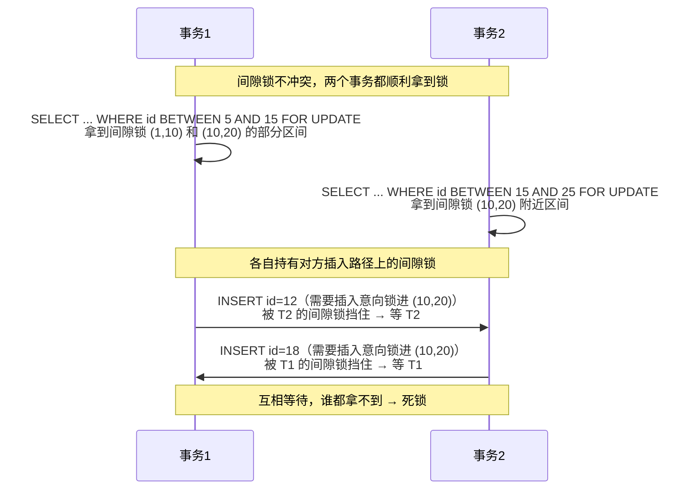

# MySQL 进阶

> **优先级：P0（面试必考）** — 后端面试数据库是必问模块，重点在索引、事务、锁、MVCC、SQL 优化。承接《数据库基础》的入门知识。

::: tip 背景
你已有数据库基础（SQL、表设计、TypeORM 使用），本文补面试深水区：B+ 树为什么快、事务隔离怎么实现（MVCC）、行锁间隙锁、explain 怎么读。
:::

## 索引：B+ 树

> **没读过 B+ 树专篇的先读它**：[B+ 树（算法篇）](/algorithms/b-plus-tree)——三分钟搞懂结构、IO 计算、分裂，再回来看本文的 MySQL 落地会顺畅得多。

### 为什么是 B+ 树（不是 B 树/哈希/二叉树）

| 结构 | 问题 |
|------|------|
| 哈希表 | 只能等值查询，无法范围查询 |
| 二叉树 | 数据量大时高度高，磁盘 IO 多 |
| B 树 | 每个节点都存数据，节点大，树高 |
| **B+ 树** | 非叶子只存索引（节点小、一次 IO 读更多），叶子存数据且**链表相连**（范围查询高效） |

B+ 树特点：矮（3-4 层可存千万级数据）、叶子有序链表、查询稳定（都要到叶子）。

### 聚簇索引 vs 非聚簇索引（必考）

| | 聚簇索引 | 非聚簇索引（二级索引） |
|--|---------|---------------------|
| 存什么 | 数据行（叶子 = 整行数据） | 索引列 + **主键值** |
| 数量 | 1 个（主键） | 多个 |
| 查询流程 | 一次定位到数据 | 先查索引拿到主键 → **回表**查聚簇索引 |

**回表是什么**：非聚簇索引的叶子里只存了"索引列 + 主键"，没存整行。所以查询分两步走：

```
① 在二级索引树里查 name = 'x'  →  拿到主键 id = 42     （第一次查树）
② 拿 id = 42 去聚簇索引树里查  →  拿到整行数据          （第二次查树）
```

这个"查完二级索引、再回主键索引查一次"的动作就是**回表**——像在图书馆先查卡片柜拿到索书号（①），再凭索书号去书架取书（②），比直接扫架快，但比书就在手边多跑一趟。

**覆盖索引**：`SELECT id, name FROM t WHERE name = 'x'`——索引里已有 id 和 name，**不需要回表**（②省掉了），这就是覆盖索引优化的核心：查询的列都在索引里，一趟查完。

### 最左前缀原则（必考）

联合索引 `(a, b, c)` 生效规则：

| 查询条件 | 走索引吗 |
|---------|---------|
| `WHERE a = 1` | ✅ 走 |
| `WHERE a = 1 AND b = 2` | ✅ 走 |
| `WHERE a = 1 AND b = 2 AND c = 3` | ✅ 全走 |
| `WHERE b = 2` | ❌ 不走（没从 a 开始） |
| `WHERE a = 1 AND c = 3` | ⚠️ 只走 a（中间断了 b） |

**原因**：索引按 `(a,b,c)` 字典序组织，跳过一个字段后面的没法比较。

**面试题**：`WHERE a = 1 AND c = 3 AND b = 2` 走索引吗？——走！**MySQL 优化器会自动调整条件顺序**（与书写顺序无关）。

### 范围查询会"截断"后面的列

`WHERE a = 1 AND b > 2 AND c = 3`：a 能用、b 用于范围、**c 用不上**。

**原因**：B+ 树先按 a 排序，a 相同的再按 b 排序，b 相同的才按 c 排序。`b > 2` 是一个范围，落在范围里的记录，其 c 值**并不是有序的**（c 只在 b 相等时才有顺序），所以无法用 c 继续定位。

> **那优化器为啥不把 c "调"到 b 前面去？**——注意这里被调整的不是一回事，得分两层看：
>
> 1. **条件的书写顺序**，优化器能调：`WHERE a = 1 AND c = 3 AND b = 2` 里 AND 是可交换的，先写谁后写谁语义一样，优化器随便重排，照样按 (a,b,c) 匹配——这是语法层的自由
> 2. **索引列的物理顺序**，谁也改不了：索引就是按 (a,b,c) 排序存的，`b > 2` 一旦是范围，范围内 c 的物理排列就断了，优化器再聪明也没法在一堆无序值里二分查找
>
> 比喻：电话簿按（姓, 名）排序，让你找"姓张、名不含'三'、年龄 20"的人——姓是精确的，名是范围（排除一个值也是范围），年龄在所有"姓张且名不含三"的人里**并没有接着排序**，你没法拿年龄继续二分翻簿，只能把范围里的人逐个看年龄。

> **设计联合索引的推论**：**等值条件放前面，范围条件放最后**。

`WHERE a = 1 ORDER BY b`：✅ 能利用索引排序（a 是定值，b 天然有序），省掉一次 `filesort`。

### 索引失效的 6 种常见场景

| 场景 | 例子 | 为什么失效 |
|------|------|-----------|
| **函数 / 运算** | `WHERE YEAR(create_time) = 2026` | 索引存的是原始值，不是函数结果 → 改写成范围：`create_time >= '2026-01-01' AND create_time < '2027-01-01'` |
| **隐式类型转换** | `WHERE phone = 13800000000`（phone 是 varchar） | 字符串列与数字比较，MySQL 把**列**转成数字（等价于对列做函数）→ 传字符串 `'13800000000'` |
| **左模糊 / 全模糊** | `WHERE name LIKE '%张'` | 前缀不确定，无法在有序索引里定位 → 尽量用 `LIKE '张%'` |
| **`OR` 连接非索引列** | `WHERE a = 1 OR b = 2`（只有 a 有索引） | 要保证 b 的结果就得全表扫描 → 两边都建索引，或用 `UNION` 改写 |
| **不满足最左前缀** | 联合索引 `(a,b,c)`，查 `WHERE b = 2` | 跳过 a，无法在索引中定位 |
| **`!=` / `NOT IN` / `IS NOT NULL`** | `WHERE status != 1` | 选择度低时，优化器算下来"走索引 + 回表"比全表扫更贵，**主动放弃索引** |

> 注意最后一种：它不是"语法上不能用索引"，而是**优化器基于成本估算放弃了**。`EXPLAIN` 里 `key = null` 但 `possible_keys` 有值，就是这种情况——可以试试 `FORCE INDEX` 或调整索引。

### 索引下推（ICP，Index Condition Pushdown）

**场景**：联合索引 `(name, age)`，查询 `WHERE name LIKE '张%' AND age = 20`。

**没有 ICP 时**：
1. 在索引上按 `name LIKE '张%'` 找到所有匹配记录的主键
2. **回表**取出整行
3. 在 Server 层过滤 `age = 20`

问题：`age` 明明就在索引里，却要回表之后才能过滤——白白多回表了很多行。

**有 ICP 时**（MySQL 5.6+，默认开启）：把 `age = 20` 这个条件下推到**存储引擎层**，在索引上直接判断，不满足的**根本不回表**。

```
无 ICP：索引过滤 name → 回表 N 行 → Server 层过滤 age
有 ICP：索引过滤 name + age → 回表 M 行（M < N）→ Server 层无需再过滤
```

`EXPLAIN` 的 `Extra` 出现 **`Using index condition`** 就是走了 ICP。

> **三个容易混的 Extra 标记**：
> - `Using index` = **覆盖索引**（不用回表）
> - `Using index condition` = **索引下推**（少回表）
> - `Using where` = 回表后在 Server 层过滤

## 事务与隔离级别

### ACID 及各自的实现

| 特性 | 含义 | InnoDB 靠什么实现 |
|------|------|------------------|
| **A** 原子性 | 事务内操作要么全成功、要么全回滚 | **undo log**（回滚日志）——修改前先记旧值，回滚时反向执行 |
| **C** 一致性 | 数据从一个一致状态到另一个一致状态 | 由 A + I + D 共同保证（它是**目的**，不是手段） |
| **I** 隔离性 | 并发事务互不干扰 | **MVCC**（读）+ **锁**（写） |
| **D** 持久性 | 提交后即使宕机也不丢 | **redo log**（重做日志）——先写日志再刷盘（WAL） |

> **两套日志的分工**（面试高频）：
> - **undo log 管"回滚"**：记录数据修改**前**的样子，事务失败时恢复；同时它也是 MVCC 版本链的来源
> - **redo log 管"不丢"**：记录"在哪个数据页做了什么修改"，宕机重启后重放
> - **为什么需要 redo log**？直接改磁盘页是随机 IO，太慢。先**顺序写日志**、再慢慢刷盘（WAL，Write-Ahead Logging）——用"顺序写"换"随机写"

### 隔离级别与三类读问题

| 隔离级别 | 脏读 | 不可重复读 | 幻读 |
|---------|------|-----------|------|
| 读未提交 | 可能 | 可能 | 可能 |
| 读已提交（RC） | 不可能 | 可能 | 可能 |
| **可重复读（RR，MySQL 默认）** | 不可能 | 不可能 | 可能（InnoDB 靠间隙锁解决） |
| 串行化 | 不可能 | 不可能 | 不可能 |

- **脏读**：读到未提交的数据
- **不可重复读**：同一查询两次结果不同（其他事务提交修改）
- **幻读**：同一查询两次**行数**不同（其他事务插入/删除）

## MVCC：多版本并发控制（必考）

**一句话**：MVCC 让"读"不用等"写"——事务 B 在改某行时，事务 A 同时读这行不会被阻塞，A 读到的是自己快照里的旧版本。没有 MVCC，读写只能靠锁互斥（B 改着，A 连读都得排队等）。

MVCC 的思路和 Git 一样：**不覆盖历史，每次修改生成一个新版本**，读的人拿自己那个时点的快照看。

### 版本链：数据行的"Git 提交历史"

InnoDB 给每行数据藏了三个字段（用户看不见）：

| 隐藏字段 | 作用 | Git 类比 |
|---|---|---|
| `trx_id` | 最后修改这行的事务 ID | 这次提交是谁干的 |
| `roll_pointer` | 指向上一版本的指针 | 指向上一个 commit |
| `row_id` | 行 ID（无主键时的备选） | — |

每次事务修改一行，就生成一个新版本（新 `trx_id`），旧版本通过 `roll_pointer` 挂成一条链——这就是**版本链**。旧版本存在 undo log 里（修改前先留"旧照"，本来是为回滚准备的，MVCC 顺手拿来当历史仓库）。

### ReadView：事务的"可见性名单"

版本链有了，读哪个版本？规则是：**读我这一眼能看见的那个**。事务做快照读时，会生成一份 **ReadView**——记录此刻"哪些事务还没提交"（活跃事务列表）。

顺着版本链从新往旧看，对每个版本问一句"你这版的事务提交了吗"：

```
ReadView 判断规则：
- 版本的 trx_id 不在活跃列表里 → 已提交 → 可见 ✅
- 版本的 trx_id 在活跃列表里   → 还没提交 → 不可见 ❌，顺链继续找下一版
```

（"跟活跃事务的最小/最大 ID 比较"是这条规则的等价实现，理解版不用记两遍。）

### 一个时间线例子

```
初始：balance = 100

T1 时刻：事务 B（trx_id=200）把 balance 改成 200 —— 未提交
T2 时刻：事务 A（trx_id=300）第一次 SELECT balance
T3 时刻：事务 B 提交
T4 时刻：事务 A 再 SELECT balance
```

**可重复读（RR）下**：

- T2 时 A 生成 ReadView：活跃事务 = [200]（B 还没提交）
- A 顺链看：最新版本 `trx_id=200` 在活跃列表里 → 不可见；下一版 `trx_id=100`（初始状态，早提交了）→ 可见 → **A 读到 100**
- T4 时 A 再查：RR **复用** T2 生成的 ReadView（200 还在名单里）→ 还是读到 **100**
- 哪怕 T3 B 已提交、库里实际值是 200——A 眼里始终是 100，这就是**可重复读**

**读已提交（RC）下**：T4 时 A **重新生成** ReadView，此时 B 已提交、不在活跃名单 → 最新版本可见 → A 读到 **200**（同一事务内两次查询结果不同）。

### RC vs RR 的唯一区别

就一件事：**ReadView 的生成时机**——RC 每次查询都生成新的（所以能读到别人刚提交的），RR 只在第一次查询生成、之后复用（快照冻结，保证可重复读）。

### 当前读 vs 快照读

| 类型 | 语句 | 行为 |
|---|---|---|
| **快照读** | 普通 `SELECT` | 走 MVCC 版本链，读快照版本，不加锁 |
| **当前读** | `SELECT ... FOR UPDATE` / `UPDATE` / `DELETE` / `INSERT` | 读**最新已提交**版本，加锁 |

所以 `UPDATE`、`DELETE` 这类写操作永远是"当前读"——它们必须拿最新值来改。这也解释了为什么 RR 下普通 SELECT 读不到别的事务刚提交的数据，而 UPDATE 却能：**写走锁和最新版本，读才走 MVCC 快照**。

## 锁

### InnoDB 锁类型

| 锁 | 说明 |
|----|------|
| 行锁 | 锁单行（基于索引实现） |
| 间隙锁（Gap Lock） | 锁索引区间，阻止插入，**解决幻读** |
| 临键锁（Next-Key Lock） | 行锁 + 间隙锁组合，左开右闭区间 |
| 表锁 | 锁整表（DDL、无索引查询兜底） |
| 意向锁（IS/IX/S） | **表级**标记，告诉"我打算在表里加行锁"，别人加表锁前不用逐行检查 |
| 插入意向锁（Insert Intention Lock） | **间隙级**，"我要往这个空档插一条"，**用途见下方专节**（理解间隙锁死锁的前提） |

::: tip 别混淆
表里的 **意向锁** 是表级"声明"（我一会儿要锁行），**插入意向锁**是间隙级"申请"（我这一条要插进这个空档）。两者名字像、层级不同，中文语境里经常混着说——面试时说清楚层级就不会错。
:::

### 插入意向锁是干什么的（理解死锁的前提）

前面说"间隙锁会阻塞插入"，那插入方总得有个东西表示"我在等"——**插入意向锁就是这个"等待凭证"**。它是 InnoDB 为插入操作设计的一种**特殊间隙锁**，作用有两个：

**作用一：告诉别人"这个空档有人要插了"**

一个事务准备 `INSERT id=12`（落在索引值 10 和 20 之间的空档）时，InnoDB 不会直接去抢那把间隙锁，而是先在 (10, 20) 这个间隙里放一个**插入意向锁**。这个标记的作用是：

| 场景 | 发生了什么 |
|---|---|
| 另一个事务也想插 (10, 20) | **不冲突**——两个插入意向锁可以并存，各自等着（不需要排成一条队互相挡） |
| 有人持有 (10, 20) 的**间隙锁** | **冲突**——间隙锁的意思就是"禁止插入"，所以插入意向锁只能等它释放 |

**作用二：把"等谁"这件事说清楚**

没有插入意向锁时，等待关系是模糊的——插入方只能挂起，没人知道它在等什么。有了它，等待队列里明确记录了"**这个事务在等 (10, 20) 的间隙锁释放**"，InnoDB 检测死锁时才能画出那张"A 等 B、B 等 A"的关系图。**上一节那个死锁场景之所以能被检测出来，靠的就是这个标记。**

#### 一个类比

把间隙锁想成**停车场的闸机**：

- **间隙锁** = 闸机关着，声明"这个位子我占了，谁也别停"
- **插入意向锁** = 你开车到闸机口按了卡，闸机显示"等待中"。**两张卡可以都按着一起等**（不互相挤），但闸机不会为任何人抬杆，直到占位的人开走

关键在于：等待方**不是**去抢闸机，而是**留个名号排在旁边**。这个"名号"就是插入意向锁。

#### 为什么它必然导致死锁

因为它同时满足两个条件：

1. **插入意向锁之间不冲突** → 两个事务可以各自拿着插入意向锁，同时卡住
2. **插入意向锁与间隙锁冲突** → 卡住的同时又被对方持有的间隙锁顶着

于是就有了"A 的插入意向锁等 B 的间隙锁，B 的插入意向锁等 A 的间隙锁"——**循环等待**。如果插入意向锁之间也冲突，第二个事务会直接排队，根本不会产生交叉，反而**不会死锁**。

> 换个角度看：**插入意向锁的"不冲突"设计本来是为了提高插入并发度（允许多方同时等待），但它和"间隙锁不冲突"叠加在一起，就成了死锁的温床。** 这也是面试里少有人答到的角度。

### 行锁什么时候会"变成"表锁

InnoDB 的行锁是**加在索引上的**——这也解释了"UPDATE 没走索引会锁表"：

| 情况 | 实际加锁 |
|------|---------|
| `WHERE id = 1`（主键） | 行锁（只锁这一行） |
| `WHERE name = 'x'`（name 有索引） | 行锁（锁索引项 + 对应主键行） |
| `WHERE note = 'x'`（note **无索引**） | **全表逐行加锁**（没有索引可定位，只能全扫并给每行加锁，效果≈表锁） |

> 面试常问："为什么 UPDATE 不走索引会锁全表？"——答案：**行锁依赖索引定位**，没索引就只能全表扫描并逐行加锁。

### 间隙锁的副作用

间隙锁（Gap Lock）锁的是"两个索引值之间的空档"，用于阻止插入、解决幻读。副作用：

- **锁范围变大**：`WHERE id > 5 AND id < 10` 会锁住 `(5, 10)` 整个区间——插入 7 会被阻塞（即使 7 原本不存在）
- **更容易死锁**：间隙锁之间不冲突，但"插入意向锁"与间隙锁冲突，容易形成死锁（下面单独展开）
- **只在 RR 级别生效**：RC 下没有间隙锁（所以 RC 并发更好，但幻读要靠应用层处理）

### 间隙锁为什么会死锁（展开）

> **前置**：插入意向锁是什么、为什么存在，见上节「插入意向锁是干什么的」。没读那一节直接看这节会很吃力。

死锁需要两个事务**互相等待对方的锁**。间隙锁死锁的关键在于两种锁的"相容性"恰好相反。

#### 第一步：搞清楚谁和谁冲突

| 锁 A | 锁 B | 是否冲突 | 原因 |
|---|---|---|---|
| 间隙锁 | 间隙锁 | **不冲突** | 间隙锁只标记"这个区间我要管"，不占任何实际资源。两个事务锁不同的区间（甚至同区间）都能共存 |
| 插入意向锁 | 插入意向锁 | **不冲突** | 两个事务都想插进同一个空档，各自在旁边挂个号等间隙锁释放，不互相挡 |
| **插入意向锁** | **间隙锁** | **冲突** ⚠️ | 间隙锁的意义就是"禁止插入"。要插就必须等间隙锁释放 |

**一句话**：间隙锁之间"客客气气"，谁也不挡谁；但**只要有一个要插东西，就会跟所有挡在它面前的间隙锁对着干**。

#### 第二步：怎么就形成循环等待了

冲突关系本身不构成死锁——死锁还得配上"**交叉访问**"。看这个真实场景，表中已有 `id = 1, 10, 20`：



注意最后两步：**两个事务都要往同一个间隙 (10, 20) 里插数据**。T1 的插入意向锁被 T2 持有的间隙锁挡，T2 的插入意向锁又被 T1 持有的间隙锁挡——**循环等待成立**，InnoDB 检测到后回滚其中一个，报 `Deadlock found when trying to get lock`。

#### 面试怎么答这道题

> **问**：间隙锁为什么容易死锁？
>
> **答**：间隙锁之间不冲突，所以两个事务可以各自持有不同区间的间隙锁；但插入意向锁与间隙锁是冲突的。当两个事务**交叉访问**——各自先锁住一段区间（对方插入时也要经过的区间），再各自往对方的地盘插入时，插入意向锁就被对方的间隙锁挡住，形成循环等待。**本质是"间隙锁不互斥"降低了并发度，却让锁的依赖关系变得隐蔽**——两个事务各自拿锁时都不冲突，插进去才发现对方已经在那了。

#### 实践上怎么防

| 手段 | 说明 |
|---|---|
| **让所有事务按同一顺序访问** | 最有效：约定"永远先改 id 小的表/行"，交叉变单向，死锁不成立 |
| **缩短事务** | 不在事务里塞 HTTP 调用、MQ 发送、大循环——持锁时间越短越安全 |
| **给热点字段建索引** | 没索引的 `WHERE` 会锁一大片间隙，把更多事务卷进冲突里 |
| **批量插入放在事务末尾** | 一堆 INSERT 聚在最后一次性提交，别和别的查询交错 |
| **改用 RC 隔离级别** | RC 下没有间隙锁，死锁概率大幅下降；代价是幻读要靠业务层保证（多数业务可以接受） |
| **死锁后重试** | 应用层捕获 `Deadlock found`，回滚整个事务后重试——这是所有数据库的通用兜底 |

::: tip 面试加分点
主动说一句"**死锁是设计内的正常行为，InnoDB 会自动检测并回滚代价小的事务，应用层正确做法是重试而不是想方设法零死锁**"，通常比背一堆优化手段更有说服力。
:::

### 死锁

**必要条件**：互斥、持有并等待、不可剥夺、循环等待。

**排查与解决**：
```
SHOW ENGINE INNODB STATUS;   # 查看最近死锁信息
```
- 调整事务访问资源的顺序（统一先 A 后 B）
- 缩短事务时间
- 死锁时 InnoDB 自动回滚一个事务（`Deadlock found when trying to get lock` 错误）
- 应用层捕获该异常并重试整个事务

其中最常见的一种成因是间隙锁死锁（插入意向锁与间隙锁冲突 + 交叉访问），机制见上节「间隙锁为什么会死锁」。

### 乐观锁 vs 悲观锁

| | 悲观锁 | 乐观锁 |
|---|--------|--------|
| 思路 | 假设一定冲突，先加锁再操作 | 假设一般不冲突，更新时才检查 |
| 实现 | `SELECT ... FOR UPDATE`（数据库锁） | 版本号 / 条件更新（应用层） |
| 加锁时机 | 读的时候就锁 | 写的时候才校验 |
| 适用 | 冲突激烈、写多 | 冲突较少、读多写少 |
| 缺点 | 并发差、易死锁、持锁期间阻塞 | 冲突多时大量失败 / 重试 |

```sql
-- 悲观锁:锁住这一行,其他事务阻塞
BEGIN;
SELECT stock FROM product WHERE id = 1 FOR UPDATE;
UPDATE product SET stock = stock - 1 WHERE id = 1;
COMMIT;

-- 乐观锁(版本号):更新时校验版本,受影响行数为 0 说明被人抢先
UPDATE product SET stock = stock - 1, version = version + 1
WHERE id = 1 AND version = 5;

-- 乐观锁(条件更新):最简洁,适合"只减不查"的场景
UPDATE product SET stock = stock - 1 WHERE id = 1 AND stock > 0;
```

> **乐观锁重试三要点**：① 限制重试次数（避免雪崩式重试）；② 加重试间隔（指数退避）；③ 重试前重新读取最新数据。

## SQL 优化：explain 怎么读

**EXPLAIN 是什么**：MySQL 的一个命令前缀，不是配置项也不是插件——在任何 SELECT 前加 `EXPLAIN`，MySQL 不会真正执行查询，而是返回这条 SQL 的**执行计划**：用没用索引、扫多少行、怎么连表、要不要排序。它是 SQL 优化的第一诊断工具，感觉查询慢，第一步就是 EXPLAIN 它。

```sql
EXPLAIN SELECT * FROM users WHERE name = 'x';
```

| 字段 | 含义 | 关注点 |
|------|------|--------|
| `type` | 访问类型 | 从上到下：system > **const** > eq_ref > **ref** > range > **index** > **ALL** |
| `key` | 实际用的索引 | 为 null = 没走索引 |
| `rows` | 扫描行数（估算） | 越小越好 |
| `Extra` | 附加信息 | `Using filesort`（排序没走索引）、`Using temporary`（临时表）要警惕 |

**优化套路**：
1. 查询尽量走索引：`type` 到 `ref`/`range` 级别
2. 避免 `SELECT *`（覆盖索引机会 + 网络开销）
3. 避免 `%xxx%` 模糊查询（前缀通配符不走索引）
4. 避免对索引列做函数/运算：`WHERE YEAR(create_time) = 2026` 不走索引，改范围查询
5. 分页深翻页优化：见下方专节

### 深分页为什么慢，怎么优化

`SELECT * FROM orders LIMIT 1000000, 20` 的执行过程：**扫描并丢弃前 100 万行**，只返回最后 20 行——而且丢弃的每一行都可能伴随一次**回表**。

**方案一：游标分页（推荐，性能最好）**

```sql
-- 记住上一页最后一条的 id,下一页从它之后取
SELECT * FROM orders WHERE id > 1000000 ORDER BY id LIMIT 20;
```

- ✅ 直接走主键索引定位，**没有丢弃**，性能稳定
- ❌ 只能顺序翻页，**不能跳页**（适合"下拉加载更多"）

#### 为什么可以拿 id 当游标？

**因为主键索引本身就是按 id 从小到大物理有序排列的**（聚簇索引，见前文）。这正是主键选型的隐性优势——自增主键天然单调递增，索引树里新行永远追加到最右侧的叶子页，不存在"插到中间导致页分裂、顺序错乱"的问题。

于是 `WHERE id > 1000000` 这个条件可以直接在 B+ 树上定位到 1000000 那个节点，**然后一路往右取 20 条就结束**：

```sql
-- 慢：要扫 100 万行（每行还可能回表），再丢掉前 999,980 行
SELECT * FROM orders ORDER BY id LIMIT 1000000, 20;

-- 快：在索引上定位到 id=1000000，右走 20 条，O(logN + 20)
SELECT * FROM orders WHERE id > 1000000 ORDER BY id LIMIT 20;
```

**关键差异**：前者必须**数着走到**第 100 万行（`OFFSET` 是"跳过 N 条"，引擎只能一条条数），后者是"**从某个点往右取 N 条**"，起点一步定位。

> 这也解释了**为什么主键推荐用自增整数而不是 UUID**：UUID 无序，插入时随机落在索引中间，大量页分裂 + 索引碎片，游标分页也用不上。

#### 游标分页的前提：排序字段必须"唯一且有序"

这套写法能成立有两个硬条件——**排序字段和游标字段必须是同一个唯一索引列**：

| 场景 | 能否用 `WHERE id > ?` | 原因 |
|---|---|---|
| `ORDER BY id`（主键/自增） | ✅ 可以 | id 唯一且单调递增，无重复无遗漏 |
| `ORDER BY create_time`（时间，允许重复） | ⚠️ 要多带一个字段兜底 | 同一秒/同一毫秒可能有多条，只用时间当游标会**漏数据或重复** |
| `ORDER BY user_id`（有重复） | ❌ 不行 | 值重复，无法确定"上一页最后一条"是谁 |

**时间戳做游标的正确写法**——加一个唯一列做二级游标（复合游标）：

```sql
-- 上一页最后一条是 (create_time = '2026-10-01 10:00:05', id = 888)
SELECT * FROM orders
WHERE (create_time, id) > ('2026-10-01 10:00:05', 888)   -- 行构造器比较，等价于字典序
ORDER BY create_time, id
LIMIT 20;
```

道理和 [最左前缀原则](#最左前缀原则必考) 完全一样：`(create_time, id)` 是联合索引，先按时间排、时间相同再按 id 排，所以这两列合起来能唯一确定一条记录的位置。**判据就是游标列必须构成一个唯一、有序的索引前缀。**

::: tip "不能跳页"是怎么来的
游标分页只知道"上一条在哪"，往回翻就得一路反向扫到起点——所以只能"下一页"。真要跳页（比如从第 500 页直接点过去），只能用方案二 `OFFSET`，接受慢。
:::

**方案二：延迟关联（可跳页）**

```sql
-- 先在索引上分页拿主键,再回表取整行
SELECT o.* FROM orders o
JOIN (SELECT id FROM orders ORDER BY id LIMIT 1000000, 20) t ON o.id = t.id;
```

原理：子查询只扫主键（覆盖索引），扫描代价远小于 `SELECT *`；**回表只发生 20 次**（而不是 100 万次）。

**方案三：业务层限制**

限制最大翻页深度（如最多 100 页），或改成"筛选 + 搜索"而不是无限翻页。

## 窗口函数（MySQL 8.0+）

窗口函数 = **在不折叠行的情况下做聚合 / 排名**。和 `GROUP BY` 的区别：`GROUP BY` 把多行压成一行，窗口函数**每行都保留**，只是多算了一列。

```sql
函数名() OVER (
  PARTITION BY 分组字段      -- 可选:按什么分组(类似 GROUP BY,但不折叠)
  ORDER BY 排序字段          -- 可选:组内排序
)
```

### 常用函数

| 函数 | 作用 | 典型场景 |
|------|------|---------|
| `ROW_NUMBER()` | 组内连续编号（1,2,3，**不并列**） | 去重、每组取第 N 条 |
| `RANK()` | 组内排名，**并列会跳号**（1,2,2,4） | 排行榜 |
| `DENSE_RANK()` | 组内排名，**并列不跳号**（1,2,2,3） | 名次连续的排行榜 |
| `SUM / AVG / COUNT() OVER(...)` | 分组聚合，但保留每行 | 占比、累计值 |
| `LAG(col, n)` / `LEAD(col, n)` | 取前 n 行 / 后 n 行的值 | 环比、同比 |

### 四个实战套路

**① 每组 TopN（面试最高频）**

```sql
-- 每个部门工资最高的前 2 名
SELECT * FROM (
  SELECT e.*, d.name AS dept_name,
         ROW_NUMBER() OVER (PARTITION BY e.dept_id ORDER BY e.salary DESC) AS rn
  FROM employee e LEFT JOIN department d ON e.dept_id = d.id
) t
WHERE t.rn <= 2;
```

**② 占比**

```sql
SELECT name, salary,
       ROUND(salary / SUM(salary) OVER (PARTITION BY dept_id) * 100, 1) AS pct
FROM employee;
```

**③ 环比（LAG）**

```sql
SELECT month, amount,
       LAG(amount) OVER (ORDER BY month) AS prev_amount,
       ROUND((amount - LAG(amount) OVER (ORDER BY month))
             / LAG(amount) OVER (ORDER BY month) * 100, 1) AS growth_pct
FROM monthly_stats;
```

**④ 连续 N 天（日期 - ROW_NUMBER 分组法）**

```sql
-- 连续 3 天及以上有订单的用户
SELECT user_id FROM (
  SELECT user_id,
         DATE(created_at) AS d,
         DATE(created_at) - INTERVAL ROW_NUMBER() OVER (
           PARTITION BY user_id ORDER BY DATE(created_at)
         ) DAY AS grp
  FROM orders
  GROUP BY user_id, DATE(created_at)     -- 同一天多单只算一天
) t
GROUP BY user_id, grp
HAVING COUNT(*) >= 3;
```

> **连续问题的通用思路**：连续的日期减去"连续的序号"，差值是一个**固定值**——按这个差值分组，就能把连续段挑出来。同一招也能解"连续签到""连续登录"。

## 实战专题

### 一条 SQL 的执行流程

```
客户端
  ↓ ① 连接器:鉴权、管理连接(连接池)、读权限
  ↓ ② 查询缓存(MySQL 8.0 已移除:命中率低、失效频繁)
  ↓ ③ 解析器:词法/语法分析 → 生成解析树
  ↓ ④ 优化器:选索引、决定 JOIN 顺序 → 生成执行计划
  ↓ ⑤ 执行器:调用存储引擎接口,逐行取数并过滤
  ↓ ⑥ 存储引擎(InnoDB):从 Buffer Pool / 磁盘取数据
```

要点：

- **优化器**决定"走不走索引"——所以会出现"索引明明存在却没被用"的情况（成本估算问题）
- **执行器是逐行处理的**（MySQL 8.0.18+ 才引入 Hash Join，之前 JOIN 都是嵌套循环）
- **Buffer Pool** 是内存中的数据页缓存，命中就不读磁盘——这是 InnoDB 性能的关键

### 慢查询排查

**第一步：定位慢 SQL**

```sql
-- 开启慢查询日志(也可写在 my.cnf 里持久化)
SET GLOBAL slow_query_log = ON;
SET GLOBAL long_query_time = 1;         -- 超过 1 秒记录
SHOW VARIABLES LIKE 'slow_query_log_file';

-- 看当前正在执行的语句(排查"正在跑"的慢 SQL)
SHOW PROCESSLIST;

-- 用 mysqldumpslow / pt-query-digest 分析日志,找出 TOP 慢 SQL
```

**第二步：EXPLAIN 分析**——看 `type`（是否 `ALL`）、`key`（是否 `null`）、`rows`（扫描行数）、`Extra`（`filesort` / `temporary`）。

**第三步：对症优化**

| 问题 | 优化 |
|------|------|
| 没走索引 | 建合适索引 / 改写 SQL（避免函数、隐式转换） |
| 走了索引但扫描行数多 | 调整联合索引顺序、加覆盖索引 |
| `Using filesort` | 让 ORDER BY 走索引（排序字段纳入联合索引） |
| `Using temporary` | GROUP BY 字段加索引，或改写 |
| 深分页 | 游标分页 / 延迟关联 |
| 数据量太大 | 分区表 / 归档历史数据 / 分库分表 |

**第四步：验证**——改完再 EXPLAIN 一次，对比 `rows` 与实际耗时。

> 排查原则：**先定位、再优化**。不要一上来就"加索引"，先确认慢在哪（慢日志 → EXPLAIN → 具体原因）。

### 高并发扣库存（超卖问题）

100 件库存、1000 个并发请求，三种方案对比：

**方案一：悲观锁（`FOR UPDATE`）**

```sql
BEGIN;
SELECT stock FROM product WHERE id = 1 FOR UPDATE;   -- 锁行
-- 应用层判断 stock > 0
UPDATE product SET stock = stock - 1 WHERE id = 1;
COMMIT;
```

- ✅ 简单、绝对不超卖
- ❌ 串行化执行，并发差；持锁期间其他请求排队

**方案二：乐观锁（条件更新）**

```sql
UPDATE product SET stock = stock - 1 WHERE id = 1 AND stock > 0;
-- 受影响行数为 0 → 库存不足,直接返回"售罄"
```

- ✅ 无显式加锁，并发高（**UPDATE 本身由 InnoDB 行锁保证原子性**）
- ✅ 一条 SQL 同时完成"判断 + 扣减"
- 💡 **扣库存的最优解**：高并发下失败的请求本来就应该"售罄"，不需要重试

**方案三：Redis 预扣减 + 异步落库**

```lua
-- Lua 脚本保证"判断 + 扣减"原子
if tonumber(redis.call('get', KEYS[1])) > 0 then
  redis.call('decr', KEYS[1])
  return 1
else
  return 0
end
```

- ✅ 性能最高（内存操作 + 单线程无锁竞争），能扛几十万 QPS
- ❌ 引入一致性问题：Redis 扣了但 DB 写失败怎么办（需补偿 / 对账）；Redis 挂了要兜底

**选型**：并发几千 → 方案二；秒杀级（几万+）→ 方案三 + 方案二兜底 + 消息队列异步落库。

### 缓存与数据库一致性

**为什么是"先更新数据库、再删缓存"？**

| 顺序 | 问题 |
|------|------|
| 先删缓存，再更新 DB | 删完缓存、更新完成前，另一个请求读到**旧数据并写回缓存** → 缓存长期是脏的 |
| **先更新 DB，再删缓存**（推荐） | 极端情况（读请求恰好卡在"更新完成、删除缓存前"）也可能脏，但**概率极低** |

**延迟双删**：更新 DB 后，**延迟一段时间再删一次缓存**，兜住"更新期间被写回的旧缓存"。

```js
await db.update(...)
await redis.del(key)
setTimeout(() => redis.del(key), 500)   // 延迟再删一次
```

**能强一致吗？** 不能（除非上分布式锁或把缓存和 DB 放进同一事务，代价极大）。工程上追求**最终一致**——接受短暂不一致，用 TTL 兜底。

### 分库分表

**什么时候需要？**

| 信号 | 经验阈值 |
|------|---------|
| 单表数据量 | > 1000 万行（或单表 > 20GB） |
| 单库 QPS | 接近单机 MySQL 上限（几千 ~ 上万） |
| 磁盘 / 连接数 | 单机瓶颈 |

**垂直 vs 水平**

| | 垂直拆分 | 水平拆分 |
|---|---|---|
| 拆什么 | 按**业务 / 字段**拆（用户库、订单库分离；大字段拆副表） | 按**行**拆（`user_id % 4` → 4 张表） |
| 特点 | 业务解耦，单表结构不变 | 单表数据量下降，便于扩容 |
| 例子 | 用户库 / 订单库分离 | `orders_0` ~ `orders_3` |

**分表后的新问题**

| 问题 | 解决 |
|------|------|
| 跨库 JOIN | 冗余字段 / 应用层组装 / 宽表 |
| 分布式事务 | 尽量单库事务；跨库用 TCC / 最终一致（MQ） |
| 全局唯一 ID | 雪花算法（Snowflake）/ Redis INCR / 号段模式 |
| 跨库分页 | 各分片取前 N 再归并；或改用搜索引擎（ES） |
| 扩容迁移 | 一致性哈希 / 预分片（一开始就分 64 张，扩容时迁整片） |

> 分库分表是**最后手段**：先考虑索引优化 → 读写分离 → 缓存 → 归档。它会带来跨库查询、事务、全局 ID 等一堆新复杂度。

## 面试题速查

| 问题 | 一句话答案 |
|------|-----------|
| 为什么用 B+ 树 | 矮（IO 少）+ 叶子链表（范围查询高效） |
| 聚簇和非聚簇索引 | 叶子存整行 vs 存主键；二级索引要回表 |
| 什么是覆盖索引 | 索引列已包含所需字段，免回表 |
| 最左前缀 | 联合索引必须从最左列开始连续匹配 |
| 范围查询后面的列为啥用不上 | 该列在范围内不有序，无法继续定位 → 范围条件放最后 |
| 索引失效常见原因 | 函数运算、隐式类型转换、左模糊、OR 非索引列、不满足最左前缀、选择度低被优化器放弃 |
| 索引下推（ICP）是什么 | 把索引列的过滤条件下推到存储引擎，减少回表 → `Using index condition` |
| ACID 怎么实现 | A 靠 undo log、D 靠 redo log、I 靠 MVCC + 锁、C 是前三者共同的结果 |
| MySQL 默认隔离级别 | 可重复读（RR），靠 MVCC + 间隙锁 |
| MVCC 是什么 | 版本链 + ReadView 快照实现无锁读；RC 每次查询生成 ReadView，RR 首次生成后复用 |
| 幻读怎么解决 | 间隙锁/临键锁阻止插入 |
| 死锁必要条件 | 互斥 + 持有等待 + 不可剥夺 + 循环等待 |
| 插入意向锁干什么用 | 插入方的"等待凭证"：标记"我要往这个间隙插一条"；与间隙锁冲突（被禁止插入）、与其他插入意向锁不冲突（可并存等待），也让死锁检测能画出等待关系 |
| 间隙锁为什么容易死锁 | 间隙锁之间不冲突，插入意向锁与间隙锁冲突；两个事务交叉访问、各往对方地盘插入 → 循环等待 |
| 意向锁 vs 插入意向锁 | 前者表级"声明要加行锁"，后者间隙级"我要往这个空档插一条" |
| 为什么没走索引的 UPDATE 会锁表 | 行锁加在索引上，没索引只能全表扫描并逐行加锁 |
| 乐观锁 vs 悲观锁 | 更新时校验版本 vs 读时就加锁；前者适合冲突少的场景 |
| 扣库存怎么防超卖 | `UPDATE ... SET stock = stock - 1 WHERE id = ? AND stock > 0`（一条 SQL 原子完成） |
| 缓存一致性怎么做 | 先更新 DB 再删缓存 + 延迟双删；只能做到最终一致 |
| 深分页怎么优化 | 游标分页 `WHERE id > ? ORDER BY id`（定位起点 + 右取 N 条，O(logN+N)）；要求游标列唯一有序，时间戳需配 id 组成复合游标 |
| 什么时候分库分表 | 单表 > 1000 万行或单库 QPS 触顶；是最后手段 |
| 深分页怎么优化 | 游标分页 `WHERE id > ? ORDER BY id`（定位起点 + 右取 N 条，O(logN+N)）；要求游标列唯一有序，时间戳需配 id 组成复合游标 |
| explain 看什么 | type（访问级别）、key、rows、Extra |
| 窗口函数和 GROUP BY 区别 | GROUP BY 折叠行，窗口函数保留每行只多算一列 |
| 连续登录怎么查 | 日期 - `ROW_NUMBER()`，差值相同即连续 |

## 延伸阅读

- [B+ 树（算法篇）](/algorithms/b-plus-tree) - 本文索引的底层结构：多路矮树、IO 计算、分裂
- [数据库基础](/service/common/database) - 入门：表设计、SQL、范式
- [TypeORM 用法](/service/node/typeorm) - ORM 使用层
- [Redis 入门](/service/common/redis-intro) - 缓存层：索引查不到的兜底方案
