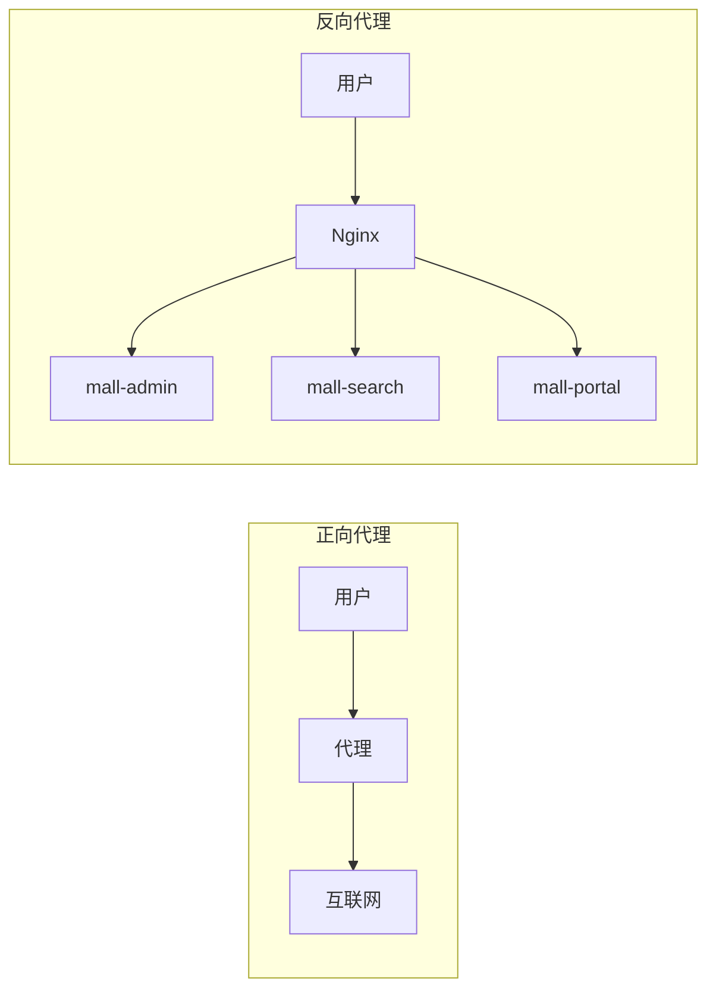
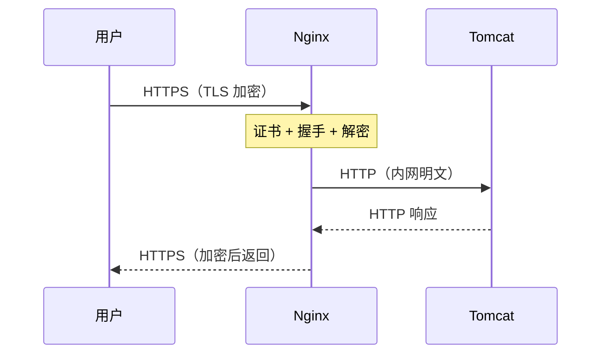
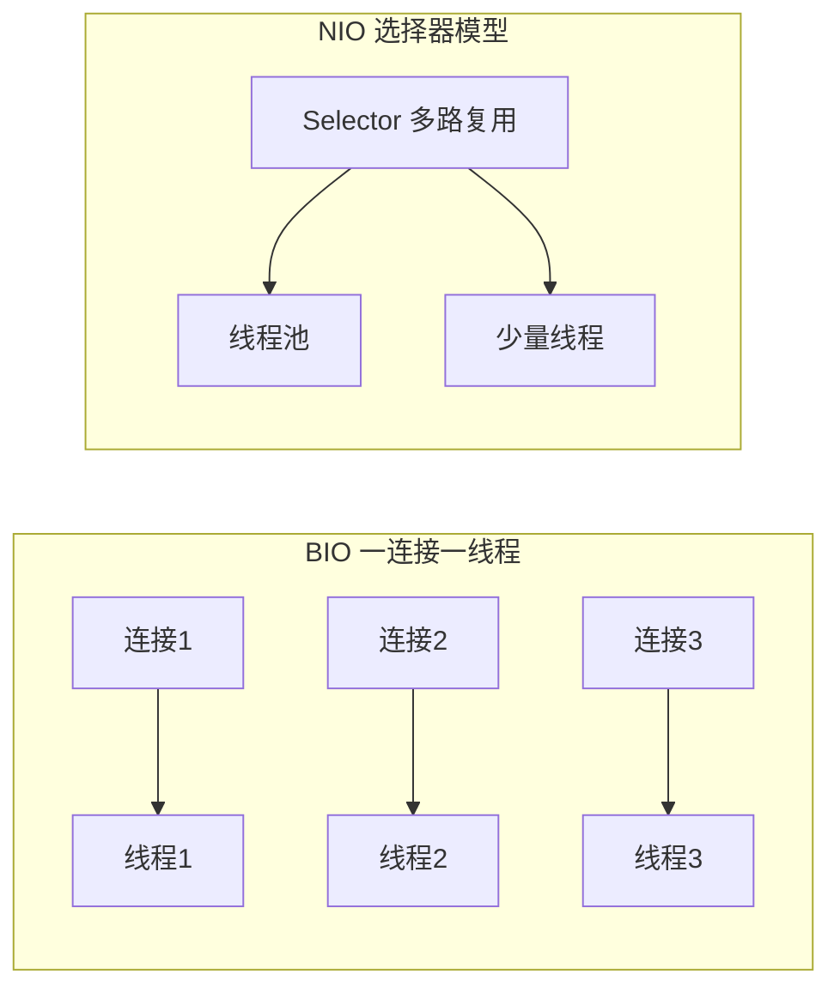
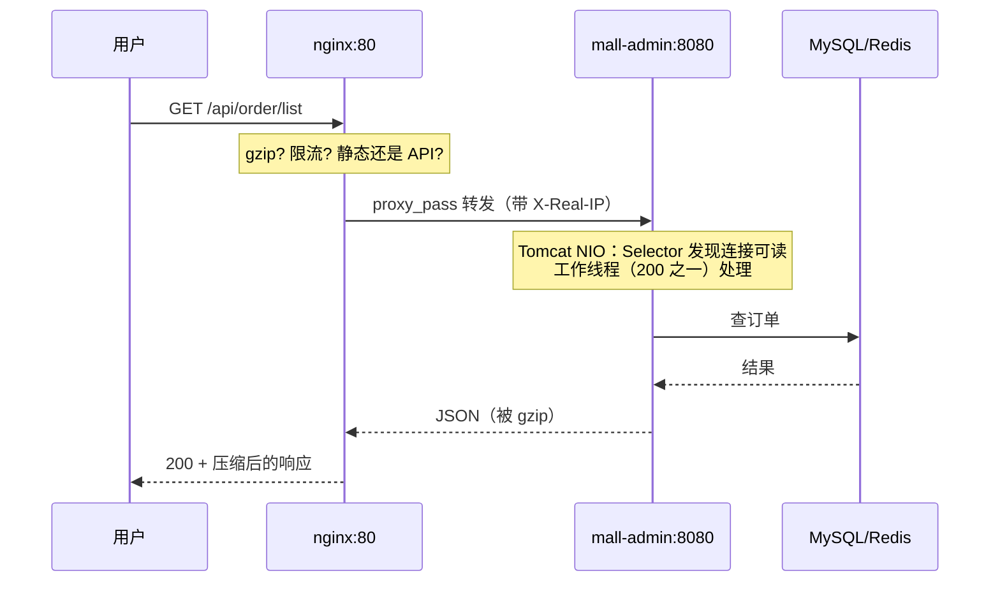

# Nginx 与 Web 容器

> **优先级：P0（上岗第一天就要配）** — Nginx 是 Java 后端的门面（反向代理/负载均衡/HTTPS），Tomcat 是应用的心脏（线程模型直接决定并发能力）。

::: tip 背景
mall 的部署图里，用户请求全部打到 nginx（80），由它分发给后端的 mall-admin/mall-search/mall-portal。本文讲清楚两件事：**Nginx 站在门口干什么**、**Tomcat 在里面怎么处理请求**。
:::

## 一、正向代理 vs 反向代理



| | 正向代理 | 反向代理 |
|---|---|---|
| 代理谁 | 代理**客户端**（帮用户出去） | 代理**服务器**（帮应用接客） |
| 谁不知道谁存在 | 服务端不知道真实用户 | **用户不知道后端有几台机器** |
| 典型场景 | 翻墙、公司出口统一管控 | 负载均衡、动静分离、HTTPS 终止 |

**后端说的"代理"默认是反向代理**。用户只面对 nginx 一个入口，后端有几台机器、扩缩容、换端口，用户无感——这就是解耦。

## 二、Nginx 核心能力

### 1. 反向代理（最基础）

```nginx
# mall 的入口：/api/ 开头的转给 mall-admin
location /api/ {
    proxy_pass http://mall-admin:8080/;   # 注意结尾的 /
    proxy_set_header Host $host;
    proxy_set_header X-Real-IP $remote_addr;       # 把真实用户 IP 传给应用
    proxy_set_header X-Forwarded-For $proxy_add_x_forwarded_for;
}
```

**必须传的三个头**：不传 `X-Real-IP`，应用日志里全是 nginx 的内网 IP，排查问题抓瞎；`X-Forwarded-For` 记录完整代理链。

**`proxy_pass` 结尾斜杠的坑**：带 `/` 会把 location 匹配的前缀**剥掉**再转发；不带 `/` 则**原样转发**。mall 用的就是带斜杠的写法。

```nginx
location /api/ { proxy_pass http://mall-admin:8080/; }   # /api/order → /order    （剥前缀）
location /api/ { proxy_pass http://mall-admin:8080;  }   # /api/order → /api/order（原样）
```

**大家通常怎么配——看后端带不带 context-path，团队内统一一种即可**：

| 流派 | 配法 | 适合 |
|---|---|---|
| **A. 网关剥前缀**（mall 用的这种） | 后端不设 context-path（Spring Boot 默认空），nginx 带斜杠 | 多个后端服务都用根路径，`/api`、`/admin` 这类前缀只存在于网关层，应用眼里路径干净 |
| **B. 后端自带前缀** | Spring Boot 配 `server.servlet.context-path=/api`，nginx **不带斜杠**原样转发 | 同一个应用有多个访问入口（网关、直连调试、内网调用），路径行为处处一致 |

两个容易忽略的细节：① `location /`（根路径）时两种写法**等价**，差异只在有非 `/` 前缀时出现；② **正则 location 不会剥前缀**（`location ~ ^/api/`），要用 `rewrite` 手动处理——这也是推荐前缀 location 的原因。

**建议**：新项目选流派 A——前缀归属是网关的关注点，应用保持"纯净 URL"最省心，`/api` 前缀随时可以在 nginx 侧改；已经选 B 的老系统也别回头改，两边一致比哪派"更对"重要。

### 2. 负载均衡（多实例分发）

```nginx
upstream mall-cluster {
    server 10.0.1.10:8080 weight=3;   # 权重 3，能力强多分
    server 10.0.1.11:8080 weight=1;
    server 10.0.1.12:8080 backup;     # 备用：其他全挂才上场
}

server {
    location /api/ {
        proxy_pass http://mall-cluster/;
    }
}
```

| 策略 | 配置 | 适用 |
|---|---|---|
| 轮询（默认） | 无 | 机器性能相当 |
| 权重 | `weight=n` | 机器性能不等 |
| ip_hash | `ip_hash;` | 需要同一用户落同一台（会话保持，有状态的老系统） |
| least_conn | `least_conn;` | 长连接场景，谁闲给谁 |
| fair（第三方） | `fair;` | 按响应时间，需装模块 |

**健康检查**：Nginx 被动检查——转发失败（连接拒绝/超时）自动标记 `down`，一段时间不转发给它，恢复后自动回归。生产够用；要主动探测（定期发心跳）得上 `nginx_upstream_check_module` 或上云 SLB。

**ip_hash 怎么配**：`ip_hash;` 指令放 upstream 块第一行，无需其他参数——

```nginx
upstream mall-cluster {
    ip_hash;                          # 对客户端 IP 取 hash，同一 IP 永远落同一台
    server 10.0.1.10:8080;
    server 10.0.1.11:8080;
    server 10.0.1.12:8080 down;       # 摘掉的机器不参与分配
}
```

原理：nginx 对客户端 IP 取 hash 后固定映射到某台上游（IPv4 取前三段，同一网段算一个 key）。代价很直观：

- **NAT 后面一栋楼共用一个出口 IP** → 全公司的人全绑死在同一台，负载直接倾斜
- **手机切 4G/WiFi，IP 就变** → 会话丢失，用户莫名掉登录态
- **增减节点全部重算**（nginx 原生没有一致性 hash）→ 每次扩容，大部分用户重新分配

所以它是"老系统 session 改造不动"时的止血方案。**正道是把 session 挪出去**：JWT 无状态化，或 session 存 Redis（见 [认证与授权](/service/auth)），然后用回普通轮询。

**无状态是前提**：能负载均衡的前提是应用无状态（session 不存本机，存 Redis——见 [认证与授权](/service/auth)）。有状态的应用要么 ip_hash 绑死（临时止血），要么改无状态（正道，通常选这个）。

### 3. 动静分离

前端构建产物（dist）放 nginx 静态目录，API 走反代——一次请求两种命运：

```nginx
server {
    root /usr/share/nginx/html;      # 前端产物位置

    # 静态资源：直接读文件，不经过应用
    location / {
        try_files $uri $uri/ /index.html;   # SPA  History 路由兜底
    }

    # API：反代到 Java 应用
    location /api/ {
        proxy_pass http://mall-cluster/;
    }
}
```

**为什么静态走 nginx 不走 Tomcat**：nginx 读文件是系统调用 + sendfile，Tomcat 读文件要过 Servlet 容器，**性能差一个量级**；且静态请求不该占用应用线程池（Tomcat 线程就 200 个，被图片请求占满，API 全堵）。

**静态资源的缓存策略也在 nginx 定**（这是 nginx 动静分离的另一半职责——应用根本见不到这些请求）：

```nginx
# 带 content hash 的构建产物（vite/webpack 产物默认在 /assets/）：强缓存一年
location /assets/ {
    expires 1y;
    add_header Cache-Control "public, immutable";   # immutable：浏览器连协商都不发
}

# HTML 入口：no-cache，每次都要问一句"还是最新吗"——发布后用户立刻拿到新引用
location = /index.html {
    add_header Cache-Control "no-cache";
}
```

HTML 入口也是 nginx 直接给的静态文件，**不走 Java 应用**；nginx 静态文件默认带 `Last-Modified` / `ETag` 响应头，浏览器带 `If-None-Match` 问回来，nginx 直接回 304——协商缓存在这一层就闭环。只有 SSR/模板页（Thymeleaf 等）才是应用生成 HTML。缓存分层的完整链路见 [HTTP 与网络基础](/service/common/http-network-basics)。

**"缓存命中与否"和"请求能走到哪"是两个维度**——静态资源就算浏览器、CDN 层层都没命中，也只是穿透到 nginx 读文件返回 200（回源 CDN 或直连 nginx），**依然到不了应用**。会走到 Java 应用的只有三种情况：

1. **`/api/` 这类 proxy_pass 的请求**——本来就是发给应用的
2. **文件不存在且配了兜底转发**：`try_files $uri $uri/ @backend;` 或 `error_page 404 = @fallback;` 把没找到的请求转给应用（正常 SPA 兜底是 `/index.html`，还是 nginx 本地文件，不会到应用）
3. **反模式**：让 Spring Boot 自己服务静态资源（`classpath:/static/`，开发时默认行为）——开发省事，但生产等于让 Tomcat 干 nginx 的活，务必改由 nginx 提供

### 4. gzip 压缩

```nginx
gzip on;
gzip_types text/plain text/css application/json application/javascript;
gzip_min_length 1k;          # 小于 1k 不压（压了更小不了多少，白费 CPU）
gzip_comp_level 5;           # 1-9，越高越 CPU 越狠，5 是甜点位
```

JSON/JS/CSS 压完通常剩 20%~30%。**注意**：已经压缩过的（图片、视频）不要重复压，`gzip_types` 别加 `image/jpeg`。

### 5. 限流（保护后端）

```nginx
# 按 IP 限流：每秒 10 个请求，突发 20
limit_req_zone $binary_remote_addr zone=api:10m rate=10r/s;

location /api/ {
    limit_req zone=api burst=20 nodelay;
    limit_req_status 429;    # 超限返回 429（不是 503）
    proxy_pass http://mall-cluster/;
}
```

**漏桶算法**：请求以 10r/s 恒定漏出，突发 20 个排队，超过直接 429。配合 [高并发设计](/service/java/java-high-concurrency) 的限流专题阅读。

### 6. HTTPS 终止

**"终止"是啥意思**：HTTPS 请求到 nginx 为止——TLS 握手、解密都在 nginx 完成，nginx 把解密后的 HTTP 明文请求转发给内网应用。加密到这一层就被"终止"，之后是可信内网里的明文传输。



```nginx
server {
    listen 443 ssl http2;
    server_name mall.example.com;

    ssl_certificate     /etc/nginx/ssl/mall.crt;       # 证书（含中间链，缺了中间链部分浏览器不认）
    ssl_certificate_key /etc/nginx/ssl/mall.key;       # 私钥
    ssl_protocols       TLSv1.2 TLSv1.3;               # 禁用 SSLv3/TLS1.0/1.1
    ssl_ciphers         ECDHE-ECDSA-AES128-GCM-SHA256:ECDHE-RSA-AES128-GCM-SHA256;

    # HSTS：告诉浏览器以后只准用 HTTPS 访问本站（防 SSL 剥离攻击）
    add_header Strict-Transport-Security "max-age=31536000" always;

    # HTTP 自动跳 HTTPS
    if ($scheme = http) { return 301 https://$host$request_uri; }
}
```

证书用 Let's Encrypt + certbot 自动续期（90 天有效期，忘了续 = 全站红色警告）。

**为什么不直接让 Tomcat 自己上证书，非要过一层 nginx**：

| 关注点 | 放 nginx（终止） | 放应用 |
|---|---|---|
| 证书管理 | 一处集中，certbot 自动续期 | 每个应用各自管 keystore |
| TLS 握手 CPU | 网关层集中扛，横向扩展容易 | 每个应用实例都要扛一遍 |
| 应用复杂度 | 无感知，监听 HTTP 8080 就行 | 要引入证书/keystore 配置 |
| 内网流量 | 明文——内网可信，省一遍加解密 CPU | 端到端加密（合规场景才需要） |

**例外：什么时候不终止**。合规要求端到端加密时（金融、支付内网），nginx 不该解密，改用 **TLS 透传**——`stream` 块直接转发 TCP 字节流，nginx 只当四层负载均衡，解密留给应用自己做。默认场景都是终止；透传是特例，配法见 [Nginx 官方文档](https://nginx.org/en/docs/stream/ngx_stream_core_module.html) 的 stream 模块。

**握手机制的细节**（1.3 为什么快、证书链怎么验、前向安全）见 [HTTP 与网络基础](/service/common/http-network-basics) 的 TLS 节。

## 三、Web 容器：Tomcat

### Spring Boot 内嵌容器

`java -jar mall-admin.jar` 跑起来，里面就藏着 Tomcat——不是外置的 Tomcat 目录，是**以类库形式嵌在 jar 里**（`spring-boot-starter-web` 默认带 `tomcat-embed-core`）。启动日志的 `Tomcat initialized with port 8080` 就是它。

```java
// 想换容器？排除 Tomcat 换 Undertow（启动更快、内存更省）
<dependency>
    <groupId>org.springframework.boot</groupId>
    <artifactId>spring-boot-starter-web</artifactId>
    <exclusions>
        <exclusion><artifactId>spring-boot-starter-tomcat</artifactId></exclusion>
    </exclusions>
</dependency>
<dependency>
    <groupId>org.springframework.boot</groupId>
    <artifactId>spring-boot-starter-undertow</artifactId>
</dependency>
```

### BIO vs NIO 线程模型（面试高频）



| | BIO | NIO（Tomcat 8+ 默认） |
|---|---|---|
| 模型 | 一个连接一个线程，阻塞等 IO | 一个 Selector 线程监听所有连接，IO 就绪才交给工作线程 |
| 连接数上限 | 线程数（默认 200） | 远高于线程数（万级长连接可以） |
| 适用 | 短连接、低并发 | 高并发、长连接 |

**Tomcat 8 之前默认 BIO，之后默认 NIO**。这就是 [Java IO/NIO](/service/java/java-io) 篇"Selector 解决 C10K 问题"的真实落地——Netty 同款思想。

### 关键参数（application.yml）

```yaml
server:
  tomcat:
    threads:
      max: 200            # 最大工作线程：同时处理 200 个请求
      min-spare: 10       # 常驻空闲线程（预热，防突发创建开销）
    accept-count: 100     # 等待队列：线程满时，请求排队等，超过 100 拒绝连接
    max-connections: 8192 # 最大连接数（NIO 下可远大于线程数）
```

**三个数管两个维度**（面试会问）——先破个误解：它们**不是"按连接数递增依次命中"**，而是两个独立的容量维度：

| 参数 | 管什么 | 通俗理解 |
|---|---|---|
| `max-connections: 8192` | 能同时**建立**的 TCP 连接总数 | 大门容量——能同时进多少人 |
| `accept-count: 100` | 连接已建立、还没被 Tomcat 取走的**排队长度**（内核 accept 队列） | 进门后取号排的队 |
| `max: 200` | 同时**干活**（执行业务代码）的工作线程数 | 柜台数量——能同时办多少笔业务 |

关键认知：**"建立连接"和"处理请求"是两回事**。NIO 下一个连接不需要一个线程跟着，所以连接数可以远大于线程数（BIO 时代两者被迫相等）。进门 ≠ 办上业务，前两步都不消耗柜员。

一次请求怎么流经这三个数：

```
客户端请求 → ① TCP 连接建立（≤ 8192，超过就不再收新连接）
           → ② 连接进 accept 队列等 Poller 线程取走（≤ 100，队满 → 新连接被拒）
           → ③ 取走后注册到 Selector，有数据就绪时交给工作线程池（≤ 200 个同时处理，多出来的在任务队列等）
           → ④ 200 个全忙 + 任务队列也满 → 拒绝处理这个请求
```

所以拒绝有两个可能的位置：**连接层**（accept-count 满，连都建不上）和**处理层**（线程池 + 任务队列满，连上没人干活）。排查时看报错类型：前者是 connection refused/timeout，后者是应用抛线程池拒绝异常。

**max 怎么估**：IO 密集型（查 DB/缓存，线程大部分时间在等）可以调大（400~800）；CPU 密集型（大量计算）别超过 CPU 核数。配合压测定，别拍脑袋。

### 容器选型速查

| 容器 | 特点 |
|---|---|
| **Tomcat** | Spring Boot 默认，生态最全，稳 |
| Undertow | 并发更高、内存省，JBoss 出品，Spring Boot 一行切换 |
| Jetty | 轻量，长连接/WebSocket 场景 historically 强 |

## 四、一次请求在 mall 里的完整路径



## 面试题速查

| 问题 | 一句话答案 |
|------|-----------|
| 正向/反向代理区别 | 正向代理客户端（用户知道服务端不知道有代理）；反向代理服务器（用户不知道后端有几台） |
| Nginx 负载均衡策略 | 轮询/权重/ip_hash（会话保持）/least_conn（长连接）+ 被动健康检查 |
| 动静分离的好处 | 静态请求不占应用线程池；nginx 读文件比 Tomcat 快一个量级 |
| 为什么 HTTPS 在 nginx 终止 | 应用不用配证书；内网 HTTP 省 CPU；证书续期集中管理 |
| Tomcat 默认 IO 模型 | 8.0+ 默认 NIO（Selector 多路复用），之前是 BIO |
| max-threads 200 什么意思 | 最多 200 个请求同时被处理（NIO 下连接数可远超它）；超出 max-threads 的请求在线程池任务队列等，队列满才拒绝 |
| max-connections 和 max-threads 关系 | 前者是连接容量（可上万），后者是处理容量（200），accept-count（100）在中间缓冲待取的连接——连接建立不消耗工作线程 |
| 应用升级为什么用户无感 | 用户只面对 nginx 入口，后端扩缩容/换端口对用户透明（负载均衡前提：无状态） |

## 延伸阅读

- [HTTP 与网络基础](/service/common/http-network-basics) - 请求到达 nginx 之前发生了什么
- [Java 服务部署最佳实践](/service/java/java-deployment) - mall 的完整部署架构（nginx 只是其中一环）
- [Java IO/NIO 与序列化](/service/java/java-io) - Tomcat NIO 的底层原理
- [Java（Spring Boot）高并发与高可用设计](/service/java/java-high-concurrency) - 限流算法的另一视角（应用层）
- [认证与授权](/service/auth) - 无状态化（JWT）是负载均衡的前提
- [mall 部署实操](/java-practice/09-deployment-practice) - nginx.conf 在真实项目里的样子
