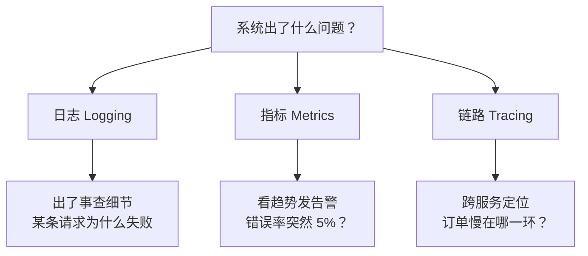
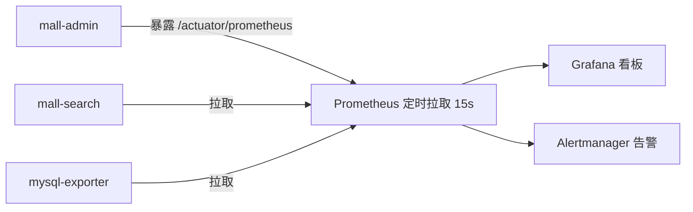
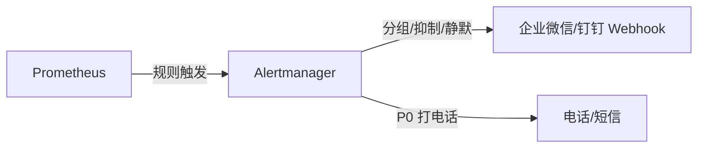

# 可观测性：监控与告警

> **优先级：P1（值班必备）** — 上线只是开始。后端工程师的日常：看监控发现异常 → 查日志定位 → 改 Bug → 下次提前告警。不会看监控的后端，故障来了就是瞎子。

::: tip 背景
你的知识库里已有日志侧的一半——ELK（应用日志 → Logstash → ES → Kibana）。但可观测性是三根支柱，日志只是其中一根。本文补齐另外两根：**指标**（Prometheus + Grafana）和**链路追踪**，并讲清楚三者分工。
:::

## 一、可观测性三支柱



| 支柱 | 回答什么问题 | 数据形态 | 已有基础 |
|------|-------------|---------|---------|
| **日志** | 这次失败的具体原因 | 离散事件（文本） | ✅ ELK（mall 已接） |
| **指标** | 系统整体健康趋势 | 时间序列（数字） | ❌ 本文补 |
| **链路** | 一次请求在微服务里慢在哪 | 调用链（span 树） | 了解概念 |

**前端类比**：日志 ≈ console.log 逐条打印；指标 ≈ Chrome DevTools 的 Performance 面板（帧率/内存曲线）；链路 ≈ Sentry 里的性能瀑布图（哪个函数占了 500ms）。

## 二、指标：Prometheus + Grafana

### Prometheus：拉模型的指标库



**拉模型（pull）**：Prometheus 主动来你的应用"抓"指标（默认 15s 一次）。应用只负责在 HTTP 端点暴露当前指标值，不关心谁来看——和 push 模型（日志推给 Logstash）相反。

**四种指标类型**（PromQL 的地基）：

| 类型 | 例子 | 说明 |
|---|---|---|
| Counter | `http_requests_total` | 只增不减（重启归零），算速率用 `rate()` |
| Gauge | `jvm_memory_used_bytes` | 可增可减，瞬时值 |
| Histogram | `http_duration_seconds_bucket` | 分布直方图，算 P99 延迟 |
| Summary | 类似 Histogram | 客户端聚合，不可跨实例相加，**Prometheus 生态推荐 Histogram** |

### 接入只需两步（Spring Boot）

**① 引依赖 + 开端点**

```xml
<dependency>
    <groupId>org.springframework.boot</groupId>
    <artifactId>spring-boot-starter-actuator</artifactId>
</dependency>
<dependency>
    <groupId>io.micrometer</groupId>
    <artifactId>micrometer-registry-prometheus</artifactId>
</dependency>
```

```yaml
management:
  endpoints:
    web:
      exposure:
        include: health,info,prometheus    # 白名单，别 * 全开（/actuator/env 会泄露配置）
  endpoint:
    health:
      show-details: always
  metrics:
    tags:
      application: mall-admin    # 所有指标带应用标签，多服务看板好区分
```

**② 访问验证**：`curl http://localhost:8080/actuator/prometheus` 返回一大堆 `jvm_*`、`http_server_requests_*`、`hikaricp_connections_*`——这些就是 Prometheus 抓的原料。

### 常用 PromQL（会读就行）

```promql
# QPS：5 分钟平均请求速率
rate(http_server_requests_seconds_count[5m])

# 错误率：5xx 占比（>1% 该告警了）
sum(rate(http_server_requests_seconds_count{status=~"5.."}[5m]))
/ sum(rate(http_server_requests_seconds_count[5m]))

# P99 延迟：99% 的请求快于这个值
histogram_quantile(0.99, rate(http_server_requests_seconds_bucket[5m]))

# 连接池活跃数（> maximum-pool-size × 80% 危险，见连接池篇）
hikaricp_connections_active
```

### Grafana：看板

Prometheus 存指标 + PromQL 查，**Grafana 负责画**。社区模板直接导入（搜 "Spring Boot" / "JVM" / "MySQL"），五分钟搭出生产级看板。看板上墙的指标见下面的"黄金指标"。

## 三、黄金指标（Google SRE 四信号）

任何服务看这四样就够定位 80% 的问题：

| 信号 | 指标 | 异常意味着 |
|---|---|---|
| **延迟**（Latency） | P50/P99 响应时间 | 变慢：DB？下游？GC？ |
| **流量**（Traffic） | QPS | 暴涨：被刷？活动？掉零：上游挂了？ |
| **错误**（Errors） | 5xx 率 / 异常数 | 发版引入？依赖故障？ |
| **饱和度**（Saturation） | CPU/内存/连接池活跃/线程池队列 | 离耗尽还有多远（**唯一能提前预警的**） |

**告警优先级**：错误率、P99、饱和度（连接池/线程池/磁盘）优先配——它们是"用户马上要疼"和"马上就要疼"的信号。QPS 暴跌也要配（服务假死时流量归零）。

## 四、链路追踪（了解）

微服务下一次订单穿 5 个服务，日志散在 5 台机器上，对不上时间线。链路追踪给每个请求发一个 **traceId**，全程携带：

```
订单请求 traceId=abc123
├── span: gateway        5ms
├── span: order-service  120ms
│   ├── span: mysql      80ms   ← 慢在这
│   └── span: redis      2ms
└── span: mq-send        10ms
```

**SkyWalking**（国产，Java 友好，无代码侵入）或 **Zipkin + Micrometer Tracing**。mall 是单体应用暂时用不上，但面试聊微服务是必答概念：traceId 串联日志 + span 树定位慢点。

## 五、告警体系

### 一条告警的完整链路



### 告警规则示例（mall）

```yaml
groups:
  - name: mall-alerts
    rules:
      # P0：错误率 > 5% 持续 2 分钟 → 打电话
      - alert: HighErrorRate
        expr: |
          sum(rate(http_server_requests_seconds_count{status=~"5..",application="mall-admin"}[2m]))
          / sum(rate(http_server_requests_seconds_count{application="mall-admin"}[2m])) > 0.05
        for: 2m
        labels: {severity: critical}

      # P1：P99 延迟 > 1s → 企业微信
      - alert: HighLatency
        expr: |
          histogram_quantile(0.99,
            rate(http_server_requests_seconds_bucket{application="mall-admin"}[5m])) > 1
        for: 5m
        labels: {severity: warning}

      # P1：连接池活跃数接近上限（预警，还没炸）
      - alert: HikariPoolNearExhaustion
        expr: hikaricp_connections_active{application="mall-admin"}
              / ignoring() hikaricp_connections_max > 0.8
        labels: {severity: warning}
```

### 分级与防疲劳

| 级别 | 例子 | 通道 | 响应 |
|---|---|---|---|
| P0 | 错误率爆、服务假死 | 电话 + 群 | 立即起床/中断手头 |
| P1 | P99 劣化、池将尽 | 群 @值班 | 当天处理 |
| P2 | 磁盘 80%、证书临期 | 邮件/周报 | 排期处理 |

**告警疲劳是真实问题**：天天响的告警等于没有告警。原则：**每条告警必须对应一个明确动作**；做不到就降级成看板。

## 六、健康检查（部署联动）

```yaml
management:
  endpoint:
    health:
      show-details: always
```

`/actuator/health` 返回 `{"status":"UP"}` 或 `DOWN`（带哪个组件挂了：db/redis/diskSpace）。用途：

- **Docker healthcheck**：`HEALTHCHECK CMD curl -f http://localhost:8080/actuator/health || exit 1`
- **K8s 探针**：liveness（挂了重启 Pod）/ readiness（没好别接流量）——见 [部署篇](/service/java/java-deployment)
- **Nginx 被动检查的补充**：主动探测比"转发失败才知道"更快摘除故障节点

## 七、mall 的最小落地路径

不用一次上全家桶，按这个顺序性价比最高：

1. **日志已有**：ELK 跑着（logback → Logstash → ES → Kibana），出事先 Kibana 搜 traceId/异常
2. **加指标**：mall-admin 引 actuator + micrometer-prometheus，docker-compose 加 prometheus + grafana 两个容器（官方镜像，5 分钟起来）
3. **导看板**：Grafana 导入社区 Spring Boot/JVM 模板（ID 4701/10001），看黄金四指标
4. **配告警**：先只配两条——错误率 > 5%（P0）+ 连接池活跃 > 80%（P1），通道接企业微信机器人
5. **（可选）链路**：后期拆微服务再上 SkyWalking

## 面试题速查

| 问题 | 一句话答案 |
|------|-----------|
| 可观测性三支柱 | 日志（查细节）/ 指标（看趋势发告警）/ 链路（跨服务定位） |
| Prometheus 拉还是推 | 拉：主动来抓 `/actuator/prometheus`；日志才是推（推给 Logstash） |
| Counter 和 Gauge 区别 | Counter 只增（算速率）；Gauge 可增可减（瞬时值） |
| 黄金四指标 | 延迟、流量、错误、饱和度 |
| P99 怎么算 | `histogram_quantile(0.99, rate(bucket[5m]))` |
| 告警怎么防疲劳 | 每条告警对应明确动作；分级（P0 电话 P1 群 P2 邮件）；做不到就降成看板 |
| 微服务日志怎么对起来 | 链路追踪 traceId 贯穿全链路；SkyWalking/Zipkin |

## 延伸阅读

- [线上问题排查](/service/troubleshooting) - 告警响了之后的 jstack/jmap 实战
- [Elasticsearch 入门](/service/common/elasticsearch) - 日志支柱的存储与检索
- [Java 服务部署最佳实践](/service/java/java-deployment) - ELK 在 mall 的接入方式
- [数据库连接池与数据源](/service/common/database-connection-pool) - `hikaricp_connections_active` 指标的来源
- [Spring Cloud 微服务](/service/java/spring-cloud) - 微服务场景下的链路追踪
