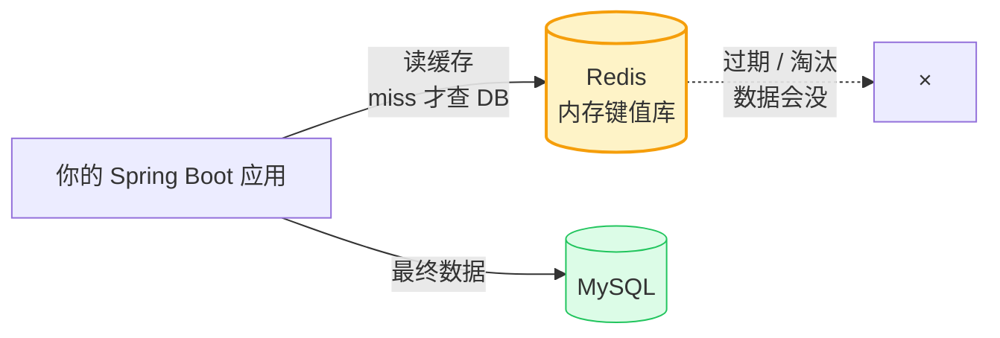

# Redis 入门

> 本质一句话：**Redis 是一个"放在内存里的、键值对形态的数据结构服务器"**。它快是因为数据在内存 + 单线程执行命令；它危险是因为**它默认会为了内存而删你的数据**。

**优先级 P0（面试必考）**：缓存三兄弟（穿透/击穿/雪崩）+ 持久化 + 分布式锁是后端面试固定节目。

::: tip 这篇的定位
面向有前端经验、正在补后端的读者。不按 Redis 命令手册讲，只讲**三件事**：它为什么快、它能出什么问题、你在 Java 服务里怎么正确用它。

深度内容：数据结构源码看 [Redis 官方文档](https://redis.io/docs)，集群运维另见 [中间件全景](/service/java/middleware)。
:::

## 0. 全景：三分钟看懂这篇

> 难度：了解

**它在哪**：Java 服务里最常被访问的**外部进程**——不是你的代码里的库，是另一台机器上的一个服务。



**读法**：左边那条是"正常路径"，右边那个叉是"Redis 的本质"——**它是个缓存，数据随时可能不在**。所有围绕 Redis 的设计，都是在处理这个叉。

**分五块**：

| 块 | 内容 | 读到什么程度 |
|---|---|---|
| 1 用途 | 什么时候该用 Redis、什么时候不该 | 能判断"这个场景该不该上缓存" |
| 2 最小可用 | 十分钟起一个 Redis，用 Java 连上 | 能跑通 |
| 3 用法 | 五种数据结构、缓存三兄弟、分布式锁 | 会用 |
| 4 原理 | 为什么快、为什么数据会没、持久化 | 能解释现象 |
| 5 边界与坑 | 症状 → 原因 → 解法 | 线上能对上号 |

**学完你能**：① 解释"Redis 为什么快"（不是背"单线程"）；② 分清穿透/击穿/雪崩并各给一个解法；③ 手写一把正确的分布式锁（含释放的原子性）；④ 说出 `KEYS *` 为什么在生产是事故。

**本篇讲什么、不讲什么**：

| 知识点 | 档位 | 处理 |
|---|---|---|
| 五种数据结构与底层实现 | 核心 | 正文 3.1 |
| 缓存三大问题 | 核心 | 正文 3.2 |
| 分布式锁 | 核心 | 正文 3.3 |
| 过期策略、淘汰策略、持久化 | 核心 | 正文 3.4、4.2 |
| 缓存一致性 | 核心 | 正文 3.5 |
| 主从 / 哨兵 / Cluster | 进阶 | 正文 6 表格 |
| Java 客户端选型（Lettuce / Redisson） | 进阶 | 正文 3.3、3.6 |
| 事务、Lua 脚本进阶、多机集群运维 | — | 不写，用到再查 |
| AOF 重写、RDB 压缩细节 | — | 不写 |

---

## 1. 用途：什么时候该用 Redis

> 难度：了解

### 1.1 五个典型场景

| 场景 | 用哪个能力 | 例子 |
|---|---|---|
| **缓存热点数据** | String（存 JSON） | 商品详情、用户信息、配置 |
| **计数与排行榜** | `INCR` / ZSet | 点赞数、积分榜、延迟队列 |
| **去重** | Set | 已读文章 ID、关注列表 |
| **分布式锁** | `SET NX PX` | 扣减库存、定时任务只跑一次 |
| **会话 / 令牌** | String + TTL | 无状态登录 |

### 1.2 什么时候**不该**上

Redis 最常见的误用是**把它当数据库用**：

| 场景 | 为什么不该 | 该怎么做 |
|---|---|---|
| **关键业务数据**（余额、订单状态） | Redis 会因内存压力**主动删数据**（见 4.2），也会因主从切换丢数据 | 放 MySQL，Redis 只做缓存副本 |
| **需要复杂查询**（多表 join、范围聚合） | Redis 只有五种数据结构，查全靠你自己拼 | 用 MySQL |
| **数据量无限增长** | 内存装不下 | 分库分表，或用 OSS 这类对象存储 |
| **只是想少写几行缓存代码** | 引 Redis = 多一个会挂的组件 + 一致性问题要额外设计 | 先别上 |

**一句话判断标准**：**这个数据丢了，业务能不能继续跑？** 能（缓存、计数、榜单）→ Redis；不能（订单、余额）→ 数据库。

### 1.3 中间件的共同代价

引入 Redis 意味着多背三件事：

| 代价 | 具体表现 |
|---|---|
| **多一个会挂的组件** | Redis 挂了 → 缓存穿透 → 流量全打到 DB |
| **数据不在同一个事务里** | 改 DB 和删缓存两步，可能交错 → 一致性问题（见 3.5） |
| **排查链路变长** | 一个慢请求可能 = Redis 慢 + DB 慢 |

---

## 2. 最小可用：十分钟跑通

> 难度：会用

### 2.1 起一个 Redis

```bash
# Docker（推荐，和项目其他中间件一起编排）
docker run -d --name redis -p 6379:6379 redis:7.4 redis-server --appendonly yes

# 或者本地装
brew install redis && redis-server --port 6379
```

```bash
redis-cli ping        # 连通性检查 → PONG
redis-cli dbsize      # 当前库有多少 key
```

### 2.2 Java 侧连上

```xml
<dependency>
    <groupId>org.springframework.boot</groupId>
    <artifactId>spring-boot-starter-data-redis</artifactId>
</dependency>
```

```yaml
spring:
  data:
    redis:
      host: localhost
      port: 6379
      database: 3          # ← 用不同 db 隔离，别和别的应用共用 db0
```

```java
@Service
@RequiredArgsConstructor
public class ProductService {

    private final StringRedisTemplate redis;

    public String getProductName(Long id) {
        String key = "mall:product:name:" + id;
        String cached = redis.opsForValue().get(key);
        if (cached != null) {
            return cached;
        }
        String name = loadFromDb(id);           // 真实逻辑
        redis.opsForValue().set(key, name, 30, TimeUnit.MINUTES);
        return name;
    }
}
```

**Spring Boot 默认用 Lettuce**（基于 Netty，响应式、支持连接池）。需要分布式锁等高级能力才换 Redisson。

### 2.3 验证

```bash
redis-cli -n 3 get "mall:product:name:1"
redis-cli -n 3 keys "mall:*"     # ⚠️ 生产禁用，见 5.4
```

> **自检**：为什么示例里用 `database: 3` 而不是默认的 0？

::: details 参考答案
为了**隔离**。Redis 的 16 个 database 是**逻辑隔离但共享同一个进程、同一份内存和同一个 maxmemory**——也就是说 db0 的 key 太多、触发内存淘汰时，**db3 的 key 也会被一起删掉**。

所以 database 只能防"key 命名撞车"，**防不了"内存压力互相影响"**。真要隔离，用**不同的 Redis 实例**（不同端口/容器），或者给 key 加业务前缀（`mall:` / `user:`）避免撞名。
:::

---

## 3. 用法：五个必会主题

> 难度：会用

### 3.1 五种数据结构

| 类型 | 底层实现 | 典型场景 | Java 用法 |
|---|---|---|---|
| **String** | SDS（动态字符串） | 缓存对象、计数器、分布式锁 | `opsForValue()` |
| **Hash** | 哈希表 | 存对象的部分字段 | `opsForHash()` |
| **List** | 双向链表 | 简单消息队列、最新列表 | `opsForList()` |
| **Set** | 哈希表 | 去重、交集/并集（共同好友） | `opsForSet()` |
| **ZSet** | 跳表 + 哈希表 | **排行榜**（score 排序）、延时队列 | `opsForZSet()` |

**ZSet 为什么用跳表**（高频面试题）：有序链表 + 多级索引 → 插入/查找/范围查询都是 O(log n)；相比红黑树，**跳表实现简单得多**（不需要旋转、代码量小），而区间查询天然适配（ZSet 本来就是按 score 排序的）。

**选型直觉**：

```text
要存一个对象          → String（序列化成 JSON）
要改对象的某几个字段  → Hash（不用反序列化整个对象）
要排队 / 取最新 N 条  → List 或 ZSet
要去重 / 求交集        → Set
要按分数排序取 Top N  → ZSet
```

### 3.2 缓存三大问题

**这三个是面试固定节目，也是生产事故的三种来源。** 先用一句话分清：

```text
穿透 = 查【不存在】的数据
击穿 = 【一个热点 key】过期
雪崩 = 【大量 key】同时过期（或 Redis 挂了）
```

| | 现象 | 原因 | 解法 |
|---|---|---|---|
| **穿透** | 查一个不存在的 id，每次都打到 DB | 缓存没有 → 每次 miss | ① **缓存空值**（设短 TTL）② **布隆过滤器**（请求先过，不存在直接拦） |
| **击穿** | 某个超热 key 过期瞬间，大量请求同时打 DB | 热点 key 的缓存重建没做好 | ① **互斥锁**：只让一个线程重建 ② **逻辑过期**：key 永不过期，value 里带过期时间，异步刷新 |
| **雪崩** | 大批 key 同时过期（或 Redis 宕机），流量全砸向 DB | 过期时间设得太一致 / Redis 单点 | ① **过期时间加随机值** ② 热点数据**逻辑过期** ③ **高可用**（主从+哨兵/集群）④ 服务端**限流降级**兜底 |

**三个细节**：

① **缓存空值也要设 TTL**，否则不存在的 key 永久占内存（而且攻击者可以构造大量不存在的 id 把内存打满）。

② **布隆过滤器有误判率**：它说"不存在"是一定不存在；说"可能存在"时得再查一次 DB。所以它**只能防不存在类的穿透**，且要维护重建。

③ **逻辑过期牺牲一致性换性能**：value 里存 `expireAt`，读到过期值时**先返回旧值**，同时异步触发刷新。好处是永不卡顿，代价是可能返回旧数据。

> **自检**：某个商品详情页 QPS 5000，其中 90% 的请求集中在同一个商品上。这个商品的价格要随时准确。用上面三种解法里的哪一种？

::: details 参考答案
**击穿**（单个热点 key 过期，瞬间大量请求打 DB）。

但"价格要随时准确"这个约束把三个解法里的两个排除了：

- **互斥锁**：其他线程等锁 → 它们等重建完才拿到新价格，**等待期间不会读到旧价格**（✅ 符合要求）
- **逻辑过期**：先返回旧值 → **价格不准**（❌ 违反要求）

所以选**互斥锁**：只放一个线程去重建缓存并更新 DB，其他线程等它完成（或者短暂自旋后重试）。注意锁要有超时和兜底，不能让一个线程挂了就锁死。

顺带一提，如果这个商品还有"库存"这种绝对不能超卖的字段，那就别靠缓存了——**用数据库的原子扣减**（`UPDATE stock = stock - 1 WHERE stock >= 1`），缓存只用于展示。
:::

### 3.3 分布式锁

**为什么需要**：`synchronized` / `ReentrantLock` 只在**单个 JVM 内**有效。多实例部署时，每个进程一把锁，扣库存必然超卖。

**正确实现分两步**：

```java
// ① 加锁：SET key value NX PX 毫秒
//    NX  = 不存在才设置（原子）→ 抢锁
//    PX  = 过期时间 → 防止业务挂死导致死锁
//    value = 唯一标识（UUID）→ 防止你删掉别人的锁
Boolean ok = redis.opsForValue()
        .setIfAbsent("lock:stock:" + skuId, requestUuid, 30, TimeUnit.SECONDS);

if (Boolean.TRUE.equals(ok)) {
    try {
        deductStock(skuId);          // 临界区
    } finally {
        // ② 释放：必须是"判断是自己的锁 + 删除"的原子操作
        releaseLock("lock:stock:" + skuId, requestUuid);
    }
}
```

**② 为什么必须用 Lua**：先 GET 判断、再 DEL 是**两步**，中间可能被打断：

```text
线程 A: GET lock → "uuid-A"     ✓ 是自己的锁
        （此时锁过期了，线程 B 抢到了锁，value = "uuid-B"）
线程 A: DEL lock                 ← 把 B 的锁删了！
```

Lua 脚本在 Redis 里**原子执行**，没有中间状态：

```lua
if redis.call("get", KEYS[1]) == ARGV[1] then
    return redis.call("del", KEYS[1])
else
    return 0
end
```

```java
// Java 侧调 Lua（Spring Data Redis）
private static final DefaultRedisScript<Long> RELEASE = new DefaultRedisScript<>(
        "if redis.call('get', KEYS[1]) == ARGV[1] then return redis.call('del', KEYS[1]) else return 0 end",
        Long.class);

redis.execute(RELEASE, List.of("lock:stock:" + skuId), requestUuid);
```

**三个必须知道的点**：

| 问题 | 说明 |
|---|---|
| **锁过期了但业务没跑完** | 锁被别的线程抢走 → 两个线程同时进临界区。**Redisson 的看门狗**解决：默认 30s 过期，业务没结束自动续期 |
| **Redis 锁不是绝对可靠** | 主从切换时锁可能丢失。**能用数据库唯一约束解决的，别用分布式锁** |
| **需要可重入** | Redisson 内置；手写要自己记 owner + 计数器 |

**生产建议：直接用 Redisson**，别手写。

```xml
<dependency>
    <groupId>org.redisson</groupId>
    <artifactId>redisson-spring-boot-starter</artifactId>
    <version>3.27.2</version>
</dependency>
```

```java
RLock lock = redissonClient.getLock("lock:stock:" + skuId);
lock.lock();                       // 默认带看门狗自动续期
try {
    deductStock(skuId);
} finally {
    lock.unlock();
}
```

### 3.4 过期与淘汰：数据为什么会"莫名消失"

```bash
SET key value EX 10     # 写入时带过期（一条命令，推荐）
EXPIRE key 3600         # 给已有 key 设过期
TTL key                 # 剩余秒数：-1 = 永不过期，-2 = key 不存在
```

**两种删除策略**（Redis 4.2 论文名）：

| | 做法 | 后果 |
|---|---|---|
| **惰性删除** | 访问到过期 key 才删 | 不访问就一直占内存 |
| **定期删除** | 每隔一段时间抽样删过期 key | 有延迟 |

两者配合 → **过期 key 可能在内存里多待一会儿**。你的 TTL 是"逻辑过期"，不是"物理消失"。

**内存淘汰策略**（`maxmemory` 满了怎么办）：

| 策略 | 行为 |
|---|---|
| **`noeviction`**（默认） | **不删任何 key，写命令直接报错** |
| `allkeys-lru` | 随便挑 key 删（**所有 key 都可能被删**） |
| `volatile-lru` | 只在"设了过期时间的 key"里挑着删 |
| `allkeys-random` / `volatile-random` / `volatile-ttl` | 各种随机/按 TTL |

⚠️ **默认 `noeviction` 意味着写会失败，但很多云厂商的托管 Redis 默认改成了 `allkeys-lru`**——那样你的缓存会**在内存压力下无声消失**。这是"缓存里的数据莫名没了"的头号原因（见 5.3）。

### 3.5 缓存一致性

**主口径**：

```text
更新 DB  →  删除缓存（不是更新缓存）
```

**为什么删而不是改**：并发写时，"更新缓存"这一步可能用旧值覆盖新值；"删除缓存"让下次读从 DB 重建，**天然一致**。代价是下次读多打一次 DB。

**为什么不是"先删缓存再更新 DB"**：

```text
删缓存
  →（还没更新 DB 的那一瞬间）
    读请求：缓存 miss → 查 DB → 拿到【旧值】 → 回写缓存
更新 DB
  → 缓存里现在是旧值，而且可能一直旧下去
```

**延迟双删**（增强版）：

```text
更新 DB → 删缓存 → 延迟 500ms 左右再删一次
```

第二次删除是为了兜住"读请求在两次操作之间把旧值写回缓存"这个窗口。

**更彻底的方案**：**订阅 MySQL binlog**（Canal / Debezium）→ 监听到变更就删缓存。好处是**应用代码不用管缓存**，且延迟低；代价是多一个组件。

> **自检**：为什么"删除缓存"能保证一致，而"更新缓存"不能？

::: details 参考答案
关键在**并发写**这个场景下，两种操作的顺序会产生不同结果。

**更新缓存**的竞态：线程 A 改 DB 成 `v2`，线程 B 改 DB 成 `v3`；但 A 的缓存更新（写 `v2`）比 B 的缓存更新（写 `v3`）**后落地** → 缓存里是 `v2`，而 DB 里是 `v3` → **缓存是旧值**。而且这个错不会自愈，直到下次缓存失效。

**删除缓存**没有这个问题：不管多少线程并发删，最后一次删完，缓存就是空的，下次读从 DB 重建 → 拿到的一定是 DB 的当前值。

**代价**：删除之后的下一次读会打 DB。所以"删除"是用**一次额外的 DB 查询**换掉"缓存可能永久不一致"的风险。
:::

### 3.6 Java 客户端：Lettuce vs Redisson

| | Lettuce（Spring Boot 默认） | Redisson |
|---|---|---|
| 定位 | 通用 Redis 客户端 | 分布式数据结构 + 锁 |
| 连接模型 | Netty，**响应式、单连接多路复用** | Netty，同上 |
| 分布式锁 | 手写（3.3 那套） | **内置**（看门狗、可重入、锁等待） |
| 额外能力 | 无 | 信号量、限流器、延迟队列、分布式 Map/队列 |
| 依赖体积 | 小（starter 自带） | 大 |

**结论**：普通缓存用 Lettuce（够用），**要分布式锁就用 Redisson**。

---

## 4. 原理：为什么是这样

> 难度：懂原理

### 4.1 为什么快

```text
命令 → 在内存的数据结构上直接执行 → 返回
```

四个因素叠加：

| 因素 | 说明 |
|---|---|
| **内存访问** | 纳秒级，比磁盘快几个数量级 |
| **单线程执行命令** | **没有锁竞争、没有上下文切换**——这是最大的误解来源，很多人以为"多线程更快" |
| **IO 多路复用**（epoll） | 一个线程能同时盯住成千上万个连接，**不需要每个连接一个线程** |
| **高效数据结构** | 哈希表 / 跳表 / 链表，O(1) 起步 |

**关于"单线程"要说清三件事**：

| 误解 | 事实 |
|---|---|
| "单线程 = 只能处理一个请求" | ❌ Redis 6.0 起**网络 IO 已多线程**（读写并行），只是**命令执行**仍单线程 |
| "单线程 = 会有锁竞争" | ❌ 正因为单线程，命令之间**天然互斥**，不需要加锁 |
| "单线程 = 遇到慢命令就全挂" | ✅ **真的**。`KEYS *` 能把整个实例卡住 |

**所以慢命令是 Redis 的头号事故源**：`KEYS *`（O(N) 遍历所有 key）、`HGETALL` 巨大 hash、`SMEMBERS` 巨大 set。生产查 key 必须用 `SCAN`（游标式分批，不阻塞）。

### 4.2 数据为什么会"莫名消失"

两个原因，都很常见：

**① 内存淘汰**（见 3.4）：`maxmemory` 满了 + 策略是 `allkeys-lru` → **Redis 主动删你的 key**。它不会通知你。

**② 过期但没被回收**（见 3.4）：惰性删除意味着不访问就一直占着。

**③ 还有一个容易忽略的**：**Redis 挂了重启，AOF/RDB 恢复后数据可能少一截**（见 4.3）。

**结论**：**Redis 里的数据必须是"丢了也能重建"的**。这不是建议，是它的工作方式决定的——缓存、计数、榜单可以；订单、余额不行。

### 4.3 持久化：RDB vs AOF

| | RDB（快照） | AOF（追加日志） |
|---|---|---|
| 机制 | 定期把内存**全量**快照到磁盘 | 每个写命令**追加**到日志文件 |
| 恢复速度 | 快（直接加载快照） | 慢（重放命令） |
| 数据安全性 | 可能丢最后一次快照后的数据 | 按 `appendfsync` 策略（`everysec` 丢约 1s） |
| 文件大小 | 小 | 大（可重写压缩） |
| 实际使用 | **两者都开**：RDB 兜底快速恢复 + AOF 保证数据完整 | |

**恢复顺序**：先加载 AOF（数据更全），AOF 不存在或关闭才用 RDB。

**`appendfsync` 三个策略**：

| 值 | 安全性 | 性能 |
|---|---|---|
| `always` | 每次写都 fsync，不丢 | 最慢 |
| `everysec` | 每秒 fsync，丢约 1s | **默认，推荐** |
| `no` | 交给操作系统，可能丢 30s+ | 最快 |

**关键认知**：持久化是**为了重启恢复**，不是为了"数据库级可靠"。**Redis 从设计上就不是持久化数据库**——它的定位是内存里的数据结构服务器。

### 4.4 高可用：主从 / 哨兵 / Cluster

| 形态 | 解决什么 | 代价 |
|---|---|---|
| **主从复制** | 读扩展 + 数据冗余 | **主挂了要手动切** |
| **哨兵（Sentinel）** | 主挂了**自动选新主** | 仍是单机容量 |
| **Cluster** | **16384 个槽位分片**，水平扩展 | 客户端要处理重定向，跨槽操作受限 |

**主从的两种同步**：

- **全量同步**：新主接入时，把 RDB 整体传过去
- **增量同步**：主库后续的写命令流式传给从库

**Redis Cluster 的 16384 个槽位**：每个 key 按 `CRC16(key) % 16384` 映射到一个槽，槽分布在不同节点 → 水平扩展。**多 key 操作要求同槽**（用 hash tag `{...}` 强制）。

**读扩展的坑**：主从复制是**异步**的 → 主刚写完还没同步到从，从上读可能拿到旧值。**"写完立刻读"要走主库**。

> **自检**：哨兵和 Cluster 都能解决"主挂了"，它们的区别是什么？

::: details 参考答案
**解决的不是同一个问题。**

- **哨兵**：只解决**高可用**（主挂了自动选新主），**容量不变**——数据还是一份，内存还是那么多。
- **Cluster**：解决**容量扩展**（数据分片到多个节点），顺带也高可用。

所以：**数据量超单机内存 → 必须 Cluster；数据量不大但不能接受主库宕机中断 → 哨兵就够。** 两个都上的集群（Cluster 每个分片内部也用主从 + 哨兵）是常见组合。

一句话记：**哨兵管"坏了怎么办"，Cluster 管"装不下怎么办"。**
:::

---

## 5. 边界与坑

> 难度：会用 + 懂原理

### 5.1 一张表先过一遍

| 症状 | 见 |
|---|---|
| 接口偶发变慢，DB 被打满 | 5.2（缓存失效 / 击穿） |
| 缓存里的数据莫名没了 | 5.3（淘汰策略 / key 撞车） |
| 生产上 Redis 卡住、连接超时 | 5.4（慢命令） |
| 改了数据但接口返回旧值 | 5.5（一致性） |
| 分布式锁偶尔失效 / 数据超卖 | 5.6（锁的边界） |
| 内存占用一直涨 | 5.7（过期没回收 / 大 key） |

### 5.2 接口偶发变慢，DB 被打满

**症状**：某个接口平时很快，偶尔卡住，同时 DB CPU 飙升。

**原因与对策**（按出现频率排）：

| 原因 | 判断方法 | 解法 |
|---|---|---|
| **缓存击穿** | 慢的时刻集中在某个热点 key 过期后 | 互斥锁 / 逻辑过期（见 3.2） |
| **缓存雪崩**（大量 key 同时过期） | 慢的时刻集中在 TTL 相同的批量数据失效后 | **过期时间加随机值** |
| **Redis 挂了** | Redis 不可用时立刻变慢 | 高可用 + **限流降级兜底** |
| **缓存穿透** | DB 上出现大量"查不到也不存在"的查询 | 缓存空值 / 布隆过滤器 |
| **热 key** | Redis 单个 key 的 QPS 极高 | 本地缓存（Caffeine）+ 过期时间错峰 |

**兜底姿态很重要**：缓存是"加速器"不是"依赖"。**Redis 不可用时，服务应该降级（返回旧数据 / 限流），而不是跟着一起挂**。

### 5.3 缓存里的数据莫名没了

**症状**：缓存命中率突然下降，DB 压力上来；或某个 key 查不到。

**原因**（按常见度）：

| 原因 | 判断 | 解法 |
|---|---|---|
| **内存淘汰** | `INFO memory` 看 `evicted_keys` 是否在涨 | 调大 `maxmemory`；换策略；减少大 key |
| **key 命名撞车** | 另一个应用用了同样的 key 前缀 | **key 带业务前缀**（`mall:` / `user:`）；用不同 database |
| **TTL 没设** | `TTL key` 返回 -1 | **写缓存必须带 TTL** |
| **Redis 重启丢数据** | 查 `INFO persistence` 看最后一次持久化时间 | AOF `everysec`；**关键数据别只存 Redis** |

**database 的局限要说清**：16 个 db 是**逻辑隔离**——共享同一个进程、同一份内存、同一个 `maxmemory`。所以 **db0 内存爆了，db3 也会被淘汰**。真隔离要用不同实例。

### 5.4 生产上 Redis 卡住

**症状**：Redis 响应变慢，客户端大面积超时，**但 CPU 不高**（说明在等 IO 或被某个命令堵住）。

**原因**：**慢命令阻塞了单线程**。

| 命令 | 问题 | 替代 |
|---|---|---|
| `KEYS *` | O(N) 遍历，百万 key 直接卡死 | **`SCAN 0 MATCH pattern COUNT 100`**（游标式，不阻塞） |
| `HGETALL`（巨大 hash） | 一次返回几十万字段 | `HSCAN` 游标遍历 |
| `SMEMBERS` / `ZRANGE 0 -1`（巨大集合） | 同上 | `SSCAN` / `ZSCAN` |
| `FLUSHALL` | 清库，阻塞所有请求 | 生产禁用 |

**清缓存的正规姿势**（很多人在生产犯过）：

```bash
# ✅ 生产：游标扫 + 逐批删，不阻塞、不误伤
redis-cli -n 0 --scan --pattern 'ums:*' | xargs -L100 redis-cli -n 0 del

# ⚠️ 只在开发环境
redis-cli -n 0 flushdb
```

**另一个坑**：**不要把 Redis 暴露到公网**。未授权访问 + `KEYS *` + `FLUSHALL` 是经典组合。

### 5.5 改了数据但接口返回旧值

**症状**：更新了商品价格，接口仍返回旧价格。

**原因**：缓存没删、删晚了、或删了又被旧值回写（见 3.5 的三种情况）。

**排查顺序**：

```text
1. 手动 GET 那个 key → 值是旧的吗？
   是 → 没删成功 / 删了又被回写（并发问题）
   否 → key 名不一致 / 读的不是这个 key / 有第二级缓存（本地 Caffeine）

2. 查有没有多个 Redis 实例 → 应用连的是不是同一个

3. 查有没有本地缓存 → Caffeine / Guava 的本地缓存不经过 Redis，DB 改了它也不知道
```

**容易漏的第三种**：**本地缓存**（Caffeine）不受 Redis 失效影响 → 改了 DB 还得等本地缓存过期。

### 5.6 分布式锁失效 / 数据超卖

**症状**：加了锁，但并发下仍然超卖。

**原因与对策**：

| 原因 | 说明 | 解法 |
|---|---|---|
| **锁过期了业务没跑完** | 锁被抢走，两个线程同时进临界区 | **Redisson 看门狗**自动续期；或把业务时间估够，锁 TTL 设长 |
| **释放时删错了锁** | GET/DEL 两步不原子 | **Lua 脚本**（见 3.3） |
| **业务本身没有兜底** | 锁只是性能优化，不是正确性保证 | **数据库层保证**：`UPDATE stock = stock - 1 WHERE stock >= 1`，看影响行数 |
| **Redis 主从切换丢锁** | 锁写在从库还没同步就切主 | 不用 Redis 锁做正确性保证 |

**最重要的一条**：**分布式锁不能替代数据库的原子性约束**。锁解决的是"性能"（不重复处理），约束解决的是"正确性"（不超卖）。**两个都要。**

### 5.7 内存占用一直涨

**症状**：`INFO memory` 里 `used_memory` 持续上涨，key 数不多但单个体积大。

**原因**：

| 原因 | 判断 | 解法 |
|---|---|---|
| **大 key** | `redis-cli --bigkeys` | 拆分（用 Hash 而非 String 存大对象）；删字段而非整个对象 |
| **过期没被回收** | `INFO stats` 看 `expired_keys` | 正常；但 key 太多时定期删除跟不上 |
| **key 数量爆炸** | `dbsize` 巨大 | 加业务前缀 + 定期清理；**给 key 设 TTL** |
| **`noeviction` 下写失败被忽略** | 应用日志里有写入异常但没人管 | 监控 `rejected_connections` / 写入异常 |

> **自检**：线上 Redis 突然变慢，CPU 只有 20%，但 `INFO commandstats` 里 `keys` 命令的调用次数很大。你怎么处理？

::: details 参考答案
**立刻停掉 `KEYS *` 的调用方**——它在 O(N) 遍历，遍历期间**整个实例被阻塞**（单线程），这解释了"CPU 不高但全变慢"：不是算得多，是**线程被占住了**。

处理顺序：
1. **先止血**：找到调用方（应用日志 / APM / `commandstats`）并停掉或改成 `SCAN`
2. **再恢复**：如果已经卡住，可能需要 `SHUTDOWN NOSAVE` 重启（会丢数据，所以先确认有持久化）
3. **再预防**：① 生产禁用 `KEYS *`，改 `SCAN`；② 给 Redis 加限流/只读副本；③ 监控 `commandstats` 里慢命令的占比

顺便查一下是谁在调 `KEYS *`——通常是某个"管理后台"或"缓存清理"脚本，图省事写了 `keys *`。
:::

---

## 6. 延伸

> 难度：了解

### 高频考点速查

| 考点 | 一句话答案 |
|---|---|
| Redis 为什么快 | 内存 + 单线程无竞争 + IO 多路复用 + 高效数据结构 |
| 穿透 / 击穿 / 雪崩 | 查不存在（空值 + 布隆）/ 单热点过期（互斥锁 + 逻辑过期）/ 大量同时过期（随机 TTL + 高可用） |
| RDB vs AOF | 快照 vs 追加日志；RDB 恢复快但丢数据多，AOF 反之 |
| 分布式锁实现 | `SET NX PX` + 唯一 value + **Lua 原子释放**；生产用 Redisson |
| 为什么单线程还快 | 瓶颈在内存和网络不在 CPU；单线程避免锁竞争 |
| 缓存一致性 | **更新 DB 后删缓存** + 延迟双删 |
| 过期删除策略 | 惰性删除 + 定期删除 |
| 哨兵 vs Cluster | 哨兵 = 高可用（主从切换），Cluster = 分片扩展（16384 槽） |
| 淘汰策略 | `noeviction`（默认，写报错）/ `allkeys-lru`（内存满随便删） |

### 命令速查

```bash
# 连接
redis-cli                    # 交互模式
redis-cli -n 3               # 指定 db
ping                         # → PONG
dbsize                       # key 数量

# 字符串
SET key val EX 10            # 写入带过期（推荐一条命令搞定）
GET key
INCR count                   # 原子 +1
TTL key                      # -1 永不过期 / -2 不存在

# key 管理
EXISTS key / TYPE key / DEL key
SCAN 0 MATCH ums:* COUNT 100 # ✅ 生产查 key
KEYS *                       # ❌ 生产禁用

# 清缓存（生产姿势）
redis-cli -n 0 --scan --pattern 'ums:*' | xargs -L100 redis-cli -n 0 del
```

### 相关篇目

| 篇目 | 关系 |
|---|---|
| [中间件全景与 Java 实战](/service/java/middleware) | Redis 在 Java 服务里的定位与缓存一致性 |
| [MySQL 进阶](/service/common/mysql-advanced) | 缓存之外的最后屏障 |
| [分布式基础](/service/common/distributed-basics) | CAP 理论：一致性与可用性的权衡背景 |
| [数据分布场景与锁设计](/service/common/data-distribution-locks) | 分布式锁的可靠性边界 |
| [高并发高可用设计](/service/java/java-high-concurrency) | 缓存三难的架构视角 |

