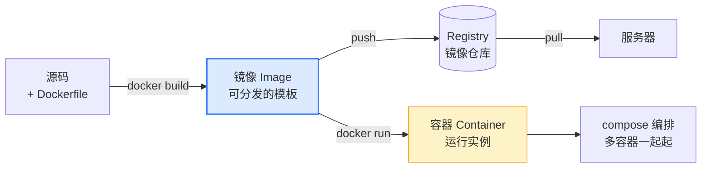
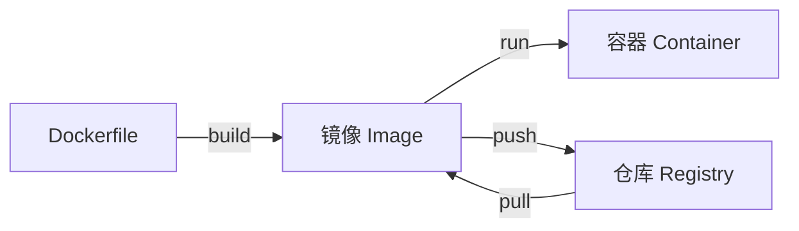

# Docker 入门

> 本质一句话：**Docker 把"运行环境"打包成一个可分发的文件**。解决的是"在我机器上能跑，在你机器上报错"——因为环境本身变成了交付物的一部分。

::: tip 这篇的定位
面向有前端经验、正在补后端的读者。Docker 是**部署和本地环境**的地基：中间件（Redis / MQ / ES）用 compose 一键起、Java 服务打镜像上线、微服务扩容靠多副本——这些都在这篇的地基上。

Java 服务的完整上线流程见 [Java 服务部署最佳实践](/service/java/java-deployment)。
:::

## 0. 全景：三分钟看懂这篇

> 难度：了解

**它在哪**：Docker 出现在**开发的最后一步和运行的第一步**。



**读法**：**镜像是模板，容器是实例**。这个类比直接来自你的经验——Class 是模板，Object 是实例。

**分五块**：

| 块 | 内容 | 读到什么程度 |
|---|---|---|
| 1 用途 | Docker 解决什么、什么时候**不该**用 | 能判断要不要上 |
| 2 最小可用 | 十分钟：跑起来 → 写 Dockerfile → compose 编排 | 能跑通 |
| 3 用法 | 五个核心概念 + 常用命令 + 镜像瘦身 | 会用 |
| 4 原理 | 分层与缓存、容器网络、cgroup | 能解释现象 |
| 5 边界与坑 | 症状 → 原因 → 解法 | 线上能对上号 |

**学完你能**：① 解释镜像和容器的区别（以及为什么容器"删了数据还在"）；② 手写一个多阶段构建的 Dockerfile 并说出每层在干什么；③ 解释 `.dockerignore` 为什么必须写（**密钥进镜像**）；④ 用 compose 把"应用 + MySQL + Redis"一键拉起来。

**本篇讲什么、不讲什么**：

| 知识点 | 档位 | 处理 |
|---|---|---|
| 镜像 / 容器 / 仓库 / Dockerfile / compose | 核心 | 正文 3.1 |
| Dockerfile 编写与多阶段构建 | 核心 | 正文 3.2 |
| `.dockerignore` | 核心 | 正文 3.3 |
| 数据卷（绑定挂载 / 命名卷） | 核心 | 正文 3.4 |
| compose 编排与常用参数 | 核心 | 正文 3.5 |
| 多副本扩容 | 进阶 | 正文 3.6 |
| 分层与构建缓存 | 核心 | 正文 4.1 |
| 容器网络与 DNS | 进阶 | 正文 4.2 |
| cgroup 资源限制 | 进阶 | 正文 4.3 |
| K8s | — | 不写（另一套体系） |
| 镜像签名 / 供应链安全 | — | 不写 |

---

## 1. 用途：Docker 解决什么

> 难度：了解

### 1.1 核心问题：环境一致性

**没有 Docker 时的经典场景**：

```text
"我本地是好的啊"  ←→  "线上报错了"

差异在哪：
  Node 版本不同 / 系统库不同 / 环境变量不同 / 依赖装的方式不同
  （最狠的：同事 `npm install` 装出来的依赖版本和你不一样）
```

**Docker 的做法**：**把运行时环境（OS 基础层 + 依赖 + 配置）一起打包**，交付的是一个**自包含的产物**。

```text
在我机器上：镜像 = 同一个文件
在你机器上：pull 同一个镜像 → 环境完全一致
```

**顺带解决的四个问题**：

| 问题 | Docker 怎么解决 |
|---|---|
| 环境不一致 | 环境打进镜像 |
| 依赖安装慢 / 装不上 | 依赖在构建时就装好了 |
| "在我机器上能跑" | 消灭"我机器"这个变量 |
| 部署麻烦 | 一个 `docker run` 就是"部署" |

### 1.2 什么时候**不该**用

| 场景 | 为什么 | 该怎么做 |
|---|---|---|
| **本地纯前端开发** | 装个 Docker Desktop 成本不低 | 本地跑 `npm run dev` 就行；只把**数据库/Redis** 容器化 |
| **需要频繁改代码的热重载** | 每次改代码要重建镜像，慢 | **挂载源码 + nodemon**（3.6 有配置） |
| **单机跑就够了** | 容器化反而多一层 | 直接部署，见 [Java 服务部署最佳实践](/service/java/java-deployment) |
| **团队没人懂容器** | 出问题排查成本高 | 先在本地把中间件容器化（收益最大、风险最低） |

**性价比最高的用法**：**把中间件容器化**（MySQL、Redis、ES、Nacos），应用代码照旧在本地跑。这样既有一致的环境，又不用为了热重载折腾。

### 1.3 Docker 和虚拟机的区别

| | Docker 容器 | 虚拟机 |
|---|---|---|
| **包含什么** | 应用 + 依赖 + 用户的进程 | 完整 OS（内核 + 用户空间 + 应用） |
| **内核** | **共享宿主机内核** | 独立内核（Hypervisor 模拟） |
| **启动** | **秒级** | 分钟级 |
| **体积** | MB 级 | GB 级 |
| **隔离强度** | 弱（进程级隔离） | 强（硬件级隔离） |

**一句话**：**虚拟机隔离的是硬件，容器隔离的是进程。**

这也是容器"轻量"的根源，也是它**不能跑不同内核**的原因（Linux 容器不能跑 Windows 程序，反之亦然——除非用 WSL2 的虚拟机方案）。

---

## 2. 最小可用：十分钟跑通

> 难度：会用

### 2.1 装上并验证

```bash
# macOS
brew install --cask docker

# 启动 Docker Desktop 后验证
docker --version
docker run hello-world
```

### 2.2 把一个应用打成镜像

以最简单的 Node 应用为例：

```dockerfile
# 基于 Node.js 20 Alpine 镜像（Alpine 体积小，约 50MB）
FROM node:20-alpine

WORKDIR /app                    # 设置工作目录

# 先复制依赖文件（利用 Docker 缓存层）
COPY package.json package-lock.json ./
RUN npm ci --only=production     # 安装依赖

COPY . .                         # 再复制应用代码

EXPOSE 3000                      # 暴露端口（只是声明，实际映射靠 -p）
CMD ["node", "server.js"]        # 启动命令
```

```bash
docker build -t my-app .
docker run -d -p 3000:3000 --name my-app my-app
curl localhost:3000
docker logs -f my-app
```

### 2.3 一键起一整套（compose）

实际项目通常有多个服务（应用 + 数据库 + Redis），用 compose 编排：

```yaml
# docker-compose.yml
services:
  app:
    build: .
    ports:
      - '3000:3000'
    environment:
      - NODE_ENV=production
      - DB_HOST=postgres
      - DB_USER=postgres
      - DB_PASSWORD=secret
      - REDIS_HOST=redis
    depends_on:
      postgres:
        condition: service_healthy
      redis:
        condition: service_started
    restart: unless-stopped

  postgres:
    image: postgres:16-alpine
    environment:
      POSTGRES_DB: myapp
      POSTGRES_USER: postgres
      POSTGRES_PASSWORD: secret
    ports:
      - '5432:5432'
    volumes:
      - pg-data:/var/lib/postgresql/data
    healthcheck:
      test: ["CMD-SHELL", "pg_isready -U postgres"]
      interval: 5s
      retries: 5
    restart: unless-stopped

  redis:
    image: redis:7-alpine
    command: redis-server --appendonly yes   # 开启 AOF 持久化
    ports:
      - '6379:6379'
    volumes:
      - redis-data:/data
    restart: unless-stopped

volumes:
  pg-data:        # 顶层声明：本项目管理的卷，up 时自动创建
  redis-data:
```

```bash
docker compose up -d        # 后台启动所有服务
docker compose logs -f app  # 查看应用日志
docker compose down         # 停止并删除容器
docker compose down -v      # 同时删除数据卷（数据没了！）
```

> **自检**：上面这个 compose 里，`app` 依赖 `postgres`。为什么用 `condition: service_healthy` 而不是光写 `depends_on: [postgres]`？

::: details 参考答案
因为 **`depends_on` 只保证"容器已启动"，不保证"服务已就绪"**。

Postgres 的容器启动 ≠ 数据库能接受连接：它要先初始化数据目录、跑初始化脚本、启动主进程，这几秒内**端口虽然监听了，但连接会被拒绝**（`the database system is starting up`）。

不加健康检查时，应用启动瞬间连 DB → 连接失败 → 应用启动失败 → 而 Postgres 随后就好了 → **容器进入 CrashLoop，但 DB 一切正常**。这个现象特别难查，因为"看起来是应用的 bug"。

`healthcheck` + `condition: service_healthy` 让 compose 等到**健康检查通过**再启动依赖它的服务：

```yaml
app:
  depends_on:
    postgres:
      condition: service_healthy    # 等 postgres 健康
postgres:
  healthcheck:
    test: ["CMD-SHELL", "pg_isready -U postgres"]   # pg_isready 是 PG 自带的就绪探针
    interval: 5s
    retries: 5
```

**另一个更稳的办法**：应用侧自己做**连接重试**（Spring Boot 有 `spring.datasource.hikari.initialization-fail-timeout` 配置）。**两者都做最好**——健康检查解决"启动顺序"，重试解决"运行期抖动"。
:::

---

## 3. 用法：五个核心概念

> 难度：会用

### 3.1 五个概念

| 概念 | 类比 | 说明 |
|------|------|------|
| **镜像（Image）** | 类（Class） | 打包好的应用模板，**只读** |
| **容器（Container）** | 对象（Object） | 镜像的运行实例，**可读写** |
| **仓库（Registry）** | npm registry | 存储和分发镜像（Docker Hub / 阿里云 ACR） |
| **Dockerfile** | 配方 | 定义如何构建镜像的文本文件 |
| **compose** | 项目编排 | 用 YAML 定义多容器应用 |



### 3.2 常用命令

```bash
# 镜像
docker images                     # 列出本地镜像
docker pull node:20-alpine       # 拉取
docker rmi <image_id>            # 删除镜像

# 容器
docker ps                        # 运行中的
docker ps -a                     # 全部（含已停止）
docker run -d -p 3000:3000 app   # 后台运行 + 端口映射
docker stop <id>                 # 停止
docker rm <id>                   # 删除容器
docker logs -f <id>              # 跟踪日志
docker exec -it <id> sh          # 进入容器 shell（排查神器）

# 清理
docker system prune -a           # 清理未使用的镜像、容器、网络
```

### 3.3 Dockerfile：多阶段构建与 `.dockerignore`

**多阶段构建**能显著减小最终镜像体积——构建工具（编译器、devDependencies）在第一阶段用完就丢：

```dockerfile
# 第一阶段：构建
FROM node:20-alpine AS builder
WORKDIR /app
COPY package.json package-lock.json ./
RUN npm ci
COPY . .
RUN npm run build

# 第二阶段：运行（只含产物和 production 依赖）
FROM node:20-alpine
WORKDIR /app
ENV NODE_ENV=production
COPY package.json package-lock.json ./
RUN npm ci --only=production
COPY --from=builder /app/dist ./dist

EXPOSE 3000
CMD ["node", "dist/server.js"]
```

**`.dockerignore` 极其重要**——它和 `.gitignore` 是**两套独立机制**：

> **Docker 构建时根本不看 `.gitignore`**。`docker build .` 时，CLI 把当前目录下**所有文件**打包成"构建上下文"发给 daemon（`node_modules`、`.env`、`.git` 全在里面，哪怕被 gitignore 了），daemon 再按 `COPY` 指令往镜像里复制。

三个价值：

| 价值 | 说明 |
|---|---|
| **减小上下文** | 几百 MB 的 `node_modules` 也要压缩传输 |
| **防止缓存失效** | 构建缓存按"指令 + 输入哈希"计算，`COPY . .` 的输入是整个上下文 → 装个包就全层重跑 |
| **⚠️ 防止密钥进镜像** | **最核心**：`.env` 被 `COPY . .` 复制进去 = **谁拿到镜像谁拿到密钥** |

```dockerignore
node_modules
npm-debug.log
.git
.gitignore
.env
.env.local
Dockerfile
docker-compose.yml
README.md
```

**镜像瘦身技巧汇总**：

| 技巧 | 效果 |
|------|------|
| Alpine 基础镜像 | ~900MB → ~50MB |
| 多阶段构建 | 只保留产物，丢弃构建工具 |
| `.dockerignore` | 减小构建上下文 + 保护密钥 |
| 合并 RUN 指令 | 减少镜像层数 |
| `npm ci --only=production` | 不装 devDependencies |

### 3.4 数据持久化：卷

**容器删除后数据会丢**，需要挂载卷。

```bash
# 绑定挂载（开发环境常用）：把宿主机当前目录挂进容器 /app，改代码即时生效
docker run -v $(pwd):/app -p 3000:3000 my-app

# 命名卷（生产推荐）：数据存在 Docker 管理的目录，不关心物理路径
docker volume create db-data
docker run -v db-data:/var/lib/postgresql/data postgres
```

**`-v 左:右` 语法**：**左边是外部**（宿主机路径或卷名），**右边永远是容器内路径**。

```text
-v db-data:/var/lib/postgresql/data
  ↑                ↑
 卷名          容器内路径（postgres 进程读写这个目录 = 读写卷）
```

数据最终存在宿主机 `/var/lib/docker/volumes/db-data/_data`，但容器里只看得到 `/var/lib/postgresql/data`。

**命名卷 vs 绑定挂载**：

| | 绑定挂载 | 命名卷 |
|---|---|---|
| 物理路径 | **你指定** | Docker 管 |
| 用途 | **开发**（改代码即时生效） | **生产**（不依赖宿主机路径，方便迁移） |
| 权限 | 受宿主机用户权限影响 | Docker 创建，权限干净 |

**卷挂载和持久化要配套做**：只挂卷不开持久化，Redis 默认的 RDB 是定时快照，仍可能丢最后几分钟的数据；重要数据要 `--appendonly yes` 开 AOF。

**Redis 要不要挂卷？**

| 用途 | 要不要挂 | 原因 |
|------|---------|------|
| **纯缓存**（丢了能重建） | 可挂可不挂 | 不挂的话容器重建后**缓存全空**，请求瞬间全打 DB，可能把 DB 打垮（缓存雪崩的变体）→ **生产建议挂** |
| **有状态数据**（session / 分布式锁 / 队列 / 排行榜） | **必须挂** | 丢了就是业务故障 |

### 3.5 compose 常用参数

| 参数 | 全称 | 作用 |
|------|------|------|
| `-f` | `--file` | 指定 compose 文件（**默认只读当前目录的 `docker-compose.yml`**）；可多次指定，后面的覆盖前面的 |
| `-d` | `--detach` | 后台运行（不加则前台跑，日志打屏，`Ctrl+C` 即停） |
| `-p` | `--project-name` | 指定项目名（**默认取当前目录名**），决定容器名前缀和网络名 |
| `--env-file` | — | 指定环境变量文件（默认读 `.env`） |
| `--profile` | — | 启用某组 profile 下的服务 |

**`-f` 的实际用法**（文件不在当前目录或名字不同时必须指定）：

```bash
# mall 项目：编排文件在 document/docker/ 下，且不叫 docker-compose.yml
docker compose -f document/docker/docker-compose-env.yml up -d
```

**多文件合并**（基础配置 + 环境覆盖）：

```bash
docker compose -f docker-compose.yml -f docker-compose.prod.yml up -d
# 后面的文件覆盖前面同名的配置项
```

**`-p` 解决"同一目录多套编排"**：

```bash
docker compose -f docker-compose-env.yml -p mall-env up -d    # 容器名 mall-env-xxx
docker compose -f docker-compose-app.yml -p mall-app up -d    # 容器名 mall-app-xxx
```

> **v1 与 v2 两种写法**（参数基本兼容）：
> - `docker-compose up -d` —— v1，老的独立二进制（**连字符**），已停止维护
> - `docker compose up -d` —— v2，Docker 插件（**空格**），现在推荐这种
>
> 老教程里看到连字符、新文档里看到空格，是同一个东西。

### 3.6 多副本扩容与开发热更新

**扩容**（容器化吃多核的主要手段）：

```bash
docker compose up -d --scale api=4     # 扩到 4 个副本
docker compose ps                      # 看 api-1 / api-2 / api-3 / api-4
docker compose up -d --scale api=2     # 缩回去
```

**开发环境热更新**（挂载源码 + nodemon）：

```yaml
# docker-compose.dev.yml
services:
  app:
    build: .
    ports:
      - '3000:3000'
    volumes:
      - .:/app                # 挂载源码
      - /app/node_modules      # 排除 node_modules（用容器内的）
    environment:
      - NODE_ENV=development
    command: npm run dev       # 使用 nodemon 等热更新工具
```

---

## 4. 原理：为什么是这样

> 难度：懂原理

### 4.1 镜像分层与构建缓存

**镜像由若干层（layer）组成**，每条 Dockerfile 指令产生一层。

```text
FROM node:20-alpine     ← 层 1：基础镜像（可共享）
RUN npm ci              ← 层 2：依赖
COPY . .                ← 层 3：应用代码
```

**缓存规则**：Docker 对每层算一个哈希 = **指令 + 输入文件内容**。**如果某一层的哈希变了，只有它和它之后的几层会失效**。

```text
改了 app.js（COPY . . 这一层）
  → 层 3 失效，重跑
  → 但层 1、2（依赖）命中缓存，不重装 npm ci ✅
```

**这就是为什么要"先 COPY 依赖文件，再 COPY 源码"**：

```dockerfile
COPY package.json package-lock.json ./   # 这一层只在依赖变化时失效
RUN npm ci                               # 依赖没变就不重装
COPY . .                                # 源码变了只重跑这一层
```

**如果顺序写反**（先 `COPY . .` 再 `RUN npm ci`），那源码一改 → 依赖层也失效 → **每次构建都重装全部依赖**（几分钟变几秒）。

**层是只读叠加的**：容器启动时在最上面加一个**可写层**，容器里的修改都写在这层，**容器删掉这层就没了**——这就是"容器删除数据会丢"的原因（要持久化就得挂卷，见 3.4）。

### 4.2 容器网络与内部 DNS

compose 起的一组容器在**同一个自定义网络**里，能**直接用服务名互相访问**：

```text
app 连 postgres → 主机名写 postgres（不是 localhost！也不是 IP）
```

**为什么能这么写**：Docker 内嵌了一个 DNS 服务器（`127.0.0.11`），它把**服务名解析到该服务所有副本的 IP**（轮询）。

```yaml
services:
  app:
    environment:
      - DB_HOST=postgres       # ← 服务名
  postgres:
    ports:
      - '5432:5432'           # ← 这个端口映射到宿主机
```

**两个必须分清的端口概念**：

| 写法 | 含义 |
|---|---|
| `ports: - '5432:5432'` | **宿主机** 5432 → 容器 5432（对外暴露） |
| `expose: - '5432'` | 只在 compose 网络内可见，**不对宿主机暴露** |

**扩副本时用 `expose` 而不是 `ports`**——固定宿主端口会导致第二个副本起不来（见 5.1）。

**负载均衡怎么配**：nginx 的 `upstream` 写**服务名**而不是 IP——内嵌 DNS 会把服务名解析到全部副本 IP：

```nginx
upstream api_backend {
    server api:3000;     # ← 服务名，不是 IP
}
server {
    listen 80;
    location /api/ { proxy_pass http://api_backend; }
}
```

### 4.3 cgroup：容器为什么"用不了超过配额"的资源

Linux 的 **cgroup**（control group）负责限制和统计资源：

| 限制 | 效果 |
|---|---|
| **CPU 配额**（`--cpus=1.5`） | 超配额 → **被 throttle（限流）**，表现为 RT 抖动 |
| **内存上限**（`-m 512m`） | 超限 → **OOM Killed**，容器直接消失 |
| **磁盘配额** | 少数场景用 |

**两个生产上真实遇到的现象**：

| 现象 | 原因 |
|---|---|
| 容器莫名消失，日志里最后一行是 `Killed` | **OOM**——容器内进程（比如 JVM）分配的内存超过 `-m` 限制 |
| P99 RT 周期性抖动，CPU 平均值不高 | **CPU throttle**——容器被限流了（`container_cpu_cfs_throttled_seconds_total` 指标能看出来） |

**所以给 JVM 容器设内存时要留余量**：`docker run -m 1g` 时，JVM 的 `-Xmx` 建议设成 `512m` 左右（堆之外还有元空间、线程栈、直接内存）。**JVM 不感知 cgroup 限制**（除非用 `UseContainerSupport`，JDK 8u191+ 默认开启，能读到限制但默认 `-XX:MaxRAMPercentage` 只在 JDK 10+ 生效）。

---

## 5. 边界与坑

> 难度：会用 + 懂原理

### 5.1 一张表先过一遍

| 症状 | 见 |
|---|---|
| 扩副本报 `port is already allocated` | 5.2 |
| 写了 `deploy.replicas` 却只起 1 个 | 5.3 |
| 应用启动就崩，DB 明明正常 | 5.4 |
| 镜像几百 MB / 构建极慢 | 5.5 |
| 容器莫名消失（`Killed`） | 5.6 |
| 密钥泄漏风险 | 5.7 |
| 容器删了数据没了 | 5.8（回到 3.4） |

### 5.2 固定宿主端口导致扩不了副本

**症状**：`--scale api=4`，第二个容器起不来，报 `port is already allocated`。

**原因**：`ports: ["3000:3000"]` 意味着"宿主机 3000"——**宿主机一个端口只能给一个容器**。

**解法**：

```yaml
api:
  expose:
    - '3000'          # 只在 compose 网络内可见
  # 不写 ports
```

然后**单独放一个 nginx 容器当负载均衡**，独占 80 端口：

```yaml
nginx:
  image: nginx:alpine
  ports:
    - '80:80'         # 整个集群对外只暴露这一个端口
  depends_on:
    - api
```

**顺便说**：nginx 的 `upstream` 要写**服务名**（`api:3000`），Docker 内嵌 DNS 会解析到所有副本 IP（见 4.2）。

### 5.3 `deploy.replicas` 在单机 compose 不生效

**症状**：写了 `deploy: replicas: 3`，`docker compose up` 只起 1 个。

**原因**：**`deploy.replicas` 只对 Swarm 生效**，普通 `docker compose up` 会忽略它。

**解法**：

```bash
docker compose up -d --scale api=3      # ✅ 单机 compose 的正确写法
```

多机集群才用 `docker stack deploy`（Swarm）或上 K8s。

**顺带**：Swarm 本身也基本被 K8s 取代了，新项目直接上 K8s。

### 5.4 `depends_on` 不等于"服务已就绪"

**症状**：应用容器反复重启（CrashLoop），但数据库容器日志一切正常。

**原因**：见 2.3 的自检——**`depends_on` 只保证"容器启动了"，不保证"服务能接受连接"**。Postgres 初始化要几秒，这期间应用连不上 → 应用崩 → 重启。

**解法（两个都做）**：

```yaml
# ① 编排层：等健康检查
app:
  depends_on:
    postgres:
      condition: service_healthy
postgres:
  healthcheck:
    test: ["CMD-SHELL", "pg_isready -U postgres"]
    interval: 5s
    retries: 5
```

```yaml
# ② 应用层：连接重试
spring:
  datasource:
    hikari:
      initialization-fail-timeout: 60000    # 启动时最多等 60s 建连接
```

**中间件没有健康检查命令怎么办**：Redis 用 `redis-cli ping`，MySQL 用 `mysqladmin ping`，ES 用 `curl localhost:9200/_cluster/health`。

### 5.5 镜像太大 / 构建极慢

**症状**：`docker images` 显示镜像 1GB；`docker build` 要十分钟。

**原因与对策**：

| 原因 | 对策 |
|---|---|
| **没写 `.dockerignore`** | 上下文里塞了 `node_modules` / `.git` → 写 `.dockerignore`（见 3.3） |
| **基础镜像太重** | 用 `-alpine`（`node:20-alpine` ~50MB vs `node:20` ~900MB） |
| **单阶段构建** | 改多阶段（见 3.3） |
| **装了 devDependencies** | `npm ci --only=production` |
| **COPY 顺序错** | 先 COPY 依赖再 COPY 源码（见 4.1） |
| **层数过多** | 合并 RUN 指令 |

**快速诊断**：

```bash
docker history my-app     # 看每层多大，找出罪魁
```

### 5.6 容器莫名消失（`Killed`）

**症状**：容器跑着跑着就没了，`docker ps` 里没了，日志最后一行是 `Killed`。

**原因**：**OOM**——容器内进程用的内存超过 `-m` 限制，被内核杀掉。

**排查**：

```bash
docker inspect <id> | grep -i oomkilled   # 看 OOMKilled 是不是 true
docker stats                                # 看内存占用
```

**Java 服务尤其容易踩**：JVM 默认按**物理内存**的 25% 设置堆（`-Xmx`），容器里限制是 1G 时它照样想用 4G → 被 kill。

**解法**：显式设置堆大小并留余量：

```bash
docker run -m 1g -e JAVA_OPTS="-Xmx512m" my-java-app
```

```dockerfile
# 或者在 Dockerfile 里
ENV JAVA_OPTS="-XX:MaxRAMPercentage=75.0"
```

`-XX:MaxRAMPercentage` 让 JVM **按容器限制的百分比**算堆，比写死 `-Xmx` 更适合容器环境。

### 5.7 密钥泄漏风险

**症状**（不是报错，是隐患）：`.env` 里有数据库密码，被 `COPY . .` 复制进镜像。

**后果**：镜像 push 到仓库 → **任何能 pull 的人都有你的密码**。而且镜像层是**只读叠加**的，即使后来删掉文件，**旧层里还在**（能 `docker history` 看出来）。

**解法**：

| 手段 | 说明 |
|---|---|
| **`.dockerignore` 排除 `.env`** | **必须做**（见 3.3） |
| **构建期不传密钥** | 用 `ARG` / `RUN --mount=type=secret`（BuildKit），别用 `ENV` |
| **运行时注入** | 密钥从环境变量 / secrets 挂载进容器，**不进镜像** |
| **用专门的 secrets 管理** | K8s Secret、云厂商的密钥管理服务 |

**核心原则**：**镜像里只能有"公开的构建产物"，不能有任何密钥。**

### 5.8 容器删了数据没了

**症状**：`docker compose down` 之后数据全没了。

**原因**：数据在容器的**可写层**，容器删掉就没了（见 4.1）。

**解法**：挂卷（见 3.4）。

**顺带一个坑**：`docker compose down -v` 会**连数据卷一起删**——生产环境手滑执行这个等于删库。养成习惯：`down` 不加 `-v`，要清数据时单独确认。

> **自检**：给一个 Java 服务做容器化，`-m 1g`，JVM 没设任何参数。跑起来一会儿就被 Killed。你怎么排查和修？

::: details 参考答案
**排查三步**：

```bash
docker ps -a                          # 看容器是不是 Exited
docker inspect <id> | grep -i oomkilled   # 确认是不是 OOM
docker logs <id> | tail -20            # 看最后几行是不是 "Killed"
```

**原因**：JVM 默认的堆大小是**物理内存的 1/4**（`MaxHeapSize = 物理内存 / 4`）。容器虽然限制是 1G，但 **JVM 读的是宿主机的物理内存**（比如 32G）→ 它算出 `-Xmx 8G` → 远超容器的 1G 限制 → 进程被内核 OOM Kill。

（注意：JDK 8u191+ 虽然能感知 cgroup 限制，但**默认只是用来判断"能不能启动"**，堆大小还是按物理内存算的。）

**修法（推荐第一种）**：

```bash
# ① 按容器限制的百分比自动算（最省心）
docker run -m 1g -e JAVA_OPTS="-XX:MaxRAMPercentage=70.0" my-app
```

```dockerfile
# ② 或者显式指定，留足余量
ENV JAVA_OPTS="-Xmx600m -XX:MaxMetaspaceSize=128m"
```

**余量为什么要留**：1G 容器里，`-Xmx 600m` 之外还有：元空间（默认 128m+）、线程栈（几百个线程 × 1m）、直接内存（NIO 缓冲）、JVM 自身开销。**堆设满 1G 一样会被 kill。**
:::

---

## 6. 延伸

> 难度：了解

### 实际部署流程


```bash
# 1. 构建并打标签（标签用版本号，不要用 latest）
docker build -t registry.example.com/my-app:v1.2.0 .

# 2. 推送到仓库
docker push registry.example.com/my-app:v1.2.0

# 3. 服务器上拉取并运行
docker pull registry.example.com/my-app:v1.2.0
docker compose up -d
```

### 前端开发者常见疑问

**Q: Docker 和虚拟机有什么区别？**
容器共享宿主机内核，启动秒级、体积 MB 级；虚拟机有完整 OS，启动分钟级、体积 GB 级。

**Q: 我本地开发需要 Docker 吗？**
非必须，但推荐——**只把数据库、Redis 这类中间件容器化**，收益最大（不用装、不冲突、版本一致），应用代码照旧本地跑。

**Q: 容器挂了数据怎么办？**
用 volume 挂载数据目录，容器删除数据不丢。**数据库一定要用 volume。**

**Q: 为什么我的镜像比 node_modules 还大？**
忘了写 `.dockerignore`（见 5.5）。

### 相关篇目

| 篇目 | 关系 |
|---|---|
| [Java 服务部署最佳实践](/service/java/java-deployment) | Spring Boot 服务的完整上线流程（含分层镜像） |
| [Node.js 服务部署最佳实践](/service/node/node-deployment) | Node 服务的完整上线流程（含容器化吃满多核） |
| [中间件全景与 Java 实战](/service/java/middleware) | 用 compose 拉起全套中间件 |
| [PM2 进程管理](/service/node/pm2) | 裸机部署时的进程守护与 cluster 模式 |
| [mall 项目部署实操](/java-practice/09-deployment-practice) | 具体项目的 compose / nginx / ELK 配置 |
