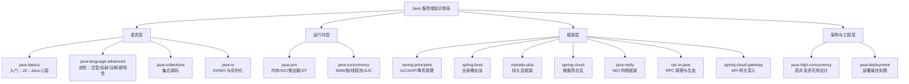

# Java 服务端知识地图与学习路径

> **定位**：本目录是「Java 服务端」的完整知识体系——面向有前端经验、转 Java 后端的读者。全部读完 + 跟完 [Java 实战计划](/java-practice/)，目标是达到**上岗水平**：能独立开发业务接口、能过 Java 岗面试、能看懂主流框架源码。
>
> **读法建议**：不要按目录顺序从头读到尾——按下文的三阶段路径读，每篇开头都标了优先级（P0 必读 / P1 选读 / P2 加分）。

## 一、知识地图（17 篇）

### 每篇讲什么、什么时候读

| 篇目 | 优先级 | 一句话内容 | 什么时候读 |
|------|--------|-----------|-----------|
| [Java 入门](/service/java/java-basics) | P0 | JS→Java 心智转换：类型/类/Stream/Optional/异常/Maven | 第一天 |
| [Java 语言进阶](/service/java/java-language-advanced) | P0 | 泛型擦除、反射、注解、String 契约、8-21 新特性 | 语言关收尾 |
| [Java 集合源码](/service/java/java-collections) | P0 | HashMap/ConcurrentHashMap 原理、fail-fast、LRU | 面试前 |
| [JVM 入门](/service/java/java-jvm) | P0 | 内存分区、GC、类加载、JIT、调优排查 | 面试前 |
| [Java 并发编程](/service/java/java-concurrency) | P0 | JMM、锁、CAS、线程池、JUC、ThreadLocal、死锁 | 面试前 |
| [Spring 核心原理](/service/java/spring-principles) | P0 | IoC、Bean 生命周期、AOP、循环依赖、事务失效 | 框架关 |
| [Spring Boot 入门](/service/java/spring-boot) | P0 | 分层/注解/校验/异常/Security/MyBatis 全家桶 | 主力工具书 |
| [MyBatis-Plus 入门](/service/java/mybatis-plus) | P0 | 持久层：BaseMapper、条件构造器、分页、插件、代码生成 | 接数据库时 |
| [Java 服务部署](/service/java/java-deployment) | P1 | 打包/profile/JVM 参数/systemd/容器化/发布 | 上线前 |
| [高并发高可用设计](/service/java/java-high-concurrency) | P1 | 缓存三难、限流算法、容量估算、演进路线 | 架构关 |
| [Spring Cloud 微服务](/service/java/spring-cloud) | P1 | Nacos/Feign/Sentinel/Gateway 总览 | 微服务岗 |
| [API 网关深入](/service/java/spring-cloud-gateway) | P1 | 网关路由/鉴权/日志/限流机制与职责边界 | 微服务岗 |
| [Java IO/NIO](/service/java/java-io) | P1 | 流体系、BIO/NIO/AIO、序列化 | 读 Netty 前 |
| [Netty 入门](/service/java/java-netty) | P1 | EventLoop/Pipeline/ByteBuf、RPC 生态 | 中高级岗 |
| [RPC 原理与 Java 生态](/service/java/rpc-in-java) | P1 | 动态代理原理、Dubbo/gRPC/Feign、超时重试熔断 | 微服务岗 |
| [Java 实战计划](/java-practice/) | P0 | mall 项目六阶段实操，把知识落到代码 | 贯穿全程 |

### 配套目录（不在本篇展开，按需查）

| 目录 | 内容 |
|------|------|
| [后端基础](/service/common/http-network-basics) | 网络协议、Nginx、数据库全家桶、Redis、Kafka、ES、分布式、锁、设计模式、Linux、可观测性 |
| [Java AI 分册](/ai-agent/java/java-ai-landscape) | 上岗后的延伸方向：Spring AI、RAG 的 Java 实现、AI 工程化（Java 视角的 AI 应用开发） |
| [Java 实战](/java-practice/) | mall + 12306 的实操记录，与本文理论配对 |
| [算法](/algorithms/basic) | 面试算法题（LeetCode 向） |
| [面试题](/interview-questions/) | 汇总题库 |

## 二、三阶段学习路径（照这个走）

### 阶段一：语言关（能写出"像 Java"的代码）

1. [Java 入门](/service/java/java-basics) —— 建立静态类型 + 同步阻塞 + 面向接口三大心智
2. [Java 语言进阶](/service/java/java-language-advanced) —— 泛型/反射/注解/String 四大件
3. [Java 集合源码](/service/java/java-collections) —— 集合是日常工具，先会用再看源码

**验收标准**：不看书写出 `User` DTO（record）+ Stream 查询 + `Optional` 处理；说清 `==` 和 `equals`；知道自定义对象当 HashMap key 要重写什么。

### 阶段二：运行时 + 框架（能干活的核心）

1. [JVM 入门](/service/java/java-jvm) —— 知道内存分区和 GC，能看懂 GC 日志
2. [Java 并发编程](/service/java/java-concurrency) —— 多线程心智 + 线程池 + 常见坑
3. [Spring 核心原理](/service/java/spring-principles) —— 先懂原理再用框架
4. [Spring Boot 入门](/service/java/spring-boot) —— **主力篇，反复翻的案头书**
5. 配合 [Java 实战计划](/java-practice/) 阶段 1-4：跑通 mall，写 CRUD，接缓存

**验收标准**：在 mall 里独立加一个带缓存 + 权限校验的业务接口；说清 IoC/AOP/事务为什么那样设计；画出线程池任务提交流程图。

### 阶段三：工程化 + 架构（能上线、能面试）

1. [Java 服务部署](/service/java/java-deployment) —— 打 jar、配 JVM、上容器
2. [高并发高可用设计](/service/java/java-high-concurrency) —— 缓存三难/限流/容量估算
3. [Java IO/NIO](/service/java/java-io) + [Netty 入门](/service/java/java-netty) —— 网络编程全景
4. [RPC 原理与 Java 生态](/service/java/rpc-in-java) —— 服务间调用怎么发生的（Dubbo/gRPC/Feign）
5. [Spring Cloud 微服务](/service/java/spring-cloud) —— 按需（微服务岗必读）
6. [API 网关深入](/service/java/spring-cloud-gateway) —— 网关的路由/鉴权/日志怎么落地（微服务岗必读）
7. 配合 [Java 实战计划](/java-practice/) 阶段 5-7：安全、微服务、部署全流程

**验收标准**：把一个 Spring Boot 服务从零部署到服务器（含 Docker + nginx + 优雅停机）；面试能讲清"缓存三坑怎么防""线程池参数怎么定""为什么 3 级缓存解循环依赖"。

## 三、面试速通路线（临阵磨枪用）

如果面的是**初中级 Java 岗**，按出镜率排序：

1. Java 集合（HashMap 原理是出镜率第一）
2. Java 并发（JMM/锁/线程池）
3. JVM（内存分区/GC/类加载）
4. Spring（IoC/AOP/事务/循环依赖）
5. MySQL/Redis（见[后端基础](/service/common/database)）
6. 语言基础（equals/hashCode、泛型擦除、异常体系）

微服务岗追加：Spring Cloud 全家桶 + 分布式（CAP/分布式锁/分布式事务）。

AI 应用岗追加：[Java AI 分册](/ai-agent/java/java-ai-landscape)（Spring AI + RAG + 工程化）——2025-2026  Java 岗的新加分项。

## 四、和其他知识的关系

- **Node/TS 经验是优势不是包袱**：每篇都用 JS/TS 做了锚点对照，读的时候主动想"这对应 JS 里什么"，比死记快一倍
- **前端基础**（浏览器/网络/安全）在[浏览器](/browser/overview)目录，和 Java 侧的网络编程互为表里
- 所有篇目的「延伸阅读」互链成网，读到不懂的概念顺着链接跳，别卡住

## 五、维护说明

- 新增/改名/删除文件后，根目录 `menu.config.mjs` 的 `/service/java/` 侧边栏要同步（站点完全按它渲染）
- 每篇保持统一结构：优先级标注 → 背景 tip → 正文（JS 对照 + 代码）→ 面试题速查 → 延伸阅读
