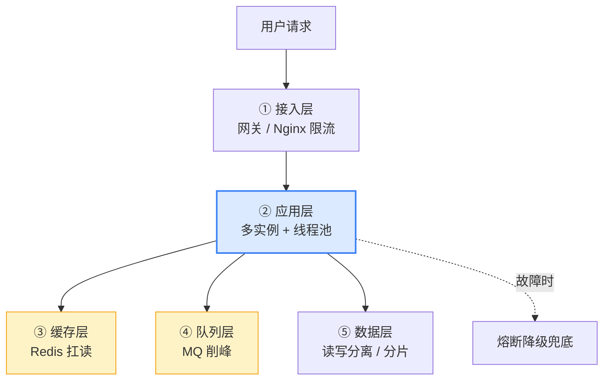

# Java（Spring Boot）高并发与高可用设计

> 本质一句话：**Java 只是"给了你并发的能力"，高并发本身是架构设计的结果**。语言给能力，设计给容量——**瓶颈几乎从不在你的 Java 代码里**。

**优先级 P1**：Java 后端的主流高并发框架是 Spring Boot（单体 / 微服务都能落）。

::: tip 这篇的定位
这篇是**架构视角**，不是 API 手册。它回答三个问题：**并发瓶颈在哪**、**高并发用什么手段扛**、**从单体到微服务怎么一步步走**。

语言级的并发能力（线程池、JMM、锁）见 [Java 并发编程](/service/java/java-concurrency)；缓存与 MQ 的具体用法见 [Redis 入门](/service/common/redis-intro) 和 [消息队列入门](/service/common/mq-intro)。
:::

## 0. 全景：三分钟看懂这篇

> 难度：了解

**它在哪**：这篇是**架构层的地图**——把语言、缓存、MQ、数据库、网关这些组件串成一条"容量路线"。



**读法**：从上到下是**一次请求要穿过的层**；每层都有自己该扛的职责。**高并发 = 每层各扛一段，而不是指望某一层扛全部。**

**分五块**：

| 块 | 内容 | 读到什么程度 |
|---|---|---|
| 1 用途 | 什么时候需要考虑高并发 | 能判断"现在该不该优化" |
| 2 最小可用 | 一次请求的完整链路 + 先定位瓶颈 | 会用 APM 和监控定位 |
| 3 用法 | 单机层 / 架构层 / 高可用三组手段 | 知道每种手段解决什么 |
| 4 原理 | 并发模型、限流算法、容量估算 | 能算能解释 |
| 5 边界与坑 | 优化做错地方的典型事故 | 线上能对上号 |

**学完你能**：① 说出高并发瓶颈的**排查顺序**；② 讲清四种限流算法的差别和临界突刺；③ 用公式算出"该加几台机器"；④ 说出缓存三难各自的解法。

**本篇讲什么、不讲什么**：

| 知识点 | 档位 | 处理 |
|---|---|---|
| 瓶颈定位顺序 | 核心 | 正文 2.1 |
| 单机层手段（线程池 / 连接池 / 异步） | 核心 | 正文 3.1 |
| 架构层手段（缓存 / MQ / 水平扩展 / 分层） | 核心 | 正文 3.2 |
| 高可用手段（集群 / 无状态 / 熔断 / 幂等 / 监控） | 核心 | 正文 3.3 |
| 缓存三难 | 核心 | 正文 3.4 |
| 限流四种算法 | 核心 | 正文 4.2 |
| 容量估算与压测 | 核心 | 正文 4.3 |
| 演进路径 | 进阶 | 正文 1.2 |
| 虚拟线程 / WebFlux | 进阶 | 正文 4.1 |
| 具体参数调优数值 | — | 不写（必须压测出来） |

---

## 1. 用途：什么时候需要考虑高并发

> 难度：了解

### 1.1 先泼一盆冷水

**高并发不是"提前设计"出来的，是"被流量逼出来"的。**

很多团队一上来就上微服务、上分库分表、上 Kafka，结果：

- 运维复杂度暴涨
- 排查链路变长（一个请求横跨 5 个服务）
- **性能反而变差了**（跨网络调用的开销 > 省下来的开销）

**正确的顺序永远是**：**先测量 → 再定位瓶颈 → 再选手段**。

### 1.2 信号：出现这些才该动手

| 信号 | 说明 |
|---|---|
| **P99 RT 明显高于平均 RT** | 平均值被大量快请求拉平了，**长尾才是用户真正感受到的** |
| **DB 连接池频繁打满** | 最常见的真瓶颈——**数据库连接是最稀缺的资源** |
| CPU 不高但 QPS 上不去 | 大概率是**在等**（下游慢 / 锁竞争 / IO 阻塞） |
| 大促前评估流量会涨 10 倍 | 提前准备，但**仍然要先压测** |

**反过来说，这些信号出现前别动**：

- "代码里有个 `for` 循环里查数据库" —— 修它，但别以此为起点做架构改造
- "面试都问高并发" —— 学习可以，工程上用不上就是浪费

### 1.3 演进路径（容量路线）

```text
单体单机（mall）
  → 单机多实例 + nginx（加机器，最便宜）
    → Redis 缓存扛读 + MQ 削峰
      → 读写分离 / 分库分表（DB 瓶颈）
        → 微服务拆分（12306，按业务域拆 + 独立扩容）
```

**每一步解决一个瓶颈**。**别一开始就上微服务**——先加缓存、加机器，便宜且快。

**判断"该走哪一步"的依据是瓶颈位置**：

| 瓶颈在哪 | 该走哪一步 |
|---|---|
| 应用 CPU 打满 | 加实例（水平扩展） |
| DB 读压力大 | Redis 缓存 |
| DB 写压力大 | MQ 削峰 + 读写分离 |
| 单表太大 | 分库分表 |
| 团队规模起来了、发布互相阻塞 | 微服务拆分 |

---

## 2. 最小可用：先学会定位瓶颈

> 难度：会用

### 2.1 排查顺序（**比任何优化手段都重要**）

```text
① 入口层：QPS 有没有突增？有没有被限流打掉？
   ↓
② 应用层：Tomcat 线程池 busy 线程数？队列是否堆积？
   ↓
③ 依赖层：慢 SQL？连接池等待时间？外部 HTTP 调用 RT？
   ↓
④ 数据层：DB 的 CPU / IO / 锁等待 / 慢查询日志？
```

**最常见的结论是 ③ 或 ④**——**瓶颈通常不在 Java 代码里**。

**Java 侧要看的三个指标**：

| 指标 | 从哪看 | 说明什么 |
|---|---|---|
| **Tomcat 线程池 busy 数** | Actuator `/actuator/metrics/tomcat.threads.busy` | 接近 max-threads 就是线程不够 |
| **HikariCP 活跃连接数** | `/actuator/metrics/hikaricp.connections.active` | 长期贴着 max = **DB 是瓶颈** |
| **JVM GC 时间** | `/actuator/metrics/jvm.gc.pause` | GC 频繁 → 分配太快或堆太小 |

**HikariCP 的 pending 数**（等待连接的线程数）是个特别好的信号：

```text
connections.pending > 0 持续增长  →  连接不够 → DB 扛不住 → 该上缓存了
```

### 2.2 压测：别拍脑袋

**① 压测环境要和线上同量级**——配置、数据量、依赖都要接近。否则结论失真（最常见：本地数据量小，索引和缓存的表现完全不一样）。

**② 流量要逐步加，找拐点**：

```text
100 QPS → 500 → 1000 → 2000 → 3000（开始 RT 明显上升）
                                ↑ 拐点在这，单机容量取这个值
```

**③ 关注 P99 而不是平均值**：

```text
平均 RT 50ms，P99 RT 3000ms
→ 意味着 1% 的请求等了 3 秒（大概率是某个下游超时）
→ 平均值完全掩盖了这个问题
```

**④ 关注的指标**：QPS、**P99 RT**、错误率、CPU / 内存 / GC、连接池等待。

> **自检**：压测时 QPS 慢慢加到 3000 时，平均 RT 还是 20ms，但 P99 RT 涨到了 2 秒。你会先怀疑什么？

::: details 参考答案
**先看是不是"少数请求卡住了"，而不是"整体变慢了"。**

平均 RT 没变而 P99 暴涨，说明**大部分请求很快，少部分请求很慢**——所以不是"整体处理能力不足"，而是**有个别请求走了不同的路径**。

按常见度排查：

1. **GC 停顿**：分配速率突增时的一次 Full GC 会让一批请求同时卡住。用 `-Xlog:gc` 看，或看 `jvm.gc.pause` 指标
2. **某个下游慢**：超时设得长（比如 3 秒），少量请求正好命中慢的下游 → 卡满超时时间。P99 ≈ 超时值是强信号
3. **锁竞争**：某个热点 key 的锁竞争，等待时间被拉长
4. **日志同步写盘**：日志异步队列满了，线程被阻塞在写日志上

**最快的定位手段**：在压测期间抓一次 **thread dump**（`jstack`），看有多少线程在等、在哪等。**线程栈是最诚实的证据**——比看指标准得多。

另外对照一下：**错误率有没有涨**？如果 P99 涨但错误率没涨，说明慢请求最终都成功了（只是慢）；如果错误率也涨了，优先看超时配置和下游熔断。
:::

---

## 3. 用法：三层手段

> 难度：会用

### 3.1 单机层

| 手段 | 做什么 | 注意 |
|---|---|---|
| **线程池调优** | Tomcat 线程数、队列大小 | **别用默认值**，按压测调；队列太长会把延迟堆在队列里 |
| **连接池调优** | HikariCP `maximum-pool-size` | **数据库连接才是真稀缺**；不是越大越好（见 5.1） |
| **异步化** | 非核心逻辑异步（MQ / `@Async`） | 别占着请求线程；**注意 `@Async` 自调用失效** |
| **并发工具用对** | `ConcurrentHashMap`、线程池、锁 | 优先用并发容器，而不是"加锁保护 HashMap" |

### 3.2 架构层（**高并发的真正主力**）

```text
Redis 缓存    → 扛热点读（挡住大部分重复查询打 DB）
MQ 削峰       → 突发流量先入队，消费者匀速处理（下单/秒杀）
水平扩展      → 多实例 + 负载均衡（加机器 = 加并发，这是最优解）
数据层        → 读写分离（主写从读）、分库分表（单库瓶颈才上）
限流          → Sentinel / Guava 令牌桶，超阈值直接拒绝（保护系统）
```

**优先级排序**（性价比从高到低）：

```text
加机器（水平扩展）  ← 最优解，改动最小、收益最大
  ↓
加缓存            ← 挡住重复读
  ↓
加队列            ← 挡住突发写
  ↓
调代码            ← 收益最小、最容易引入 bug
```

### 3.3 高可用（不挂 / 挂了能救）

| 手段 | 做什么 | 对应 mall / 12306 |
|---|---|---|
| **集群 + 负载均衡** | 多实例 + LB + 健康检查 | 多台 mall-admin 前面挂 nginx |
| **无状态化** | 登录态 / 会话外置（Redis / JWT） | mall 的 JWT 无状态天然可扩 |
| **熔断降级** | 依赖挂了走兜底（Sentinel / Resilience4j） | 缓存失败降级查库 |
| **限流** | 超阈值拒绝，保护自己 | 秒杀场景必备 |
| **幂等** | 重复请求不重复扣款 / 下单 | 订单防重 |
| **分布式锁** | 并发抢资源（库存扣减） | 12306 锁库存 |
| **监控** | Actuator / 日志（ELK）/ 指标（Prometheus） | **先能看见，才能救** |

**无状态化是前提**：只要会话存在单机内存里，你就**没法随便加实例**（用户的请求打到新实例就掉登录态）。所以**做扩容之前先做无状态化**。

### 3.4 缓存三难

缓存是"扛热点读"的第一层武器，但有三个经典坑：

| 问题 | 现象 | 解法 |
|------|------|------|
| **穿透** | 查一个**根本不存在**的数据，缓存永远没有，每次直打 DB | ① 缓存空值（`null` 也存，短 TTL）② 布隆过滤器预判 ③ 接口层参数校验 |
| **击穿** | 某个**热点 key 过期瞬间**，大量请求同时涌向 DB | ① 互斥锁（只放一个请求回源）② 热点 key 逻辑过期 ③ 提前异步重建 |
| **雪崩** | **大批 key 同时过期**或 Redis 挂了，流量全部轰向 DB | ① TTL 加随机值 ② 多级缓存（本地 + Redis）③ 熔断限流兜底 ④ Redis 高可用 |

```java
// 防穿透实战：查库为空也写一个短 TTL 的占位值
String cached = redis.get(key);
if (NULL_PLACEHOLDER.equals(cached)) {
    return null;                              // 命中空值，直接返回
}
if (cached == null) {
    User user = db.query(id);
    if (user == null) {
        redis.setex(key, 60, NULL_PLACEHOLDER);   // 空值缓存 60 秒，挡住恶意请求
        return null;
    }
    redis.setex(key, 3600, user);
}
```

**记忆口诀**：**穿透 = 不存在（挡在入口）｜击穿 = 热点过期（锁住回源）｜雪崩 = 集体失效（错峰 + 兜底）**。

**为什么"穿透"要挡在入口**：恶意请求构造大量不存在的 id，**每个 id 都会打到 DB** → DB 被拖垮，而缓存一点用没有（因为确实没有这个数据）。所以解法是"**在请求进 DB 之前就拒绝**"。

---

## 4. 原理：三个关键机制

> 难度：懂原理

### 4.1 Java 的并发模型

传统 Spring Boot（Servlet 容器 Tomcat）模型：

```text
一个请求 = 一个线程（Tomcat 线程池，默认 200）
  ├─ IO 阻塞时线程睡眠，OS 切换别的线程
  └─ 并发上限 ≈ 线程数（受内存 / 切换成本约束，通常几千到顶）
```

**每个线程都要栈内存**（默认 1MB 量级）→ 几千个线程就是几个 G 的内存，**且切换有成本**。这是"一请求一线程"的天花板。

**两条演进方向**：

| 方向 | 做法 | 适合 |
|---|---|---|
| **虚拟线程**（JDK 21） | 百万级轻量线程，**每请求一虚拟线程**，阻塞时自动让出载体线程 | **IO 密集**（大部分时间在等 DB / HTTP）——Spring Boot 3.2+ 只需 `spring.threads.virtual.enabled=true` |
| **响应式（WebFlux）** | 一个事件循环线程处理成千上万连接，非阻塞 IO | IO 密集，但**心智负担大**（不能随便调阻塞 API） |

**⚠️ 虚拟线程不是万能的**：

- **CPU 密集**的任务（大量计算）用虚拟线程**没有收益**，甚至更慢（载体线程数少，并行度受限于 CPU 核数）
- **同步阻塞的第三方库**（老的 JDBC 驱动）会**"钉住"载体线程** → 反而更糟（需要换 `spring-boot-starter-jdbc` 的虚拟线程支持，或用连接池的异步客户端）
- 数据库连接数**不会因为虚拟线程变多**——连接池还是那么点

### 4.2 限流四种算法

限流是"保护自己"的闸门。四种算法由粗到细：

| 算法 | 原理 | 缺点 |
|------|------|------|
| **固定窗口计数** | 每秒计数，超阈值拒绝；整秒重置 | **临界突刺**：1.9s 和 2.1s 各来 100 个，单秒都没超限，实际放进 200 |
| **滑动窗口** | 窗口切小格滑动统计，解决临界问题 | 实现稍复杂 |
| **漏桶** | 请求进桶，**恒定速率**流出，桶满拒绝 | 突发流量直接拒（不能应对正常脉冲） |
| **令牌桶** | 恒定速率往桶放令牌，拿到令牌才放行；**允许攒令牌应对突发** | 实现稍复杂 |

```java
// Guava RateLimiter：令牌桶，单机限流最常用
RateLimiter limiter = RateLimiter.create(1000);   // 每秒 1000 个令牌
if (limiter.tryAcquire()) {                       // 拿不到立即拒绝（不等待）
    handle();
} else {
    return "系统繁忙";                             // 降级响应
}
```

**工程选型**：**单机限流 Guava RateLimiter，分布式限流用 Sentinel / Nginx**（按集群总 QPS 限）。Sentinel 内置以上四种算法 + 热点参数限流。

**为什么令牌桶最常用**：它**同时限住了平均速率和允许了可控突发**——符合真实流量特征（用户会自然聚集在某几个时刻）。

### 4.3 容量估算：别拍脑袋

**三步法**：

**① 算单机容量**：压测得出单实例的 QPS 上限（关注 QPS、P99 RT、错误率、CPU/内存/GC）。

**② 估算目标容量**：

```text
峰值 QPS × 安全系数 ÷ 单机 QPS = 实例数
```

安全系数通常取 **2~3**（留 buffer 给突发和故障）。

**③ 验证**：按估算扩容后**再压一次峰值流量的 1.5 倍**，确认还有余量。

```
例：大促峰值 8000 QPS，单机压测上限 3000 QPS
   → 8000 × 2 ÷ 3000 ≈ 5.3 → 上 6 台实例（含冗余）
```

**压测注意**：环境要同量级、流量逐步加（找拐点）、关注 **P99 RT 和错误率**（平均值会把问题藏住）。

**安全系数为什么不能省**：一台机器挂掉 / 一个实例发布重启 / 流量比预估高 30%——这些都会吃掉余量。**系数取 1 意味着"满打满算"，故障一来就崩。**

---

## 5. 边界与坑

> 难度：会用 + 懂原理

### 5.1 一张表先过一遍

| 症状 | 见 |
|---|---|
| 加了连接池配置，吞吐反而下降 | 5.2 |
| 限流生效了，但用户大量报错 | 5.3 |
| 限流没拦住流量 | 5.4 |
| 加了 Redis，DB 压力没降 | 5.5 |
| 压测结论和线上不符 | 5.6 |
| 熔断把正常请求也熔断了 | 5.7 |

### 5.2 连接池不是越大越好

**症状**：把 `maximum-pool-size` 从 10 调到 100，吞吐没涨，RT 反而变差。

**原因**：**数据库的并发处理能力是有限的**（CPU 核数、IO 承载）。连接数超过这个数，请求只是**在池里排队等连接**，等的时间比直接处理还长。

```text
连接数 > DB 承载能力
  → 请求排队等连接
    → 等待时间 = RT × (排队数)
      → 表现为"RT 暴涨、吞吐不变"
```

**经验公式**：

```text
连接数 ≈ CPU 核数 × 2 + 有效磁盘数
```

**更重要的是**：连接数是**跨实例共享**的总量——4 个应用实例 × 每个 10 条 = **DB 侧 40 条连接**，所以扩容时要除以实例数。

### 5.3 限流把正常用户挡在门外

**症状**：大促期间大量用户收到"系统繁忙"，但 CPU 并不高。

**原因**：限流阈值**拍脑袋定的**，或者限流维度不对。

**解法**：

| 做法 | 说明 |
|---|---|
| **按压测结果定阈值** | 单机容量 × 实例数 × 安全系数，**别凭感觉** |
| **按用户/租户维度限流** | 而不是全局一刀切 → 防止个别用户刷爆所有人的配额 |
| **区分接口限流** | 秒杀接口限 100 QPS，查询接口限 5000 QPS |
| **限流要和降级配合** | 被限的请求返回友好提示，而不是 500 错误 |

### 5.4 限流没拦住流量

**症状**：限流配置了，但压测时 QPS 远超阈值。

**原因与对策**：

| 原因 | 解法 |
|---|---|
| **限流只在一个实例生效** | 单机限流 × 实例数 = 总阈值；分布式限流要用 Redis 计数器 / Sentinel 集群模式 |
| **网关和应用的限流层数不同** | 网关限了应用没限，或反之 → **请求路径上的每一层都要知道** |
| **限流键选错**（比如按 IP 限，但都在同一个 NAT 出口） | 换维度（用户 ID / API Key） |
| **限流规则没生效**（配置没加载 / 规则被后续配置覆盖） | 启动后查一下规则列表 |

### 5.5 加了 Redis，DB 压力没降

**症状**：缓存命中率 90%（看起来正常），但 DB QPS 没降。

**原因与对策**：

| 原因 | 检查 |
|---|---|
| **命中率统计口径** | 是不是把"空值缓存"也算成了命中？空值命中不减轻 DB 压力 |
| **key 分布不均** | 少数热 key 占了大部分请求 → 需要**加本地缓存**（Caffeine）挡一层 |
| **缓存 TTL 太短** | 大部分 key 过期了 → 检查 TTL 设置 |
| **查询本身没法缓存** | 参数组合太多（比如按任意条件查）→ 缓存 key 设计有问题 |
| **读的是从库但流量没过去** | 读写路由没生效（见 [数据分布场景与锁设计](/service/common/data-distribution-locks)） |

### 5.6 压测结论和线上不符

**症状**：压测 5000 QPS 没问题，线上 2000 QPS 就崩了。

**常见原因**：

| 原因 | 说明 |
|---|---|
| **数据量不同** | 线上有 1000 万条、压测只有 1 万条 → **索引效率、缓存命中率、GC 行为全不一样** |
| **依赖不同** | 压测时 DB / Redis / 下游是 mock 或小集群 |
| **没有预热** | JVM 还没编译热点代码（JIT）、连接池还没建满、缓存是空的 |
| **压测客户端自己成了瓶颈** | 压测机 CPU 打满 → 实际发出的 QPS 远低于设定值 |
| **网络** | 压测机和服务在同一台机器上 vs 跨机房，RTT 差好几倍 |

**结论**：**压测环境与线上的差异，往往比代码优化更能解释性能差异。**

### 5.7 熔断把正常请求也熔断了

**症状**：下游只是**变慢**（不是挂），但熔断器打开了，全部请求快速失败。

**原因**：熔断器统计的是**失败率**，而"超时"也算失败。下游变慢 → 超时 → 失败率上升 → 熔断打开 → 更多请求快速失败 → 下游压力反而减小（歪打正着），但用户体验断崖式下跌。

**解法**：

| 手段 | 说明 |
|---|---|
| **区分慢和失败** | 慢响应走"降级"而不是"熔断"（Resilience4j 可以分别配置） |
| **超时时间要合理** | 比下游 P99 稍大（比如 P99=500ms → 超时设 1s），别设 3s |
| **熔断粒度要细** | 按下游方法/接口熔断，别整个下游一起熔 |
| **半开探测** | 熔断打开后定期放一个请求试探，通过了再恢复 |

> **自检**：一个接口压测时 QPS 5000、P99 RT 800ms、平均 RT 30ms。线上用户反馈"有时候要等好几秒"。你怀疑什么？

::: details 参考答案
**怀疑两件事：慢请求有，但被平均值藏住了；以及"有时候"暗示是特定条件触发。**

分析：
1. **平均 30ms vs P99 800ms** → 1% 的请求慢了 26 倍。这 1% 是什么？可能是：某类参数走了一条慢路径（如没走缓存的搜索）、某个下游偶发慢、冷启动（首次请求要预热）
2. **"有时候要等好几秒"** → 比 P99 的 800ms 还长，**说明线上存在压测里没有的路径**——典型三种：
   - **缓存未命中 / 缓存失效**：压测时缓存是热的，线上高峰期大量 key 同时过期 → 全打到 DB（**缓存雪崩**）
   - **冷启动 / 扩容后预热**：新实例的 JVM 还没 JIT、连接池没建满、缓存是空的 → 前几分钟慢
   - **某个外部依赖偶发超时**：超时设了 3 秒 → 命中就是"等好几秒"

**怎么查**：看**慢请求的日志和链路**——把 P99 那些请求单独拎出来看它们命中了什么路径（哪个下游、缓存有没有命中、是不是新实例）。**平均值在这里没有任何诊断价值。**

**这题的关键不是猜，是"用分位数 + 路径维度"而不是"看平均值"**——这也是为什么我在正文里反复强调 P99。
:::

---

## 6. 延伸

> 难度：了解

### 实践清单

| 清单项 | 为什么 |
|---|---|
| **先定位瓶颈** | 代码 / DB / 连接池？优化错地方白干 |
| **加机器 > 调代码** | 水平扩展是最优解，代码优化是瓶颈期才做 |
| **缓存扛热点** | 读多写少先上 Redis |
| **MQ 削峰** | 突发写用队列匀速消化 |
| **连接池不是越大越好** | 连接数是 DB 上限，超了排队更糟 |
| **无状态化前置** | 不然扩不了实例 |
| **限流 / 熔断 / 降级** | 高可用的三件套，出事能活 |
| **监控先上线** | 容量规划靠数据，不是拍脑袋 |

### 一句话

> Java 高并发的正确姿势：**先承认"语言不是瓶颈，架构才是"**——单机靠线程池 / 异步压榨，真正容量来自 **Redis 扛读 + MQ 削峰 + 多实例水平扩展 + 数据层拆分**；高可用靠**集群 + 无状态 + 限流熔断降级 + 监控**。演进路径"单体 → 加缓存 / 加机器 → 分库 → 微服务"，**一步解决一个瓶颈**。

### 相关篇目

| 篇目 | 关系 |
|---|---|
| [Java 并发编程](/service/java/java-concurrency) | 语言级并发能力（本文的地基） |
| [Redis 入门](/service/common/redis-intro) | 高并发第一层（缓存）与缓存三难 |
| [消息队列（Kafka）入门](/service/common/mq-intro) | 削峰 |
| [数据分布场景与锁设计](/service/common/data-distribution-locks) | 读写分离与分片 |
| [分布式基础](/service/common/distributed-basics) | 集群 / 分布式锁 |
| [Nginx 与 Web 容器](/service/common/nginx-web-container) | 入口层限流（`limit_req`）与应用层限流互补 |
| [Node.js vs Java 后端选型](/service/node/node-vs-java) | 并发模型对比 |
| [Spring Cloud 微服务](/service/java/spring-cloud) | Sentinel 熔断限流组件 |
