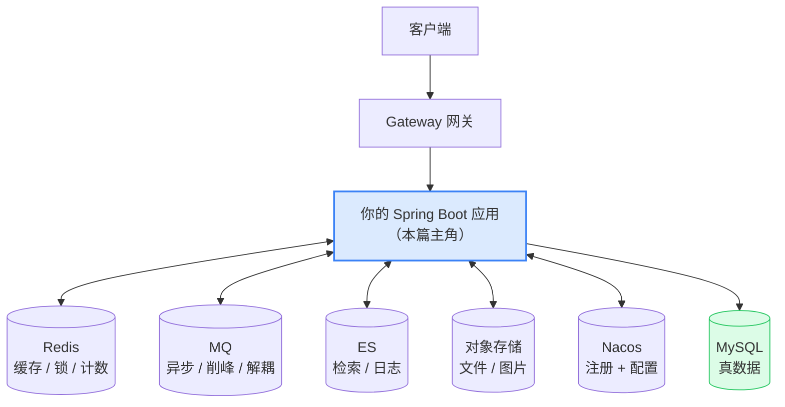
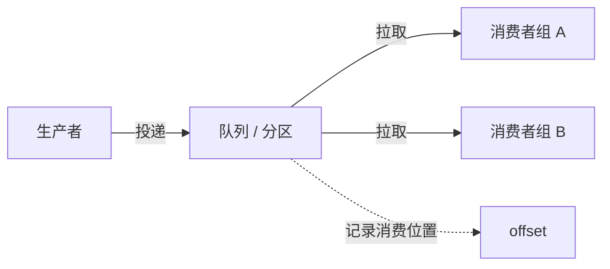

# 服务端中间件全景与 Java 实战

> 本质一句话：**中间件就是"把某个能力从你的进程里搬到另一个进程里"**。搬出去能换来共享、高可用、削峰，代价是：多一个会挂的东西、多一套一致性问题。

::: tip 这篇的定位
本篇站在 **Java 服务端视角**讲五个最常碰的中间件：Redis、MQ、ES、对象存储、Nacos。

**原理不重复讲**——Redis 的数据结构、MQ 的投递语义、ES 的倒排索引，在 [后端基础](/service/common/mysql-advanced) 等专篇里已有（Redis 见 [Redis 入门](/service/common/redis-intro)），本篇只讲**「Java 侧怎么接、接完会踩什么坑」**。深度需求按需跳转：

| 组件 | 原理专篇 |
|---|---|
| Redis | [Redis 入门](/service/common/redis-intro) |
| MQ | [消息队列（Kafka）入门](/service/common/mq-intro) |
| ES | [Elasticsearch 入门](/service/common/elasticsearch) |
| 分布式一致性 | [分布式基础](/service/common/distributed-basics)、[数据分布场景与锁设计](/service/common/data-distribution-locks) |
| 微服务组件 | [Spring Cloud 微服务](/service/java/spring-cloud) |
:::

## 0. 全景：三分钟看懂这篇

> 难度：了解

**中间件在 Java 服务里的位置**——它们不在你的进程里，但你的代码天天在调它们：



**五个组件，一句话定位**：

| 组件 | 它替你解决什么 | 不用它会怎样 |
|---|---|---|
| **Redis** | 把"查过一次的结果"留在内存里 | 每次都打 DB，流量一涨就挂 |
| **MQ** | 把"必须做的"和"可以晚点做的"拆开 | 下游抖动直接拖死上游 |
| **ES** | 在海量数据里做**模糊 / 全文**检索 | 只能 `LIKE '%x%'`，走不了索引 |
| **对象存储** | 存**文件二进制**，并让客户端直传 | 文件塞进 DB，备份和带宽全崩 |
| **Nacos** | 让服务**互相找到**，配置**集中管理** | 地址写死在代码里，加机器要发版 |

**本篇讲什么、不讲什么**：

| 内容 | 档位 | 处理 |
|---|---|---|
| 五个组件的**引入信号**（什么时候该上） | 核心 | 正文 1 |
| **本地一键拉起**全套中间件 | 实战 | 正文 2 |
| **Java 侧接入**：依赖、配置、最小代码 | 核心 | 正文 3 |
| 五个组件的**核心机制**（够用即止） | 核心 | 正文 4 |
| **Java 侧特有的坑** | 核心 | 正文 5 |
| 选型速查 + 学习顺序 | — | 正文 6 |

**不覆盖**：各组件的源码实现、集群搭建运维、压测调参。这些属于"用了之后再说"的阶段。

---

## 1. 用途：什么时候该上中间件

> 难度：了解

### 1.1 三个引入信号

中间件不是"标配"，看到这三种信号才考虑上：

| 信号 | 典型场景 | 该上什么 |
|---|---|---|
| **① 同样的计算重复了很多次** | 同一个商品详情被查了 1 万次 | **Redis** |
| **② 下游抖动会拖死我** | 发个通知要调 3 个服务，其中一个经常超时 | **MQ** |
| **③ 数据量大到不能只靠 LIKE 搜** | 百万级商品，要按关键词模糊匹配 | **ES** |
| **④ 二进制数据塞不进 DB** | 图片、PDF、Excel | **对象存储** |
| **⑤ 服务之间要互相找到，且要独立扩缩容** | 从 1 个服务拆成 5 个 | **Nacos** |

### 1.2 反过来：什么时候**不该**上

这是更值钱的部分——**中间件是负债，不是资产**：

| 场景 | 为什么别上 | 先做什么 |
|---|---|---|
| **数据量还小**（几千条） | Redis / ES 的运维成本 > 收益 | 把索引建好，够用 |
| **单机部署、流量很小** | 多一个组件 = 多一个故障点 | 先单体跑通 |
| **只是"以后可能会用"** | 提前引入 = 提前学习成本 + 提前踩坑 | 等信号出现 |
| **团队没人运维过** | 中间件出问题时没人会救 | 先在小项目里跑一遍 |

**一条判断标准**：中间件带来的**复杂度增量**（一致性问题、故障面、排查链路）必须小于它带来的**性能/解耦收益**。单体项目加 Redis 缓存很容易，**加了之后还要处理"缓存和 DB 不一致"**——那是另一笔账。

### 1.3 中间件的共同代价

不管你上哪个，这三笔账要提前认：

| 代价 | 具体表现 |
|---|---|
| **多一个会挂的东西** | Redis 挂了，缓存穿透直接打到 DB；MQ 挂了，消息堆积 |
| **数据不再在同一个事务里** | 本地事务管不到 Redis / MQ / ES，**一致性要单独设计**（这是最大的坑，见 5.1） |
| **排查链路变长** | 一个慢请求可能横跨 5 个组件，日志、链路 ID、监控都得跟上 |

---

## 2. 最小可用：本地一键拉起全套

> 难度：会用

学中间件最快的方式是**本地跑一遍**。五个组件用 Docker 一次性拉起，5 分钟就能有可用的环境。

### 2.1 一份 docker-compose 拉起五个

```yaml
# docker-compose.yml
services:
  redis:
    image: redis:7.4
    ports: ["6379:6379"]
    command: redis-server --appendonly yes

  rabbitmq:
    image: rabbitmq:3.13-management
    ports: ["5672:5672", "15672:15672"]     # 15672 是管理界面
    environment:
      RABBITMQ_DEFAULT_USER: guest
      RABBITMQ_DEFAULT_PASS: guest

  elasticsearch:
    image: elasticsearch:8.15
    ports: ["9200:9200"]
    environment:
      discovery.type: single-node
      xpack.security.enabled: "false"        # 本地关掉认证，生产绝不能这样
      ES_JAVA_OPTS: "-Xms512m -Xmx512m"     # 默认 1G 内存，本地机器扛不住

  minio:
    image: minio/minio:latest
    ports: ["9000:9000", "9001:9001"]        # 9001 是控制台
    command: server /data --console-address ":9001"
    environment:
      MINIO_ROOT_USER: minioadmin
      MINIO_ROOT_PASSWORD: minioadmin

  nacos:
    image: nacos/nacos-server:v2.4
    ports: ["8848:8848", "9848:9848"]
    environment:
      MODE: standalone                       # 单机模式，开发够用
```

```bash
docker compose up -d
docker compose ps          # 看几个起来了
curl localhost:9200        # ES: 返回集群信息
curl localhost:8848/nacos  # Nacos: 控制台（nacos/nacos）
```

> **Nacos 记得放开端口**：除了 8848（控制台/HTTP），gRPC 通信还要 **9848**（`8848 + 1000`）。只映射 8848 会导致"控制台能打开，但服务注册不上"——这是最常见的 Nacos 新手坑。

### 2.2 Java 侧的依赖

```xml
<!-- Redis -->
<dependency>
    <groupId>org.springframework.boot</groupId>
    <artifactId>spring-boot-starter-data-redis</artifactId>
</dependency>

<!-- MQ：Spring 官方 AMQP（RabbitMQ） -->
<dependency>
    <groupId>org.springframework.boot</groupId>
    <artifactId>spring-boot-starter-amqp</artifactId>
</dependency>

<!-- ES -->
<dependency>
    <groupId>org.springframework.boot</groupId>
    <artifactId>spring-boot-starter-data-elasticsearch</artifactId>
</dependency>

<!-- 对象存储：MinIO 官方 SDK（S3 兼容） -->
<dependency>
    <groupId>io.minio</groupId>
    <artifactId>minio</artifactId>
    <version>8.5.12</version>
</dependency>

<!-- Nacos 注册中心 + 配置中心 -->
<dependency>
    <groupId>com.alibaba.cloud</groupId>
    <artifactId>spring-cloud-starter-alibaba-nacos-discovery</artifactId>
</dependency>
<dependency>
    <groupId>com.alibaba.cloud</groupId>
    <artifactId>spring-cloud-starter-alibaba-nacos-config</artifactId>
</dependency>
```

### 2.3 最小配置

```yaml
# application.yml
spring:
  data:
    redis:
      host: localhost
      port: 6379
  rabbitmq:
    host: localhost
    port: 5672
    username: guest
    password: guest
  elasticsearch:
    uris: http://localhost:9200
  cloud:
    nacos:
      discovery:
        server-addr: localhost:8848
      config:
        server-addr: localhost:8848
        file-extension: yaml
```

**跑起来就绪**：Spring Boot 启动日志里会看到 `Redis` 客户端初始化、`RabbitMQ` 连接、`Elasticsearch` 客户端创建。**任何一个连不上，应用启动就失败**——这比"连上了但行为不对"好排查得多。

> **自检**：Nacos 控制台能打开，但服务注册不上去（服务列表为空），且日志里没有明显报错。你先查什么？

::: details 参考答案
先查 **9848 端口**（gRPC 端口）通不通。Nacos 2.x 的服务注册走 gRPC，只映射 8848 会导致"控制台能访问（HTTP），但注册请求发不出去（gRPC）"。docker-compose 里没映射 9848 是最常见的原因。

其次确认 `spring.cloud.nacos.discovery.server-addr` 写的是 `localhost:8848` 而不是 `http://localhost:8848`（协议前缀会让解析出错）。

最后看日志里有没有 `Client not connected, current status: STARTING` 之类的字样——Nacos 2.x 客户端会先等连接建立，超时后才报错，容易被忽略。
:::

---

## 3. 用法：五个组件在 Java 侧怎么接

> 难度：会用

### 3.1 Redis：缓存的读与写

**核心心智**：Redis 在 Java 服务里最常见的角色是**缓存**——把 DB 的查询结果放在内存里，下次直接拿。

**先说清一致性前提**：Java 侧用 Redis 缓存，**几乎一定是"旁路模式"（cache-aside）**：

```text
读：查缓存 → 没有 → 查 DB → 写回缓存 → 返回
写：改 DB → 删缓存（不是更新缓存！）
```

**为什么是"删"而不是"改"**：并发写时，"改缓存"可能用旧值覆盖新值；"删缓存"让下次读重新从 DB 拿，永远不会不一致。代价是下次读会打一次 DB——这就是缓存三大问题的来源（见 [Redis 入门](/service/common/redis-intro)）。

**代码怎么写**——两种风格，按场景选：

```java
// 风格一：手动（需要精细控制时用）
@Service
@RequiredArgsConstructor
public class ProductService {

    private final StringRedisTemplate redis;
    private final ProductMapper productMapper;

    private static final String KEY = "product:detail:";

    public Product getById(Long id) {
        String cached = redis.opsForValue().get(KEY + id);
        if (cached != null) {
            return JsonUtil.parse(cached, Product.class);
        }
        Product p = productMapper.selectById(id);
        if (p != null) {
            redis.opsForValue().set(KEY + id, JsonUtil.toJson(p), 30, TimeUnit.MINUTES);
        }
        return p;
    }

    public void update(Product p) {
        productMapper.updateById(p);
        redis.delete(KEY + p.getId());     // ← 改 DB 之后删缓存
    }
}
```

```java
// 风格二：Spring Cache 注解（简单场景够用）
@Service
@RequiredArgsConstructor
public class ProductService {

    private final ProductMapper productMapper;

    @Cacheable(value = "product", key = "#id")           // 读：走缓存
    public Product getById(Long id) {
        return productMapper.selectById(id);
    }

    @CacheEvict(value = "product", key = "#p.id")        // 写：删缓存
    public void update(Product p) {
        productMapper.updateById(p);
    }
}
```

| | 手动 | `@Cacheable` |
|---|---|---|
| **控制力** | 强（能拼 key、能设不同 TTL、能在 miss 时做兜底） | 弱（key 表达式受限） |
| **代码量** | 多 | 少 |
| **坑** | 忘了删缓存 / TTL 没设 | 默认 key 是参数拼的（对象参数要小心）、**默认 TTL 无限** |

> ⚠️ **Spring Cache 的两个默认值要记住**：① 没配 TTL，**缓存永不过期**；② key 默认由参数生成，参数是对象时**用的是 `hashCode`**（上一篇讲过 `@Data` 的 hashCode 那个坑）。

**分布式锁**（跨实例互斥）：

```java
// 用 Redis 的 SET NX EX 语义取锁，释放时必须带 value 校验
Boolean ok = redis.opsForValue().setIfAbsent("lock:order:" + orderId, "req-uuid", 10, TimeUnit.SECONDS);
if (Boolean.TRUE.equals(ok)) {
    try {
        // 临界区
    } finally {
        // 释放前校验 value 是自己持有的那把锁，否则可能删掉别人的锁
        if ("req-uuid".equals(redis.opsForValue().get("lock:order:" + orderId))) {
            redis.delete("lock:order:" + orderId);
        }
    }
}
```

**注意**：Redis 锁是**尽力而为**的（Redlock 有争议），要求绝对可靠还得靠 DB 的唯一约束 / 行锁。**能用数据库约束解决的，别用分布式锁**（同 [数据分布场景与锁设计](/service/common/data-distribution-locks) 的思路）。

### 3.2 MQ：把"必须做的"和"可以晚点做的"拆开

**核心心智**：MQ 的价值不是"快"，是**解耦 + 削峰 + 异步**。

```text
没有 MQ：用户下单 → 扣库存 → 发短信 → 发积分 → 记录日志 → 返回
          每个下游都同步等，任何一个慢，用户就等

有 MQ：  用户下单 → 扣库存 → 发消息 → 立即返回
                     ↓
              消费者各自慢慢处理（短信、积分、日志）
```

**Java 侧最小示例**（Spring AMQP，RabbitMQ）：

```java
// 生产者
@Service
@RequiredArgsConstructor
public class OrderService {

    private final RabbitTemplate rabbitTemplate;

    public void create(Long orderId) {
        // 交换机 routingKey + 消息体
        rabbitTemplate.convertAndSend("order.exchange", "order.created",
                new OrderMessage(orderId));
    }
}
```

```java
// 消费者
@Component
@RequiredArgsConstructor
public class OrderMessageListener {

    private final OrderService orderService;

    @RabbitListener(queues = "order.queue")
    public void onMessage(OrderMessage msg) {
        orderService.handleCreated(msg.orderId());
    }
}
```

```yaml
spring:
  rabbitmq:
    listener:
      simple:
        acknowledge-mode: auto          # 业务正常返回才 ack
        prefetch: 10                   # 每次最多取 10 条，控制并发
        retry:
          enabled: true
          max-attempts: 3
```

**三个必须答得出的问题**（面试固定节目，原理见 [MQ 入门](/service/common/mq-intro)）：

| 问题 | 答案 | 对应配置 |
|---|---|---|
| **消息怎么不丢** | 生产端 confirm + 持久化交换机/队列/消息 + 消费端手动 ack | `publisher-confirm-type: correlated` |
| **怎么不重复消费** | **接受重复，靠幂等**：唯一索引 / 状态机 / 去重表 | 业务层保证 |
| **顺序怎么保证** | 分区/队列内有序（同一 key 进同一分区）；全局有序 = 单分区 = 没有并行 | `routingKey` 设计 |

**幂等是最容易被忽略的**：MQ 只保证"至少一次"，**重复消费是常态**。所以消费逻辑必须幂等：

```java
// 幂等的标准做法：用唯一索引兜底
public void handleCreated(Long orderId) {
    try {
        pointService.addPoints(orderId, 100);      // 里面用 INSERT IGNORE / 唯一索引
    } catch (DuplicateKeyException e) {
        log.info("订单 {} 已加过积分，忽略", orderId);   // 重复消费直接吞掉
    }
}
```

**延迟消息**（"30 分钟后取消未支付订单"）：

| 方案 | 说明 |
|---|---|
| **RabbitMQ TTL + 死信队列** | 每条消息设 TTL，过期后进死信队列再消费；**队头阻塞**（后面的消息会等前面的过期） |
| **RabbitMQ 延迟插件** | `x-delayed-message` 插件，直接指定延迟毫秒数 |
| **RocketMQ 定时/延迟消息** | 原生支持等级延迟（1s 5s 10s … 2h），国内项目常用它做这个 |
| **Redis + 延时队列** | 时间轮/ZSet，自己实现，适合简单场景 |

### 3.3 ES：模糊检索

**核心心智**：MySQL 的索引对 `LIKE '%x%'` **无效**（前缀都定不了，走不了索引）。ES 倒排索引天生为"任意位置包含关键词"设计。

**什么时候该上 ES**：

| 需求 | MySQL 行不行 |
|---|---|
| 精确匹配、范围查询、排序 | ✅ MySQL 完全够，**别上 ES** |
| 前缀匹配（`LIKE 'abc%'`） | ✅ 能走索引 |
| **任意位置包含**（`LIKE '%abc%'`） | ❌ 走不了索引 → 上 ES |
| **分词搜索**（"手机壳" 搜到 "保护壳"） | ❌ MySQL 不分词 → 上 ES |
| 相关性排序、聚合分析 | ❌ → 上 ES |
| 海量数据 + 高并发 | ❌ → 上 ES |

**Java 侧接入**（Spring Data Elasticsearch）：

```java
// 实体：@Document 指定索引名，@Field 指定是否可检索/是否存原始值
@Document(indexName = "product")
public class ProductDoc {
    @Id
    private Long id;

    @Field(type = FieldType.Text, analyzer = "ik_max_word")   // 中文分词
    private String title;

    @Field(type = FieldType.Keyword)                          // 精确匹配（不过分词）
    private String category;

    @Field(type = FieldType.Double)
    private BigDecimal price;
}
```

```java
// 查询
@Service
@RequiredArgsConstructor
public class ProductSearchService {

    private final ElasticsearchOperations es;

    public List<ProductDoc> search(String keyword, String category) {
        NativeQuery query = NativeQuery.builder()
                .withQuery(q -> q.bool(b -> {
                    b.must(m -> m.multiMatch(mm -> mm
                            .query(keyword)
                            .fields("title^2", "description")));   // title 权重更高
                    if (category != null) {
                        b.filter(f -> f.term(t -> t.field("category").value(category)));
                    }
                    return b;
                }))
                .withPageable(PageRequest.of(0, 10))
                .build();
        return es.search(query, ProductDoc.class).getSearchHits()
                .stream().map(SearchHit::getContent).toList();
    }
}
```

**两个关键设计点**：

① **`text` 还是 `keyword`**：`text` 分词存倒排（能搜），`keyword` 不分词整体存（能精确匹配、能聚合）。**同一字段两种都要，就建两个字段**（`title` + `title.raw`）。

② **ES 不该做"真数据源"**：ES 有近实时特性（写入到能搜到有 1 秒左右延迟 `refresh_interval`），而且**没有事务、没有强一致**。**真数据在 MySQL，ES 只是索引**——需要"写 DB + 写 ES"的一致性方案（见 5.6）。

### 3.4 对象存储：文件不进数据库

**核心心智**：数据库存**结构化、可查询**的数据；对象存储存**大文件、按 key 取**的二进制。图片、PDF、Excel、用户头像、日志文件——都该进对象存储。

**为什么不能塞进 MySQL**：

| 问题 | 后果 |
|---|---|
| 单行大小限制 | `max_allowed_packet` 默认 16MB，大文件直接存不进 |
| 备份成本 | 备份一个 100GB 的库 = 备份所有文件 |
| 带宽 | 下载文件走 DB 连接池，把业务请求挤死 |
| 访问方式 | DB 要按 SQL 查；对象存储是 **HTTP + key**，浏览器能直连 |

**MinIO 接入**（S3 兼容协议，代码和 AWS S3 几乎一样）：

```java
@Service
@RequiredArgsConstructor
public class FileService {

    private final MinioClient minioClient;      // bean 见下

    private static final String BUCKET = "mall";

    // 1. 预签名：后端只签 URL，客户端直传文件（不经过你的服务器）
    public String presignUpload(String objectName) {
        try {
            MinioPresignedPostFormData form = minioClient.getPresignedPostFormData(
                    null, BUCKET, objectName, 10, TimeUnit.MINUTES);
            return form.url();     // 客户端直接 POST 到这个地址上传
        } catch (Exception e) {
            throw new ServiceException("生成上传地址失败", e);
        }
    }

    // 2. 下载：返回一个 302 或带签名的直链
    public String presignDownload(String objectName) {
        try {
            return minioClient.getPresignedObjectUrl(GetPresignedObjectUrlArgs.builder()
                    .method(Method.GET)
                    .bucket(BUCKET)
                    .object(objectName)
                    .expiry(10, TimeUnit.MINUTES)
                    .build());
        } catch (Exception e) {
            throw new ServiceException("生成下载地址失败", e);
        }
    }
}
```

```java
@Configuration
public class MinioConfig {
    @Bean
    public MinioClient minioClient() {
        return MinioClient.builder()
                .endpoint("http://localhost:9000")
                .credentials("minioadmin", "minioadmin")
                .build();
    }
}
```

**⭐ 预签名直传是对象存储最大的价值**：

```text
❌ 文件流经你的服务器：客户端 → 你的服务 → MinIO → 你的服务 → 客户端
   （你的服务带宽和内存都被占用，还多一次转存）

✅ 预签名直传：客户端 → 你的服务（只要一个签名 URL，10KB 以内）
              → 客户端 → MinIO（文件直接进对象存储）
```

**这就是前端上传图片的标准姿势**——和你在 Node 服务里做 S3 直传是一回事。

### 3.5 Nacos：服务发现 + 配置中心

**核心心智**：Nacos 干两件事，和 [Spring Cloud 那篇](/service/java/spring-cloud) 讲的是同一套：

```text
注册中心：服务启动 → 报自己的 IP:端口 → 别人按【服务名】找到我
配置中心：配置放 Nacos → 服务启动拉取 → 改了能动态刷新（不用发版）
```

**注册中心用法**（客户端代码几乎没有成本）：

```yaml
spring:
  application:
    name: order-service        # ← 别人靠这个名字找到你
  cloud:
    nacos:
      discovery:
        server-addr: localhost:8848
```

```java
// 别人调用你：用【服务名】，不用 IP
@FeignClient(name = "user-service")
public interface UserClient {
    @GetMapping("/api/users/{id}")
    UserDTO getUser(@PathVariable Long id);
}
```

**配置中心用法**：

```yaml
spring:
  cloud:
    nacos:
      config:
        server-addr: localhost:8848
        file-extension: yaml
        # 共享配置：所有服务都要的放这里
        shared-configs:
          - data-id: common.yaml
            refresh: true
        # 专属配置：只有本服务读的
        extension-configs:
          - data-id: order-service.yaml
            group: DEFAULT_GROUP
            refresh: true
```

```java
@RefreshScope                    // ← 关键：让这个 Bean 的 @Value 能被刷新
@RestController
public class ConfigController {

    @Value("${feature.new-checkout:false}")
    private boolean newCheckout;
}
```

**三个必知**：

| 事项 | 说明 |
|---|---|
| **`@RefreshScope` 必须加** | 不加，`@Value` 读到的永远是启动时的值，改配置不生效 |
| **Nacos 挂了服务还能调吗** | **能**——调用方本地缓存了实例列表（这是 AP 设计），只是感知不到变更 |
| **配置推送是"准实时"** | 长轮询机制，**不是**推模型，感知有秒级延迟 |

---

## 4. 原理：五个组件的核心机制

> 难度：懂原理

每个组件只讲"**够用来判断对错的那一层**"，细节留给各自的专篇。

### 4.1 Redis：单线程 + 内存 + 过期策略

```text
命令 → 内存里的数据结构直接执行 → 返回
```

- **单线程执行命令** → **原子性天然成立**（不用加锁），但也意味着**一个慢命令会卡住全部**（`KEYS *` 能把服务拖死）
- **内存** → 读写是纳秒级，比磁盘快几个数量级
- **单线程 ≠ 单连接**：Redis 6.0 起 IO 多线程（网络读写并行），命令执行仍是单线程

**过期策略：惰性删除 + 定期删除**

| | 做法 | 后果 |
|---|---|---|
| **惰性删除** | 访问到过期 key 才删 | 不访问就一直占内存 |
| **定期删除** | 每隔一段时间抽样删过期 key | 有延迟 |

两者配合，所以**过期 key 可能在内存里多待一会儿**——你的缓存 TTL 是"逻辑过期"，不是"物理消失"。

**为什么 Redis 快**：内存 + 单线程无锁 + IO 多线程 + 惰性删除。**代价是单点**（主从/Cluster 另说，见 [Redis 入门](/service/common/redis-intro)）。

### 4.2 MQ：三个角色 + 偏移量



- **生产 → 队列**：消息被持久化到 broker（Kafka 是分区日志文件，RabbitMQ 是队列结构）
- **队列 → 消费者**：消费者**主动拉取**（pull），不是 broker 推
- **offset**：消费位置。**一个消费者组内，offset 由组内协调**——同组多个实例是**抢消息**（一条消息只被组内一个实例处理），不同组各自消费一份（广播）

**这套模型决定了两个常见行为**：

| 现象 | 原因 |
|---|---|
| 同组多个实例，消息只被一个处理 | 组内抢消费 + offset 记录在 broker 侧 |
| 重启后从上次位置继续 | offset 持久化了 |
| **但重启会丢正在处理的那条** | offset 是**提交后**才记录，宕机时正在处理的消息会重投 |

**最后一条就是"消息可能重复"的根源**——所以消费端**必须幂等**。

### 4.3 ES：倒排索引

```text
正向索引（MySQL 的方式）：文档 ID → 内容
倒排索引（ES 的方式）：  词 → 包含它的文档 ID 列表
```

"手机壳"这个关键词被分词成"手机 / 壳"，倒排表里记着"手机"出现在哪些文档、"壳"出现在哪些文档——**查的时候不需要扫全表**。

**代价是写入变贵**：每次写入都要更新倒排表，所以 ES **不适合频繁更新**，也不适合当唯一数据源。

**近实时（near real-time）**：写入后不是立刻可搜，而是每隔 `refresh_interval`（默认 1 秒）把内存段刷成可搜索的 Lucene 段。**"写完立刻查不到"是正常行为，不是 bug。**

### 4.4 对象存储：Key + 扁平命名空间

```text
PUT  /my-bucket/photos/2026/11/06/a.jpg   → 存进去
GET  /my-bucket/photos/2026/11/06/a.jpg   → 取出来
DELETE /my-bucket/photos/.../a.jpg        → 删掉
```

**没有真正的目录**——`photos/2026/11/06/` 只是 key 里的字符串，按 `/` 分割出来的"伪目录"。这带来两个特性：

| 特性 | 说明 |
|---|---|
| **大文件要分片** | 单个 PUT 上传 5GB 会失败 → 用 multipart upload 分片上传再合并 |
| **预签名 = 授人以限时的权限** | URL 里带签名和过期时间，过期即失效；所以**不要把预签名 URL 存进日志或返回给不可信方** |

**一致性**：对象存储通常是**最终一致**（PUT 完成后可能短暂读不到）。如果业务要求"上传完立刻能读"，要么读走缓存，要么选支持强一致的实现。

### 4.5 Nacos：注册发现的 AP 设计

```text
服务启动 → 向 Nacos 注册（IP:端口 + 心跳）
服务调用 → 问 Nacos 要实例列表 → 【本地缓存】→ 负载均衡挑一个
服务挂掉 → 心跳超时 → 从列表剔除
```

**关键在"本地缓存"三个字**：Nacos 挂了，服务之间**仍然能互相调用**（用缓存的列表），只是感知不到新增/下线。这是有意的 **AP（可用性优先）** 设计——注册中心挂了导致全站不可用，比短时间数据不一致严重得多。

**配置推送同理**：客户端拉取配置后**本地缓存**，Nacos 挂了继续用本地配置。

---

## 5. 边界与坑

> 难度：会用 + 懂原理

### 5.1 一张表先过一遍

| 症状 | 见 |
|---|---|
| 改了数据库，接口还返回旧数据 | 5.2 |
| Redis 里的数据莫名没了 / 读到别人的数据 | 5.3 |
| 消息被消费了两次，业务执行了两遍 | 5.4 |
| MQ 消息堆积、消费越来越慢 | 5.5 |
| ES 里的数据搜不到刚写进去的 | 5.6 |
| 用了 MQ 但数据库和消息对不上 | 5.7 |
| 文件上传后 404 / 被拒绝 | 5.8 |
| Nacos 里服务实例下线了还在被调用 | 5.9 |

### 5.2 缓存和数据库不一致

**症状**：改了数据库，接口还返回旧数据；或者反之，缓存里是脏数据。

**原因**：旁路模式下，"写 DB + 删缓存"不是原子的。两个线程交错就出问题：

```text
线程 A                    线程 B
读缓存 → miss
查 DB → 读到旧值 x
                          改 DB → 新值 y
                          删缓存
写缓存 x  ← 慢了一步，把旧值写进去了
```

**解法**：

| 方案 | 做法 | 适用 |
|---|---|---|
| **延迟双删** | 改 DB → 删缓存 → 延迟几百毫秒再删一次 | 最常用，代价是延迟 |
| **缓存 TTL 兜底** | 缓存设个不太长的 TTL（如 5 分钟），最坏情况过期后自然一致 | 简单场景够用 |
| **先删缓存再改 DB** | 改 DB 之前先删 | 仍有并发窗口，但比"先改后删"窗口小 |
| **订阅 binlog** | Canal 监听 DB 变更 → 删缓存 | 彻底，但要引入 Canal |

**更根本的做法**：**不要缓存"会变的派生数据"**。缓存的是能容忍旧值的静态数据（商品详情、配置），而不是余额、库存这类强一致数据。

### 5.3 Redis 数据"莫名消失"

**症状**：缓存里的数据没了，或者读到了别人的数据。

**原因**：Redis 的内存是有限的，默认有 `maxmemory` 限制，**淘汰策略默认 `allkeys-lru`**——内存满的时候**随便一个 key 都可能被删掉**。

更隐蔽的是**另一个库/另一个应用连了同一个 Redis**：key 命名空间撞了。

**解法**：

```yaml
spring:
  data:
    redis:
      host: localhost
      database: 3                # ← 用不同 database 隔离
```

```java
// key 前缀带上业务和版本，避免撞车
private static final String KEY = "mall:product:detail:v2:";
```

**生产上还要注意**：Redis **不能只靠持久化兜底**——RDB 是快照（可能丢最近几秒），AOF 是追加写（丢得更少但文件大）。**Redis 里的数据必须是"丢了也能重建"的**（缓存就是）。

### 5.4 消息重复消费

**症状**：同一笔业务被执行了两次（加了两遍积分、扣了两遍款）。

**原因**：见 4.2——offset 是**处理成功后才提交**的。处理中宕机，消息会重投。

**解法**：**消费端幂等**，三条路：

| 方案 | 说明 |
|---|---|
| **唯一索引**（最常用） | `INSERT IGNORE` / `ON DUPLICATE KEY`，靠 DB 拦重复 |
| **状态机** | 只允许 `待支付 → 已支付`，重复执行时状态不匹配就跳过 |
| **去重表** | 单独一张表记已处理的消息 ID |

**别用"Redis 记个 processed 标记"**——Redis 可能丢数据，标记丢了就又重复了。**幂等要落在 DB 上**。

### 5.5 MQ 消息堆积

**症状**：消费越来越慢，队列深度持续上涨。

**原因**（按常见度排）：

| 原因 | 判断方法 |
|---|---|
| **消费能力不足** | 单条消费耗时 × QPS < 消息产生速率 → 就是不够 |
| **某条消息处理卡住** | 队列头部不动，后面的全堵着（RabbitMQ 的队头阻塞） |
| **下游挂了** | 消费端在等下游超时重试，速率降为 0 |
| **没开并发** | 消费端是单线程串行的 |

**解法**：

```yaml
spring:
  rabbitmq:
    listener:
      simple:
        concurrency: 10          # 消费者并发数
        max-concurrency: 20
        prefetch: 20            # 每次最多取多少（太小会浪费，太大会压垮下游）
```

**调 prefetch 是关键**：太小 → 吞吐低；太大 → 单个消费者囤积太多消息，一旦它挂了重投就是灾难。**经验值：让"一个消费者处理完 prefetch 条"的时间略小于心跳间隔。**

**根本解法是"快速消费 + 异步处理"**：收到消息只做入库（快），真正的耗时逻辑丢回业务队列。

### 5.6 ES 搜不到刚写的数据

**症状**：写入成功了，查询没结果。

**原因**：ES 是**近实时**的——数据在内存里，要等 `refresh_interval`（默认 1 秒）才变成可搜索状态。

**解法**：

| 场景 | 做法 |
|---|---|
| 正常业务 | **等 1 秒**，别在写完立刻查 |
| 测试/要求立即可见 | `POST /product/_refresh` 手动刷新 |
| 需要"写完立刻能查" | 这不是 ES 的强项 → **真数据放 MySQL，ES 只做检索** |

**另一个原因**：**分词不一致**。写入时用 `ik_max_word`（细粒度），查询时用 `ik_smart`（粗粒度），或者字段类型一个是 `text` 一个是 `keyword` → 搜不到。**写入和查询必须用同一个分析器。**

### 5.7 数据库和消息对不上

**症状**：订单创建了，但积分没加；或者消息发出去了，订单却没创建。

**原因**：**本地事务管不到 MQ**。`@Transactional` 只保证 DB 事务，消息发送是另一条链路。

**三种解法**（按可靠性排序）：

| 方案 | 做法 | 代价 |
|---|---|---|
| **可靠消息最终一致**（最常用） | 本地事务表：同一事务里写"业务表 + 消息表"，另一个线程扫消息表发 MQ | 要多一张表 + 定时任务 |
| **RocketMQ 事务消息** | 半消息 → 本地事务提交 → broker 才投递 | 依赖 MQ 特性 |
| **Seata AT** | 全局事务，各节点自动提交/回滚 | 侵入性大，性能损耗 |

**95% 的业务用第一种就够了**——"本地事务表"其实就是自己实现消息表 + 定时补偿。

### 5.8 文件上传失败 / 上传后访问不到

**症状**：前端拿到上传地址但传不上去；或者传上去了但访问 403。

**原因与对策**：

| 症状 | 原因 | 解法 |
|---|---|---|
| 上传 403 | 预签名过期（有效期太短） | 有效期调到 10 分钟；**别复用同一个 URL 反复上传** |
| 上传 413 | 文件超过限制 | 检查 MinIO 的 `fileSizeLimit` 和网关的 `max-file-size` |
| 访问 404 | bucket 不存在 / key 拼错 | 启动时 `bucketExists` 检查，不存在就 `makeBucket` |
| 跨域失败 | 浏览器直传 MinIO 被 CORS 拦 | 给 MinIO 配 `MINIO_API_CORS_ALLOW_ORIGIN` |
| **文件能被猜到 URL 访问** | key 太简单（`photo/1.jpg`） | key 加随机 UUID；敏感文件用**私有桶 + 预签名访问** |

**最危险的一条**：**别用 `file.getOriginalFilename()` 直接当 key**——用户可以传 `../../etc/passwd` 之类。key 应该自己生成（UUID + 扩展名）。

### 5.9 Nacos 实例下线了还在被调用

**症状**：把服务实例从 Nacos 摘掉了，流量还往那儿打。

**原因**：

| 情况 | 说明 |
|---|---|
| **正常下线没做** | 客户端只感知心跳超时（默认几十秒），Nacos 手动摘除**不会立即通知**已缓存列表的客户端 |
| **调用方本地缓存没刷新** | 客户端拉列表有间隔 |
| **服务没主动注销** | kill -9 时无法注销，只能等心跳超时 |

**解法**：

| 做法 | 说明 |
|---|---|
| **优雅停机** | 下线前调 Nacos 的注销接口 + 等一个心跳周期（配合 Spring Cloud 的 `spring.cloud.nacos.discovery.shutdown.wait-time`） |
| **客户端主动剔除** | 调用失败重试时换一个实例（Nacos 自带重试策略） |
| **别手动摘除** | 要下线就**先停流量再停进程**，顺序反了就会出现这个现象 |

**K8s 场景另说**：K8s 有自己的服务发现（Service + EndpointSlice），用 `Nacos discovery` 那套反而绕。

---

## 6. 延伸

> 难度：了解

### 选型速查表

| 你要解决的问题 | 选它 | 别选它 |
|---|---|---|
| 热点数据重复查询 | **Redis** | ES（重但能做全文） |
| 数据库扛不住读 | **Redis** + 一致性方案 | 加机器（成本高） |
| 下游抖动拖死我 | **MQ** | 重试（会放大流量） |
| 削峰（流量忽高忽低） | **MQ** | 扩容（来不及） |
| 全文 / 模糊检索 | **ES** | MySQL `LIKE '%x%'` |
| 日志检索与分析 | **ES**（+ Logstash/Kibana，即 ELK） | grep 大文件 |
| 存图片 / PDF / 附件 | **对象存储** | MySQL BLOB |
| 让浏览器直传文件 | **对象存储 + 预签名** | 自己的服务中转 |
| 服务互相发现 | **Nacos / K8s Service** | 代码里写死 IP |
| 配置集中管理、动态刷新 | **Nacos Config** | 每个服务一份 `application.yml` |
| 分布式锁 | **Redis（尽力而为）** | 数据库唯一约束（更可靠） |
| 强一致的关键数据 | **MySQL + 事务** | Redis / ES |

### 什么时候学、学到什么程度

按"用得上"的顺序：

| 阶段 | 目标 | 判据 |
|---|---|---|
| **现在（能干活）** | 会用 Redis 缓存、会用 MQ 异步、会用预签名上传 | 能把文件上传功能完整做出来（含直传） |
| **接第一个中间件时** | 亲手在本地 docker-compose 里跑起来，用代码连上 | 能说出"Redis 挂了会怎样" |
| **上线前** | 会配连接池、超时、重试、监控；知道缓存和 DB 一致性怎么做 | 缓存三大问题能各说一个解法 |
| **做微服务时** | Nacos + Feign + Gateway + Sentinel 能配起来 | 能画出一次请求经过哪些组件 |
| **深入** | 读各组件的专篇（本篇是地图，专篇是细节） | — |

### 中间件层的学习顺序建议

```text
Redis（最常用，先学）
  → MQ（异步思维，最难在"消息可能重复"）
    → 对象存储（最简单，纯 API）
      → ES（和 MySQL 强对比，学"什么场景不该用"）
        → Nacos（微服务的前置知识）
```

**每学一个都做同一件事**：**先想清楚"它解决什么问题"，再学 API**。中间件最容易的失败模式是"会用 API 但不知道什么时候该用它"——那时候你只会到处加中间件，把系统搞得比单体还复杂。

### 与本知识库其他篇目的关系

| 篇目 | 关系 |
|---|---|
| [Spring Cloud 微服务](/service/java/spring-cloud) | Nacos / Feign / Sentinel / Gateway 的组件视角 |
| [Java 高并发高可用设计](/service/java/java-high-concurrency) | 缓存三难、限流、容量估算的架构视角 |
| [数据分布场景与锁设计](/service/common/data-distribution-locks) | 分布式锁的可靠性边界 |
| [分布式基础](/service/common/distributed-basics) | CAP、分布式事务 |
| [Redis 入门](/service/common/redis-intro) | Redis 原理与面试题 |
| [消息队列入门](/service/common/mq-intro) | MQ 投递语义 |
| [Elasticsearch 入门](/service/common/elasticsearch) | ES 与 MySQL 的选型 |
| [Docker 入门](/service/docker) | 本地拉起中间件的基础 |

---

> **一句话收尾**：中间件的价值在于**搬走**某个能力，代价是**搬走了之后的一致性要你亲手补**。每引入一个，先问自己两句话：**"不用它行不行"**、**"用了之后一致性问题怎么解"**——答不上第二个，就先别上。

