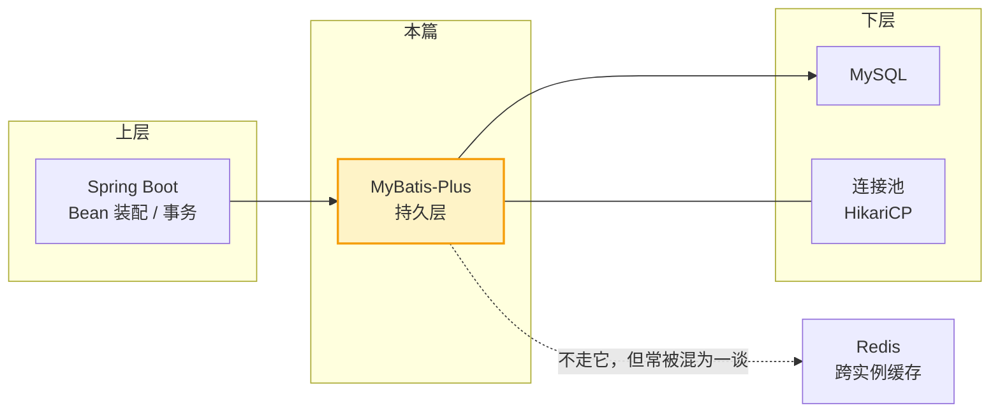
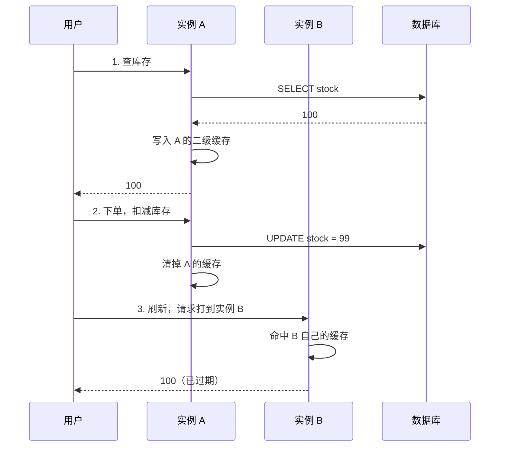

# MyBatis-Plus 入门

> 本质一句话：**MyBatis-Plus 不是另一个 ORM，而是在 MyBatis 上加了一层「CRUD 免写」**——SQL 真正执行的那条链路一点没变。

::: tip 读者定位
承接 [Spring Boot 篇](/service/java/spring-boot)。面向前端转全栈、Java 只到"能看懂语法"的读者。你熟悉 TypeORM / Prisma 的话，很多概念能直接对上，但有几处反直觉必须先拆掉——第 1.4 节那张锚点表就是干这个的。
:::

**优先级 P1（国内企业高频）**：国内 Java 后端的实际标准持久层方案，面试问「你们项目用什么 ORM」十有八九是它。

## 0. 全景：三分钟看懂这篇

> 难度：了解

**它在哪**：持久层。上接 Spring Boot 的 Bean 装配与事务，下接 MySQL 的 SQL 执行；跨实例缓存通常交给 Redis，跟它无关。它自己不是数据库、不是连接池，也不管事务——那三件事分别由 MySQL、HikariCP、Spring 负责。

**分四块**：

| 块 | 内容 | 读到什么程度 |
|---|---|---|
| 1 用途 | 它省掉了什么、什么项目该用、什么项目不该用 | 能对着自己的项目做判断 |
| 2 最小可用 | 依赖 + 一张表 + 一次查询，10 分钟跑通 | 跑通一遍 |
| 3 用法 | Wrapper / 分页 / 逻辑删除 / Service / 手写 SQL / 乐观锁 | 会用，能抄改 |
| 4 原理 | 动态代理、四大对象、两级缓存 | 懂机制，能对上报错 |

**学完你能**：① 在项目里正确使用六种常见操作；② 看到 `Invalid bound statement` 这类报错时知道去哪查；③ 解释「为什么 updateById 传 null 不生效」这种前端最容易踩的坑。



**本篇讲什么、不讲什么**——完整性靠这张表兜底，不靠正文把边角料全塞进来：

| 知识点 | 档位 | 处理 |
|---|---|---|
| 三层定位（JDBC / MyBatis / MP） | 核心 | 正文 1.1 |
| 与 generator / JPA 的路线选择 | 核心 | 正文 1.3 |
| BaseMapper CRUD、Wrapper | 核心 | 正文 3.1 |
| 分页 / 逻辑删除 / 主键策略 | 核心 | 正文 3.2 ~ 3.3 |
| `#{}` vs `${}` | 核心 | 正文 5.6 + 面试考点 |
| MapperProxy、四大对象、插件 | 核心 | 正文 4.1 ~ 4.2 |
| 两级缓存 | 核心 | 正文 4.3 |
| IService / ServiceImpl | 进阶 | 正文 3.4 |
| 乐观锁 `@Version` | 进阶 | 正文 3.6 |
| 自动填充、多租户 | 进阶 | 正文 6 表格带过 |
| 代码生成器 | 边角 | 正文 6 一句话 |
| 自定义 SQL 注入器、TypeHandler、枚举映射 | 边角 | 不写，指向官方文档 |

**不覆盖**：多数据源、分库分表、MyBatis 与 JPA 的完整选型论证。

---

## 1. 用途：什么项目该用它

> 难度：了解

### 1.1 它到底省掉了什么

先看没有它的时候。JDBC（**Java Database Connectivity**）是 Java 访问数据库的最底层标准接口，Spring、MyBatis、Hibernate 全都建在它上面。你平时不会直接用它，但看一遍就知道上面那些框架替你做了多少事：

```java
public User findById(long id) throws SQLException {
    String sql = "SELECT id, name, status FROM users WHERE id = ?";
    try (Connection conn = dataSource.getConnection();              // 1. 从连接池拿连接
         PreparedStatement ps = conn.prepareStatement(sql)) {       // 2. 预编译
        ps.setLong(1, id);                                          // 3. 塞参数
        try (ResultSet rs = ps.executeQuery()) {                    // 4. 执行
            if (!rs.next()) {
                return null;
            }
            User u = new User();                                    // 5. 手动逐列映射
            u.setId(rs.getLong("id"));
            u.setName(rs.getString("name"));
            u.setStatus(rs.getInt("status"));
            return u;                                               // 6. try-with-resources 自动关连接/语句/结果集
        }
    }
}
```

`dataSource` 就是连接池（`DataSource` 接口的实例），Spring Boot 按配置自动建好，不必自己 `new`。

十九行里只有 `SELECT ... WHERE id = ?` 是"业务"，其余全是搬运。表有二十个字段，这份映射要写二十遍；加一列，全项目每个查询方法都得改。

这就是 ORM（**Object-Relational Mapping，对象关系映射**）要解决的问题：**让你只关心「查什么」和「拿到什么对象」，中间的样板代码由框架生成。**

三层的关系一眼看清：

| 层 | 你写什么 | 谁生成 SQL |
|---|---------|-----------|
| ① JDBC | `Connection` / `PreparedStatement` / `ResultSet` 全套 | 你手写，还要自己遍历结果集 |
| ② MyBatis | **只写 SQL**（XML 或注解），参数映射与结果集映射它包了 | 你写 |
| ③ MyBatis-Plus | 单表场景**连锁 SQL 都不写** | 它按实体自动生成 |

关键认知：**MP 不替代 MyBatis，它在上面加了一层。** 运行时依然是 `SqlSession → Executor → JDBC` 那条老路，MP 只是在**启动时**替你生成了「XML 本该写的内容」，也就是一条 `MappedStatement`（"一个方法对应一条 SQL"的登记项）。后面第 4 章讲的代理、四大对象、缓存，全是 MyBatis 的机制，MP 一层都没改。

### 1.2 什么场景该用

- 业务以**单表增删改查**为主（后台管理、内容管理、订单基础操作），这类代码占了项目大半
- 团队里 **SQL 要能改**：复杂查询直接写 SQL，DBA 能审、能贴进客户端调优
- 新人多，希望"一个实体类 + 一个空接口"就能开始写业务

### 1.3 什么场景不该用

不是所有项目都适合。三条分界线：

**① 需要 SQL 在代码库里可见、可 diff、可逐条审 → 用原生 MyBatis + 代码生成器**

`mybatis-generator-core`（常见简称 MBG）读一份配置连上库表，直接生成实体 + Mapper 接口 + **XML**（写死的 SQL）+ 条件类到源码树。同样是"单表免写"，但它把 SQL 固化成了文件。

两条路的真正差别，是**SQL 什么时候产生**：

| 维度 | MyBatis + generator | MyBatis-Plus |
|---|---|---|
| 单表 SQL 何时出现 | **编译期**一次性生成，落成 XML 进版本库 | **运行期**按实体推导，源码里看不到 |
| 改表结构 | 重跑生成器；**要防覆盖手改过的代码** | 改实体字段就行 |
| 条件构造 | `XxxExample` + 字符串字段名 | `LambdaQueryWrapper` + 方法引用，改名编译期报错 |
| SQL 可审计性 | **高**：XML 就是最终 SQL | 中：要开日志才看得到实际语句 |
| 分页 | 不带，另配 PageHelper | 内置拦截器 |
| 逻辑删除 | 自己写进每条 SQL | `@TableLogic` 自动加条件 |
| 常见于 | 存量大项目、SQL 必须逐条可审 | 新项目、追求开发效率 |

**② 多表 join、聚合报表占主体 → 两边都得手写 SQL**

MP 的 Wrapper 只能做单表条件（`WHERE / ORDER BY / LIMIT`），做不了 join。这类项目用 MP 只是省掉单表 CRUD，复杂查询照样 `@Select` 或 XML。

**③ 想要"零 SQL、全自动映射" → 那不是 MP 的定位**

JPA（Hibernate）才是全自动那条路，代价是生成的 SQL 不可控：复杂报表查询它生成的语句可能又慢又难读，DBA 也没法审查调优。国内团队的选择习惯是**SQL 必须握在自己手里**，MP 是在这个习惯上长出来的。

两者**并不互斥**：MP 兼容原生 MyBatis，`@MapperScan` 扫到的接口里同时混着 `BaseMapper` 体系和手写 XML 的 Mapper 没问题。老项目"既有 `UserMapper.xml` 又在用 `LambdaQueryWrapper`"，通常就是迁移中。

### 1.4 给前端读者的锚点表

转型者踩的坑几乎都来自同一处：**把前端的心智模型原样搬过来**。这张表建议先扫一遍，后面章节遇到再回头看。

| 本篇概念 | 前端近似物 | 相同点 | **关键差异** | 按前端直觉用会出什么事 |
|---|---|---|---|---|
| `UserMapper` 接口 | 自己写的 `api.getUserById()` | 都是声明式调用 | 前端要写实现；这里由动态代理在运行时实现 | 以为要写实现类 |
| MapperProxy | **JS 的 `Proxy`** | 都是运行期拦截 | JS 拦属性读写；它拦方法调用，再按「接口名+方法名」查 SQL | 以为能拦任意方法 |
| `updateById` | `prisma.update` / `setState` 合并 | 都按主键更新 | **默认只更新非 null 字段**，不是整体替换 | 想清空字段传 null → 静默不生效 |
| `LambdaQueryWrapper` | TypeORM 的 `where` 对象 | 都是条件构造 | 它是**可变对象**，链式改的是自身 | 复用同一个 wrapper → 条件越拼越多 |
| `SqlSession` | 一次 `fetch` 的上下文 | 都承载一次数据库交互 | Spring 里几乎每次操作都新开一个 | 以为查询结果有缓存 |
| 一级缓存 | React Query 的 `staleTime` | 都能省掉重复请求 | 粒度是 SqlSession，作用域极小 | 以为跨请求有效 |
| 二级缓存 | Service Worker 全局缓存 | 都是应用内缓存 | 挂在 namespace 上，多表 join 无法联动失效 | 以为会自动 revalidate |
| 逻辑删除 `@TableLogic` | 前端的 `isDeleted` 软删除 | 都是标记删除 | **只对 MP 自动生成的 SQL 生效** | 手写 SQL 忘加条件，查出已删数据 |
| `#{}` / `${}` | 参数化查询 vs 模板字符串 | — | 只有 `#{}` 是预编译 | 把 `${}` 用在 where 条件上 → SQL 注入 |

> **自检**：你的项目里有一半接口是复杂多表查询，还适合用 MP 吗？

::: details 参考答案
适合，但要降低预期：MP 只帮你省掉单表那部分（实体、CRUD、分页、逻辑删除），多表查询照样手写 SQL。判断标准不是"能不能用"，而是**单表占比**——单表占七成以上收益明显；单表只占三成，引入它主要是换来统一的分页和逻辑删除。
:::

---

## 2. 最小可用：十分钟跑通

> 难度：了解

先跑通一件事，别急着理解原理。

### 2.1 依赖

```xml
<dependency>
    <groupId>com.baomidou</groupId>
    <artifactId>mybatis-plus-boot-starter</artifactId>
    <version>3.5.x</version>
</dependency>
<dependency>
    <groupId>mysql</groupId>
    <artifactId>mysql-connector-j</artifactId>
    <scope>runtime</scope>
</dependency>
```

::: warning 3.5.9 起，分页要额外引一个包
官方安装文档原文：「版本 `3.5.9+` 插件部分开始修改为可选依赖」。原因是 jsqlparser 5.0+ 不再支持 JDK 8，它被拆成了独立包。所以在 3.5.9 及以上版本，用到分页还要加：

```xml
<dependency>
    <groupId>com.baomidou</groupId>
    <artifactId>mybatis-plus-jsqlparser</artifactId>
    <version>3.5.x</version>
</dependency>
```

低于 3.5.9 时它由 starter 直接带入，不用单独引。
:::

### 2.2 一张表 + 一个实体 + 一个空接口

```sql
CREATE TABLE users (
    id      BIGINT PRIMARY KEY AUTO_INCREMENT,
    name    VARCHAR(32) NOT NULL,
    status  INT      DEFAULT 1,
    deleted INT      DEFAULT 0
);
```

```java
// User.java —— 这里手写 getter/setter。实际项目几乎都用 Lombok 的 @Data，
// 那需要额外依赖（org.projectlombok:lombok），不是 JDK 自带
@TableName("users")
public class User {
    @TableId(type = IdType.AUTO)   // 主键策略：数据库自增
    private Long id;
    private String name;
    private Integer status;
    @TableLogic                    // 逻辑删除标记
    private Integer deleted;
    // getter / setter 省略
}

// UserMapper.java —— 空接口，继承就有全套 CRUD
public interface UserMapper extends BaseMapper<User> {
}
```

**接口不会自己变成 Bean**，还要让它被扫描到（漏了启动就 `NoSuchBeanDefinitionException`），二选一：

```java
// 方式一：启动类批量扫描（推荐）
@SpringBootApplication
@MapperScan("com.example.mapper")   // org.mybatis.spring.annotation.MapperScan
public class App { }

// 方式二：每个接口自己标 @Mapper
@Mapper
public interface UserMapper extends BaseMapper<User> { }
```

### 2.3 跑通那一行

```java
@Autowired
private UserMapper userMapper;

User user = userMapper.selectById(1L);
// 实际执行：SELECT id,name,status,deleted FROM users WHERE id = 1 AND deleted = 0
```

注意最后那行 SQL：`AND deleted = 0` 是自动加的（见 3.3）。

**第一次跑，一定要打开 SQL 日志**，亲眼看见这条语句，比读十段解释都管用：

```yaml
mybatis-plus:
  configuration:
    log-impl: org.apache.ibatis.logging.stdout.StdOutImpl
```

> **自检**：`selectById` 一行代码，实际发出什么 SQL？多出来的条件是哪来的？

::: details 参考答案
一条 `SELECT ... WHERE id = 1 AND deleted = 0`。`deleted = 0` 来自实体上的 `@TableLogic`——逻辑删除的查询条件由 MP 自动追加，但只对自动生成的 SQL 生效。
:::

---

## 3. 用法：六个主线任务

> 难度：会用

这一章只讲"怎么做"，机制留到第 4 章。

### 3.1 CRUD 与条件构造

`BaseMapper` 直接给了一套方法：`insert`、`deleteById`、`updateById`、`selectById`、`selectList`、`selectCount`、`selectPage`。

条件查询用 `Wrapper`，和 TypeORM 的 `where` 干的是同一件事：

```java
List<User> list = userMapper.selectList(
    new LambdaQueryWrapper<User>()
        .eq(User::getName, "张三")
        .gt(User::getId, 100)
        .orderByDesc(User::getId)
);
```

| TypeORM | MyBatis-Plus |
|---------|--------------|
| `where: { name: '张三' }` | `.eq(User::getName, "张三")` |
| `where: { id: MoreThan(100) }` | `.gt(User::getId, 100)` |
| `orderBy: { id: 'DESC' }` | `.orderByDesc(User::getId)` |
| `like: { name: '%张%' }` | `.like(User::getName, "张")` |
| `in: ...` | `.in(User::getId, ids)` |

> `Wrappers.lambdaQuery(User.class)` 与 `new LambdaQueryWrapper<User>()` 等价，前者是静态工厂；嵌套时用 `Wrappers.<User>lambdaQuery()` 可省掉泛型参数。

**为什么用 `User::getName` 而不是字符串 `"name"`**：方法引用会被解析成实体字段名，字段改名时编译期就报错；字符串写错了要等运行时才炸。

### 3.2 分页

```java
// 1. 配置拦截器（只配一次）
@Configuration
public class MybatisPlusConfig {
    @Bean
    public MybatisPlusInterceptor mybatisPlusInterceptor() {
        MybatisPlusInterceptor interceptor = new MybatisPlusInterceptor();
        interceptor.addInnerInterceptor(new PaginationInnerInterceptor(DbType.MYSQL));
        return interceptor;
    }
}

// 2. 使用
Page<User> page = userMapper.selectPage(
    new Page<>(1, 10),                              // 第 1 页，每页 10 条
    new LambdaQueryWrapper<User>().eq(User::getStatus, 1)
);
List<User> records = page.getRecords();
long total = page.getTotal();
```

两件必须知道的事：

1. 不配拦截器，`Page` 参数会被**静默忽略**，你会拿到全表数据——不报错，只是悄悄变慢。
2. 默认会**多发一条 COUNT**（所以"分页 = 两条 SQL"）。不需要总数时用 `new Page<>(1, 10, false)` 关掉，实实在在省一半数据库压力。

### 3.3 逻辑删除

```java
@TableLogic
private Integer deleted;   // 默认：0 未删，1 已删
```

配了之后：`deleteById(id)` 变成 `UPDATE users SET deleted = 1 WHERE id = ?`；所有 **MP 自动生成**的查询自动追加 `AND deleted = 0`。

⚠️ **手写 SQL 不会自动加条件**，这是最容易出事的边界，详见 5.3。

### 3.4 Service 层：IService 是可选的

先把两件事分开：

- **Service 层**：你自己的业务类，标 `@Service`，负责事务、跨表编排、缓存。这个必须有。
- **`IService` / `ServiceImpl`**：MP 额外送的基类，把 `baseMapper` 包一层，再送几个便利方法（`saveBatch`、`getOne`、`lambdaUpdate`）。**用不用都行，不是框架要求。**

用了是这样（各两行）：

```java
public interface UserService extends IService<User> { }

@Service
public class UserServiceImpl extends ServiceImpl<UserMapper, User> implements UserService { }
```

`ServiceImpl` 内部持有 `baseMapper`，子类能直接 `this.baseMapper.selectById(id)`，也能用继承来的 `getById(id)`、`saveBatch(list)`。

**不用的写法**（很多真实项目就是这样）：

```java
@Service
@RequiredArgsConstructor
public class IntentTreeServiceImpl implements IntentTreeService {

    private final IntentNodeMapper intentNodeMapper;        // 注入多个 Mapper
    private final KnowledgeBaseMapper knowledgeBaseMapper;

    @Transactional
    public void create(CreateRequest req) {
        KnowledgeBaseDO kb = knowledgeBaseMapper.selectById(req.getKbId());
        if (kb == null) {
            throw new ClientException("知识库不存在");
        }
        intentNodeMapper.insert(toDO(req));
    }
}
```

差别一句话：`ServiceImpl` 是「**一个 Service 管一张表**」，上面这种是「**一个 Service 编排多张表**」。

一旦 Service 要同时操作订单、库存、流水三张表，`ServiceImpl<单个 Mapper, 单个实体>` 就不匹配了——继承它只换来一个没用上的泛型，其他 Mapper 照样得自己注入。

| 你的 Service 形态 | 建议 |
|---|---|
| 基本是单表 CRUD + 一点业务校验 | 继承 `ServiceImpl`，省掉一层转发方法 |
| 一个业务动作跨多张表 | 普通 `@Service`，直接注入需要的 Mapper |

所以 ragent 这类项目里看不到 `IService` 很正常——它的 Service 大多是编排型的。**别人不用不代表你用错，它就是个可选工具。**

### 3.5 手写 SQL：注解还是 XML

```java
// 注解：简单查询够用
@Select("SELECT * FROM users WHERE name = #{name}")
List<User> findByName(@Param("name") String name);
```

```xml
<!-- XML：复杂查询、动态条件（resources/mapper/OrderMapper.xml） -->
<select id="findOrdersWithItems" resultType="com.example.OrderVO">
    SELECT o.*, i.name AS item_name
    FROM orders o
    LEFT JOIN order_items i ON o.id = o.order_id
    WHERE o.user_id = #{userId}
    <if test="status != null">
        AND o.status = #{status}
    </if>
    ORDER BY o.created_at DESC
</select>
```

动态 SQL 标签：`<if>`、`<where>`、`<foreach>`（in 查询）、`<choose>`（switch）。

**「零 XML」是完全可行的现实选择**：中等规模项目可以全库没有 mapper XML——单表走 Wrapper，多表走 `@Select`。

### 3.6 乐观锁：并发更新同一行

两个请求同时改同一条记录，后提交的会覆盖先提交的——前一个人的改动凭空消失，这叫**丢失更新**。前端有同样的场景：两个标签页同时编辑同一份草稿，谁后点保存谁赢。

悲观锁的思路是查的时候就锁住（`SELECT ... FOR UPDATE`）；乐观锁反过来——**不加锁，写的时候检查版本号有没有变，变了就失败**。

```java
// 1. 实体加版本字段（数据库里也要有这一列，int，默认 0）
@Version
private Integer version;

// 2. 注册插件——不注册的话 @Version 形同虚设，注解不报错，只是不生效
@Bean
public MybatisPlusInterceptor mybatisPlusInterceptor() {
    MybatisPlusInterceptor interceptor = new MybatisPlusInterceptor();
    interceptor.addInnerInterceptor(new OptimisticLockerInnerInterceptor());
    interceptor.addInnerInterceptor(new PaginationInnerInterceptor(DbType.MYSQL));
    return interceptor;
}
```

配好之后 `updateById` 会被改写成带版本条件的语句：

```sql
-- 你写的：userMapper.updateById(user);   user.version 当前是 3
UPDATE users SET name = ?, version = 4 WHERE id = ? AND version = 3
```

**唯一的成功判据是影响行数**：

```java
int rows = userMapper.updateById(user);
if (rows == 0) {
    // 版本号被别人改过：要么重试（重查 → 改 → 再写），要么让前端刷新
    throw new ServiceException("数据已被他人修改，请刷新后重试");
}
```

| 注意点 | 说明 |
|---|---|
| 只对 MP 的 update 生效 | `updateById` / `update(entity, wrapper)` 自动加版本条件；手写 XML 得自己写进 WHERE |
| 版本号必须从库里读出来 | `new User()` 手动 set 一个 version 也能"成功"，但每次都会覆盖别人 |
| 什么时候不选它 | 冲突频繁、重试代价高（秒杀扣库存）时，直接 `UPDATE stock = stock - 1 WHERE stock >= 1`，让数据库保证原子性 |

> **自检**：`updateById` 返回 0 行，可能是「id 不存在」也可能是「版本冲突」。这两种情况该给用户同一个提示吗？

::: details 参考答案
不该。id 不存在通常是程序错误或数据被删（该记日志、报警）；版本冲突是正常的并发结果（该提示"请刷新后重试"）。混成一句"操作失败"，线上排查时你分不清该查 bug 还是查并发。
:::

---

## 4. 原理：为什么是这样

> 难度：懂原理

### 4.1 接口没有实现类，为什么能调

`UserMapper` 是个接口，全项目找不到 `UserMapperImpl`，但注入后能直接调——靠 **JDK 动态代理**。

```text
启动时：
  @MapperScan 扫描接口
    → MapperFactoryBean 负责创建 Bean
    → MapperProxyFactory 生成代理对象（InvocationHandler 是 MapperProxy）
    → 注册进 Spring 容器

调用时：
  userMapper.selectById(1L)
    → MapperProxy.invoke()                       ← 代理拦截
    → 用「接口全限定名 + 方法名」定位 MappedStatement（那条 SQL）
    → SqlSession.selectOne(statementId, 参数)
    → Executor → StatementHandler → JDBC
```

**前端锚点**：这就是 JS 的 `Proxy`——只不过 JS 拦的是属性读写，它拦的是方法调用，然后拿「哪个接口的哪个方法」当 key 去查一张 SQL 登记表。

| 类比 | 对应 |
|---|---|
| `new Proxy(target, handler)` | `MapperProxyFactory` 生成的代理实例 |
| `handler.get(obj, prop)` | `MapperProxy.invoke(proxy, method, args)` |
| 用 prop 名去查配置表 | 用「接口名 + 方法名」查 `MappedStatement` |

**类比失效边界**：JS Proxy 可以拦任意属性、还能返回假值；这里只认接口上声明过的方法，方法名对不上就直接抛异常，没有兜底。

两个常见报错能直接对上号：

| 报错 | 原因 |
|---|---|
| `NoSuchBeanDefinitionException` | 漏了 `@MapperScan` / `@Mapper`，代理 Bean 根本没注册 |
| `Invalid bound statement (not found)` | 代理有了，但按名字找不到 SQL：XML 的 `namespace` 写错、方法名对不上、XML 没被打进 `resources` |

### 4.2 四大对象与插件链

真正干活的是四个对象：

| 对象 | 职责 |
|------|------|
| `Executor` | 执行器：发起查询/更新（`SimpleExecutor` 默认；`BatchExecutor` 攒批；`CachingExecutor` 套二级缓存） |
| `StatementHandler` | 创建 `PreparedStatement`、设置参数、执行 SQL |
| `ParameterHandler` | Java 参数 → JDBC 参数（`#{}` 就是它做预编译赋值） |
| `ResultSetHandler` | `ResultSet` → Java 对象 |

插件（`Interceptor`）用动态代理**层层包装这四个对象**，按 `@Intercepts` / `@Signature` 声明拦谁。MP 的分页插件拦的是 `StatementHandler`：先把 SQL 改写成带 `LIMIT` 的版本，再按需发一条 `COUNT`。

**多个插件按添加顺序串成链**，官方给的顺序是「多租户 / 动态表名 → 分页 / 乐观锁 → SQL 性能规范 / 防全表更新删除」，背后的规律更好记：**要改 SQL 的排前面，不改 SQL 的排最后**（[插件主体](https://baomidou.com/plugins/)）。

顺序排错会出现什么症状、为什么，见 5.5。

### 4.3 两级缓存

| | 一级缓存 | 二级缓存 |
|--|---------|---------|
| 作用域 | **SqlSession**（会话级） | **namespace / Mapper**（应用级） |
| 默认 | **开启**，不用配 | 关闭，要 `<cache/>` 或 `@CacheNamespace` 显式开 |
| 命中条件 | 同一 SqlSession + 同一 statementId + 相同参数 + 期间没执行过增删改 | 跨 SqlSession，同一 namespace |
| 清理时机 | 执行 INSERT/UPDATE/DELETE、`commit()` / `rollback()`、手动 `clearCache()` | 该 namespace 有写操作时清除 |
| 存储 | 内存 HashMap（`PerpetualCache`） | 内存 HashMap，可换 Redis / Ehcache |

**先说 `SqlSession` 是什么**。可以理解成**去银行办事取的那张号**：从取号到办完，是你和柜台之间的一段会话；叫下一位，你的号就作废了。

| 类比 | 对应 |
|---|---|
| 取号 | 打开一个 `SqlSession` |
| 全程在同一个窗口 | 同一个数据库连接、同一份会话内缓存 |
| 办事员记得你刚交的材料 | 一级缓存命中，第二次不发 SQL |
| 号作废，资料清空 | `close()` / 事务提交结束，缓存清掉 |

**类比失效边界**：银行里"号在手、资料就在"，`SqlSession` 不是——**同一个会话里只要执行了 INSERT / UPDATE / DELETE（或 commit / rollback），缓存立刻被清空**。

那为什么 **Spring 项目里感觉不到一级缓存**？因为 `SqlSessionTemplate` 每次数据库操作都会开一个**新的 SqlSession**，用完就关。**只有在同一个事务里**，多次 Mapper 调用才复用同一个：

```java
@Transactional
public void demo() {
    userMapper.selectById(1L);   // 查库
    userMapper.selectById(1L);   // 命中一级缓存，不发 SQL
}
```

**二级缓存为什么生产上基本不用**，两个原因各看一个后果：

**原因一：缓存挂在 namespace 上，别的表改了它不知道**

```text
OrderMapper   → 缓存里存着「订单 + 商品名」的关联查询结果
ProductMapper → 缓存里存着 products 的查询结果

运营改了 products.stock（走 ProductMapper）
  → 只有 ProductMapper 的缓存被清
  → OrderMapper 里那条关联结果原封不动，还是旧商品信息
```

它不是"清得慢"，而是**根本不知道别的表动过**。

**原因二：它是应用内缓存，多实例各存一份**



实例 A 清了缓存，实例 B 毫不知情。**用户看到的数字取决于请求打到哪台机器**——本地单机开发永远复现不了，一上多实例就出。

所以主流做法：关掉二级缓存，跨实例的缓存交给 Redis（`@Cacheable`，或自己封一层 CacheService）。

> **自检**：同一个事务里先 `selectById(1)`，再 `updateById`，再 `selectById(1)`，第二次查询会命中一级缓存吗？

::: details 参考答案
不会。中间的 `updateById` 属于写操作，会把该 SqlSession 的一级缓存整个清空，所以最后那次查询还是会走数据库。这也是一级缓存"看起来在、实际很少生效"的原因之一。
:::

---

## 5. 边界与坑

> 难度：会用 + 懂原理

按「症状 → 原因 → 解法」写，方便线上对号入座。

### 5.1 一张表先过一遍

| 症状 | 见 |
|---|---|
| 想清空字段，传 null 没生效 | 5.2 |
| 列表里冒出已删除的数据 | 5.3 |
| 第二个查询莫名多出上次的条件 | 5.4 |
| 分页总数偏大、页码多出一截 | 5.5 |
| 某个 `limit` / `order by` 参数能注入 | 5.6 |
| 删了记录再新建同名，报唯一键冲突 | 5.7 |

### 5.2 updateById 吞掉 null

**症状**：`user.setName(null)` 后 `updateById`，数据库里 name 纹丝不动，也不报错。

```java
User u = new User();
u.setId(1L);
u.setName(null);
userMapper.updateById(u);
// 实际 SQL：UPDATE users SET id=1 WHERE id=1   ← name 根本没出现在 SET 里
```

**原因**：字段策略默认 `NOT_NULL`，null 被视为"这个字段不用改"。**这其实是保护**——只传要改的字段就能做增量更新，不会像整体替换那样误伤。

`FieldStrategy` 的取值（**3.5.11 起 `IGNORED` 已移除，统一用 `ALWAYS`**）：

| 值 | 含义 |
|---|---|
| `NOT_NULL` | 值为 null 时不出现（insert / update / where 的**默认值**） |
| `NOT_EMPTY` | 字符串空串同样不出现 |
| `ALWAYS` | 无论是否 null 都写进 SQL（即旧的 `IGNORED`） |
| `NEVER` | 永远不写进 SQL |

出处：[官方《使用配置》](https://baomidou.com/reference/)。

**解法**：优先用 UpdateWrapper 显式 set，只影响这一处：

```java
userMapper.update(null, Wrappers.lambdaUpdate(User.class)
        .set(User::getName, null)
        .eq(User::getId, 1L));
```

确实要全局放开才用注解（影响面大）：`@TableField(updateStrategy = FieldStrategy.ALWAYS)`。

### 5.3 手写 SQL 丢掉逻辑删除

**症状**：列表里突然多出一条已删除的数据。

```java
// Wrapper 查询：自动带 deleted = 0 ✅
mapper.selectList(Wrappers.lambdaQuery(User.class).eq(User::getName, "张三"));

// @Select / XML 手写：不加，能查到已删除的数据 ❌
@Select("SELECT * FROM users WHERE name = #{name}")
List<User> findByName(@Param("name") String name);
```

**原因**：`@TableLogic` 只对 MP **自动生成**的 SQL 生效，手写 SQL 它管不到。

**解法**：手写 SQL 自己补 `AND deleted = 0`，自定义的 `update` / `count` / `join` 同理。排查这类问题时，第一个怀疑对象就是"这条 SQL 是不是手写的"。

### 5.4 Wrapper 被复用污染

**症状**：第二个查询莫名多出第一个查询的条件。

```java
LambdaQueryWrapper<User> w = Wrappers.lambdaQuery(User.class).eq(User::getStatus, 1);

mapper.selectList(w);                       // WHERE status = 1
w.eq(User::getName, "张三");
mapper.selectList(w);                       // WHERE status = 1 AND name = '张三' —— 条件累加了
```

**原因**：wrapper 是**可变对象**，`eq()` 返回的就是 `this`。参数里传对象，接收方拿到的和你手里的是同一个。

**解法**：每个查询新建一个 wrapper，别当模板复用。

### 5.5 插件顺序排错

**症状**：列表数据是对的，**总数不对**——总数偏大、页码多出一截。

**原因**：多个 `InnerInterceptor` 按添加顺序串成链，分页插件在它那一环就要**把 COUNT 语句算出来**：

```text
顺序 A（正确）：租户 → 分页
  查询： SELECT ... WHERE tenant_id = 5 LIMIT 0,10
  COUNT：SELECT COUNT(*) ... WHERE tenant_id = 5       ← 只数本租户

顺序 B（错误）：分页 → 租户
  查询： SELECT ... WHERE tenant_id = 5 LIMIT 0,10       ← 最终查询语句是对的
  COUNT：SELECT COUNT(*) ...                             ← 少了租户条件，把别家的也数进来
```

**解法**：按官方顺序加——多租户 / 动态表名 → 分页 / 乐观锁 → SQL 性能规范 / 防全表更新删除。排查方式是开 SQL 日志，比对那条 COUNT 里有没有租户条件。

### 5.6 `.last()` 是字符串直拼

**症状**：某个 `limit` / `order by` 参数看起来"能传"，其实是注入入口。

```java
mapper.selectOne(
    Wrappers.lambdaQuery(SummaryDO.class)
        .eq(SummaryDO::getConversationId, conversationId)
        .orderByDesc(SummaryDO::getId)
        .last("limit 1")                  // ✅ 常量，安全
);
// .last("limit " + userLimit)          // ❌ 拼接外部输入 = SQL 注入
```

**原因**：`.last()` 绕过所有参数化机制，把内容原样拼到 SQL 末尾。

**解法**：只传常量。确实要外部数值（`limit` / `offset`）时，先做类型与范围校验，或者改用 `Page` 分页。

> `selectOne` 还有个隐含约束：结果超过一条直接抛 `TooManyResultsException`，所以"取最新一条"要配 `.last("limit 1")`——那是**保护措施，不是性能优化**。

### 5.7 逻辑删除撞上唯一索引

**症状**：删掉用户「张三」（`deleted=1`）后，再新建同名用户 → 唯一键冲突。

**原因**：`deleted` 只有 0/1 两个值，那行已删记录还占着 `name` 这个唯一键。

**解法**（按改动成本排序）：

| 做法 | 说明 |
|---|---|
| `deleted` 存时间戳或 id，删除时写入唯一值 | 主流做法，唯一索引改成 `(name, deleted)` 组合 |
| 删除时把 `name` 改名（加后缀） | 侵入业务数据，不推荐 |
| 不建唯一索引，靠业务层判断 | 见下方说明，并发下会漏 |

**为什么"业务层判断"不可靠**：「先查有没有，再插入」是两步，两步之间没有任何东西拦得住别人：

```text
请求 A：SELECT ... WHERE name = '张三'  → 没有  ┐
请求 B：SELECT ... WHERE name = '张三'  → 没有  ┘  几乎同时发生
请求 A：INSERT ('张三')  → 成功
请求 B：INSERT ('张三')  → 也成功（数据库根本不知道你查过）
```

结果就是两条同名记录。这段代码单线程测永远是对的，一上并发就漏——**这叫 check-then-act 竞态**，前端做"先查用户名可用再注册"时是同一个坑。

**唯一索引本身就是那把锁**，由数据库在写入的瞬间完成互斥，你一行代码都不用写。通用规律：**能用数据库约束保证的，别用应用层判断保证。**

> **自检**：一个 Mapper 方法既被 Wrapper 调用、又被 XML 手写调用，逻辑删除对它俩都生效吗？

::: details 参考答案
不都生效。`@TableLogic` 只作用于 MP 自动生成的 SQL：Wrapper 那条会自动带 `deleted = 0`，XML 手写的那条不会——必须自己补条件。
:::

---

## 6. 延伸

> 难度：了解

| 能力 | 用在哪 | 备注 |
|---|---|---|
| 自动填充 | 创建人 / 更新时间等审计字段 | `@TableField(fill = FieldFill.INSERT)` + 实现 `MetaObjectHandler` |
| 多租户隔离 | SaaS 多客户共库 | `TenantLineInnerInterceptor`，必须排在分页插件**之前**（原因见 5.5） |
| 代码生成器 | 新表初始化一套 Entity / Mapper / Service | 一次性工具，不引入项目依赖 |

**下一步学什么**：本篇只到"会用 + 懂机制"。往下两块——① 事务与隔离级别（`@Transactional` 为什么会失效、传播行为）；② 索引与 SQL 优化。分别对应 [Spring Boot 篇](/service/java/spring-boot) 与 [MySQL 进阶](/service/common/mysql-advanced)。

官方文档里还有自定义 SQL 注入器、`TypeHandler`、枚举自动映射等能力，用到再查，不必提前背。

---

## 面试考点速查

| 考点 | 要点 |
|------|------|
| MyBatis 与 MyBatis-Plus 的区别 | Plus = MyBatis + CRUD 免写 + 分页 + 代码生成器，完全兼容原生用法 |
| 为什么用 MyBatis 不用 JPA | SQL 可控、可调优，复杂报表友好（**经验判断**，不同团队结论不同） |
| 原生 MyBatis + generator 怎么选 | 差别在 SQL 何时产生：编译期生成 XML（可审计、要防覆盖）vs 运行期推导（开发快、要开日志才可见） |
| `#{}` 与 `${}` 区别（高频） | `#{}` 预编译占位符防注入；`${}` 字符串拼接，只能用于表名/排序字段且必须白名单校验 |
| 主键策略 | `IdType.AUTO` 自增 / `ASSIGN_ID` 雪花 / `ASSIGN_UUID` |
| 逻辑删除 | `@TableLogic`，删除变 UPDATE，查询自动加 `deleted = 0`，**仅对自动生成的 SQL 生效** |
| 乐观锁 | `@Version` + 乐观锁插件，更新带版本条件，影响行数为 0 即冲突 |
| Mapper 没实现类怎么调 | JDK 动态代理（MapperProxy），按 statementId 找到 SQL 交给 SqlSession |
| 一级缓存 | SqlSession 级、默认开启；Spring 下只有同一事务内的多次查询才命中 |
| 二级缓存为什么不推荐 | namespace 级、多表 join 无法联动失效、多实例各存一份 → 用 Redis 代替 |
| 分页原理 | 拦截 StatementHandler，改写 SQL 加 LIMIT，另发一条 COUNT（可关闭） |
| 插件怎么实现 | 动态代理包装 Executor / StatementHandler / ParameterHandler / ResultSetHandler |
| `updateById` 传 null 会更新吗 | 不会，默认 `NOT_NULL` 策略忽略 null 字段 |

**最容易被追问的半句**：`ORDER BY ${column}` 为什么必须用 `${}`？——列名不能作为预编译占位符传参，但传入前必须做白名单校验，否则就是注入入口。

## 延伸阅读

- [Spring Boot 入门](/service/java/spring-boot) —— 项目集成环境
- [MySQL 进阶](/service/common/mysql-advanced) —— SQL 优化的知识背景
- [TypeORM 用法](/service/node/typeorm) —— 你的 JS 侧对照
- [Java 服务端知识地图](/service/java/) —— 全部篇目与学习路径
