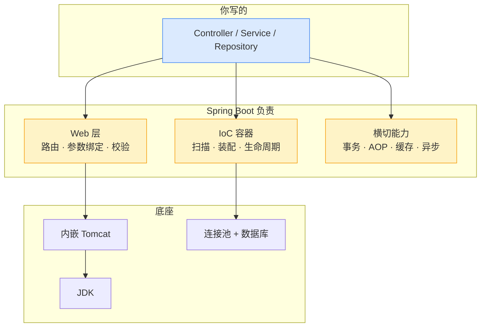
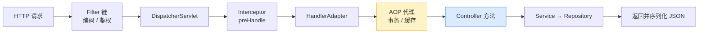
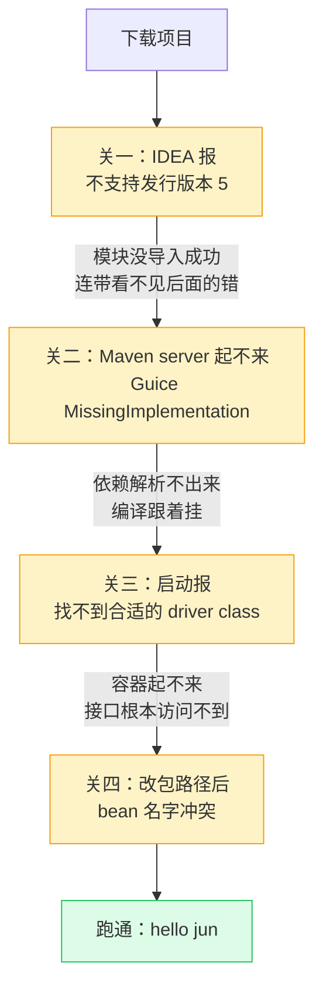

# Spring Boot 入门与实战

> 本质一句话：**Spring Boot 是 Java 的"全家桶式应用框架"**——它把「扫哪些类、谁依赖谁、HTTP 怎么接、数据库怎么连」这些样板装配全接管了，你只写业务。

::: tip 读者定位
面向熟悉 NestJS 或任意 Node 后端的读者。Spring Boot 在生态位上最接近 NestJS：自带 DI 容器、分层约定、生态整合。本文用 NestJS 做锚点，但**重点写差异**——那些"看起来一样、实际反着来"的地方，才是转型踩坑的位置。
:::

## 0. 全景：三分钟看懂这篇

> 难度：了解

**它在哪**：最上层的应用框架。它坐在 Servlet 容器（内嵌 Tomcat）之上，往下管数据库连接池，往外提供 HTTP 接口。它不是语言、不是运行时，也不是"另一个 Java"——底层还是 JDK 和 Servlet 规范。



**分六块**：

| 块 | 内容 | 读到什么程度 |
|---|---|---|
| 1 用途 | 它替你做了什么、什么项目不该用 | 能说清和 NestJS 的分工差异 |
| 2 最小可用 | Initializr → 目录 → 启动类 → 一个接口 | 亲手跑一遍 |
| 3 用法 | DI / 分层 / 校验 / 异常 / 数据访问 / 横切能力 | 会用，能抄改 |
| 4 原理 | 启动流程、请求链路、代理与事务 | 懂机制，能解释失效 |
| 5 坑 | 事务静默失效、异步丢返回、缓存脏 | 线上能对上号 |
| 6 实战踩坑 | 从下载项目到跑通，四个层层遮蔽的报错 | 照着走一遍，别重复踩 |

**学完你能**：① 独立起一个带 CRUD 的 Spring Boot 服务；② 看懂 mall 这类真实项目 80% 的代码；③ 解释"为什么 @Transactional 没生效"这类高频问题；④ 遇到启动报错时，能分清是 IDE 问题、依赖问题还是配置问题。

**本篇讲什么、不讲什么**：

| 知识点 | 档位 | 处理 |
|---|---|---|
| IoC / DI、三层分层 | 核心 | 正文 3.1 |
| 参数校验、全局异常、统一返回 | 核心 | 正文 3.2 |
| 数据访问（JPA vs MyBatis） | 核心 | 正文 3.3 |
| 事务、AOP、Filter/Interceptor 区别 | 核心 | 正文 3.5 ~ 3.6、4.3 |
| 启动流程、请求链路 | 核心 | 正文 4.1 ~ 4.2 |
| 事务/异步/缓存的坑 | 核心 | 正文 5.2 ~ 5.4 |
| 异步、定时、缓存注解 | 进阶 | 正文 3.8 |
| 配置、打包部署 | 进阶 | 正文 3.9 ~ 3.10 |
| 上传下载、静态资源、Jackson、测试、Actuator | 边角 | 正文 3.11 速查表 |
| 从零跑通一个 demo 的排错 | 实战 | 正文 6（四道关） |
| Spring Security 过滤器链 | 进阶 | 只讲定位，详见 mall 源码 |
| Spring Cloud 微服务 | — | 另见 [Spring Cloud](/service/java/spring-cloud) |

**不覆盖**：Spring Boot 自动配置的源码级原理（见 [Spring 核心原理](/service/java/spring-principles)）、WebFlux 响应式栈。

---

## 1. 用途：它到底替你做了什么

> 难度：了解

### 1.1 没有它的时候

Spring 本身在上古时代就要写一堆 XML：声明 Bean、声明事务代理、声明 MVC 路由，最后打 war 包丢进外置 Tomcat。一个 Hello World 要三个 XML 文件。

Spring Boot 做了三件事，把这三步全干掉了：

| 原来要你做的 | Spring Boot 的做法 |
|---|---|
| 写 XML 声明每个 Bean | **组件扫描**：扫到 `@Service`/`@Component` 自动注册 |
| 配 DispatcherServlet、配 Jackson、配数据源 | **自动配置**：看到 classpath 有 MySQL 驱动就自动配好 DataSource |
| 装 Tomcat、打 war、扔进去 | **内嵌容器**：打成一个 jar，`java -jar` 就跑 |

一句话：**它把"配置"变成了"约定"，把"部署"变成了"一个 jar"。**

### 1.2 什么场景该用

- 你要写**能对外提供 HTTP 接口的服务**（BFF、管理后台 API、内部微服务）—— 这是它的主战场
- 团队用 Java，需要成熟的**事务、连接池、安全、监控**方案，不想自己攒
- 需要和企业已有的 Java 生态（MyBatis、Redis、MQ、注册中心）对接

### 1.3 什么场景不该用

三个反例，都是真实存在的选型错误：

| 场景 | 为什么别用 | 更合适的选择 |
|---|---|---|
| 只想写个命令行脚本 / 定时批处理 | 为几十行逻辑拉起一个完整容器，启动就要 2~3 秒 | 纯 Java + `main`，或 Quarkus / Micronaut |
| 函数计算（冷启动敏感） | 容器初始化 + 类加载，冷启动几百毫秒到几秒 | GraalVM native image，或换 Node/Go |
| 极简内网小工具 | 依赖体积大、升级面广（一个 starter 引入几十个 jar） | 直接用 `HttpServer` 或轻量框架 |

> 判断标准很朴素：**你需要"长期运行、多人协作、要事务和监控"的服务吗？** 需要就用它，不需要就别为了"主流"硬上。

### 1.4 给 NestJS 读者的锚点表

| 概念 | NestJS | Spring Boot | **关键差异 / 按 NestJS 直觉用会怎样** |
|---|---|---|---|
| 依赖注入 | `@Injectable()` + providers | `@Service` + 组件扫描 | 不用显式注册，**扫到就算**——写错包名就扫不到，报 `NoSuchBeanDefinitionException` |
| 作用域 | 默认单例（可配 REQUEST） | 默认**单例** | 单例里存可变状态 = 全局共享，前端写惯了每请求新建，这里会串数据 |
| 注入方式 | 构造函数注入 | 构造器注入（推荐） | `@Autowired` 字段注入**已过时**：不可测试、隐藏依赖、循环依赖静默 |
| 路由 | `@Controller('api/users')` + `@Get()` | `@RestController` + `@RequestMapping` + `@GetMapping` | 路径拼接规则不同：类上前缀 + 方法上路径 |
| 校验 | `class-validator` + `ValidationPipe` | `@Validated` + Jakarta Bean Validation | 校验失败抛的是异常，**必须配全局异常处理器**，否则返回 400 + 一堆堆栈 |
| 异常 | `ExceptionFilter` | `@RestControllerAdvice` + `@ExceptionHandler` | 它是"全局增强器"，异常只是最常用的一类能力 |
| 中间件 | `app.use()` / NestMiddleware | Filter → Interceptor → AOP 三层 | **三层不是一回事**，选错层就拿不到需要的东西（见 3.6） |
| 事务 | `queryRunner` 手动管理 | `@Transactional` 声明式 | 靠**代理**生效，自调用/非 public 会静默失效（见 5.2） |
| 异步 | `async/await`（单线程） | `@Async` + 线程池（真并行） | 两者不是一回事：Java 是另起线程，返回值拿不到、异常也不往外抛 |
| 配置 | `.env` + `ConfigService` | `application.yml` + `@Value` / `@ConfigurationProperties` | 支持多 profile 覆盖，优先级有明确规则 |

> **自检**：你说得出 Spring 的 Bean 默认是单例，这意味着什么风险吗？

::: details 参考答案
意味着**同一个 Bean 实例被所有请求共享**。如果在 Service 里放了可变成员变量（比如 `private User currentUser`），并发请求会互相覆盖，A 用户可能读到 B 用户的数据。正确做法是把状态放在方法局部变量或参数里——这也是 Spring 官方推荐"无状态 Bean"的原因。
:::

---

## 2. 最小可用：十分钟跑通

> 难度：了解

### 2.1 生成项目

用 [Spring Initializr](https://start.spring.io)（对应 `nest new`），选 Java 17+、Maven，依赖勾三个：**Spring Web**、**Spring Data JPA**、**MySQL Driver**。

```text
src/main/
├── java/com/example/demo/
│   └── DemoApplication.java     # 入口，对应 main.ts
└── resources/
    └── application.yml          # 配置，对应 .env
```

### 2.2 启动类

```java
@SpringBootApplication   // = @Configuration + @EnableAutoConfiguration + @ComponentScan
public class DemoApplication {
    public static void main(String[] args) {
        SpringApplication.run(DemoApplication.class, args);
    }
}
```

**这个类必须放在所有业务代码的父包下**——`@ComponentScan` 默认只扫"本包及子包"。放在 `com.example` 下，却把 Service 写到 `cn.other`，启动就会告诉你找不到 Bean。

### 2.3 第一个接口

```java
@RestController
@RequestMapping("/api/hello")
public class HelloController {

    @GetMapping("/{name}")
    public String hello(@PathVariable String name) {
        return "hello " + name;
    }
}
```

### 2.4 跑起来

```bash
mvn spring-boot:run        # 对应 npm run start:dev
curl http://localhost:8080/api/hello/jun
```

默认端口 8080。到这一步，你已经拥有：一个内嵌 Tomcat、一个自动配置好的 Jackson、一个能路由的 MVC 栈——**这些都没写过一行配置**。

> **自检**：启动报 `NoSuchBeanDefinitionException`，第一件事该查什么？

::: details 参考答案
先查**包路径**：Spring 只扫启动类所在包及其子包。Controller/Service 写到兄弟包或上级包下，扫不到就不会注册成 Bean。其次查类上有没有 `@Service`/`@Component`/`@Repository`（或 `@RestController`）。
:::

---

## 3. 用法：十个主线任务

> 难度：会用

这一章只讲"怎么做"。为什么这么设计，留到第 4 章。

### 3.1 IoC / DI 与三层分层

先把两个词说清楚——它们是全文出现频率最高的词，也是最容易被糊弄过去的。

**IoC（Inversion of Control，控制反转）**：反转的是**「谁控制对象的创建」**。

不用 IoC 的时候，控制权在你手里：

```java
public class UserController {
    // 我自己决定用哪个 Service、哪个 Repository，甚至 new 出来的细节
    private final UserService userService = new UserService(new UserRepository(...));
}
```

写死了的后果：换一个 `UserRepository` 实现要回来改这一行，`new` 出来的依赖没法在测试里替换，要测就得连真实数据库一起起。

用 IoC 之后，控制权交给容器：

```java
@RestController
public class UserController {
    private final UserService userService;      // 注意：这里没有 new

    public UserController(UserService userService) {
        this.userService = userService;
    }
}
```

这段代码只声明"我需要一个 `UserService`"——**是谁给的、什么时候给的、是不是同一个实例，它不关心，也不该关心**。

**DI（Dependency Injection，依赖注入）**：DI 是实现 IoC 的具体手段，反转的是**「谁给依赖」**。上面那个构造函数就是 DI——容器创建 `UserController` 时，发现它需要一个 `UserService`，就从容器里找到那个 Bean 塞进构造器。

一句话区分：

| | 反转了什么 | 谁来做 |
|---|---|---|
| **IoC** | 对象的**创建权** | 容器扫描 + 实例化 |
| **DI** | 依赖的**提供方** | 容器在构造时注入 |

**IoC 是目标，DI 是手段。** 你听到的"Spring 的 IoC 容器"，落到代码上就是 DI 这一套动作。

**前端对照**：NestJS 其实已经是 DI——`constructor(private readonly userRepo: UserRepository)` 加 `providers`，就是依赖注入。**差别在反转的程度**：NestJS 你还得在 Module 里手写 `providers: [UserService]`，反转的是"谁 new 出实现"；Spring 连注册都省了，组件扫描直接发现，反转的是"谁决定有哪些对象存在"。

**一个常见误解**：DI ≠ 依赖查找。DI 是容器**推**给你（你声明需要什么）；反过来你自己去容器里 `get()` 拿，叫 **Service Locator**（Spring 里的 `ApplicationContext.getBean()` 就是它），那只是把 `new` 藏到了别处，还多了一个全局入口。判据很干脆：**你的类里出现了 `getBean()` 或 `ApplicationContext` 字段，就不是 DI。**

```java
@RestController            // ① 接 HTTP，返回 JSON
@RequestMapping("/api/users")
public class UserController {

    private final UserService userService;       // ② 构造器注入，字段 final

    public UserController(UserService userService) {
        this.userService = userService;
    }

    @GetMapping("/{id}")
    public User getUser(@PathVariable Long id) {
        return userService.getById(id);
    }
}
```

```java
@Service                   // ③ 业务层：事务边界放这里
public class UserService {

    private final UserRepository userRepository;

    public UserService(UserRepository userRepository) {
        this.userRepository = userRepository;
    }

    @Transactional
    public User create(CreateUserDto dto) {
        return userRepository.save(new User(dto.name()));
    }
}
```

```java
@Repository                // ④ 数据访问层
public interface UserRepository extends JpaRepository<User, Long> {
    List<User> findByName(String name);        // 方法名即查询，不用写实现
}
```

**构造器注入：为什么不用写 `@Autowired`**

**不用写**——只要类里**只有一个构造器**，Spring 就用它来注入（Spring 4.3 起的行为）。

```java
@Service
public class UserService {
    private final UserRepository userRepository;

    // 有构造器就够了，不用写 @Autowired
    public UserService(UserRepository userRepository) {
        this.userRepository = userRepository;
    }
}
```

"自动注入"自动的是哪一步：**你不用在构造器上标 `@Autowired`**，Spring 看到"这个类只有一个构造器"，就把它当成注入点，把容器里的 `UserRepository` 塞进来。

Spring 4.3 之前不这么干，必须显式标注，否则 Spring 会退去找**无参构造器**、找不到就启动报错：

```java
@Autowired              // 4.3 之前必须写这一行
public UserService(UserRepository userRepository) { ... }
// 少了它 → BeanInstantiationException: No default constructor found
```

**这条规则值得单独记住，因为它决定了你"能写几个构造器"**：

| 构造器数量 | Spring 的行为 | 你需要做什么 |
|---|---|---|
| **1 个** | 直接用它注入 | 什么都不用标（4.3+） |
| **2 个及以上** | 不知道该用哪个 → 启动报错 | 必须给其中一个标 `@Autowired` |

第二行最容易踩。比如你后来为了"便于测试"又加了一个构造器：

```java
public UserService(UserRepository repo) { this(repo, DEFAULT_TIMEOUT); }   // 原始那个
public UserService(UserRepository repo, Duration timeout) { ... }          // 新加的
```

现在有两个构造器，Spring 拿不准了，报错大意是"找不到唯一可用的构造器"。得显式标一个才算数：

```java
@Autowired
public UserService(UserRepository repo) { this(repo, DEFAULT_TIMEOUT); }
```

**还有第三种注入方式**，也是官方明确不推荐的：

```java
@Service
public class UserService {
    @Autowired          // 字段注入：Spring 4.3 之前要这么写才生效
    private UserRepository userRepository;
}
```

它现在还能用（4.3 之后单构造器场景不需要它了），但**别在新代码里写**：字段能是 `null` 也能被反射改掉、单元测试没法注入假实现、依赖关系藏起来了。构造器注入的三个好处一次拿齐——**依赖不可为空（`final` 字段）、一眼看清这个类需要什么、测试时直接 `new` 出来传假依赖**。

所以实际写法通常配 Lombok：

```java
@Service
@RequiredArgsConstructor          // 为所有 final 字段生成构造器
public class UserService {
    private final UserRepository userRepository;   // 不用写构造器，不用 @Autowired
}
```


> **自检**：`UserService` 现在有两个构造器（一个带 `Duration` 参数的便利构造器），启动会报错吗？为什么？

::: details 参考答案
会报错。Spring 的规则是"**有且只有一个**构造器时自动用它注入"；一旦有两个以上，它无法判断该用哪个，必须靠 `@Autowired` 明确指定。得给其中一个标上：

```java
@Autowired
public UserService(UserRepository repo) { this(repo, DEFAULT_TIMEOUT); }
```

不标的话，Spring 会退去找无参构造器，找不到就抛 `BeanInstantiationException`（`No default constructor found`）。这个坑的特点是**加个构造器就突然炸**，所以给类加便利构造器时记得同步处理。
:::

> **自检**：这三段代码里，"谁决定 `UserController` 用哪个 `UserService` 实现"这件事，从哪一步开始交给了容器？

::: details 参考答案
从**构造器注入**那一步开始。`UserController` 的代码里只写了"我需要 `UserService`"，具体是哪个实现（单例？多例？测试用的 mock？）由容器在实例化时决定并注入进来。

反过来说：如果哪天你在 Controller 里写了 `new UserService(...)`，或者注入了一个 `ApplicationContext` 然后自己 `getBean()`，控制权就又回到业务代码手里了——IoC 被架空，测试也会重新变难。
:::

**核心心智**：容器负责 `new`，你负责声明"我需要什么"。**不要自己 `new` 业务对象**——`new UserService()` 出来的实例不在容器里，它内部的 `@Transactional`、`@Async`、`@Cacheable` 全部不生效（原因见 4.3）。

### 3.2 参数校验、全局异常、统一返回

三件事配套使用，缺一个就会有"接口报错信息乱七八糟"的问题。

**① 校验**：DTO 上写规则，Controller 上标 `@Validated`。

```java
@PostMapping("/login")
public CommonResult login(@Validated @RequestBody LoginParam param) { ... }

@Data
public class LoginParam {
    @NotBlank                    // 去空格后非空
    private String username;

    @NotBlank
    @Size(min = 6, max = 20)     // 长度区间
    private String password;
}
```

常用注解：`@NotNull`（非 null）、`@NotEmpty`（非空串）、`@NotBlank`（去空格非空）、`@Min/@Max`、`@Size`、`@Pattern`、`@Email`。

**② 全局异常**：校验失败、业务出错都抛异常，统一在这里接住。

```java
@RestControllerAdvice
public class GlobalExceptionHandler {

    @ExceptionHandler(ApiException.class)          // 业务异常
    public CommonResult handleApi(ApiException e) {
        return CommonResult.failed(e.getMessage());
    }

    @ExceptionHandler(MethodArgumentNotValidException.class)   // 校验失败
    public CommonResult handleValid(MethodArgumentNotValidException e) {
        return CommonResult.validateFailed("参数校验失败");
    }

    @ExceptionHandler(Exception.class)             // 兜底：未知异常
    public CommonResult handleUnknown(Exception e) {
        log.error("未捕获异常", e);                  // 日志里留堆栈，别返回给前端
        return CommonResult.failed("系统繁忙");
    }
}
```

业务代码里主动报错就一句 `throw new ApiException("密码不正确")`，剩下的交给它。**你调登录接口输错密码看到的"密码不正确"，走的就是这条路。**

> `@RestControllerAdvice` 不只能接异常：它还能做参数绑定（`@InitBinder`）、全局模型数据（`@ModelAttribute`）、响应体增强（实现 `ResponseBodyAdvice`）。异常兜底只是最常用的一类。

**③ 统一返回**：mall 这类项目所有接口都包一层 `{code, message, data}`：

```json
{ "code": 20000, "message": "操作成功", "data": { "id": 1 } }
```

业务码分段：`2xxxx` 成功 / `4xxxx` 客户端问题 / `5xxxx` 服务端问题，并且映射到 HTTP 状态码（40000→400、40100→401）。

**这不是 Spring 的功能，是项目约定**——但读任何国内 Java 项目都会看到它，先建立认知。

### 3.3 数据访问：JPA 还是 MyBatis

上面 3.1 的 `JpaRepository` 是 JPA（自动生成 SQL）。**国内主流其实是 MyBatis：SQL 自己写，可控可调优。** mall 用的就是 MyBatis。

| | Spring Data JPA | MyBatis（mall 用这个） |
|--|-----------------|----------------------|
| SQL 来源 | 方法名自动生成 | **手写在 XML 里** |
| 代表 | `JpaRepository` | `XxxMapper` 接口 + `XxxMapper.xml` |
| 动态条件 | `findByName(...)` 派生查询 | `XxxExample` 对象拼条件 |
| 代码生成 | 手写 Entity | MyBatis Generator 生成 model/mapper/XML |

mall 的数据访问是"接口 + XML"两件套：

```java
// Mapper 接口：没有实现类
public interface PmsProductMapper {
    List<PmsProduct> selectByExample(PmsProductExample example);
}
```

```xml
<select id="selectByExample" resultMap="BaseResultMap" parameterType="...PmsProductExample">
  SELECT ... FROM pms_product
  <if test="_parameter != null">
    <include refid="Example_Where_Clause"/>   <!-- 把 Example 条件对象翻译成 WHERE -->
  </if>
</select>
```

三个关键认知：

1. Mapper 接口**没有实现类**，MyBatis 用**动态代理**在运行时生成实现，方法名 ↔ XML `<select id>` 一一对应
2. 动态 SQL 是"两层拼"：Java 层用 `Example.createCriteria().andNameLike(...)` 拼条件对象（含 null 守卫），XML 层按条件类型翻译成 `=` / `between` / `in`
3. model / Mapper / XML 都由 **MyBatis Generator** 从表结构生成，不用手写

对照 NestJS：更像 TypeORM 的 `QueryBuilder`，SQL 掌控感强于自动生成。MP 的完整用法见 [MyBatis-Plus 入门](/service/java/mybatis-plus)。

### 3.4 Lombok：用注解替代样板

Java 的字段封装要写一堆 getter/setter。Lombok 在**编译期**生成它们——源码里看不到，字节码里有。

```java
@Data            // getter/setter/toString/equals/hashCode
public class LoginParam {
    @NotBlank
    private String username;
    private String password;
}
```

| 注解 | 生成什么 | 常用在哪 |
|---|---|---|
| `@Data` | getter/setter/toString/equals/hashCode | DTO、Entity |
| `@Getter` / `@Setter` | 只要一半 | 只想暴露部分字段 |
| `@Slf4j` | `log` 对象 | 所有要打日志的类 |
| `@RequiredArgsConstructor` | 为 final 字段生成构造器 | 构造器注入（配合 3.1） |
| `@Builder` | 链式构造器 | 参数多的对象 |

**依赖要点**：`org.projectlombok:lombok`，`scope` 通常设为 `provided`（编译期用，运行期不需要）。IDE 需要 Lombok 插件（IDEA 新版内置）。它是**编译期魔法**，报错信息有时指向生成的代码，看不太懂 —— 这是它的主要代价。

### 3.5 日志与 AOP

**日志**用 `@Slf4j`，占位符是 `{}`（对应 JS 模板字符串）：

```java
@Slf4j
@Service
public class UserService {
    public void create(String username) {
        log.info("创建用户: {}", username);
        log.error("出错", e);          // 异常对象放最后一个参数，堆栈才会打出来
    }
}
```

级别 `trace < debug < info < warn < error`，默认 info。按包调级别很常用：

```yaml
logging:
  level:
    com.example.mapper: debug      # 只对这个包开 debug（打印 SQL）
```

**AOP** 用来抽横切逻辑（耗时、日志、权限）：

```java
@Aspect
@Component
public class LogAspect {
    @Around("execution(* com.example.service.*.*(..))")
    public Object around(ProceedingJoinPoint pjp) throws Throwable {
        long start = System.currentTimeMillis();
        Object result = pjp.proceed();          // 执行目标方法
        log.info("{} 耗时 {}ms", pjp.getSignature(), System.currentTimeMillis() - start);
        return result;
    }
}
```

**前端锚点**：单看一个切面，它就是高阶函数包装。

```js
const withLog = (fn) => (...args) => {
  const start = Date.now()
  const r = fn(...args)
  console.log('耗时 ' + (Date.now() - start) + 'ms')
  return r
}
```

多切面叠起来才是洋葱模型（`proceed()` 从"调目标方法"变成"调下一个切面"），这部分放到 4.4 讲——因为不理解代理机制，这个区别记不住。

### 3.6 Filter / Interceptor / AOP：选错层就拿不到东西

**这是面试必问，也是实际开发最常选错的地方。**

| | 生效位置 | 能拿到什么 | 典型用途 |
|--|---------|-----------|---------|
| **Filter**（Servlet 规范） | 请求进 Spring 之前 | `HttpServletRequest` | 编码、CORS、token 全局处理 |
| **Interceptor**（Spring MVC） | 进 Controller 之前/之后 | Handler 方法信息 + ModelAndView | 登录拦截、接口日志 |
| **AOP 切面**（Spring） | 方法调用前后 | 方法签名、参数、返回值 | 事务、缓存、耗时统计 |

执行顺序：`Filter → Interceptor → AOP → Controller`。

**怎么选**：需要**请求对象**（改 header、读 IP）→ Filter；需要**知道要调哪个 Controller 方法** → Interceptor；需要**拿到方法参数和返回值** → AOP。

Spring Security 的鉴权链就是 Filter 层的：JWT 过滤器通过 `addFilterBefore` 插进链里，解析 token 后把用户塞进 `SecurityContextHolder`；Controller 里用 `Principal` 直接取当前用户。

### 3.7 事务：一行注解

```java
@Service
public class OrderService {
    @Transactional(rollbackFor = Exception.class)   // 放在实现类的方法上
    public void createOrder(Long userId) {
        orderMapper.insert(...);        // ①
        stockMapper.decrease(...);      // ②
        // ①② 要么都成功，要么都回滚
    }
}
```

三个要点先说清楚，失效场景见 5.2：

1. **放实现类方法上**，不放接口上（事务是实现细节，接口上声明会污染契约——但注意：**放接口上其实也能生效**，理由见下面的实测）
2. **默认只回滚 `RuntimeException`**，其他异常要回滚必须写 `rollbackFor = Exception.class`（下面细说）
3. **它靠代理生效**，所以自调用、private 方法、final 类都会静默失效

#### 第 1 点细说：放接口上能不能生效

常见说法是「注解不被继承，CGLIB 只认类上的注解，所以放接口上不生效」——**这个说法不成立**，实测五种组合全部生效（Spring 6.0.9 与 7.0.10 结果一致）：

```text
A 注解只在接口方法上        CGLIB   事务事件=[事务开启, 提交]
A 注解只在接口方法上        JDK     事务事件=[事务开启, 提交]
B 注解只在实现类方法上      CGLIB   事务事件=[事务开启, 提交]
C 注解只在接口类上          CGLIB   事务事件=[事务开启, 提交]
C 注解只在接口类上          JDK     事务事件=[事务开启, 提交]
```

**为什么"注解不被继承"却仍然生效**：Java 的 `@Inherited` 只管**类**上的注解，不管方法。用反射直接查实现类方法，确实是 `null`：

```text
实现类方法上【直接】的 @Transactional : null
```

但 Spring 不是这么查的。`AnnotationTransactionAttributeSource` 的查找顺序是：

```text
1. 目标类上的方法（UserServiceImpl.save()）  ← CGLIB 实际增强的就是这个
2. 目标类本身（类级 @Transactional）
3. 接口上的同名方法（UserService.save()）     ← 兜底：实现类没标，就去接口上找
```

第 3 步用的��� `AnnotatedElementUtils.findMergedAnnotationAttributes`（**"合并"查找**），它会沿着「接口 → 实现类」的链路找，而���是只看目标方法自己的字节码。**所以"注解不被继承"没错，但它不是接口注解失效的原因——真正原因是 Spring 特意做了接口兜底查找。**

**那为什么还是推荐放实现类？** 不是"不生效"，是"不推荐"：

| 问题 | 说明 |
|---|---|
| **污染契约** | 事务是实现细节，接口不该知道"实现类要开事务" |
| **一个接口多个实现时语义混乱** | 接口上标了 = 所有实现都被迫开事务，包括本来不需要的 |
| **两个注解的合并规则不直观** | 实现类又标一次时，属性怎么合并？规则复杂，别去赌 |
| **官方推荐** | Spring 官方文档明确建议放在实现类方法上 |

**一句话**：接口上标**能生效**，但你依赖的是"Spring 会去接口上找"这个兜底行为，而不是显式声明。**显式写在实现类上，永远比依赖兜底可靠。**

> **什么时候接口上的注解真的会失效**：
> - **Spring Security 的 `@PreAuthorize`**：它只扫实现类，接口上的会被忽略（Security 自己的限制，与事务机制无关）
> - **自定义了 `AnnotationTransactionAttributeSource`**：换成只用 `getAnnotation()` 的实现，就找不到接口上的了
> - **方法被 `final` 修饰**：CGLIB 覆写不了，代理里根本没这个方法

#### 第 2 点细说：Java 的异常分两类

Java 把异常按**编译期是否强制处理**分成两类：

| | 受检异常（Checked） | 非受检异常（Unchecked） |
|---|---|---|
| 包含 | `IOException`、`SQLException`、`ClassNotFoundException`… | `RuntimeException` 及其子类（`NullPointerException`、`IllegalArgumentException`…）+ `Error` |
| 编译器 | **强制**你 `catch` 或 `throws` | 不强制，可以直接抛 |
| 典型含义 | 预期内、调用方应该处理的失败 | 程序 bug |

```java
// 受检异常：编译器逼你处理
public void read(File file) throws IOException { ... }

// 非受检异常：编译器不管
public void parse(String s) { Integer.parseInt(s); }   // 数字格式错了直接抛
```

**Spring 的默认规则**：事务只在遇到 **`RuntimeException`（和 `Error`）** 时回滚；受检异常**默认提交**。

```java
@Transactional
public void createOrder(Long userId) throws IOException {
    orderMapper.insert(...);
    readFile();          // 抛 IOException → 事务照样提交！第一条 insert 留在库里
}
```

**为什么这么设计**：Spring 的假设是「受检异常 = 可预期的业务结果，调用方该自己处理」，所以不认为该撤销数据库操作。比如"文件读不到"可能正是业务想记录的情况。

**但绝大多数业务场景不是这样**：你希望"只要中途出错，数据库就回到原样"。所以实务里几乎都写：

```java
@Transactional(rollbackFor = Exception.class)   // 任何异常都回滚
public void createOrder(Long userId) throws IOException { ... }
```

> **记忆点**：`rollbackFor` 的意思是"**除了 `RuntimeException`，这些也给我回滚**"。写 `Exception.class` 就是"全都回滚"。
>
> 顺便说一句：`rollbackFor` 也可以写得更细，比如只对 `BusinessException` 回滚——但多数团队图省事直接 `Exception.class`。

**注意还有第三个坑**：即使你写了 `rollbackFor = Exception.class`，如果异常被 `catch` 吞掉了，事务**照样不回滚**——Spring 判断回滚的唯一依据是"异常有没有从方法里抛出去"。这个更隐蔽，详见 5.2。


### 3.8 异步、定时、缓存：三个开关型注解

共同套路：**① 方法上加注解 → ② 启动类加 `@EnableXxx` → ③ 按需配基础设施（线程池 / 缓存管理器）**。

| 注解 | 做什么 | 开关 | 对应 Node |
|---|---|---|---|
| `@Async` | 方法丢到线程池后台执行 | `@EnableAsync` | 不是 `async/await`，更像"扔给线程池" |
| `@Scheduled` | 定时任务（cron） | `@EnableScheduling` | `node-cron` |
| `@Cacheable` | 方法结果缓存 | `@EnableCaching` | `CacheInterceptor` |

```java
@Async                                  // 调用方立刻返回，实际在别的线程跑
public void sendEmail(String to) { ... }

@Scheduled(cron = "0 0/10 * * * ?")     // 每 10 分钟（秒 分 时 日 月 周）
public void cancelTimeoutOrder() { ... }

@Cacheable(value = "user", key = "#id")        // 读：没缓存才执行方法
public User getById(Long id) { ... }

@CacheEvict(value = "user", key = "#id")       // 删：更新后让缓存失效
public void update(User user) { ... }
```

**缓存一致性**：更新数据用「先改 DB 再 `@CacheEvict` 删缓存」，**不要用 `@CachePut` 覆盖**——DB 写失败了缓存却更新了，就脏了；删掉让下次读回源最稳。

**什么时候别用这些注解**：mall 就没用 `@Cacheable`，而是自己封 `CacheService`——因为它要控制 key 结构、过期时间、**防穿透（缓存空值）**、主动删除，注解表达不了。异步也没用 `@Async`，而是走 MQ——因为"订单 30 分钟超时取消"需要**延迟 + 可靠重试**，线程池做不了。

> 判断标准：**注解是快路径，够用就用；不够用就自己封一层，别硬掰。**

### 3.9 配置：yml、profile、两种读法

```yaml
server:
  port: 8080

spring:
  datasource:
    url: jdbc:mysql://localhost:3306/demo
    username: root
    password: secret
  jpa:
    hibernate:
      ddl-auto: update       # 开发期自动建表；生产用 none + 迁移工具
```

读取有两种：单个值用 `@Value`，一组配置用 `@ConfigurationProperties`（推荐，类型安全）。

```java
@Value("${server.port}")
private String port;

@ConfigurationProperties(prefix = "spring.datasource")
@Data
public class DataSourceProps {
    private String url;
    private String username;
}
```

**多环境**：`application.yml` 里 `spring.profiles.active: dev`，再建 `application-dev.yml` / `application-prod.yml`，同名 key 自动覆盖。启动时也可覆盖：`java -jar app.jar --spring.profiles.active=prod`。

### 3.10 打包与部署

| 步骤 | 命令 | 对应 JS |
|---|---|---|
| 打包 | `mvn package` | `npm run build` |
| 产物 | `target/demo-0.0.1.jar` | `dist/` |
| 运行 | `java -jar demo.jar` | `node dist/main.js` |

jar 里**内嵌了 Tomcat**，目标机器只要有 JRE，不需要单独装服务器。这就是"可执行 jar"。

#### JRE 是什么

Java 有一套"一套代码，三处运行"的分层，三个词经常被混用：

| 名称 | 全称 | 是什么 | 类比 |
|---|---|---|---|
| **JVM** | Java Virtual Machine | 真正执行字节码的虚拟机 | 引擎 |
| **JRE** | Java Runtime Environment | **JVM + 运行期需要的类库**（含 Tomcat 依赖的运行包），**不含编译工具** | 运行时 |
| **JDK** | Java Development Kit | **JRE + 编译工具**（`javac`、`javadoc`、`jar` 等） | 运行时 + 构建工具 |

关系是**包含**关系：

```text
JDK  =  JRE  +  javac 等编译工具
JRE  =  JVM  +  运行期类库
```

**为什么运行 jar 只需要 JRE**：jar 里装的是**字节码**（`.class`），字节码需要 JVM 去解释执行，这部分属于 JRE。而 `javac` 是"把 `.java` 编译成字节码"的工具——**部署的时候已经没有 `.java` 源文件了，自然用不上编译工具**。

```bash
java -jar demo.jar
```

这一条命令要做的三件事：启动 JVM → 加载 jar 里的字节码 → 因为 manifest 里写了 `Main-Class`，反射找到并执行 `DemoApplication.main`。

**开发用 JDK，运行用 JRE**——这是 Java 部署时最常被问到的题。（实际上现在的 JDK 发行版都自带 JRE，而且 Spring Boot 项目通常还要用 `jshell`、`jlink` 这些工具，所以生产机上装的往往还是完整 JDK。）

#### 顺带说几个部署时会遇到的名词

| 名词 | 是什么 | 你会在这几个地方碰到它 |
|---|---|---|
| **jar** | Java 应用包（本质是 zip） | `target/demo.jar` |
| **war** | Web 应用包（旧式，需要外部容器） | `packaging` 选 `war` 时；现在的 Spring Boot 默认打 jar |
| **fat jar** | 把依赖也打进包里的 jar | Spring Boot 的 `mvn package` 产出的就是它——所以不用单独拷依赖 |
| **jlink** | 从 JDK 里裁剪出一个只含所需模块的最小运行时 | 做"瘦镜像"时用（Docker 官方镜像就是 jlink 出来的） |
| **Docker 镜像 vs jar** | 两种交付形态 | 镜像 = jar + 基础镜像 + 启动脚本；K8s 上一般交镜像 |

> **一个实践建议**：本地开发用 JDK（含 `javac`、调试工具），服务器上按需裁剪（`jlink` 瘦身镜像）或直接用带 JRE 的基础镜像。别在生产机上装完整 JDK——体积大是一方面，攻击面也是一方面。

### 3.11 其余能力速查

| 能力 | 关键代码 | 对应 NestJS |
|---|---|---|
| 跨域 | `@CrossOrigin(origins = "http://localhost:5173")`，或全局实现 `WebMvcConfigurer#addCorsMappings` | `app.enableCors()` |
| 文件上传 | `@RequestParam("file") MultipartFile file` → `file.transferTo(...)` | `FileInterceptor` + multer |
| 文件下载 | 返回 `ResponseEntity<byte[]>` + `Content-Disposition` 头 | `res.download()` |
| 上传大小 | `spring.servlet.multipart.max-file-size`（默认单文件 1MB） | multer limits |
| 静态资源 | `resources/static/` 下直接可访问；自定义用 `addResourceHandlers` | `ServeStaticModule` |
| 日期格式 | `@JsonFormat(pattern = "yyyy-MM-dd HH:mm:ss")` 或 yml 全局配置 | `class-transformer` |
| 忽略 null 字段 | `@JsonInclude(NON_NULL)` 或 `default-property-inclusion: non_null` | 手写序列化 |
| 测试 | `@SpringBootTest` + `@Autowired` 注入被测类 | `Test.createTestingModule()` |
| 探活 | 加 `spring-boot-starter-actuator`，访问 `/actuator/health` | `/health` 端点 |

## 4. 原理：为什么是这样

> 难度：懂原理

### 4.1 启动时发生的事情

```text
SpringApplication.run()
  ① 准备环境：读 application.yml、环境变量、命令行参数（优先级：命令行 > 环境变量 > profile 文件 > 默认）
  ② 创建容器（ApplicationContext）
  ③ 组件扫描：从启动类所在包往下扫，找出所有 @Component/@Service/@Repository/@RestController
  ④ 生成 BeanDefinition：此时只是"登记表"，还没 new
  ⑤ 实例化 Bean：按依赖顺序 new，构造器注入就是在这里发生的
  ⑥ 处理 @Transactional / @Async / @Cacheable：给需要代理的 Bean 生成代理对象，放回容器
  ⑦ 启动内嵌 Tomcat，把 DispatcherServlet 注册进去
  ⑧ 发布 ApplicationReadyEvent，服务可用
```

**第 ⑥ 步是关键**：容器里拿到的往往不是你的原始对象，而是一个**代理对象**。这就是 4.3 一切问题的根源。

### 4.2 一次请求的完整链路



记住两个坐标就够用：**Filter 在 Servlet 层（拿得到 request，不知道你要调哪个方法）**，**AOP 在 Bean 层（知道方法、参数、返回值，但拿不到原始请求对象）**。Interceptor 夹在中间。

### 4.3 @Transactional 为什么"偶尔不生效"

Spring 的事务是**代理**实现的：容器里放的 `orderService` 其实是一个代理对象，它包着你的真实对象。

```text
外部调用：controller → [代理] open tx → 真实对象.createOrder() → commit
自调用：  真实对象.this.createOrder() → 没有代理 → 没有事务
```

这就是**自调用失效**：同类里 `this.method()` 走的是原始对象，绕过了代理，注解形同虚设。`@Async`、`@Cacheable` 同理，因为用的是同一套代理机制。

**怎么验证**：在这个方法里打个断点，看 `this` 的类名——如果打印出来是 `OrderService` 而不是 `OrderService$$SpringCGLIB$$0`，说明你拿到的不是代理。

**怎么解**：把方法拆到另一个 Bean 里调用，或者注入自己（`@Lazy` 破循环），或者用 `AopContext.currentProxy()`（需开 `exposeProxy`）。最干净的是前者。

### 4.4 AOP：单切面是包装，多切面才是洋葱

**单切面**时，`proceed()` 调的就是**目标方法本身**：

```java
@Around("execution(* com.example.service.*.*(..))")
public Object around(ProceedingJoinPoint pjp) throws Throwable {
    log.info("before");
    Object result = pjp.proceed();     // 同步调目标方法，阻塞等它返回
    log.info("after");
    return result;
}
```

形状是"包一个方法"，对应前端的高阶函数 `withLog(fn)`，**不是**中间件洋葱。

**多切面**叠起来时，`proceed()` 调的是**下一个切面**，最后一层才是目标方法：

```java
@Aspect @Component @Order(1)   // 外层
public class LogAspect {
    @Around("execution(* com.example.service.*.*(..))")
    public Object around(ProceedingJoinPoint pjp) throws Throwable {
        log.info("日志 before");
        Object r = pjp.proceed();        // 调下一个切面
        log.info("日志 after");
        return r;
    }
}

@Aspect @Component @Order(2)   // 内层（事务）
public class TxAspect {
    @Around("execution(* com.example.service.*.*(..))")
    public Object around(ProceedingJoinPoint pjp) throws Throwable {
        openTx();
        try { return pjp.proceed(); }    // 最后才是目标方法
        finally { closeTx(); }
    }
}
```

执行顺序：`日志 before → 事务 before → 目标方法 → 事务 after → 日志 after`。顺序由 `@Order` 决定，数字小的在外层。

| | 单切面 | 多切面 |
|--|--------|--------|
| `proceed()` 调谁 | **目标方法本身** | **下一个切面**（最后才是目标方法） |
| 形状 | 装饰器 / 包装 | 洋葱模型 |
| 前端类比 | `withLog(fn)` | `withLog(withTx(fn))` |

> 一句话：**单切面"包一个方法"，多切面才"叠成洋葱"**。同一个 `proceed()`，两者语义不同——这是 AOP 最反直觉的地方。

**关于同步/异步**：Java 的 `proceed()` 默认同步阻塞。如果目标方法本身返回 `CompletableFuture`，`proceed()` 拿到 future 就返回了，异步等待由线程池处理——**不是切面的职责**。别拿 JS 的 `await next()` 硬套。

> **自检**：一个 Service 方法既标了 `@Transactional` 又标了 `@Async`，会发生什么？

::: details 参考答案
大概率**事务失效**。`@Async` 会把方法放到另一个线程执行，而事务上下文（ThreadLocal 里的连接绑定）不会跟过去，新线程里没有事务；同时调用方立刻返回，也拿不到异常。要么把异步方法内部单独开事务，要么拆成"异步方法调用一个带事务的 Bean"。两个注解叠加在同一个方法上，几乎总是错的。
:::

### 4.5 切面放在哪一层：controller 切面 + service 切面

> 难度：懂原理

**先回答第一个问题：切面不限于 service。** 切面匹配的是**方法**，只要那个方法是 Spring bean 的方法就能织入——`@RestController`、`@Repository`、Feign client、甚至你自己写的工具类。

但**选哪一层有讲究**，因为切面拿不到的东西不一样：

| 切面位置 | 适合做什么 | 拿不到什么 |
|---|---|---|
| **Controller 层** | 请求日志、整体耗时、traceId、权限校验、限流 | 拿不到 `HttpServletRequest`（除非用 `RequestContextHolder`） |
| **Service 层** | 事务、缓存、幂等、数据权限、审计 | 拿不到 HTTP 上下文 |
| **Repository 层** | SQL 审计、慢查询记录 | 基本没人用 |

> 需要 `request` / `response` 原生对象，**别用 AOP，用 Interceptor 或 Filter**（见 3.6 的三层对比）。

#### 关键机制：跨层不是一条链，是两段嵌套

这是最容易想错的地方。**同一方法上的多个切面才构成一条链**（4.4 讲的洋葱）；**切在不同方法上的两个切面，是两个独立的切面，靠方法调用嵌套**：

```text
Controller 切面（外层，由调用栈决定，一定更外）
  before
    Controller 方法
      └─ 调用 service 方法 ──┐
      Service 切面（内层）  │  ← 这是另一个切面，不是上面那条链的下钻
        before              │
        Service 方法        │
        after  ─────────────┘
  after
```

注意几件事：

- **两个切面之间没有 `proceed()` 关系**。service 切面的 `proceed()` 调的是 **service 方法本身**，不是 controller 切面
- **`@Order` 只在同层有意义**。controller 切面永远比 service 切面在外层——这是调用栈决定的，跟 `@Order` 无关
- 想让两个切面叠成一条链，必须**切同一个方法**

**四层切面排在一起看**（ca、cb 切 controller，sa、sb 切 service，各自 `@Order(1)` 在外、`@Order(2)` 在内）：

```text
ca.before → cb.before → controller 方法
                              └─ sa.before → sb.before → service 方法
                                                └─ sb.after → sa.after ──┘
                         ← cb.after ← ca.after
```

**记法**：同层是"洋葱套洋葱"（`ca(cb(目标))`），跨层是"洋葱套洋葱"（外层洋葱里装着内层洋葱）。**`@Order` 只在同一个洋葱内部决定层次**。

**一个容易混的点**：`@Order` 的数值大小只在**同一批匹配同一个方法的切面**之间比较。如果某个切面的切点写得很宽（`execution(* com.example..*.*(..))`，controller 和 service 都匹配），那它会**在两层各出现一次**——每层各有一条独立的链，各层内部各自比 `@Order`。这也是为什么"全局日志切面"通常只按注解（如 `@Log`）匹配，而不是按包路径乱切。

#### 一个立刻能用的实践：耗时拆解

同一个请求，在两层各切一刀：

```java
@Aspect @Component @Order(1)              // controller 层
public class ControllerTimeAspect {
    @Around("execution(* com.example.controller..*.*(..))")
    public Object around(ProceedingJoinPoint pjp) throws Throwable {
        long start = System.currentTimeMillis();
        try {
            return pjp.proceed();
        } finally {
            log.info("[HTTP] {} {} 耗时 {}ms",
                pjp.getSignature(), requestUri(), System.currentTimeMillis() - start);
        }
    }
}

@Aspect @Component @Order(1)              // service 层
public class ServiceTimeAspect {
    @Around("execution(* com.example.service..*.*(..))")
    public Object around(ProceedingJoinPoint pjp) throws Throwable {
        long start = System.currentTimeMillis();
        try {
            return pjp.proceed();
        } finally {
            log.info("[SVC] {} 耗时 {}ms",
                pjp.getSignature(), System.currentTimeMillis() - start);
        }
    }
}
```

**两个数字相减 ≈ 框架开销**（参数绑定、序列化、事务提交、连接获取）。线上慢了，这个差值能立刻告诉你是"业务慢"还是"框架慢"——比看监控面板猜快得多。

#### 三个跨层才有的坑

**① Controller 层切面 catch 掉异常 → 前端以为成功了**

```java
// controller 层切面
@Around("execution(* com.example.controller..*.*(..))")
public Object around(ProceedingJoinPoint pjp) throws Throwable {
    try {
        return pjp.proceed();
    } catch (Exception e) {
        log.error("接口异常", e);
        return CommonResult.failed("系统繁忙");   // ← 吞掉了
    }
}
```

配合 service 层事务看会发生什么：

```text
service 方法抛异常
  → service 的事务拦截器看到异常 → 标记回滚 ✓
    → 异常继续往上抛
      → controller 层切面 catch 住，吞掉，返回 failed("系统繁忙")
        → HTTP 200，body 里 code != 成功
```

事务**回滚了**（这步没问题），但如果你的 `CommonResult.failed` 用的业务码前端不认（比如前端只判 `code == 20000`），前端会把这次失败**当成成功处理**，提示"提交成功"，而数据根本没写进去。

**结论：跨层切面不要吞异常。** 要兜底就在 `@RestControllerAdvice` 里兜（3.2 讲过），那里是框架的正规出口。

**② 在 controller 上加 `@Transactional`**

技术上能生效，但事务范围会大到荒谬——**参数绑定、service 调用、返回值序列化全在事务里**，连接被占用的时间变长。而且 service 层的 `REQUIRES_NEW`（新开一个事务）会和它产生奇怪的交互：外层事务被挂起、内层独立提交，异常处理变得更绕。

**规矩：事务只放 service 层。** controller 层不碰 `@Transactional`。

**③ controller 被代理后，类和方法不能 `final`**

切 controller 意味着这个 bean 会被 CGLIB 代理。同 5.5 那条规则：`final` 类 / `final` 方法 / `private` 方法**切面织不进去**，而且**不报错**——切面静默失效，比报错更难查。

> **自检**：一个切面切在 controller 方法上，另一个切在 service 方法上，controller 切面里的 `pjp.proceed()` 调用的是谁？

::: details 参考答案
调用的是 **controller 方法本身**，不是 service 切面、更不是 service 方法。

跨层的两个切面是**两段独立的嵌套**（靠 Java 的方法调用栈嵌套），只有**切在同一个方法上**的多个切面才串成一条链、`proceed()` 逐层下钻。`@Order` 也只在同层之间决定谁在外谁在内；跨层时 controller 层天然在外。
:::

---

## 5. 边界与坑

> 难度：会用 + 懂原理

按「症状 → 原因 → 解法」写，方便线上对号入座。

### 5.1 一张表先过一遍

| 症状 | 见 |
|---|---|
| 事务注解写了但没回滚 | 5.2 |
| `@Async` 方法抛异常没人管、返回值永远是 null | 5.3 |
| 更新完数据，接口还返回旧值 | 5.4 |
| 老教程代码复制过来报"找不到 javax" | 5.5 |
| IDE 里 getter 飘红，编译却通过 | 5.6 |

### 5.2 事务静默失效的五种情况

**症状**：方法上明明写了 `@Transactional`，中途抛异常，数据却没回滚。**不报错，最难查。**

**原因**：事务靠代理实现（4.3），凡是"绕过代理"或"不满足回滚条件"的，都静默失效。

| 情况 | 为什么失效 | 解法 |
|---|---|---|
| 同类自调用 `this.method()` | 走原始对象，没经过代理 | 拆到另一个 Bean，或注入自身 |
| 方法不是 `public` | 代理拦不到（CGLIB 对 private/protected 不生效） | 改 public |
| 类或方法是 `final` | CGLIB 无法继承/覆写 | 去掉 final |
| 抛的是**受检异常** | 默认只回滚 `RuntimeException`（见 3.7） | `@Transactional(rollbackFor = Exception.class)` |
| `catch` 吞掉了异常 | Spring 判断回滚的唯一依据是"异常有没有抛出方法" | catch 里调 `TransactionAspectSupport.currentTransactionStatus().setRollbackOnly()`，或重新抛出 |

**还有一个不算失效但很致命的**：**长事务**。事务方法里夹着 HTTP 调用、发邮件、调大模型，数据库连接从方法开始一直占着，并发一高连接池就耗尽。非数据库操作一律挪到事务外。

### 5.3 @Async 的两个陷阱

**症状**：异步方法里抛了异常，日志里看不到；或者方法返回值永远是 null。

**原因**：

1. **自调用不生效**（和事务同一个机制）
2. **返回值必须是 `void` 或 `Future`**；返回普通对象时，调用方拿到的是 null——方法在另一个线程跑，结果没法同步给你
3. **异常不会传回调用方**，默认被吞。要兜住得配 `AsyncUncaughtExceptionHandler`

**解法**：需要结果就返回 `CompletableFuture<T>`；需要可靠执行和重试就别用线程池，走 MQ。

### 5.4 缓存脏：别用 @CachePut 覆盖

**症状**：更新接口返回新值，但下一个查询接口还是旧值。

**原因**：用了 `@CachePut`，它"执行方法并写缓存"——如果 DB 更新失败抛异常，缓存可能已经写进去了；或者你先写缓存、DB 后失败，缓存里就是不存在的数据。

**解法**：更新路径统一用 `@CacheEvict`（先改 DB，再删缓存），让下次读回源。极端并发下还有"删缓存与读缓存交错"的窗口，需要延迟双删或版本号，但那是另一个量级的问题，先保证不用 `@CachePut`。

### 5.5 jakarta 与 javax：抄老教程必踩

**症状**：代码看着没错，编译报 `程序包 javax.servlet 不存在`。

**原因**：Spring Boot 3 起，Java EE 移交 Eclipse 基金会并改名 Jakarta EE，包名从 `javax.*` 变成 `jakarta.*`：

```java
import jakarta.servlet.http.HttpServletRequest;   // SB3 ✅
import javax.servlet.http.HttpServletRequest;     // SB2，SB3 里不存在 ❌
```

**解法**：搜资料时认准 Spring Boot 3 / jakarta。看到 `javax` 当 SB2 处理，别混用。

### 5.6 Lombok 的"编译通过但 IDE 飘红"

**症状**：`mvn package` 正常，IDE 里 `getUsername()` 却标红说找不到方法。

**原因**：Lombok 是**编译期**注解处理器，IDE 需要装插件才能识别。

**解法**：IDEA 装 Lombok 插件（新版内置），并开启 Annotation Processing。团队协作时把 Lombok 写进 `pom.xml`（`scope=provided`），避免有人本地有、CI 上没有。

> **自检**：一个 `@Transactional` 方法里 `catch` 了异常并返回错误码，事务会回滚吗？

::: details 参考答案
不会。Spring 判定回滚的唯一依据是"异常有没有从方法里抛出去"。catch 住自己消化，等于告诉 Spring"成功了"，事务照常提交。如果确实要回滚，就在 catch 里调 `setRollbackOnly()` 或重新抛出。
:::

---

## 6. 第一个 demo 的四道关

> 难度：会用

这一节是实录：从 [Initializr](https://start.spring.io) 下载一个空项目，到 `curl` 返回 `hello jun`，中间踩了四个错。

**它们不是并列的，是层层遮蔽的**——修好一个才看得见下一个：



### 6.1 关一：`不支持发行版本 5`

**症状**：IDEA 里点运行，报 `java: 错误: 不支持发行版本 5`。

**第一反应是错的**：会以为是 `pom.xml` 里 Java 版本写错。但那个项目里明明写着 `<java.version>17</java.version>`。

**真正的原因**：**IDEA 根本没把这个项目导入成 Maven 项目**。证据在 IDEA 的项目缓存里：

| | 模块依赖数 | 模块语言级别 |
|---|---|---|
| 正常的 Maven 项目 | 172 个 | `JDK_17` |
| 这个项目 | **0 个** | **`JDK_1_5`** |

没有模块 → 没有编译配置 → IDEA 只能退回默认值 **5** → JDK 17 的 javac 直接拒绝。

所以"版本 5"不是你配的，是**IDEA 什么都不知道时的兜底值**。

**为什么会导入失败**：`Initializr` 生成的项目都自带 `.mvn/wrapper/`（Maven Wrapper），IDEA 默认优先用它。而 wrapper 的下载地址是 `repo.maven.apache.org`，国内经常连不上。

**解法**（两条一起做最稳）：

1. Settings → Build Tools → Maven → **Maven home path** 改成你本机装的 Maven（`/Users/tsuna2751/tools/apache-maven-3.9.16`），别用 wrapper
2. Maven 面板 → Reload All Maven Projects 的下拉 → **Reload All Projects from disk**（普通 reload 是增量，会沿用上次的失败状态）

> **为什么老项目不用管这事**：`mall` 这类手工建的项目**没有 `.mvn/` 目录**，IDEA 自然退回全局默认 Maven。而 Initializr 生成的项目个个带 wrapper——**所以你以后每建一个新项目都会撞一次**。把全局 Maven home 指到本机安装的版本，一劳永逸。

### 6.2 关二：`Unable to create injector`

**症状**：换完 Maven home 重新导入，IDEA 报：

```
Unable to create injector, see the following errors:
1) [Guice/MissingImplementation]: No implementation for ArtifactHandlerManager was bound.
    at DefaultPlexusContainer$1.configure
```

**原因**：`ArtifactHandlerManager` 是 Maven 内部组件，由 Plexus/Sisu 容器从 `maven-core` 的 `META-INF/sisu/javax.inject.Named` 索引里发现。索引没被加载 → 容器报这个错。

而索引没被加载，是因为 **wrapper 里的 Maven 3.10.0 和 IDEA 2025.2 的 Maven server 不兼容**（IDEA 自己内置的是 3.9.9）。Maven 3.10 换了 resolver 那套东西，IDEA 拼 classpath 时对不上。

**排查思路**（这个套路通用）：

| 检查 | 结果 |
|---|---|
| 命令行跑同版本 Maven | BUILD SUCCESS ✅ |
| 两份 Maven 的 jar 逐个 md5 比对 | 完全一致 ✅ |
| jar 完整性、sisu 索引 | 正常存在 ✅ |
| IDEA 自带 Maven | 3.9.9 |

**jar 没坏、pom 没坏、网络没问题 → 问题必然在 IDE 侧**。

**解法**：把 wrapper 版本降到 IDEA 兼容的 3.9.x（`.mvn/wrapper/maven-wrapper.properties` 里改 `distributionUrl`），或者直接用本机 Maven（上一节的办法）。

### 6.3 关三：`Failed to determine a suitable driver class`

**症状**：编译过了，启动却挂：

```
Failed to configure a DataSource: 'url' attribute is not specified
and no embedded datasource could be configured.
Reason: Failed to determine a suitable driver class
```

**原因不是"MySQL 没启动"**，而是这条链路：

```text
pom 里有 starter-data-jpa
  → Spring Boot 判定"你要用数据库" → 自动配置 DataSource
    → application.properties 里没有 spring.datasource.url
      → 也没有内嵌库（H2 / HSQL / Derby）
        → DataSource 创建失败
          → entityManagerFactory 连带失败 → 整个容器起不来
```

日志里还有个线索：`Found 0 JPA repository interfaces` —— 一个实体类都没写，说明 JPA 这层本来就是空的。

**解法有两条**：

**A. 第一个 demo 先不要数据库**（推荐）

把 `spring-boot-starter-data-jpa` 和 `mysql-connector-j` 删掉，纯 Web 3 秒就起来。第一个 demo 要学的是容器、分层、注解，跟数据库无关。

> 注意：删掉前两个还不够，`spring-boot-starter-data-jpa-test` 会 transitively 把 JPA 拖回来，三个一起删。

**B. 真要用数据库**，三行配置缺一不可：

```properties
spring.datasource.url=jdbc:mysql://localhost:3306/demo?useSSL=false&serverTimezone=Asia/Shanghai
spring.datasource.username=root
spring.datasource.password=你的密码
```

本地没数据库时，**H2 内嵌库**最省事：加一个依赖就行，连 url 都不用写。

### 6.4 关四：`bean name 'xxx' conflicts with existing`

**症状**：把 `HelloController` 从 `com.example.demo` 移到 `com.example.demo.controller` 之后，启动报：

```
Annotation-specified bean name 'helloController' for bean class
[com.example.demo.controller.HelloController] conflicts with existing,
non-compatible bean definition of same name and class [com.example.demo.HelloController]
```

**原因**：**`target/` 里旧 class 没被清掉**。

`target/` 是编译产物目录，Maven 默认**只做增量覆盖、不做删除**。你移动了源文件：

| 目录 | 内容 |
|---|---|
| `target/classes/com/example/demo/HelloController.class` | 旧的（移动前留下的，**原地不动**） |
| `target/classes/com/example/demo/controller/HelloController.class` | 新的 ✅ |

启动时扫描到**两个** `@RestController`，而默认 bean 名是从类名推出来的——两个都叫 `helloController`，同一个容器里同名 bean 就撞了。（"non-compatible" 指两个 bean 的**类不同**。）

**解法**：

```bash
mvn clean && mvn spring-boot:run
```

IDEA 里：Maven 面板 → Lifecycle → **clean**；或者 Build → **Rebuild Project**（= clean + build）。

**记忆点**：

| 场景 | 结果 |
|---|---|
| 改类**名** | 旧 class 留下 → 同名 bean 冲突 |
| 改类**包路径** | 旧路径 class 留下 → 同名 bean 冲突（就是本关） |
| 只改类**内容** | 正常覆盖，没问题 |

**类名或包路径变了，第一次编译前先 `mvn clean`。**

### 6.5 复盘：三条能反复用的判断

**① 报错信息指向的多半是症状，不是病因**

这四关的真实原因全在上一层：「不支持版本 5」的病因是"没导入成功"，「找不到 driver」的病因是"多了一个 JPA 依赖"。**遇到启动/构建报错，先确认"上一步真的成功了吗"**，别盯着报错文本在 pom 里瞎改。

**② 命令行和 IDE 是两条独立的证据链**

这次 `mvn validate` 是 BUILD SUCCESS、jar 逐个 md5 完全一致，但 IDEA 就是不行。**命令行能跑 → pom 和网络没问题 → 问题在 IDE 侧**（导入、代理、classpath）。分清这两条链能省掉大量瞎改 pom 的时间。

**③ 报错之间会互相遮蔽**

关三被关一挡着——你连编译都没过，根本看不到"缺数据库"。**修一个才能看见下一个**，别指望一次改完。

### 6.6 跑通之后的项目长什么样

```text
src/main/java/com/example/demo/
├── DemoApplication.java              # 启动类，组件扫描范围的根
├── controller/HelloController.java   # @RestController + 构造器注入
└── service/GreetingService.java      # @Service，业务层
```

pom 只剩三个依赖（webmvc + 两个 test starter），`application.properties` 只有一行 `spring.application.name=demo`。

**留两个实验给你做**：

| 实验 | 预期现象 | 印证什么 |
|---|---|---|
| 删掉 `GreetingService` 的 `@Service` | `NoSuchBeanDefinitionException` | 组件扫描 + IoC 容器 |
| 把 `controller` 包挪到 `com.example.other` | 同样报错 | `@ComponentScan` 只扫启动类所在包及子包 |

::: details 参考答案
两个实验的报错都是 `NoSuchBeanDefinitionException`，但根因不同：

- 第一个是**类没被注册**——`@Service` 是注册凭证，扫到了才进容器
- 第二个是**类根本没被扫到**——`@ComponentScan` 默认只扫启动类所在包及其子包，`com.example.other` 在它外面

第二个实验还额外说明：**启动类必须放在所有业务代码的父包下**，这是 Spring Boot 项目结构的硬约束。
:::

## 7. 延伸

> 难度：了解

**建议的学习顺序**（按"能干活"倒推）：

1. **先跑通**：Initializr 生成 → 写一个 User CRUD（Controller → Service → Repository）。
   第一次生成大概率会卡在第 6 章那四道关，**照着那一章走一遍**，比看十篇教程有用
2. **理解容器**：写代码时多问一句"这个对象谁 new 的？"——答案永远是容器
3. **补工程能力**：Lombok、参数校验、全局异常、统一返回
4. **选数据访问**：JPA 上手快，MyBatis 更主流；国内项目大多后者
5. **啃横切**：事务 → AOP → 异步/缓存，这三块是"会用"和"用对"的分水岭
6. **看真实项目**：mall 的 `mall-security`（过滤器链）、`mall-admin`（分层写法），配合 [Java 实战学习计划](/java-practice/) 对照读

**下一步该学什么**：本篇讲的是"怎么用"，往下两块——**① Spring 自己的原理**（IoC 容器怎么建、Bean 生命周期、循环依赖怎么解、AOP 底层是 JDK Proxy 还是 CGLIB），见 [Spring 核心原理](/service/java/spring-principles)；**② 多服务怎么协作**（注册发现、网关、配置中心、熔断），见 [Spring Cloud](/service/java/spring-cloud)。

---

## 注解速查

| 注解 | 作用 | 对应 NestJS |
|------|------|-------------|
| `@SpringBootApplication` | 入口，含组件扫描 | `NestFactory.create()` |
| `@RestController` / `@RequestMapping` | JSON 控制器 / 路由前缀 | `@Controller()` |
| `@GetMapping` / `@PostMapping` | HTTP 方法路由 | `@Get()` / `@Post()` |
| `@PathVariable` / `@RequestParam` / `@RequestBody` | 路径 / 查询 / 请求体参数 | `@Param` / `@Query` / `@Body` |
| `@Service` / `@Component` / `@Repository` | 注册到容器 | `@Injectable()` |
| `@Autowired` | 字段注入（已过时，用构造器） | — |
| `@Transactional` | 事务边界 | `queryRunner` |
| `@Entity` / `@Table` / `@Id` | ORM 映射 | TypeORM 装饰器 |
| `@Configuration` / `@Bean` | 配置类 / 手动注册 Bean | providers |
| `@Value` / `@ConfigurationProperties` | 读配置 | `ConfigService` |
| `@Data` / `@Slf4j` / `@RequiredArgsConstructor` | Lombok 生成样板 | 无 |
| `@Validated` + `@NotBlank` | 参数校验 | `class-validator` |
| `@RestControllerAdvice` / `@ExceptionHandler` | 全局增强 / 异常处理 | `ExceptionFilter` |
| `@Aspect` / `@Around` / `@Order` | AOP 切面 / 执行顺序 | `Interceptor` |
| `@Async` / `@Scheduled` / `@Cacheable` | 异步 / 定时 / 缓存 | `node-cron` / `CacheInterceptor` |
| `@CrossOrigin` | 跨域 | `enableCors()` |
| `@SpringBootTest` | 集成测试 | Jest |
| `@JsonFormat` / `@JsonInclude` | 序列化格式 | `class-transformer` |

## 延伸阅读

- [Spring 核心原理](/service/java/spring-principles) —— IoC 容器、AOP、事务的实现
- [Spring Cloud](/service/java/spring-cloud) —— 微服务那一套
- [MyBatis-Plus 入门](/service/java/mybatis-plus) —— 持久层完整用法
- [Java 语言进阶](/service/java/java-language-advanced) —— 反射/注解（Spring 的地基）
- [数据库连接池](/service/common/database-connection-pool) —— 池化原理与参数调优
- [可观测性](/service/common/observability) —— Actuator 指标与 Prometheus
- [Java 服务端知识地图](/service/java/) —— 全部篇目与学习路径
