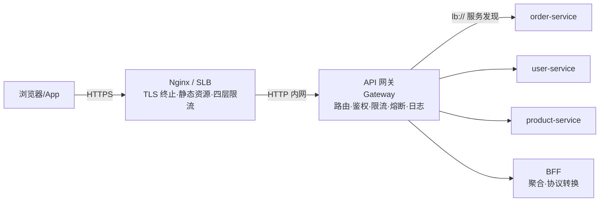
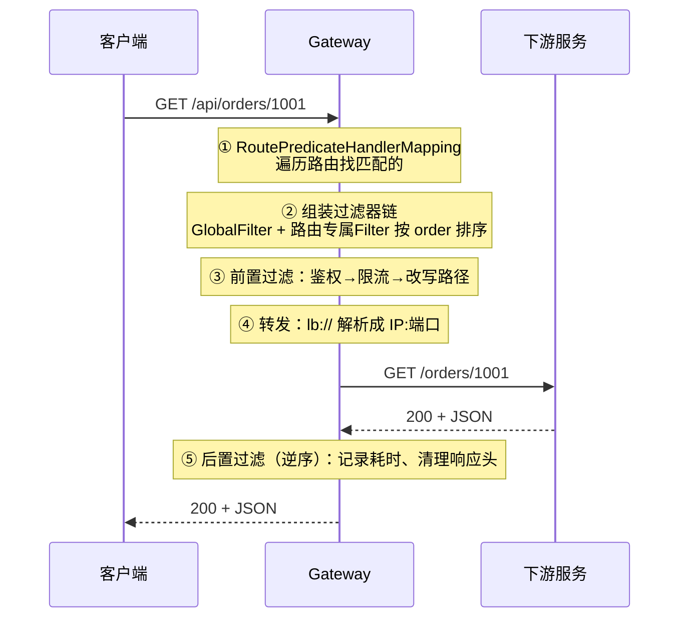

# API 网关：Spring Cloud Gateway 深入（JS 开发者视角）

> **优先级：P1（微服务岗必问，P0 实操必备）** — 网关是所有请求进系统的第一道门。你写的每一行 `orderService.getOrder()`，物理上都要先穿过它。面试问"你们网关怎么做路由/鉴权/限流的"，答不上来基本就出局了。

::: tip 背景
《Spring Cloud 微服务》篇把 Gateway 压缩成了一段 YAML——那是"知道有这个组件"的程度。真到线上，网关要回答四个问题：

1. **它怎么知道把请求转给哪个服务？**（路由匹配）
2. **它怎么拦住没登录的请求？**（鉴权）
3. **它怎么把每次请求的日志串起来？**（可观测）
4. **这些东西谁来改、谁来维护？**（职责边界——这是最容易被忽视、也最容易在团队里扯皮的问题）

本文按这四个问题展开，并把网关的**内部机制**（三件套 + 过滤器链排序）讲透——这是读源码和面试深挖的门槛。
:::

## 一、网关在整个链路里的位置

先看全景。请求从浏览器到数据库，要穿过几道门：



**网关和 Nginx 的分工**——这两个最容易混：

| | Nginx | API 网关（Gateway） |
|---|--------|-------------------|
| 层次 | 四层/七层代理，**C 层** | 应用层网关，**业务感知** |
| 强项 | 静态资源、SSL 卸载、连接数吞吐（万级连接） | 路由规则、鉴权、限流、灰度、协议转换 |
| 扩展方式 | 改配置文件 | 写 Java 代码（能复用你的 Spring 生态） |
| 懂不懂业务 | ❌ 只认 URL 和 Header | ✅ 懂 JWT、懂用户、懂业务语义 |
| 典型 | 放最外层，接所有流量 | 放在 Nginx 之后、业务服务之前 |

**它们不是二选一，是叠加**：Nginx 挡掉大流量和静态资源（它更扛并发），Gateway 处理需要业务逻辑的横切关注点。

> **一句话**：Nginx 解决"**连接和流量**"，网关解决"**请求和身份**"。

**那 BFF 和网关什么关系？** 网关是**通用横切层**（谁都能用，不含业务）；BFF 是**某个前端专属的业务层**（数据聚合、字段裁剪）。网关做路由，BFF 做编排。详见 [BFF 模式](/service/bff)。

## 二、核心机制：三件套（Route / Predicate / Filter）

Spring Cloud Gateway 的世界观就三个概念。理解了它们，整个框架就通了。

```mermaid
graph LR
    subgraph Route 一条路由 = 一个规则
        P[Predicate 断言<br/>要不要走这条?] --> F[Filter 过滤器<br/>走之前/之后做什么?] --> U[URI 去哪?]
    end
```

| 概念 | 作用 | 类比（前端 Express/Koa） |
|------|------|------------------------|
| **Route** | 一条规则：`id` + 目标 `uri` | 一条 `app.get('/api/x', handler)` 注册 |
| **Predicate** | **匹配条件**——不匹配就不选这条路由 | `if (req.path.startsWith('/api/x'))` |
| **Filter** | **改写加工**——改请求、改响应、重试、限流 | 中间件 `app.use(...)` |

**Predicate 是"要不要"，Filter 是"做什么"**——这个区分是理解网关的钥匙。

### 一次请求的完整旅程



**关键认知**：真正干活的**不是 Route，是 Filter**。Route 只负责"匹配规则 + 指向哪个地址"，具体怎么转发、怎么重试、怎么限流，全是 Filter 干的。

### 路由匹配：顺序 + 逻辑与

```yaml
spring:
  cloud:
    gateway:
      server:
        webflux:
          routes:
            - id: order-service
              uri: lb://order-service
              predicates:
                - Path=/api/orders/**      # 路径匹配
                - Method=GET,POST            # 且方法是 GET/POST
```

**两条匹配规则**（面试常问）：

1. **同一条路由上的多个 Predicate 是"与"（AND）关系**——上面这条要求路径 **且** 方法都满足
2. **不同路由之间按配置顺序遍历，第一条匹配的命中即停止**（不继续往下找）

**所以具体路由必须写在宽泛路由前面**，否则被"截胡"：

```yaml
routes:
  - id: order-detail      # ✅ 具体的写前面
    uri: lb://order-service
    predicates:
      - Path=/api/orders/special/**
  - id: order-service      # ⚠️ 宽泛的写后面
    uri: lb://order-service
    predicates:
      - Path=/api/orders/**
```

如果反过来写，`/api/orders/special/xxx` 会先命中宽泛那条，特殊路由永远不生效——**而且不报错**，只是静默走错。排查时用 `GET /actuator/gateway/routes` 看实际生效的路由表。

### 过滤器链：order 决定一切

请求命中路由后，网关把所有过滤器（全局的 + 这条路由专属的）合并，**按 order 值从小到大排成一条链**：

```java
@Override
public int getOrder() {
    return -100;      // 越小越先执行
}
```

**洋葱模型**——和 Koa 中间件完全一致：

```java
chain.filter(exchange)          // ← 之前的代码 = 请求方向（前置）
    .then(Mono.fromRunnable(() -> {
        // 这里的代码 = 响应方向（后置）
    }));
```

框架内置的几个关键 order 值（**背下来能省很多调试时间**）：

| 过滤器 | order | 作用 |
|-------|-------|------|
| 自定义鉴权 | -100（自己定） | 越早拦截越好 |
| `NettyWriteResponseFilter` | -1 | 把响应写回客户端 |
| `ForwardPathFilter` | 0 | 路径转发 |
| `RouteToRequestUrlFilter` | 10000 | 把 `lb://order-service` 拼成真实 URL |
| `ReactiveLoadBalancerClientFilter` | 10150 | **服务发现 + 负载均衡**：解析成 IP:端口 |
| `NettyRoutingFilter` | `Integer.MAX_VALUE` | 真正发起下游 HTTP 请求（最后一个 pre 过滤器） |

**两个补充说明**：

- 负载均衡过滤器的 order 在不同版本有出入——老的 `LoadBalancerClientFilter` 是 **10100**，新版的 `ReactiveLoadBalancerClientFilter` 是 **10150**。要卡在"路由已解析、负载均衡尚未生效"这个夹缝里做事时，**别猜，去源码里搜 `getOrder()`**。
- `NettyRoutingFilter` 的 order 是 `Integer.MAX_VALUE`，意味着它是**最后一个 pre 过滤器**——它之后的所有过滤器都在 post 阶段（响应返回后）执行。

**所以自定义过滤器的 order 要小于 10000**，才能在转发之前执行完。经验区间是 **-200 ~ 100**，太极端的值容易和内置行为冲突。

### 前端对照：网关 = Express 中间件 + 路由表

```javascript
// Express：路由匹配 + 中间件串行
app.use('/api/orders', authMiddleware);          // 类似 GlobalFilter
app.get('/api/orders/:id', stripPrefix, proxy);  // 类似 Route + Filter
```

区别只在**执行模型**：Express 是阻塞同步的，Gateway 是响应式异步的——这带来了后面那个致命约束。

## 三、⚠️ 最大的坑：别在网关里写阻塞代码

**网关跑在 Netty + Project Reactor 上（响应式非阻塞）**，事件循环线程只有极少数几个（默认 CPU 核数）。

```java
// ❌ 致命：在过滤器里调 JDBC / RestTemplate / Thread.sleep
public Mono<Void> filter(ServerWebExchange exchange, GatewayFilterChain chain) {
    User user = userService.queryFromDatabase(id);   // 阻塞！
    return chain.filter(exchange);
}
```

**后果**：一个阻塞调用会**卡住整个事件循环线程**，而这个线程上挂着成千上万个连接——一个慢查询能让整个网关的所有请求一起停摆。这不是"这个接口慢"，是"网关全挂"。

**正确写法**：

```java
// ✅ 用 WebClient（响应式 HTTP 客户端）
return webClient.get()
        .uri("/users/" + id)
        .retrieve()
        .bodyToMono(UserDTO.class)
        .flatMap(user -> chain.filter(mutate(exchange, user)));

// ✅ 实在要跑阻塞代码，显式挪到独立线程池
return Mono.fromCallable(() -> blockingOperation())
        .subscribeOn(Schedulers.boundedElastic());
```

**这也是为什么网关应用里不能加 `spring-boot-starter-web`**——它会把 Spring Boot 变成 Servlet 应用，响应式路由根本不生效。要用 Servlet 栈的话，2025.x 提供了 `spring-cloud-starter-gateway-server-webmvc` 变体（Tomcat + 阻塞模型）。

**Java 侧对照**：这就像在 Node 的 event loop 里写了个同步 `fs.readFileSync`——一个慢文件读，整个服务卡住。同一个道理。

## 四、路由配置实战

### 最小可用配置（2025.x 新写法）

```yaml
server:
  port: 8080

spring:
  cloud:
    gateway:
      server:
        webflux:                    # ⚠️ 2025.x 起必须带这一层
          discovery:
            locator:
              enabled: true         # 服务发现自动路由（可选）
          routes:
            - id: order-service
              uri: lb://order-service        # lb:// = 服务发现 + 负载均衡
              predicates:
                - Path=/api/orders/**
              filters:
                - StripPrefix=1               # /api/orders/1 → /orders/1
                - AddRequestHeader=X-Gateway, shop-gateway
```

### 常用 Predicate 速查

| Predicate | 匹配条件 | 典型用法 |
|-----------|---------|---------|
| `Path=/api/**` | 路径 | 最常用 |
| `Method=GET,POST` | HTTP 方法 | 限制读接口 |
| `Header=X-Tenant, \d+` | 请求头（支持正则） | 多租户路由 |
| `Host=**.shop.com` | Host | 同一网关服务多个域名 |
| `Query=version, 2` | 查询参数 | 版本路由 |
| `After=/Before=/Between=` | 时间窗口 | 限时活动 |
| `Weight=group, 90` | 权重 | **灰度发布**（见下） |

### 常用 Filter 速查

| Filter | 作用 |
|--------|------|
| `StripPrefix=1` | 剥掉前 N 段路径 |
| `RewritePath=/api/(?.*), /$\{seg}` | 正则重写路径 |
| `AddRequestHeader` / `RemoveRequestHeader` | 注入/删除请求头 |
| `AddResponseHeader` | 加响应头 |
| `RequestRateLimiter` | 限流（Redis 令牌桶） |
| `CircuitBreaker` | 熔断 + 降级 |
| `Retry` | 重试（**只对幂等接口**） |
| `RequestSize` | 限制请求体大小 |

### 灰度发布：Weight 谓词

```yaml
routes:
  - id: order-stable
    uri: lb://order-service
    predicates:
      - Path=/api/orders/**
      - Weight=order-group, 90        # 90% 流量走稳定版
  - id: order-canary
    uri: lb://order-service-v2
    predicates:
      - Path=/api/orders/**
      - Weight=order-group, 10        # 10% 流量走灰度版
```

**这是网关最被低估的能力**——不用改任何业务代码，就在入口按比例分流。

### Java DSL 写法（需要逻辑时）

```java
@Bean
public RouteLocator customRoutes(RouteLocatorBuilder builder) {
    return builder.routes()
            .route("order-service", r -> r
                    .path("/api/orders/**")
                    .filters(f -> f
                            .stripPrefix(1)
                            .circuitBreaker(config -> config
                                    .setName("orderCB")
                                    .setFallbackUri("forward:/fallback/orders")))
                    .uri("lb://order-service"))
            .build();
}
```

**什么时候用 YAML、什么时候用 Java**：路由固定用 YAML（运维能改、可读）；需要条件判断、共享过滤器链用 Java。

## 五、鉴权：网关统一校验 + 下游信任传递

### 核心思路：边缘认证，内部信任

```
客户端 --Bearer JWT--> 网关（校验 JWT） --X-User-Id--> 下游服务（直接读用户身份）
```

**为什么放网关做**：每个服务都写一遍 JWT 校验 = N 份重复代码 + N 处可能配错的地方。放网关 = 改一次全链路生效。

**但必须同时做防御性校验**：网关可能被绕过（内网直连、网关被攻破），所以下游服务**仍应校验** token。业界共识是**两边都做**：网关做"快速拒绝明显无效的请求"，服务做"真正的授权判定"。

### 实现：GlobalFilter + 响应式 JWT 解码

```java
@Component
@Order(-100)                     // 尽可能早拦截
public class AuthGlobalFilter implements GlobalFilter, Ordered {

    private static final Set<String> PUBLIC_PATHS = Set.of(
            "/api/auth/login", "/api/auth/register", "/actuator/health");

    private final ReactiveJwtDecoder jwtDecoder;   // 响应式解码器

    @Override
    public Mono<Void> filter(ServerWebExchange exchange, GatewayFilterChain chain) {
        String path = exchange.getRequest().getPath().value();

        // 白名单直接放行
        if (PUBLIC_PATHS.stream().anyMatch(path::startsWith)) {
            return chain.filter(exchange);
        }

        String auth = exchange.getRequest().getHeaders().getFirst("Authorization");
        if (auth == null || !auth.startsWith("Bearer ")) {
            return unauthorized(exchange);
        }

        return jwtDecoder.decode(auth.substring(7))       // 返回 Mono，不阻塞
                .flatMap(jwt -> {
                    // 校验通过：把身份注入请求头，转发给下游
                    ServerHttpRequest mutated = exchange.getRequest().mutate()
                            .header("X-User-Id", jwt.getSubject())
                            .header("X-User-Roles", String.join(",", jwt.getClaimAsStringList("roles")))
                            .build();
                    return chain.filter(exchange.mutate().request(mutated).build());
                })
                .onErrorResume(e -> unauthorized(exchange));
    }

    private Mono<Void> unauthorized(ServerWebExchange exchange) {
        exchange.getResponse().setStatusCode(HttpStatus.UNAUTHORIZED);
        return exchange.getResponse().setComplete();   // 短路，不再往下走
    }

    @Override
    public int getOrder() { return -100; }
}
```

下游服务读用户身份：

```java
@GetMapping("/api/orders")
public List<OrderDTO> list(@RequestHeader("X-User-Id") String userId) {
    return orderService.listByUser(userId);
}
```

### 三个必须注意的安全点

**① 必须先删掉客户端伪造的身份头**。客户端可以自己发 `X-User-Id: admin`——如果网关只是"添加"而不"删除"，攻击者伪造的头会和你注入的头同时存在，取值逻辑一乱就是越权。

```yaml
filters:
  - RemoveRequestHeader=X-User-Id      # ✅ 先删掉客户端带来的
  - RemoveRequestHeader=X-User-Roles
```

**② `X-Forwarded-*` 头在 2025.x 默认不再透传**。升级后如果下游拿不到真实客户端 IP（限流按 IP、审计日志记录 IP 全失效），需要显式声明可信代理：

```yaml
spring:
  cloud:
    gateway:
      server:
        webflux:
          trusted-proxies: "10\\.0\\.\\d+\\.\\d+"    # 正则匹配你的 LB/ingress 网段
```

**③ JWKS 是懒加载的**——第一次请求才会去拉公钥，冷启动 + 流量突袭时首个请求会慢甚至 401。做法是启动时预热：

```java
@Component
public class JwksWarmUp {
    @PostConstruct
    void warmUp(ReactiveJwtDecoder decoder) {
        decoder.decode("warm-up").onErrorComplete().subscribe();  // 强制触发一次拉取
    }
}
```

### 鉴权 vs 授权的边界

| | 放网关 | 放业务服务 |
|---|--------|-----------|
| **认证**（你是谁，token 真不真） | ✅ 统一做 | 防御性复验 |
| **授权**（你能不能改这条订单） | ❌ 网关不知道业务规则 | ✅ 必须做 |
| **数据权限**（只看自己的订单） | ❌ | ✅ |

**判据**：网关做"**通用横切**"，服务做"**业务规则**"。一旦网关开始判断"订单金额超过 1 万要审批"，它就变成了业务系统的一部分——每个业务变更都要排队等网关发版（这是网关团队的经典噩梦）。

## 六、日志与可观测性：三层一起上

批注问的"怎么收集日志"，答案是**三个层次**，别只做第一层。

### 第一层：访问日志（每个请求记一行）

```java
@Component
@Order(Ordered.HIGHEST_PRECEDENCE)
public class AccessLogFilter implements GlobalFilter, Ordered {

    @Override
    public Mono<Void> filter(ServerWebExchange exchange, GatewayFilterChain chain) {
        long start = System.currentTimeMillis();
        String path = exchange.getRequest().getURI().getPath();
        String method = exchange.getRequest().getMethod().name();

        return chain.filter(exchange).then(Mono.fromRunnable(() -> {
            // 注意：getStatusCode() 可能是 null（比如连接超时直接断开），必须判空
            HttpStatusCode code = exchange.getResponse().getStatusCode();
            int status = code != null ? code.value() : -1;
            long cost = System.currentTimeMillis() - start;
            log.info("{} {} status={} cost={}ms", method, path, status, cost);
        }));
    }

    @Override
    public int getOrder() { return Ordered.HIGHEST_PRECEDENCE; }
}
```

**三个必踩的坑**：

1. **`getStatusCode()` 可能返回 null**——下游超时、连接被断时。不判空会抛 NPE，把日志过滤器变成故障源
2. **别在过滤器里打整个请求体**——大 body 打日志既慢又可能泄露敏感数据
3. **别用 `System.out.println`**——走 logback，才能被 ELK 采集

### 第二层：traceId 贯穿（跨服务串联）

网关是链路的**起点**，traceId 应该在这里生成，然后往下传：

```java
@Component
@Order(Ordered.HIGHEST_PRECEDENCE + 1)
public class TraceIdFilter implements GlobalFilter, Ordered {

    private static final String HEADER = "X-Request-Id";

    @Override
    public Mono<Void> filter(ServerWebExchange exchange, GatewayFilterChain chain) {
        String traceId = exchange.getRequest().getHeaders().getFirst(HEADER);
        if (traceId == null) {
            traceId = UUID.randomUUID().toString();
        }
        String finalTraceId = traceId;

        ServerHttpRequest mutated = exchange.getRequest().mutate()
                .header(HEADER, finalTraceId)
                .build();

        return chain.filter(exchange.mutate().request(mutated).build())
                .then(Mono.fromRunnable(() ->
                        exchange.getResponse().getHeaders().add(HEADER, finalTraceId)));  // 回传给客户端
    }

    @Override
    public int getOrder() { return Ordered.HIGHEST_PRECEDENCE + 1; }
}
```

**回传给客户端的价值**：用户报障时截图里就有 traceId，你直接拿它查全链路，不用来回问"你什么时候调的""哪个账号"。

**和链路追踪的关系**：`X-Request-Id` 是**你自己拼的关联 ID**；而 SkyWalking / Micrometer Tracing 的 traceId 是**框架标准化的追踪上下文**。后者更完整（自动生成 span 树），前者更轻量（不依赖追踪系统也能用）。**两者不是二选一**——但如果已经有链路追踪系统了，别重复造 traceId，用标准的那个。

### 第三层：指标与路由表（Actuator）

```yaml
management:
  endpoints:
    web:
      exposure:
        include: health,info,gateway,metrics,prometheus
  endpoint:
    gateway:
      enabled: true
```

| 端点 | 用途 |
|------|------|
| `GET /actuator/gateway/routes` | **查看生效的路由表**——排查"请求为什么走错服务"的第一站 |
| `GET /actuator/gateway/globalfilters` | 查看所有全局过滤器及其 order |
| `GET /actuator/gateway/routefilters` | 查看所有内置 Filter 工厂 |
| `POST /actuator/gateway/refresh` | 清空路由缓存，配合配置中心动态刷新 |

**指标**：Gateway 自带 Micrometer 埋点，指标名 `spring.cloud.gateway.requests`，标签包含 `routeId`（哪条路由）、`routeUri`、`outcome`（成功/客户端错误/服务端错误，由 HttpStatus.Series 分类）、`status`、`httpStatusCode`、`httpMethod`。直接接 Prometheus 就能算出"哪个路由最慢、哪个路由错误率高"。

```yaml
management:
  metrics:
    enable:
      gateway: true          # ⚠️ 2020.0.x 之后是这个开关
```

> **配置坑**：老教程里的 `spring.cloud.gateway.metrics.enabled=true` 在 2020.0.x 之后已废弃，照抄会导致指标完全采集不到——而且没有任何报错。接 Prometheus 前先 `curl /actuator/metrics/spring.cloud.gateway.requests` 确认有数据。

指标体系整体怎么接，见 [可观测性：监控与告警](/service/common/observability)。

## 七、限流与熔断：网关层的保护

### 限流（Redis 令牌桶）

```yaml
filters:
  - name: RequestRateLimiter
    args:
      redis-rate-limiter.replenishRate: 100      # 每秒补 100 个令牌
      redis-rate-limiter.burstCapacity: 200       # 桶容量 200（允许突发）
      redis-rate-limiter.requestedTokens: 1       # 每个请求消耗 1 个
      key-resolver: "#{@userKeyResolver}"        # 限流维度
```

限流维度可以按用户、按 IP、按接口——用 `KeyResolver` 决定：

```java
@Bean
public KeyResolver userKeyResolver() {
    return exchange -> Mono.just(
            exchange.getRequest().getHeaders().getFirst("X-User-Id") != null
                ? exchange.getRequest().getHeaders().getFirst("X-User-Id")
                : exchange.getRequest().getRemoteAddress().getAddress().getHostAddress());
}
```

> 用 Redis 而不是本地 Map，是因为网关通常多实例部署——本地限流每个实例各算各的，实际阈值是"阈值 × 实例数"。

**算法细节**（漏桶 vs 令牌桶、单机 vs 分布式）见 [高并发高可用设计](/service/java/java-high-concurrency)。

### 熔断 + 降级

```yaml
filters:
  - name: CircuitBreaker
    args:
      name: orderCB
      fallbackUri: forward:/fallback/orders
```

```java
@RestController
public class FallbackController {
    @RequestMapping("/fallback/orders")
    public ResponseEntity<?> ordersFallback() {
        return ResponseEntity.status(HttpStatus.SERVICE_UNAVAILABLE)
                .body(Map.of("code", "SERVICE_UNAVAILABLE", "message", "服务繁忙，请稍后重试"));
    }
}
```

### ⚠️ 重试的顺序陷阱

`Retry` 和 `CircuitBreaker` 一起用时，**重试的次数会计入熔断器的失败统计**——一个激进的重试策略会让熔断器比预期更早打开（你以为在测 1 次调用，其实测了 4 次）。

**规则**：
- 重试只对**幂等**操作（GET 为主），POST 重试 = 重复下单
- 只对**真正的瞬时故障**重试（`SERVICE_UNAVAILABLE`、`BAD_GATEWAY`），不要重试 4xx
- 重试次数保守（2~3 次），并配指数退避
- 超时和熔断要配齐，否则重试会放大成重试风暴

## 八、网关要不要开发者维护？（职责边界）

这是批注里最该被认真回答的问题。**答案是：要看网关属于哪种形态。**

### 三种形态，三种答案

| 形态 | 谁维护 | 适合 |
|------|-------|------|
| **① 共享网关**（一个网关服务全公司） | **平台/基础架构团队维护**。业务团队只提需求（"我要一条路由"），不碰代码 | 大多数公司 |
| **② 业务自建网关**（每个团队自己一个） | **业务团队自己维护**，想怎么写怎么写 | 特殊协议、遗留系统对接 |
| **③ 网关即配置**（Nginx/Kong 托管） | **运维维护**，改配置不发版 | 路由规则简单、变化少 |

**大多数公司是 ①**。这意味着：**"网关要不要开发者维护"这个问题的答案是——普通业务开发者不需要维护它，需要的是平台团队。**

### 业务开发者的真实边界

如果你是业务开发者，你能做的是：

| 做什么 | 谁做 | 怎么做 |
|--------|------|--------|
| 加一条新路由 | 业务开发者**提需求**，平台团队配置 | 在 Nacos/配置中心改配置，或给平台团队提 MR |
| 加一个自定义过滤器 | 平台团队开发 + 业务团队提需求 | 说明清楚"这个过滤器要做什么"，平台团队实现并做成通用件 |
| 改鉴权规则 | 平台团队 | 通常是配置化（白名单路径、密钥切换） |

**业务开发者不该做的**：
- ❌ 在网关过滤器里写业务逻辑（"订单金额 > 1 万要审批"）
- ❌ 在网关里做数据聚合（那是 BFF 的活）
- ❌ 在网关里改请求体字段（耦合了网关和某个服务的 schema，改个字段名要发版网关）
- ❌ 每个业务团队各改各的，导致网关成为"谁都能改"的公共财产

### 判断标准（一句话）

> **"团队改自己的服务行为，需不需要网关跟着发版？"**
>
> 如果需要，说明有东西放错地方了。

一个**好**的网关：加路由、改限流阈值、扩服务实例，业务团队全程不碰网关代码。
一个**坏**的网关：后端改个字段名，网关也得改代码发版——所有团队都得排队等平台团队发版，这就是"网关成为部署瓶颈"。

### 共享网关的治理问题

共享网关最大的坑是**排队**：所有团队的路由变更都要走平台团队的发布窗口。

**缓解手段**：
1. **路由配置外置**——放 Nacos/Apollo，改配置自动刷新（`POST /actuator/gateway/refresh` 手动触发），不发版
2. **按业务域拆分网关**——大流量核心域单独一个网关，其余共享
3. **只允许通用过滤器进网关**——业务逻辑留服务里
4. **灰度 + 回滚预案**——路由改错能立刻回退

### 路由配置外置（动态刷新）

```java
@Bean
public RouteDefinitionLocator nacosRouteDefinitionLocator(
        NacosConfigManager configManager) {
    return new NacosRouteDefinitionLocator(configManager);
}
```

配置变更后，网关重新加载路由，**不用重启**——这是让共享网关可维护的关键。

## 九、⚠️ 版本陷阱：2025.x 的大改动

如果你在网上抄配置抄到"路由不生效"，大概率是踩了这个（Spring Cloud 2025.0 / Gateway 5.x）：

| 项目 | 旧写法（Boot 3 时代） | 新写法（2025.0+ / Boot 4） |
|------|------------------------|------------------------|
| WebFlux starter | `spring-cloud-starter-gateway` | `spring-cloud-starter-gateway-server-webflux` |
| WebMVC starter | `spring-cloud-starter-gateway-mvc` | `spring-cloud-starter-gateway-server-webmvc` |
| 配置前缀 | `spring.cloud.gateway.*` | `spring.cloud.gateway.server.webflux.*`（或 `.server.webmvc.*`） |

**这个改动极其阴险**：新版本里写旧的 `spring.cloud.gateway.routes` **不报错，路由直接静默失效**。所以升级后第一件事：

```bash
curl http://localhost:8080/actuator/gateway/routes   # 确认路由真的加载了
```

**新旧共存情况**：2025.0 里旧名被弃用（打 warning），2025.1 起旧 artifact 被移除。所以老教程的 `spring-cloud-starter-gateway` 在 Boot 4 项目里根本拉不到依赖。

**迁移工具**：`spring-boot-properties-migrator` 能自动桥接旧前缀，OpenRewrite 有现成 recipe。

## 十、常见坑速查

| 坑 | 现象 | 解法 |
|----|------|------|
| **过滤器里调阻塞代码** | 一个慢查询拖垮整个网关 | 用 WebClient / `Mono.fromCallable().subscribeOn(boundedElastic())` |
| **加了 `spring-boot-starter-web`** | 网关路由完全不生效 | 响应式网关不能带 Servlet starter；要用 Servlet 栈选 `-server-webmvc` |
| **宽泛路由写在具体路由前面** | 特定路由静默不生效 | 具体在前；用 `/actuator/gateway/routes` 验证 |
| **客户端伪造 `X-User-Id`** | 越权访问 | `RemoveRequestHeader` 先删再注入 |
| **2025.x 沿用旧配置前缀** | 路由静默失效 | 用 `spring.cloud.gateway.server.webflux.*`，升级后查 actuator |
| **本地限流** | 多实例实际阈值翻倍 | 用 Redis 令牌桶 |
| **重试非幂等接口** | 重复下单 | 只重试 GET，并配幂等键 |
| **Retry 排在 CircuitBreaker 之前** | 熔断器比预期更早打开 | 理解重试会计入失败统计，控制重试次数 |
| **日志过滤器不判空 `getStatusCode()`** | NPE，故障源变日志源 | 判空处理 |
| **不配 HTTP 客户端超时** | 下游卡死，网关连接被拖住 | 配 `httpclient.connect-timeout` / `response-timeout` |
| **默认信任 `X-Forwarded-*`** | 客户端 IP 伪造 / 真实 IP 丢失 | 2025.x 需显式配 `trusted-proxies` |
| **JWKS 懒加载** | 冷启动后首个请求 401 或很慢 | 启动时预热解码器 |
| **在网关里写业务逻辑** | 变成部署瓶颈 | 业务逻辑留服务，网关只做横切 |

## 面试题速查

| 问题 | 一句话答案 |
|------|-----------|
| 网关和 Nginx 什么区别 | Nginx 是四层代理，扛连接和流量（TLS/静态资源）；网关是应用层，做路由/鉴权/限流/灰度。两者叠加，不是二选一 |
| 网关核心三件套 | Route（规则）+ Predicate（要不要走这条）+ Filter（走之前/之后做什么） |
| 多个 Predicate 什么关系 | AND，全部满足才匹配 |
| 多条路由怎么选 | 按配置顺序遍历，第一条匹配的命中（所以具体路由要写前面） |
| 过滤器执行顺序怎么定 | 按 order 升序；`chain.filter()` 之前是前置，之后是后置（洋葱模型，同 Koa） |
| 关键 order 值 | 自定义 < 10000；`RouteToRequestUrlFilter`=10000、`LoadBalancerClientFilter`=10150、`NettyRoutingFilter`=MAX |
| 为什么网关不能写阻塞代码 | 跑在 Netty 事件循环上，阻塞会卡住整个网关的所有请求 |
| 网关怎么做鉴权 | GlobalFilter + `ReactiveJwtDecoder` 校验 JWT，通过后注入 `X-User-Id` 转发下游；下游仍应复验 |
| 为什么注入身份头前要先删 | 防客户端伪造身份头造成越权 |
| 网关怎么做日志 | 三层：访问日志 GlobalFilter（含耗时/状态码）、traceId 贯穿回传客户端、Actuator 指标与路由表 |
| 网关要不要业务开发者维护 | 共享网关由平台团队维护，业务只提需求；判据是"改业务要不要网关发版" |
| 什么不该放网关 | 业务规则、数据聚合、请求体字段改写——这些属于 BFF 或业务服务 |
| 限流为什么用 Redis | 网关多实例，本地限流实际阈值 = 阈值 × 实例数 |
| 2025.x 有什么破坏性变更 | starter 改名 `-server-webflux/-server-webmvc`，配置前缀改 `spring.cloud.gateway.server.webflux.*`，旧写法静默失效 |

## 延伸阅读

- [Spring Cloud 微服务](/service/java/spring-cloud) - 全家桶组件全景，Gateway 在其中的位置
- [Nginx 与 Web 容器](/service/common/nginx-web-container) - 网关外面那层的分工
- [可观测性：监控与告警](/service/common/observability) - 指标、链路、告警怎么接
- [认证与授权](/service/auth) - JWT 的签发、校验、失效策略
- [BFF 模式](/service/bff) - 网关 vs BFF 的职责边界
- [高并发高可用设计](/service/java/java-high-concurrency) - 限流算法与容量估算
- [RPC 原理与 Java 生态](/service/java/rpc-in-java) - 浏览器调不到 gRPC 时为什么需要 BFF
- [Java 并发编程](/service/java/java-concurrency) - 响应式编程与传统并发模型的差异
