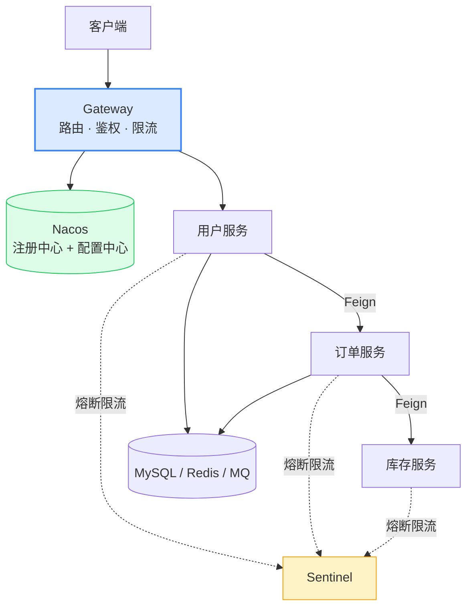

# Spring Cloud 微服务

> 本质一句话：**微服务不是"更高级的架构"，而是把单体拆开之后，必须额外养活的六个中间件**。这篇按"拆完多出什么问题"组织组件，而不是按 API 背参数。

**优先级 P1（微服务岗位必问）**：说清全家桶各组件职责 + 串起一个完整链路即可，不必背每个组件的 API。

::: tip 读者定位
你已经会写单体 Spring Boot 服务。这篇讲的是：当一个服务变成五个、十个，**多出来的问题分别由谁解决**。国内主流是 Spring Cloud Alibaba 这一套。
:::

## 0. 全景：三分钟看懂这篇

> 难度：了解

**它在哪**：单体之上的一层"协作设施"。它不写业务，只解决服务之间的**找到彼此、调通、扛住故障、统一入口、统一配置**这几件事。

拆分会稳定地带来六个新问题，每个问题对应一个组件——**这张对照表就是全篇的地图**：

| 拆完多出来的问题 | 谁解决 | 组件 |
|---|---|---|
| 服务之间怎么调用 | 声明式 HTTP 客户端 | OpenFeign |
| 服务地址怎么互相知道 | 注册中心 | Nacos |
| 下游挂了怎么不拖垮自己 | 熔断限流 | Sentinel |
| 配置改了要不要逐个重启 | 配置中心 | Nacos Config |
| 请求从哪进、鉴权在哪做 | 网关 | Gateway |
| 一次请求跨五个服务，怎么排查 | 链路追踪 | SkyWalking / traceId |



**分五块**：

| 块 | 内容 | 读到什么程度 |
|---|---|---|
| 1 用途 | 该不该拆、拆了要付什么代价 | 能做架构判断 |
| 2 最小可用 | 三个服务 + 注册中心 + 网关跑通一次调用 | 跑一遍 |
| 3 用法 | 五个组件的职责与最小配置 | 会用 |
| 4 原理 | AP/CP、雪崩推演、响应式网关 | 能解释为什么 |
| 5 坑 | 网关静默失效、路由截胡、阻塞卡死 | 升级和排查时用得上 |

**学完你能**：① 画出你家项目的服务调用图；② 说清一次请求从网关到数据库经过哪些组件；③ 遇到"网关改了配置没生效"知道去哪查。

**本篇讲什么、不讲什么**：

| 知识点 | 档位 | 处理 |
|---|---|---|
| 拆分代价与组件职责 | 核心 | 正文 0、3 |
| Nacos 注册发现 + 配置中心 | 核心 | 正文 3.1、3.5 |
| OpenFeign 声明式调用 | 核心 | 正文 3.2 |
| Sentinel 熔断限流降级 | 核心 | 正文 3.3 |
| Gateway 路由与职责边界 | 核心 | 正文 3.4 |
| 雪崩是怎么发生的 | 核心 | 正文 4.3 |
| 分布式事务 Seata | 进阶 | 正文 6 一句话 |
| 网关的过滤器实现细节 | 边角 | 见 [API 网关深度篇](/service/java/spring-cloud-gateway) |
| 链路追踪落地 | 边角 | 正文 6 |
| K8s 服务网格（Istio） | — | 不写 |

---

## 1. 用途：什么时候该拆，什么时候别拆

> 难度：了解

### 1.1 拆分买到的是什么

只有三样，而且都不便宜：

1. **独立部署**：订单服务改一行，不用把用户服务一起发版
2. **独立扩容**：只有订单是热点，就只扩订单
3. **故障隔离（理论上）**：一个服务的内存泄漏不至于拖垮整个进程

### 1.2 拆分付出的代价

**上面那六个问题，全部是拆分之后才出现的。** 单体时代你从来不用考虑"用户服务怎么找到订单服务"——它们就在同一个进程里，一个方法调用就完事。

除此之外还有：分布式事务（本地事务没了）、跨服务查询（join 没了）、联调成本（本地起五个服务）、日志分散（一个请求横跨五个日志文件）。

### 1.3 什么情况下不该拆

| 情况 | 为什么别拆 | 更合适的做法 |
|---|---|---|
| 团队 < 10 人 | 拆完每人维护两三个服务，运维成本吃掉全部收益 | **模块化单体**：一个应用，代码按业务域分模块，边界画清楚 |
| 业务还在快速试错 | 领域边界没稳定，拆完就要重组 | 先单体，等边界稳定再拆 |
| 没有自动化运维 | 五个服务手工发版、手工配网关，出事没人救 | 先把 CI/CD、监控、日志做起来 |
| 只是想"显得架构先进" | 这是最常见也最贵的错误 | 单体 + 清晰模块划分，够用很多年 |

> 判断标准：**你能独立养起注册中心、网关、配置中心、监控告警这一套吗？** 能，再谈拆；不能，模块化单体是更诚实的选择。

**拆分的正确粒度**：按业务域（DDD 的限界上下文），不按技术层。拆成"Controller 服务 / Service 服务 / DAO 服务"是最典型的错误——每加一个功能要改三个服务、发三次版。

> **自检**：五个人的团队，日活一万的后台系统，要不要上 Spring Cloud？

::: details 参考答案
不建议。五个人的团队维护 5~8 个服务 + 注册中心 + 网关 + 配置中心，运维投入会远超收益；而且后台系统流量小，独立扩容的价值几乎为零。更合理的是**模块化单体**（一个应用、按业务域分模块、模块间只通过接口调用），等团队扩到二三十人、或某个模块真的成为性能瓶颈时再拆。
:::

---

## 2. 最小可用：三个服务跑通一次调用

> 难度：了解

不追求完整，目标是**亲眼看到"服务名 → 真实地址"这个过程**。

### 2.1 起一个注册中心

```bash
# 本地起 Nacos（单机模式）
docker run -d --name nacos -p 8848:8848 -e MODE=standalone nacos/nacos-server:v2.4.0
```

访问 `http://localhost:8848/nacos`（默认 nacos/nacos），能看到"服务列表"就是起来了。

### 2.2 让服务注册上去

```yaml
# 每个业务服务的 application.yml
spring:
  application:
    name: user-service          # 这个名字就是别人调用你时用的名字
  cloud:
    nacos:
      discovery:
        server-addr: localhost:8848
```

启动后去 Nacos 控制台，`user-service` 会出现在服务列表里，实例数是 1。**这一行配置就是"注册"的全部**——服务启动时把自己的 IP:端口写进注册中心，并定期心跳。

### 2.3 用服务名调用另一个服务

```java
@FeignClient(name = "order-service")           // 写服务名，不写 IP
public interface OrderClient {
    @GetMapping("/api/orders/{id}")
    OrderDTO getOrder(@PathVariable Long id);
}
```

```java
@Service
@RequiredArgsConstructor
public class UserService {
    private final OrderClient orderClient;      // 像调本地方法一样调远程

    public UserWithOrders getUser(Long id) {
        User user = ...;
        List<OrderDTO> orders = orderClient.listByUser(id);   // 实际发了一次 HTTP
        return new UserWithOrders(user, orders);
    }
}
```

启动类加 `@EnableFeignClients`，否则接口不会被扫描成 Bean（症状和普通 Bean 没注册一模一样）。

### 2.4 加一道网关

```yaml
spring:
  cloud:
    gateway:
      server:
        webflux:                       # ⚠️ Spring Cloud 2025.x 起必须带这一层
          routes:
            - id: user-route
              uri: lb://user-service   # lb:// + 服务名，走注册中心负载均衡
              predicates:
                - Path=/api/user/**
              filters:
                - StripPrefix=1        # 转发前去掉 /api 前缀
```

现在 `GET http://localhost:8080/api/user/1` 会经过网关 → 找到 `user-service` → 转发到它的 `/user/1`。

> **自检**：`uri: lb://user-service` 里的 `lb` 是什么意思？为什么不能直接写 `http://localhost:8081`？

::: details 参考答案
`lb` 是 load balance 的缩写，表示"把这个服务名交给负载均衡器去解析成真实实例列表"。写死 `http://localhost:8081` 在本地能跑，但服务扩容成三个实例时就只能命中一个，且实例 IP 变化就得改配置——那就退回硬编码时代了，注册中心白搭。
:::

---

## 3. 用法：五个组件各管什么

> 难度：会用

### 3.1 Nacos：注册中心 + 配置中心

```text
服务启动 → 向 Nacos 注册（IP:端口 + 心跳）
调用服务 → 问 Nacos 要目标服务的实例列表 → 本地缓存 → 负载均衡挑一个
服务挂掉 → 心跳超时 → 从列表剔除
```

负载均衡现在由 **Spring Cloud LoadBalancer** 负责（**Ribbon 在 2020.0 版本已移除**，老文章里还在讲 Ribbon，看的时候别照抄）。

**Nacos 与另外两个的差别**：

| | 一致性模型 | 现状 |
|---|---|---|
| Eureka | AP（可用性优先） | 已停止更新 |
| ZooKeeper | CP（强一致） | 注册中心场景偏重，一般用于其他协调场景 |
| **Nacos** | **AP / CP 可切换** + 自带配置中心 | 国内主流 |

### 3.2 OpenFeign：声明式 HTTP

```java
@FeignClient(name = "order-service", fallbackFactory = OrderClientFallback.class)
public interface OrderClient {
    @GetMapping("/api/orders/{id}")
    OrderDTO getOrder(@PathVariable Long id);
}
```

你只写接口，实现是**运行时动态代理**生成的（和 MyBatis 的 Mapper 一个思路）：按注解拼出 URL → 走负载均衡选中实例 → 发 HTTP → 反序列化。

它比手写 `RestTemplate` 多出三件事：**声明式**（接口即客户端）、**自动负载均衡**、**可配置超时/重试/降级**。

> Feign 常被叫"半个 RPC"——写起来像方法调用，传输层还是 HTTP + JSON。真 RPC（Dubbo / gRPC）的对比见 [RPC 原理与 Java 生态](/service/java/rpc-in-java)。

### 3.3 Sentinel：限流、熔断、降级

三个词经常混着说，实际是三种不同动作：

| 概念 | 是什么 | 保护谁 |
|---|---|---|
| **限流** | 超过 QPS 阈值直接拒绝 | 保护**自己**不被打垮 |
| **熔断** | 下游失败率超阈值 → 一段时间内直接快速失败，不再发请求 | 保护**调用方的线程和连接池** |
| **降级** | 熔断/限流后返回兜底数据（缓存值、默认值） | 保护**用户体验**（少报错） |

一句话记：**熔断是状态（开着/关着），降级是策略（失败时给什么）**。熔断打开后走降级逻辑。

### 3.4 Gateway：所有请求的第一道门

一条路由就是三件事：`Predicate`（要不要走这条）+ `Filter`（走之前/之后做什么）+ `uri`（去哪）。

**三个必须建立的心智**：

**① 它是"路由表 + 中间件"，不是转发器。** 多条路由**按配置顺序遍历，第一条匹配的命中**——所以具体路由必须写在宽泛路由前面，否则会被静默截胡（`/api/user/admin` 写在 `/api/user/**` 后面，永远进不去）。

**② 它跑在响应式栈上（Netty + Reactor），不能写阻塞代码。** 在过滤器里调 JDBC、`RestTemplate`、`Thread.sleep`，卡住的是**事件循环线程**——一个慢查询能让整个网关的所有请求一起停摆。这不是"这个接口慢"，是"网关全挂"。

**③ 鉴权在网关统一做，但下游仍要复验。** 网关校验 JWT 后把身份注入 `X-User-Id` 转发给下游，下游直接读这个头。**前提是网关必须先 `RemoveRequestHeader=X-User-Id`**，把客户端自带的同名头删掉——否则客户端伪造 `X-User-Id: admin` 就是越权。

**网关和 Nginx 不是二选一**：Nginx 解决连接与流量（TLS 终止、静态资源、扛万级连接），网关解决请求与身份（路由、鉴权、限流、灰度）。两者叠加。

### 3.5 Nacos Config：配置中心

```java
@RefreshScope                    // 这个 Bean 的配置变更后会被重新创建
@RestController
public class ConfigController {
    @Value("${feature.new-checkout:false}")   // 冒号后是默认值
    private boolean newCheckout;
}
```

配置放 Nacos，服务启动时拉取，改完自动推送刷新（不用重启）。对应你熟悉的 `.env`，区别是**集中管理 + 热更新 + 多环境隔离**。

### 3.6 串起来看：一次下单请求

```text
客户端 → Gateway（校验 JWT，注入 X-User-Id，限流）
       → order-service（Feign 向 Nacos 查 user-service 实例，取第一个健康实例）
       → user-service（查用户，返回）
       → order-service 落库
       → 全程带同一个 traceId，出问题能串起来
```

中间任何一跳失败：Feign 抛异常 → Sentinel 统计失败率 → 超过阈值熔断 → 走 fallback 返回兜底 → 保护 order-service 的线程。

---

## 4. 原理：为什么会这样

> 难度：懂原理

### 4.1 注册中心挂了，服务还能调吗

**能。** 因为调用方本地缓存了实例列表，注册中心只是"更新通道"，不是"必经之路"。代价是：挂了期间**新增或下线的实例感知不到**——可能继续往一个已经死掉的实例发请求，直到熔断或重试兜住。

这也是 Nacos 默认走 **AP**（可用性优先）的原因：注册中心这个场景下，"短时间数据不一致"远好过"注册中心一挂全站不可用"。反过来，如果业务需要强一致的元数据（比如配置不能出现新旧混用），可以切成 CP。

### 4.2 为什么熔断能防雪崩

雪崩的发生链条很具体：

```text
C 变慢（DB 锁表）
  → B 调 C 的线程全部阻塞等待
  → B 的 Tomcat 线程池（默认 200）被占满
  → B 连正常的接口也无法响应
  → A 调 B 的线程开始阻塞
  → 一路向上，全站无响应
```

关键点是：**B 并不是被 C 的返回错误拖垮的，而是被"等待"拖垮的**——线程是有限资源，等满就没了。

熔断做的事：连续失败到阈值，就直接在 B 侧**快速失败**（不发请求、立刻返回错误），线程立刻释放。这样 B 还能服务其他接口。**保护的是调用方自己，少打下游只是顺带的好处。**

### 4.3 为什么网关不能阻塞

Gateway 基于 Netty，少数几个事件循环线程处理所有连接。**一个线程阻塞，它负责的那批连接全部等着**。而在 Tomcat 模型里（每请求一线程），一个线程阻塞只影响一个请求。

这是"响应式栈性能好"的代价：**吞吐高，但你不能在里面犯错**。要在网关里访问数据库，正确做法是把数据提前放进 Redis，或者交给下游服务。

### 4.4 Feign 为什么"看起来像本地调用"

因为它是动态代理：接口没有实现类，启动时生成代理对象，调用被 `InvocationHandler` 接住 → 读注解拼 URL → 负载均衡选实例 → 发 HTTP → 反序列化返回。

和 MyBatis 的 Mapper、Spring 的 AOP 是同一套思路：**"接口 + 注解 → 运行时代理"**。你在前端用过的 `Proxy` 也是这个套路。

> **自检**：Sentinel 熔断打开后的那 10 秒，被熔断接口的请求还回数据库吗？

::: details 参考答案
不回。熔断的本质就是**在调用方这一侧短路**——请求根本不发出去，直接走 fallback 返回兜底。这也是它能保护调用方线程池的原因：不等待、不占线程。所以下游恢复后，还需要等熔断器的"半开"状态去试探一次，成功才重新放流量。
:::

---

## 5. 边界与坑

> 难度：会用 + 懂原理

### 5.1 一张表先过一遍

| 症状 | 见 |
|---|---|
| 网关配置都对，路由就是不生效 | 5.2 |
| 精细路由永远进不去，全被大路由吃掉 | 5.3 |
| 网关一上线，所有接口一起变慢甚至超时 | 5.4 |
| 客户端能伪造身份，越权访问 | 5.5 |
| 改完配置必须重启才生效 | 5.6 |

### 5.2 网关路由静默失效

**症状**：路由配置看着没问题，请求就是 404，日志里没有任何警告。

**原因**：**Spring Cloud 2025.0 起 starter 改名** `spring-cloud-starter-gateway-server-webflux`，配置前缀变成 `spring.cloud.gateway.server.webflux.*`。用旧前缀 `spring.cloud.gateway.routes` 在旧版本能用，在新版本里**不报错，直接不加载**。

**解法**：升级后第一件事是 `curl /actuator/gateway/routes` 确认路由真的注册上了；再确认依赖名和前缀都换了。

### 5.3 路由顺序被截胡

**症状**：专门给 `/api/user/admin/**` 配了一条鉴权更严的路由，实际却走了通用的 `/api/user/**`。

**原因**：路由**按配置顺序匹配，第一条命中即止**，不是"最长前缀优先"。

**解法**：具体路由写在前面。这是一条纯约定，框架不会提醒你。

### 5.4 在网关里写阻塞代码

**症状**：网关上线后，所有接口一起变慢，甚至大面积超时，但每个后端服务自己的监控都正常。

**原因**：网关跑在 Netty 事件循环上，过滤器里一个阻塞调用会卡住整批连接。

**解法**：网关过滤器只做轻量的事（改头、鉴权、限流）；需要查数据的，把数据提前放进 Redis 或本地缓存；业务逻辑一律下沉到服务。

### 5.5 X-User-Id 被伪造

**症状**：普通用户能拿到管理员数据。

**原因**：网关把用户身份注入 `X-User-Id` 转发，但没删客户端带来的同名头，客户端自己塞一个 `X-User-Id: 1`（管理员 id）就通过了。

**解法**：网关入口第一件事 `RemoveRequestHeader=X-User-Id`；下游服务不要信任任何外部请求直接带来的身份头，只信任网关；敏感接口下游再复验一次权限。

### 5.6 配置中心"改了没反应"

**症状**：Nacos 上改了配置，服务日志显示已刷新，但业务行为没变。

**原因**：`@RefreshScope` 只对**这个 Bean 的 `@Value` 字段**生效。如果配置是启动时读进静态变量、或塞进了自己 new 的组件里，刷新不会传导。

**解法**：需要热更新的配置放在 `@RefreshScope` 的 Bean 里读；结构性配置（端口、数据源）本来就不支持热更新，该重启就重启。

> **自检**：网关的熔断限流，和 Sentinel 在业务服务里的熔断限流，是一回事吗？

::: details 参考答案
不是。网关层的限流保护的是**整个系统入口**（防止流量洪峰打进来，通常按 IP / 路由 / 租户维度）；服务内的 Sentinel 保护的是**这个服务自己依赖的下游**（防止某个下游拖死自己的线程池）。两者位置和作用对象不同，正规做法是两层都配，而不是二选一。
:::

---

## 6. 延伸

> 难度：了解

**建议顺序**：先理解 0 章那张"问题 → 组件"对照表（这是面试的主线），再跑通第 2 章，最后才看各组件细节。**别从组件 API 入手**——那样记不住，也不知道该用哪个。

| 还没讲到的 | 一句话 | 去哪看 |
|---|---|---|
| 分布式事务 | 跨服务的事务不能用数据库事务，Seata 提供 AT（自动补偿）/ TCC（手写补偿）两种 | [分布式基础](/service/common/distributed-basics) |
| 链路追踪 | 请求带同一个 traceId 贯穿所有服务，SkyWalking 采集，日志里带上就能串 | [可观测性](/service/common/observability) |
| 网关细节 | 过滤器实现、鉴权、灰度发布 | [API 网关深度篇](/service/java/spring-cloud-gateway) |
| RPC 选型 | Feign 是"半个 RPC"，Dubbo / gRPC 的取舍 | [RPC 原理与 Java 生态](/service/java/rpc-in-java) |
| 部署载体 | 每个服务一个容器，K8s 负责编排与服务发现 | [Docker 入门](/service/docker) |

**一个常见误区**：以为上了 Spring Cloud 就叫"微服务架构"。**架构的边界在业务划分，不在中间件数量**——五个服务之间互相调数据库、共享一张表，那只是"分布式单体"，比单体更难维护。

---

## 面试题速查

| 问题 | 一句话答案 |
|------|-----------|
| 微服务拆分原则 | 按业务域（DDD 限界上下文），不按技术层 |
| 拆分付出的代价 | 调用、发现、熔断、配置、入口、排错六件事都要额外组件 |
| 注册中心作用 | 服务注册发现 + 健康检查，解耦服务地址 |
| 注册中心挂了还能调吗 | 能，本地有实例缓存；只是感知不到变更，默认 AP |
| Nacos 与 Eureka | Nacos 支持 AP/CP 切换且自带配置中心；Eureka 已停更 |
| Feign 是什么 | 声明式 HTTP 客户端，动态代理 + 负载均衡 |
| 熔断和降级的区别 | 熔断是状态（短路），降级是策略（兜底） |
| 雪崩怎么发生的 | 下游变慢 → 调用方线程被"等待"占满 → 逐层向上耗尽 |
| 怎么防雪崩 | 熔断 + 限流 + 线程隔离（Sentinel） |
| 网关做什么 | 路由 + 鉴权 + 限流 + 跨域 + 灰度，统一入口 |
| 网关与 Nginx 区别 | Nginx 管连接与流量，网关管请求与身份，叠加使用 |
| 网关路由怎么匹配 | Predicate + Filter + uri；按顺序第一条命中，具体路由在前 |
| 网关为什么不能阻塞 | Netty 事件循环，一个阻塞卡住整批连接 |
| 网关鉴权怎么做 | 校验 JWT → 先删客户端同名头 → 注入 X-User-Id → 下游复验 |
| 网关该不该业务团队维护 | 通常平台维护，业务提需求；判据是"改业务要不要网关发版" |
| 分布式事务怎么做 | Seata AT/TCC，或业务补偿（对账、幂等） |
| 链路追踪怎么做 | traceId 贯穿，SkyWalking 采集 + 日志串联 |

## 延伸阅读

- [API 网关：Spring Cloud Gateway 深入](/service/java/spring-cloud-gateway) —— 路由/鉴权/限流实现与职责边界
- [RPC 原理与 Java 生态](/service/java/rpc-in-java) —— Feign / Dubbo / gRPC 的选型
- [分布式基础](/service/common/distributed-basics) —— CAP、分布式事务
- [Spring Boot 入门](/service/java/spring-boot) —— 单个服务怎么写
- [Docker 入门](/service/docker) —— 微服务的部署载体
- [Java 服务端知识地图](/service/java/) —— 全部篇目与学习路径
