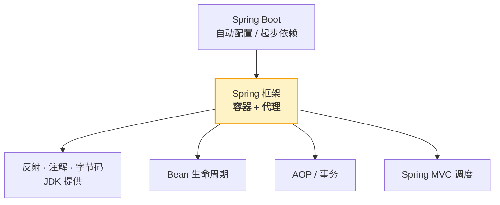

# Spring 核心原理

> 本质一句话：**Spring 的所有"魔法"都来自两件事——容器替你 new 对象，代理替你包方法**。理解了这两句，IoC、AOP、事务失效、循环依赖全是它的推论。

**优先级 P0（面试必考）**：IoC、AOP、Bean 生命周期、循环依赖、事务，是 Spring 岗位的必答组合拳。

::: tip 读者定位
你已经掌握 NestJS 的 DI 心智（Module / providers / 构造器注入）。这篇是把那套心智往下挖一层：容器怎么管 Bean、循环依赖怎么破、代理怎么织入、事务为什么失效。
:::

## 0. 全景：三分钟看懂这篇

> 难度：了解

**它在哪**：本篇不讲怎么用（那是 [Spring Boot 入门](/service/java/spring-boot) 的事），只讲**为什么能这样用**。它站在 JDK 之上、Spring Boot 之下——反射和注解提供地基，Spring 用它搭出容器和代理，Spring Boot 再在上面包装成"开箱即用"。



**分五块**：

| 块 | 内容 | 读到什么程度 |
|---|---|---|
| 1 用途 | 这些原理在什么场合救你 | 知道该查哪一条 |
| 2 最小可用 | 亲手看一眼"代理对象长什么样" | 动手跑一次 |
| 3 用法 | 容器、生命周期、AOP、循环依赖、事务、MVC 链路、自动配置 | 能讲清每个机制做什么 |
| 4 原理 | 为什么必须代理、为什么三级缓存、为什么需要 Adapter | 能回答"为什么这么设计" |
| 5 边界与坑 | 事务失效、循环依赖的例外、传播行为的连接代价 | 面试和线上都能对上 |

**学完你能**：① 把"Bean 从哪来、什么时候被代理"讲成一条线；② 面试被问循环依赖能画出三级缓存流转；③ 线上遇到"事务没回滚"时按顺序排查，而不是瞎猜。

**本篇讲什么、不讲什么**：

| 知识点 | 档位 | 处理 |
|---|---|---|
| IoC 容器本质、组件扫描 | 核心 | 正文 3.1 |
| Bean 生命周期与代理创建时机 | 核心 | 正文 3.2、4.1 |
| JDK 代理 vs CGLIB | 核心 | 正文 4.2 |
| 循环依赖三级缓存 | 核心 | 正文 3.4、4.3 |
| 事务失效、传播行为 | 核心 | 正文 3.5、5.2 |
| DispatcherServlet 请求链路 | 核心 | 正文 3.6 |
| 自动配置原理 | 核心 | 正文 3.7 |
| BeanFactory vs ApplicationContext | 进阶 | 正文 6 一句话 |
| Spring 源码逐行解读 | — | 不写，本文只讲机制与设计意图 |
| 响应式 WebFlux | — | 不写 |

---

## 1. 用途：什么时候用得上

> 难度：了解

这不是"为了面试"的知识。四种真实场景：

| 场景 | 用哪块原理 |
|---|---|
| 面试（P0） | 全套：IoC / 生命周期 / 循环依赖 / 事务失效 / MVC 链路 |
| 线上"事务没回滚" | 3.5 + 5.2：先看是不是自调用，再看异常有没有抛出去 |
| 启动报 `BeanCurrentlyInCreationException` | 3.4：构造器注入的循环依赖，三级缓存救不了 |
| 想给所有 Service 加统一日志/耗时 | 3.3 + 4.2：知道 AOP 走哪种代理，才不会遇到"改了不生效" |

**什么时候不用深究**：只写业务代码、不排查框架问题时，知道"容器管对象、注解在方法上加能力"就够了。下面这些是给"要解释、要排错、要面试"的人准备的。

### 1.1 给 NestJS 读者的锚点表

| 概念 | NestJS 心智 | Spring 实际 | **关键差异** |
|---|---|---|---|
| Bean 注册 | 在 Module 的 providers 里显式声明 | 组件扫描，扫到就算 | 忘了声明在 Nest 会报错；在 Spring 是**扫不到才报错**，且不告诉你在哪 |
| 作用域 | 默认单例 | 默认单例 | 单例里放可变字段 = 全局共享，前端写惯了每请求新建 |
| 依赖注入 | 构造器注入 | 构造器注入（推荐） | 字段 `@Autowired` 不报错但难测、隐藏依赖 |
| 切面 | Interceptor（洋葱） | AOP 代理（单层是包装，多层才是洋葱） | **单切面时 `proceed()` 调的是目标方法本身**，不是下一个"中间件" |
| 事务 | 手动 `queryRunner` | `@Transactional` 声明式 | 声明式靠代理，**自调用一定会失效**（Nest 里手动管理不会） |
| 请求链路 | 中间件一条链到底 | 前端控制器 + 一堆可替换组件 | Spring 有 `DispatcherServlet` 这个唯一入口，中间件只是链上第一段 |

> **自检**：为什么 NestJS 里不太会遇到"事务失效"，而 Spring 里天天遇到？

::: details 参考答案
因为 NestJS/TypeORM 的事务通常在**调用处手动管理**（`queryRunner` 或 `transaction()` 显式包裹），代码写在哪就在哪执行；Spring 是**声明式**，靠代理在方法调用前后插逻辑——只要调用没经过代理（自调用、new 出来的对象），事务就不存在，而且不会报错。
:::

---

## 2. 最小可用：亲眼看见代理

> 难度：了解

原理篇最容易"看懂了但没真信"。十分钟做一件事：**确认你注入的到底是不是原始对象**。

```java
@Service
public class OrderService {
    @Transactional
    public void createOrder() {
        // 关键：打印自己真实的类型
        System.out.println(this.getClass().getName());
    }
}
```

- 如果打印 `com.example.OrderService` —— 容器里放的是**原始对象**，事务不会生效
- 如果打印 `com.example.OrderService$$SpringCGLIB$$0` —— 是**代理**，事务生效

为什么会有差别？因为代理只在需要时才创建（方法上有 `@Transactional` / `@Async` / `@Cacheable`，或者类匹配了切点）。没有这些注解，Spring 懒得包一层。

再看一眼容器里的 Bean：

```java
@Autowired
private ApplicationContext ctx;

public void dump() {
    System.out.println(ctx.getBean("orderService").getClass().getName());  // 代理类名
}
```

> **自检**：一个类没有任何 AOP 注解，也没被切点匹配，`getBean()` 拿到的是代理吗？

::: details 参考答案
不是，是原始对象。Spring 只在"需要增强"时才创建代理（有 `@Transactional`/`@Async`/`@Cacheable`，或被某个切面的切点表达式命中）。这也解释了一个常见困惑：为什么有的 Bean 加了注解"看起来变了"，有的没变——没变说明它压根没被代理。
:::

---

## 3. 用法：七个必考机制

> 难度：会用

这一章讲"每个机制在做什么、怎么触发"，第 4 章再讲"为什么这么设计"。

### 3.1 IoC 容器：本质是一个 Map

IoC（**Inversion of Control，控制反转**）说的是：对象的创建权从"你自己 new"反转给容器。

> 术语先对齐：**IoC 是目标**（创建权交给容器），**DI（Dependency Injection，依赖注入）是手段**（容器在构造时把依赖塞给你）。两者的完整解释和前端对照见 [Spring Boot 篇的 3.1](/service/java/spring-boot#_31-ioc--di-与三层分层)。

容器内部就两层结构：

```text
ApplicationContext
  ├── beanDefinitionMap : Map<beanName, BeanDefinition>   ← 登记表（类名、作用域、依赖）
  └── singletonObjects  : Map<beanName, Object>           ← 单例池（成品实例）
```

`@Service` 这类注解只干一件事：让扫描器把这条"登记信息"放进第一张表。真正的 `new` 发生在容器启动的实例化阶段（4.1）。

```java
@Service
public class UserService { }

@RestController
public class UserController {
    private final UserService userService;

    public UserController(UserService userService) {   // 容器按类型找到 Bean 注入
        this.userService = userService;
    }
}
```

### 3.2 Bean 生命周期

```text
① 实例化（调构造器）
② 属性填充（依赖注入）
③ 初始化前：@PostConstruct → InitializingBean.afterPropertiesSet()
④ 初始化：initMethod（@Bean(initMethod="...")）
⑤ 初始化后：AOP 代理在这里创建并替换 Bean
⑥ 使用中
⑦ 销毁：@PreDestroy → DisposableBean.destroy()
```

**第 ⑤ 步是整篇的核心**：代理是在"对象已经完整"之后才包的。所以 Bean 自己内部调用自己时，拿到的永远是原始对象——这是事务/AOP/异步失效的统一原因。

### 3.3 AOP：两种代理

| 方式 | 条件 | 原理 | 限制 |
|---|---|---|---|
| **JDK 动态代理** | 目标类**实现了接口** | `Proxy.newProxyInstance` 生成接口的实现类，调用经 `InvocationHandler` | 只能通过接口方法调用（注入时按接口类型） |
| **CGLIB** | 目标类**没实现接口**（或强制开启） | 生成目标类的子类，重写方法 | 类/方法不能 `final`；`private` 拦不到 |

Spring Boot 2.x 起**默认强制 CGLIB**（`spring.aop.proxy-target-class=true`），所以你会看到 `$$SpringCGLIB$$` 那种类名。

```java
@Aspect
@Component
public class LogAspect {
    @Around("@annotation(com.example.Log)")
    public Object log(ProceedingJoinPoint pjp) throws Throwable {
        long start = System.currentTimeMillis();
        Object result = pjp.proceed();                 // 执行被代理的方法
        System.out.println("耗时: " + (System.currentTimeMillis() - start) + "ms");
        return result;
    }
}
```

### 3.4 循环依赖：三级缓存

**现象**：A 依赖 B，B 依赖 A。创建 A 时要 B，创建 B 时又要 A，看起来是死锁。

**Spring 的办法**：A 实例化完（还是个空对象），就**提前把自己的引用暴露出去**，先让 B 拿到用着，等 A 填充完属性再补全。

三级缓存就是三个 Map，各管一段：

| 级别 | 名字 | 装什么 |
|---|---|---|
| 一级 | `singletonObjects` | 成品 Bean |
| 二级 | `earlySingletonObjects` | 半成品（实例化了，但属性还没填） |
| 三级 | `singletonFactories` | **lambda 工厂**（能延迟决定要不要生成代理） |

流转（A 依赖 B，B 依赖 A）：

```text
创建 A → 实例化 A（空对象）→ 把 A 的工厂放进三级缓存
  → 填充 A 的属性，需要 B → 去创建 B
    → 实例化 B → 填充 B 的属性，需要 A
      → 三级缓存找到 A 的工厂 → 调它拿到 A 的引用（必要时现场生成代理）→ 放进二级缓存 → 注入给 B
  → B 完成后进一级缓存
→ A 继续填充，拿到 B → A 完成，进一级缓存，清理二三级
```

**适用范围（很重要）**：只对**单例** + **setter/字段注入**有效。构造器注入的循环依赖无解——因为实例化那一刻就需要对方，没有"空对象"可以先暴露，直接抛 `BeanCurrentlyInCreationException`。

**为什么构造器注入就无解？** 看两种写法的对比就清楚了。

#### 写法一：构造器注入（循环依赖 → 启动直接失败）

```java
@Service
public class OrderService {
    private final StockService stockService;

    public OrderService(StockService stockService) {   // ← 构造器就要 StockService
        this.stockService = stockService;
    }
}

@Service
public class StockService {
    private final OrderService orderService;

    public StockService(OrderService orderService) {   // ← 构造器又要 OrderService
        this.orderService = orderService;
    }
}
```

启动时容器做的事：

```text
实例化 OrderService → 调构造器 → 需要 StockService
  → 实例化 StockService → 调构造器 → 需要 OrderService
    → OrderService 正在创建中（还没实例化完）→ 找不到
      → 💥 BeanCurrentlyInCreationException
```

**死在哪**：构造器执行完，对象才算"存在"。而构造器**必须**拿到参数才能执行完。于是双方都在等对方先"存在"——**这不是死锁，是根本没法开始**。三级缓存那套"先暴露半成品"救不了它，因为**此刻连半成品都还没有**（`new OrderService()` 这一行还没执行到）。

#### 写法二：setter 注入（循环依赖 → 能启动）

```java
@Service
public class OrderService {
    private StockService stockService;

    public OrderService() {}                    // ① 无参构造器，先把对象造出来

    @Autowired
    public void setStockService(StockService s) {  // ② 之后再填
        this.stockService = s;
    }
}
```

（`StockService` 同理，改成 setter 注入。）

```text
实例化 OrderService（无参构造器，此时是个空壳）→ 放进三级缓存 ✅
  → 填充属性：需要 StockService
    → 实例化 StockService（也是空壳）→ 放进三级缓存
      → 填充属性：需要 OrderService
        → 三级缓存找到了！拿到 OrderService 的引用（此时它还是个空壳）
          → 塞给 StockService
    → StockService 完成，进一级缓存
  → OrderService 拿到 StockService → 完成
```

**能成功的原因**： setter 注入把"造对象"和"填依赖"拆成了两步。第一步只需要一个空壳，对象**已经存在**了，三级缓存才有东西可以提前暴露。

#### 但写法二有坑：拿到的是"半成品"

```java
@Service
public class StockService {
    private OrderService orderService;

    public StockService() {}

    @Autowired
    public void setOrderService(OrderService orderService) {
        this.orderService = orderService;
    }

    public void deduct() {
        orderService.getUserName();      // ⚠️ 此时 orderService 的字段可能还是 null
    }
}
```

因为注入发生在**构造器之后**，B 拿到的 A 可能是"属性还没填完"的半成品。B 立刻调 A 的方法、而 A 依赖的字段还是 null → **运行期 NPE**。

构造器注入恰好反过来：**对象一造出来就是完整的**（所有依赖都在构造器里确定了），不存在半成品窗口。所以 Spring 官方从 4.3 起推荐构造器注入，不是风格问题，是**它能暴露循环依赖**——setter 的循环依赖能启动，但可能留个运行期的坑。

#### 第三条路：`@Lazy` 骗过容器

```java
@Service
public class OrderService {
    private final StockService stockService;

    public OrderService(@Lazy StockService stockService) {   // 注入的是代理，不是真身
        this.stockService = stockService;
    }
}
```

`@Lazy` 让容器注入一个**延迟代理**，真正调用 `stockService.xxx()` 时才去拿 bean。此刻容器不需要立刻造出 `StockService`，循环就断了。

但这是**治症状不治病因**：依赖关系还是环形的，只是被代理藏起来了。

#### 第四条路：重构（真正该做的）

环形的依赖通常说明**职责没划清**。上面的例子本质是"订单和库存互相需要"，正确做法是抽出一个双方都依赖的东西：

```java
@Service
public class OrderService {
    private final StockChecker stockChecker;      // 都依赖它
    public OrderService(StockChecker stockChecker) { ... }
}

@Service
public class StockService {
    private final StockChecker stockChecker;      // 不再互相依赖
    public StockService(StockChecker stockChecker) { ... }
}
```

**依赖图应该是单向的树，不该有环。** 面试时给出这条，比背"三级缓存"更有说服力。


### 3.5 事务：AOP 的一个应用

`@Transactional` 的本质：容器给这个 Bean 包一层代理，方法进入前开启事务、正常返回提交、抛异常回滚。

所以"事务失效"几乎等价于"代理没生效"，清单见 5.2。

**传播行为**回答另一个问题：**A 事务方法里调了 B 事务方法，B 用谁的事务？**

##### 先把问题本身讲清楚

"事务"在 Spring 里对应**一个数据库连接 + 一段要么全成要么全败的操作**。所以"B 用谁的事务"本质上是在问：**B 是不是跟 A 共用同一个连接？**

什么时候会出现这种"事务里套事务"？**一个业务动作拆成了多个方法**：

```java
@Service
public class OrderService {

    @Transactional
    public void createOrder(Long userId) {
        stockService.deduct(...);      // ① 扣库存
        flowService.write(...);        // ② 写流水
    }
}
```

现在问题来了：假设 ② 写流水失败了，① 扣的库存**要不要一起回滚**？

- **要** → 两者必须共用一个事务、同一个连接 → 这叫 REQUIRED
- **不要**（库存必须扣，流水日志必须留下）→ ② 得自己开一个独立事务 → 这叫 REQUIRES_NEW

**Spring 默认选前者**（REQUIRED），因为大多数业务动作是要么全成要么全败。**传播行为就是让你为这两种需求分别指定规则。**

还有一个关键前提：**传播行为只在"B 自己也标了 `@Transactional`"时才起作用**。如果 B 没标，B 默认就跟着 A 的事务跑（等价于 REQUIRED）。

##### 七种传播行为

| 传播行为 | B 用谁的事务 | 连接 | A 回滚时 B 会怎样 | 典型用途 |
|---|---|---|---|---|
| **REQUIRED**（默认） | 加入 A 的事务 | 与 A **共用** | 一起回滚 | 绝大多数业务 |
| **REQUIRES_NEW** | **总是新建**，把 A 的挂起 | 与 A **各占一条** | **不受影响**，B 已提交 | 审计日志：主流程失败也要留痕 |
| SUPPORTS | 有就加入，没有就非事务跑 | 有则共用 | 跟着 A | 查询方法（无所谓事务） |
| NOT_SUPPORTED | 非事务跑，挂起 A | 不占连接 | 不受影响 | 事务里夹的耗时操作 |
| MANDATORY | 必须有外层事务，否则抛异常 | 与 A 共用 | 一起回滚 | 强制必须在事务内调用 |
| NEVER | 必须没有事务，否则抛异常 | — | — | 强制脱事务执行 |
| **NESTED** | 有就建**保存点**，没有等同 REQUIRED | 与 A **共用** | 保存点之后的操作撤销 | 子步骤失败只想回滚子步骤 |

##### 用代码看两个最关键的

**REQUIRED（默认）—— 共用一条连接，一起生死**

```java
@Service
public class OrderService {
    @Transactional
    public void createOrder(Long userId) {
        stockService.deduct(...);          // REQUIRED，加入外层事务
        flowService.write(...);            // 失败 → 整个回滚，库存也白扣
    }
}
```

```text
createOrder 开事务 → 拿连接 C1
  → deduct：加入同一事务，用 C1
  → write：加入同一事务，用 C1
    → 抛异常 → 回滚 → C1 上的一切都没了 ✅
```

**REQUIRES_NEW —— 各自一条连接，互不相干**

```java
@Service
public class OrderService {
    @Transactional
    public void createOrder(Long userId) {
        stockService.deduct(...);          // REQUIRED
        auditService.log(...);             // REQUIRES_NEW，自己开新事务
    }
}

@Service
public class AuditService {
    @Transactional(propagation = Propagation.REQUIRES_NEW)
    public void log(String action) { ... }
}
```

```text
createOrder 开事务 → 拿连接 C1
  → deduct：用 C1
  → log：挂起 C1 的事务，另开一条连接 C2
          → log 自己提交 ✅（C2 上的数据已经落库）
  → 回到外层
  → 假设 deduct 抛异常 → C1 回滚
    → 库存没扣，但审计日志已经在 C2 里留下了 ← 这正是审计想要的
```

**注意这里的关键差别**：外层回滚**救不回** `REQUIRES_NEW` 的数据——它已经在另一个连接上提交了。

##### 两组必背对比

```text
REQUIRED vs REQUIRES_NEW
  REQUIRED：同一个物理事务、共用连接，外层回滚 → 内层一起滚
  REQUIRES_NEW：新事务 + 独立连接，外层回滚 → 内层已提交，不受影响

REQUIRES_NEW vs NESTED
  REQUIRES_NEW：真正的新事务，提交即落库，外层回滚也救不回来
  NESTED：同一事务里的保存点，外层回滚 → 保存点之后的操作全部撤销
```

**NESTED 存在的意义**：同样是"子步骤失败只回滚子步骤"，它比 `REQUIRES_NEW` 省一条连接——因为它不另开事务，只在当前事务里打个**保存点**（savepoint），失败时回滚到保存点，外层还能继续跑。

##### 两个实战坑

**① `REQUIRES_NEW` 会多占一条连接**

外层事务握着 C1 不放，`REQUIRES_NEW` 又要 C2 —— 一次请求占两条连接。嵌套两层就是三条。Hikari 默认池子只有 10 条，几十并发就把池子占满，报错是"**等连接超时**"，而数据库其实很闲（详见 5.4）。

**② 同类自调用，传播行为也失效**

```java
public void a() { b(); }              // this.b()，不走代理
@Transactional(propagation = REQUIRES_NEW)
public void b() { ... }               // 这个 REQUIRES_NEW 根本没生效
```

和 `@Transactional` 一样（见 4.3 的代理机制）——`this.b()` 走的是原始对象，绕过了代理。

##### 面试怎么答

**问：A 事务方法调 B 事务方法，B 用谁的事务？**

> 看 B 的传播行为。默认 REQUIRED，B 加入 A 的事务、共用同一个连接，A 回滚 B 一起回滚；如果 B 是 REQUIRES_NEW，就挂起 A 的事务自己开一条连接独立提交，A 回滚也影响不到它。常见的实际场景是审计日志用 REQUIRES_NEW——主流程失败也要留下痕迹。

**追问：REQUIRES_NEW 有什么代价？**

> 多占一条数据库连接，嵌套深或并发高时会耗尽连接池，表现为"等连接超时"而不是慢 SQL；另外它和同类自调用叠加时不会生效（不走代理）。

### 3.6 Spring MVC：一个请求怎么走到你的方法

前端最容易答错的一题——因为 Express/Koa 是"一条中间件洋葱走到底"，Spring 是**前端控制器 + 一堆可替换组件**：所有请求先进同一个 Servlet，再由它调度。

```text
HTTP 请求
 → Filter 链（Servlet 规范层：编码 / CORS / token）
 → DispatcherServlet.doDispatch()          ← 唯一入口
     ① HandlerMapping  这个 URL 归谁处理 → 拿到 handler + 拦截器列表
     ② HandlerAdapter  用适配器去调用（handler 可能不是一个普通方法）
     ③ 参数解析 @RequestBody / @PathVariable / @RequestParam
     ④ 执行 Controller → Service → Repository
     ⑤ 返回值处理：@ResponseBody → HttpMessageConverter（Jackson 转 JSON）
        否则 → ViewResolver 找模板（前后端分离走不到）
 → 出 Filter 链 → 响应
异常 → HandlerExceptionResolver（@RestControllerAdvice 在这一步接管）
```

九大组件里答出前四个就够：`HandlerMapping`、`HandlerAdapter`、`HandlerExceptionResolver`、`ViewResolver`。

### 3.7 自动配置：条件装配

```java
@SpringBootApplication  // = @SpringBootConfiguration + @EnableAutoConfiguration + @ComponentScan
```

**先回答一个决策问题：什么时候需要它？**

自动配置解决的是「**应用的基础设施默认值**」问题。判断标准三条：**配置量大 / 没业务含量 / 每个项目都一模一样**。

| 场景 | 需要吗 | 例子 |
|---|---|---|
| 写一个 **Spring Boot 应用** | ✅ 绝大多数情况需要 | 内嵌 Tomcat、DispatcherServlet、MVC、Jackson、文件上传、错误页、线程池…… |
| 写一个 **库 / SDK**（给别人调用的 jar） | ❌ 不需要 | 库不该自带 Tomcat 和 Jackson |
| 写 **CLI 工具 / 批处理** | ⚠️ 部分需要 | 要日志和配置解析，不要 web 和 JPA |
| 用 **原生 Spring（不用 Boot）** | ❌ 没有这机制 | 全手写 XML / 配置类 |
| 要**深度定制**某个基础设施 | ⚠️ 自动配置只是起点 | 用自己的 Bean 覆盖掉它 |
| **多数据源 / 动态数据源** | ❌ 自动配置帮不上 | 通常要排除默认那份，自己写 |

一句话：**自动配置属于"应用"，不属于"库"**。

**它到底替你做了什么？** 下面这份清单是**实测数据**——一个只有 3 个依赖、零配置的 demo 项目（`spring-boot-starter-webmvc` + 两个 test starter），启动时实际生效的 15 个自动配置：

```
TomcatServletWebServerAutoConfiguration     ← 起内嵌 Tomcat
DispatcherServletAutoConfiguration         ← 注册 DispatcherServlet + 路径映射
WebMvcAutoConfiguration                    ← 视图解析器、静态资源映射、路径匹配
JacksonAutoConfiguration                   ← ObjectMapper + JSON 序列化规则
HttpMessageConvertersAutoConfiguration     ← 消息转换器（JSON / String / 字节）
HttpEncodingAutoConfiguration              ← 字符编码过滤器
MultipartAutoConfiguration                 ← 文件上传解析器
ErrorMvcAutoConfiguration                  ← 错误页 / /error 端点
PropertyPlaceholderAutoConfiguration       ← ${} 占位符解析
TaskExecutionAutoConfiguration             ← 线程池
TaskSchedulingAutoConfiguration            ← 定时任务基础设施
AopAutoConfiguration                       ← AOP 代理开关
LifecycleAutoConfiguration                 ← 启动 / 关闭钩子
ApplicationAvailabilityAutoConfiguration
SslAutoConfiguration
```

**这些就是"你没写但已经拥有"的东西。** 对照着看一遍就知道：如果自己手写，Tomcat + DispatcherServlet + MVC + Jackson + 上传 + 编码 + 错误页 + 线程池这一套，至少是几十行配置起步。

**反例：什么时候它是个麻烦**

自动配置的行为是「**有依赖就配**」，不是「你配了才用」。引了 JPA 依赖，它就认为你要用数据库：

```text
pom 里有 starter-data-jpa → 条件成立 → 自动配置要建 DataSource
  → 但 application.properties 里没有 url，也没有内嵌库
    → 建不出来 → 整个容器启动失败
```

**你不能靠"我不写 url"让它别管这件事。** 两种选择：

| 想要 | 怎么做 |
|---|---|
| 我要用数据库 | 补 `spring.datasource.url` 等配置 |
| 我不用数据库 | **把 JPA 依赖删掉**，或排除 `DataSourceAutoConfiguration` |

#### 三个步骤

**① 读清单**

`@EnableAutoConfiguration` 会去读 classpath 上所有 jar 里的这份文件：

```
META-INF/spring/org.springframework.boot.autoconfigure.AutoConfiguration.imports
```

里面是一行一个自动配置类的全限定名。Boot 4.0.10 的 `spring-boot-autoconfigure` 里真实内容长这样（只有 12 条）：

```
org.springframework.boot.autoconfigure.aop.AopAutoConfiguration
org.springframework.boot.autoconfigure.jackson.JacksonAutoConfiguration
org.springframework.boot.autoconfigure.task.TaskExecutionAutoConfiguration
...
```

**② 逐个判断条件**

清单里的每个类都带条件注解，条件不成立就**整个跳过**（连类都不会加载）：

| 注解 | 判断依据 | 真实例子 |
|---|---|---|
| `@ConditionalOnClass` | classpath 上**有这个类** | `@ConditionalOnClass({ DataSource.class, EmbeddedDatabaseType.class })` → "你引了 JDBC 驱动，我才配 DataSource" |
| `@ConditionalOnMissingBean` | 容器里**还没有**这个类型的 Bean | `@ConditionalOnMissingBean(DataSource.class)` → "你自己配了 DataSource，我就不配了" |
| `@ConditionalOnProperty` | **配置项**满足条件 | `@ConditionalOnProperty(name = "spring.datasource.url")` |
| `@ConditionalOnBean` | 容器里**已经有**某个 Bean | `@ConditionalOnBean(DataSource.class)` → "有数据源了，我才建依赖它的东西" |
| `@ConditionalOnBooleanProperty` | 布尔开关 | `spring.aop.auto=true` → 才会开 AOP |
| `@ConditionalOnWebApplication` | 当前是不是 Web 应用 | 非 Web 应用跳过 MVC 那一套 |

以 `DataSourceAutoConfiguration` 为例（真实存在于 `spring-boot-jdbc` 模块），结构大致是：

```java
@AutoConfiguration(before = DataSourceInitializationAutoConfiguration.class)
public class DataSourceAutoConfiguration {

    @ConditionalOnClass({ DataSource.class, EmbeddedDatabaseType.class })
    @ConditionalOnMissingBean(type = "io.r2dbc.spi.ConnectionFactory")
    @EnableConfigurationProperties(DataSourceProperties.class)
    public static class PooledDataSourceConfiguration {   // 命名空间 = 池化数据源

        @Bean
        @ConditionalOnMissingBean(DataSource.class)        // 关键：容器里没有 DataSource 才建
        @ConfigurationProperties("spring.datasource")     // 属性从 spring.datasource.* 读
        public DataSource dataSource(DataSourceProperties properties) {
            return DataSourceBuilder.create()
                    .type(properties.getType())
                    .url(properties.getUrl())
                    .username(properties.getUsername())
                    .password(properties.getPassword())
                    .build();
        }
    }
}
```

**③ 条件成立就注册 Bean**

于是你引了 `spring-boot-starter-data-jpa` + MySQL 驱动 → `DataSourceAutoConfiguration` 条件全成立 → 替你建好 `DataSource`（Hikari）+ 读 `spring.datasource.*` → 再由 `HibernateJpaAutoConfiguration` 建 `EntityManagerFactory`。**你一个 `@Bean` 都没写。**

**Boot 4 的变化**：清单不再是"一个大 jar 里一份"，而是**按模块拆分**——`spring-boot-autoconfigure` 只放通用的 12 条，`DataSource`、`Jackson`、`JdbcTemplate` 这些各在自己的模块 jar 里（`spring-boot-jdbc`）带一份自己的清单。所以"清单里有这个类"的前提是**那个模块的 jar 在 classpath 上**，而 starter 正是把这些模块 jar 一起带进来的东西。

#### 开发者能控制条件吗

**能，但控制的是"输入"，不是条件本身。** 条件是框架按输入算出来的结果：

| 你的杠杆 | 怎么用 | 影响哪个条件 |
|---|---|---|
| **加 / 减依赖** | 引 `starter-data-jpa` / 不引 | `@ConditionalOnClass` |
| **改配置项** | `application.yml` 写 `spring.datasource.url=...` | `@ConditionalOnProperty` |
| **自己定义同类型 Bean** | 写一个 `DataSource` Bean | `@ConditionalOnMissingBean`（框架让位） |
| **主动排除** | `spring.autoconfigure.exclude=...` | 直接不参与评估 |

**关掉它的三种手段，粒度不同**：

**① 换掉（最常用）**——定义同类型 Bean，`@ConditionalOnMissingBean` 让位：

```java
@Bean
public DataSource dataSource() {
    return DataSourceBuilder.create().url("jdbc:mysql://other-host/db").build();
}
```

注意这是**替换**不是关闭：框架那份不生效了，你这份生效。

**② 排除整个自动配置类**：

```yaml
spring:
  autoconfigure:
    exclude:
      - org.springframework.boot.autoconfigure.jdbc.DataSourceAutoConfiguration
```

```java
@SpringBootApplication(exclude = DataSourceAutoConfiguration.class)
```

**③ 只关掉其中一个 Bean**——多数自动配置内部是 `@ConditionalOnMissingBean` 的嵌套配置类，排除整个类会连别的 Bean 一起干掉。这时通常用 ① 顶掉它。

**⚠️ 排除 ≠ 它依赖的东西就没了。** 排除掉 `DataSourceAutoConfiguration`，但 `starter-data-jpa` 还在 classpath 上 → JPA 的自动配置照样跑 → 去找 `DataSource` bean → **找不到**（唯一能造它的那份被排除了）→ 启动照样失败。**排除前先看它是不是被别人依赖着**，用 `--debug` 的报告查最快。

#### 怎么验证自动配置做了什么

**启动时加 `--debug`**（或 `spring.main.log-startup-info=true`），会打印一份**条件评估报告**：

```
Positive matches:
   DataSourceAutoConfiguration matched:
      - @ConditionalOnClass (found: "javax.sql.DataSource" "org.springframework.jdbc.datasource.embedded.EmbeddedDatabaseType")
Negative matches:
   RedisAutoConfiguration:
      - @ConditionalOnClass did not match (missing: "redis.clients.jedis.Jedis")
```

正匹配 = 生效了，负匹配 = 因为缺什么而跳过。**这份报告是排查"为什么我的 Bean 没被创建"的第一手工具**——上次那个 `Failed to determine a suitable driver class` 的报错里就提示了 `re-run your application with 'debug' enabled`，指的就是这个。

报告里能读出的信息很具体，比如上面这个 demo 的 AOP 判定：

```
AopAutoConfiguration matched:
   - @ConditionalOnBooleanProperty (spring.aop.auto=true) matched (OnPropertyCondition)
AopAutoConfiguration.ClassProxyingConfiguration matched:
   - @ConditionalOnMissingClass did not find unwanted class 'org.aspectj.weaver.Advice'
   - @ConditionalOnBooleanProperty (spring.aop.proxy-target-class=true) matched
```

**类名、条件类型、命中原因**全列出来——`OnClassCondition` / `OnBeanCondition` / `OnPropertyCondition` 分别对应上面那张表里的三种条件。

**注意报告是启动时算一次的，之后不能改**——所以"条件不满足"不是"等一会儿就满足了"，只能改输入后重启。

#### 一个延伸：starter 的本质

自动配置不只是官方提供的——**你写的第三方 starter 也能提供自动配置**，原理完全一样：

```text
starter = 依赖 jar  +  一份 AutoConfiguration.imports 清单  +  若干条件配置类
```

所以 Spring Boot 3 之后甚至允许 starter **不依赖任何 jar**，纯靠自动配置提供能力。

#### 前端类比

这套机制像 Vite / webpack 的插件条件启用——`import` 了某个插件、且满足它的条件（版本、依赖、配置项），就自动生效；你手动提供了同名实现，插件就检测到并跳过。差别是 Java 这边是**扁平的一串 jar 路径**（classpath），所以会有"版本冲突"这种 Node 不存在的问题——两个版本的同一个 jar 都在 classpath 上，排在前面的赢。

#### 面试怎么答

**问：Spring Boot 的自动配置原理？**

> 启动时 `@EnableAutoConfiguration` 读取 classpath 上各 jar 里的 `AutoConfiguration.imports` 清单，逐个评估这些自动配置类上的条件注解（`@ConditionalOnClass` 看 classpath 有没有、`@ConditionalOnMissingBean` 看容器里有没有、`@ConditionalOnProperty` 看配置项），条件成立的才注册对应 Bean。所以"引 starter 就自动配好"本质是**依赖 → 条件成立 → 自动装配**。要覆盖就自己定义同类型 Bean，`@ConditionalOnMissingBean` 会让位。Boot 3 起清单文件从 `spring.factories` 迁到了 `META-INF/spring/...imports`，Boot 4 又进一步按模块拆分。

---

## 4. 原理：为什么必须这么设计

> 难度：懂原理

### 4.1 为什么一定要有代理

需求是：**在不改你代码的前提下，在方法前后插一段逻辑**（开事务、打日志、算耗时）。JDK 只有两种办法：

| 办法 | 代价 |
|---|---|
| 让你手动调 `tx.begin()` / `tx.commit()` | 每个方法都要写，忘了就错 |
| 编译期改字节码 | 构建链路变重，且无法按配置动态开关 |
| **运行期生成一个"替身"对象** | 只多一个类，业务代码零改动 |

Spring 选了第三种。代价是：**你手上的引用可能不是你的对象**。所有"注解不生效"的问题，本质都是"你以为在调 A，实际调用没经过替身"。

一个直观对照——代理对象长这样：

```text
调用方 → orderService（代理）
             ├─ 进方法前：开启事务
             ├─ 调用真实对象.createOrder()
             └─ 正常返回：提交；抛异常：回滚
```

而 `this.createOrder()` 里的 `this` 指向**真实对象内部**，替身完全不知道有这次调用。

### 4.2 为什么 Spring Boot 默认用 CGLIB

早期 Spring 默认「有接口用 JDK 代理，没接口用 CGLIB」。这个规则本身没道理，踩的两个坑也都源于**JDK 代理生成的对象到底长什么样**。

#### 先看清两种代理生成的对象

JDK 动态代理是**运行时**用接口数组造一个对象出来，这个对象：

- **只实现你传给它的接口**
- **完全不继承你的实现类**（它继承的是 `java.lang.reflect.Proxy`）

这段代码可以直接跑（不依赖 Spring）：

```java
interface UserService { String hello(); }
static class UserServiceImpl implements UserService {
    public String hello() { return "hi"; }
}

public static void main(String[] args) {
    UserServiceImpl real = new UserServiceImpl();

    Object jdkProxy = Proxy.newProxyInstance(
            Demo.class.getClassLoader(),
            new Class<?>[]{UserService.class},      // ← 只给接口
            (p, m, a) -> m.invoke(real, a));

    System.out.println(jdkProxy.getClass().getName());        // $Proxy0
    System.out.println(jdkProxy instanceof UserService);       // true
    System.out.println(jdkProxy instanceof UserServiceImpl);   // false ！
    UserServiceImpl x = (UserServiceImpl) jdkProxy;            // ClassCastException
}
```

**实测输出**：

```
JDK 代理类名 : $Proxy0
是不是 UserService 的实例?      true
是不是 UserServiceImpl 的实例?  false
强转失败 -> ClassCastException: class $Proxy0 cannot be cast to class Demo$UserServiceImpl
```

CGLIB 则是**生成一个子类**：

```text
UserServiceImpl$$SpringCGLIB$$0 extends UserServiceImpl
```

所以它是实现类的真子类，按实现类注入、按实现类强转都没问题。**两者的关键差异就这一条**：JDK 代理只实现接口，CGLIB 代理继承实现类。

#### 坑一：按实现类注入 → 启动直接失败

```java
@Service
public class UserServiceImpl implements UserService { ... }

@RestController
public class UserController {
    private final UserServiceImpl userService;   // ← 按实现类注入
}
```

容器里放的是 JDK 代理对象（只实现 `UserService`），而注入点要的是 `UserServiceImpl`。**类型不匹配**——这个类没法赋值给那个字段，Spring 在启动阶段就会抛异常（`BeanNotOfRequiredTypeException` 一类）。

而如果按接口注入：

```java
private final UserService userService;    // ✅ 代理对象实现了这个接口
```

就一切正常。

**这就是第一个坑：同一份代码，注入点写接口还是写实现类，结果完全不同。** 而"我明明 implements 了接口，为什么不能按实现类注入"这个问题非常违反直觉——因为在 Java 的普通语义里，实现类对象**应该**能赋给实现类变量，而代理对象偏偏不是实现类的实例。

#### 坑二：接口之外的方法既调不到、也增强不了

JDK 代理只暴露接口里声明的方法。假设 Service 这么写：

```java
@Service
public class OrderService implements UserService {

    @Override
    public String hello() { ... }          // 接口里有

    @Transactional                          // 接口里没有！
    public void createOrder(...) { ... }
}
```

用 JDK 代理时：

| 方法 | 能不能通过代理调用 | 事务/缓存注解生效吗 |
|---|---|---|
| `hello()`（接口声明） | 能 | ✅ |
| `createOrder()`（只在实现类里） | **调不到**——代理对象上根本没这个方法 | ❌ 即便调到也不会被增强 |

换成 CGLIB 就全好：代理是实现类的子类，**所有**方法都能被增强。

**所以"同一个 Service，加了接口就换了一种代理方式"的后果是**：类的行为悄悄变了——注解可能在某个方法上失效，而你在代码里看不出任何区别。这就是原文说的"行为不一致，排查时很迷惑"。

#### 所以 Spring Boot 2.x 起统一用 CGLIB

`spring.aop.proxy-target-class=true`（Boot 2.x 起的默认值），不再看有没有接口。**行为一致了**，代价是：

- 被代理的类**不能是 `final`**
- 被代理的方法**不能是 `final` / `private`**

**这也是 5.5 那类"注解静默失效"的来源**——切面织不进去，而且**不报错**。

> **前端类比**：CGLIB 是"生成一个原类的子类"，像 JS 里 `Object.create(原类)` 再覆盖方法；JDK 代理是"生成一个只认接口的新对象"，原类的方法只是被转发过去。前者保留了原类的全部方法，后者只暴露接口清单。
>
> **自检**：一个 Service 实现了接口，Controller 按实现类注入它。在 JDK 代理下会报什么错？在 CGLIB 下呢？

::: details 参考答案
JDK 代理下：容器里的 bean 是只实现接口的代理对象（`$ProxyXX`），不是 `UserServiceImpl` 的实例，赋给实现类类型的字段会抛 `BeanNotOfRequiredTypeException`（类型不匹配），启动失败。

CGLIB 下：代理对象是 `UserServiceImpl` 的子类，按实现类注入正常启动。

顺带一个推论：JDK 代理下，**只声明在实现类里、不在接口里的方法**通过代理调不到，方法上的 `@Transactional` / `@Cacheable` 也不会生效——CGLIB 没这个问题，因为它代理的是整个类。
:::
### 4.3 为什么是三级缓存而不是两级

两级也能解决循环依赖：一级放成品，二级放半成品。那第三级干什么？

关键在于 **AOP 代理什么时候生成**。考虑 A 被切面匹配：

- 如果 A 创建完就直接暴露**原始对象**，B 注入的就是原始对象，A 后续生成的代理对 B 无效——B 调用 A 时绕过了事务
- 如果一开始就生成代理，那所有 Bean 都得先造代理，哪怕它根本不需要（浪费，且代理依赖后置处理器，时机未必成熟）

第三级缓存放的是 **lambda 工厂**，把"要不要生成代理、生成哪一个"这个决定**延迟到真正有人来取的时候**。有人来取 → 现场判断是否需要代理 → 需要就生成并放进二级缓存 → 之后所有人拿到的都是同一个代理。

一句话：**三级缓存不是缓存对象，是缓存"生成对象的办法"。**

### 4.4 为什么要 HandlerAdapter

如果 DispatcherServlet 自己调 handler，代码会变成一串 `if (handler instanceof XxxHandler) ... else if ...`。而 handler 的形态至少有三种：注解方法（`@RequestMapping`）、`HttpRequestHandler`、函数式端点（`RouterFunction`）。

适配器把"调度"和"怎么调"拆开：新增一种 handler 只要加一个 Adapter，核心流程不动。这就是为什么面试爱问它——**它是"开闭原则"在框架里的落地样本**。

### 4.5 为什么 REQUIRED 是默认传播行为

因为最常见的业务语义就是：**一个业务动作 = 一个事务**。下单里调的扣库存、写订单，理应同生共死。`REQUIRES_NEW` 才是特殊需求（日志、审计），所以它不该是默认。

> **自检**：为什么 NESTED 能"只回滚子步骤"，而 REQUIRES_NEW 不能回滚已经被外层牵连的部分？

::: details 参考答案
NESTED 用的是**同一个事务里的保存点（savepoint）**：子步骤失败回滚到保存点，外层事务还活着，可以继续或整体回滚。REQUIRES_NEW 是**真开了一个新事务、新连接**，它的提交是独立落库的，外层即使回滚也撤销不了已经提交的那部分——所以它适合"必须留下"的日志，不适合"可回滚的子步骤"。
:::

---

## 5. 边界与坑

> 难度：会用 + 懂原理

### 5.1 一张表先过一遍

| 症状 | 见 |
|---|---|
| 事务注解写了，异常了却没回滚 | 5.2 |
| 启动报 `BeanCurrentlyInCreationException` | 5.3 |
| 并发一高就"等连接超时"，SQL 却不慢 | 5.4 |
| 给类加了 `final`，注解突然不生效 | 5.5 |
| 不同用户看到彼此的数据 | 5.6 |

### 5.2 事务失效的六种情况

**症状**：方法上有 `@Transactional`，中途抛异常，数据照样落库。**不报错，最难查。**

| 场景 | 原因 | 解法 |
|---|---|---|
| 同类内 `this.xxx()` | 不走代理（最常见） | 拆到另一个 Bean；或注入自身；或 `AopContext.currentProxy()` |
| 方法不是 public | CGLIB 子类无法覆写 private/protected | 改 public |
| 类或方法 `final` | CGLIB 无法继承 | 去掉 final |
| 异常被 catch 吞掉 | Spring 只看"异常有没有抛出方法" | catch 里 `setRollbackOnly()` 或重新抛 |
| 抛受检异常 | 默认只回滚 `RuntimeException` / `Error` | `rollbackFor = Exception.class` |
| Bean 不是容器管的 | 自己 `new` 出来的没有代理 | 交给容器 |

排查顺序建议：**先看 this 的类型（是不是代理）→ 再看方法签名 → 再看异常有没有抛出去**。前两条看代码，第三条看日志。

### 5.3 循环依赖的两类例外

三级缓存只救**单例 + setter/字段注入**。下面两种救不了，启动直接失败：

| 情况 | 为什么 | 解法 |
|---|---|---|
| 构造器注入的循环依赖 | 实例化那一刻就需要对方，没有"空对象"可提前暴露（两种写法的对比见 3.4） | 改用 setter 注入（**会留半成品的坑**）；或 `@Lazy` 注入代理；或**重构拆依赖**（推荐） |
| `prototype` 作用域的循环依赖 | 原型 Bean 不进缓存 | 重构，别在原型里互依赖 |

### 5.4 REQUIRES_NEW 会多占一个连接

**症状**：并发一高就报"获取连接超时"，但慢 SQL 日志里什么都没有。

**原因**：`REQUIRES_NEW` 会挂起外层事务、**再要一条新连接**。嵌套两层就是 2 条连接/请求，Hikari 默认池子只有 10 条，几十个并发就把池子占满——此时线程都在等连接，数据库其实很闲。

**解法**：审计日志这类场景，能异步就异步（MQ 或线程池，注意事务上下文不会跟过去）；必须同步时把嵌套层数压到 1 层，并给连接池留足余量。

### 5.5 final / private 导致的静默失败

**症状**：给类加了 `final`，或者把方法改成 `private`，事务/缓存突然不生效，**没有任何报错**。

**原因**：CGLIB 靠继承生成子类，`final` 类不能继承、`private` 方法不能覆写。

**解法**：需要被增强的方法必须是 **public + 非 final**。这是一条可以写进 code review 清单的硬规则。

### 5.6 单例 Bean 里存可变状态

**症状**：并发下 A 用户看到 B 用户的数据，或者莫名串号。

**原因**：Bean 默认单例，所有请求共享同一个实例。在字段里存 `currentUser`、`requestId` 这类请求级数据，等于开了个全局变量。

**解法**：状态放方法参数或局部变量；确实需要请求级共享，用 `RequestContextHolder` 或 `ThreadLocal`（记得在 finally 里清理，否则线程池复用会串数据）。

> **自检**：一个 Service 是单例，里面有个 `private int counter`，两个线程同时 `counter++`，最后一定是 2 吗？

::: details 参考答案
不一定。`counter++` 不是原子操作（读-改-写三步），两个线程可能都读到 0 再各自写 1，结果是 1。而且单例意味着这个字段被所有请求共享，语义上大概率就是设计错误。要计数用 `AtomicInteger`，要请求级状态就别放字段。
:::

---

## 6. 延伸

> 难度：了解

**建议的顺序**：先能画出"Bean 从扫描到被代理"这条线（3.1 → 3.2 → 4.1），再攻循环依赖（3.4 → 4.3），最后才碰事务传播（3.5），因为传播行为的坑几乎都和连接、代理有关。

**再往下的两块**：

- **源码级**：`refresh()` 的 12 个步骤、`getBean()` 的三级缓存查找、`TransactionInterceptor` 的调用栈——这部分建议直接开调试器跟一遍，比看文章有用
- **工程实践**：把事务边界画进时序图、给连接池算容量、用 AOP 做统一的幂等和审计，这些在 [Spring Boot 入门](/service/java/spring-boot) 的用法层已经讲过

> 一个概念辨析：`BeanFactory` 是容器的"最小实现"（懒加载、只做 Bean 的创建与获取），`ApplicationContext` 是它的增强版（启动即预实例化、加了事件、国际化、资源加载）。日常说"Spring 容器"一般指后者。

---

## 面试题速查

| 问题 | 一句话答案 |
|------|-----------|
| IoC 是什么 | 对象创建与依赖管理交给容器，不自己 new |
| 容器本质是什么 | 两张表：BeanDefinition 登记表 + 单例池 |
| Bean 生命周期 | 实例化 → 属性填充 → 初始化前 → 初始化 → **AOP 代理** → 使用 → 销毁 |
| 代理在什么时候创建 | 初始化之后，替换掉容器里的原始对象 |
| JDK 代理 vs CGLIB | 前者要求接口、走 InvocationHandler；后者生成子类、不能 final/private |
| 为什么 Boot 默认 CGLIB | JDK 代理按接口注入才生效，行为不一致 |
| 循环依赖怎么解决 | 三级缓存提前暴露半成品引用，仅限单例 + setter 注入 |
| 为什么三级不是两级 | 第三级存 lambda 工厂，延迟决定是否生成代理 |
| 构造器循环依赖能解吗 | 不能，实例化阶段就互相需要，直接报错 |
| 事务失效的常见原因 | 自调用、非 public、final、异常被吞、受检异常、Bean 非容器管理 |
| Spring 事务默认回滚什么 | RuntimeException 和 Error |
| 七种传播行为 | REQUIRED（默认）/ REQUIRES_NEW / SUPPORTS / NOT_SUPPORTED / MANDATORY / NEVER / NESTED |
| REQUIRED 与 REQUIRES_NEW | 前者同一事务一起回滚；后者新事务独立提交 |
| REQUIRES_NEW 与 NESTED | 前者真新事务；后者是保存点，外层回滚仍会撤销 |
| 一个请求怎么到 Controller | Filter → DispatcherServlet → HandlerMapping → HandlerAdapter → 参数解析 → 方法 → 返回值处理 |
| 为什么要 HandlerAdapter | handler 形态多样，适配器让调度与调用解耦 |
| @ResponseBody 怎么变 JSON | 返回值处理器选 HttpMessageConverter（Jackson）写回 body |
| 自动配置原理 | 读 AutoConfiguration.imports + @Conditional 条件装配 |
| BeanFactory 与 ApplicationContext | 前者最小容器、懒加载；后者预实例化 + 事件 + 资源加载 |

## 延伸阅读

- [Spring Boot 入门](/service/java/spring-boot) —— 使用层：怎么用这些能力
- [Spring Cloud](/service/java/spring-cloud) —— 多服务协作
- [Java 语言进阶](/service/java/java-language-advanced) —— 反射与注解（IoC/AOP 的地基）
- [设计模式](/service/common/design-patterns) —— 单例、代理、工厂在 Spring 里的落地
- [Java 服务端知识地图](/service/java/) —— 全部篇目与学习路径
