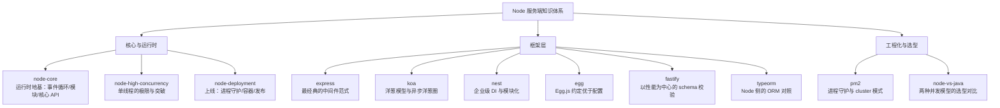

# Node 服务端知识地图与学习路径

> **定位**：本目录是「Node 服务端」的完整知识体系——面向已经会写前端、想把服务端做扎实的读者。全部读完 + 对照 [Java 服务端知识地图](/service/java/) 的选型篇，目标是能独立开发业务接口、能说清 Node 的并发模型、能在 Node 和 Java 之间做出合理的技术选型。
>
> **读法建议**：不要按目录顺序从头读到尾——先读「Node 核心与运行时」三篇建立运行时心智，再按需要进具体框架；「Node 工程化与选型」两篇放在最后（一个讲怎么上线，一个讲该不该用 Node）。

## 一、知识地图（11 篇）

### 每篇讲什么、什么时候读

| 篇目 | 优先级 | 一句话内容 | 什么时候读 |
|------|--------|-----------|-----------|
| [Node.js 入门](/service/node/node-core) | P0 | 运行时地基：事件循环、模块系统、核心 API（fs/stream/http/buffer） | 第一天 |
| [Express.js 入门](/service/node/express) | P0 | 中间件范式、路由、错误处理 | 第一周 |
| [Node.js 高并发与高可用设计](/service/node/node-high-concurrency) | P1 | 单线程的极限、worker_threads / cluster / 异步 IO 的取舍 | 面试前 |
| [Node.js 服务部署最佳实践](/service/node/node-deployment) | P0 | 进程守护、容器化、优雅退出、发布与回滚 | 上线前 |
| [Koa 入门](/service/node/koa) | P1 | 洋葱模型、async/await 中间件、context 委托 | 读 Express 之后 |
| [NestJS 从入门到放弃](/service/node/nest) | P1 | 企业级 DI、模块化、装饰器、ORM 集成 | 做中大型项目时 |
| [TypeORM 用法](/service/node/typeorm) | P1 | 实体、查询、迁移、软删除 | 接数据库时 |
| [PM2 进程管理](/service/node/pm2) | P1 | 守护、cluster 模式、日志、什么时候不该用它 | 裸机部署时 |
| [Node.js vs Java 后端选型](/service/node/node-vs-java) | P1 | 两种并发模型的对比与选型决策 | 做技术选型时 |
| [Fastify 入门](/service/node/fastify) | P2 | schema 校验驱动的性能取向 | 需要更高吞吐时 |
| [Egg.js 入门](/service/node/egg) | P2 | 约定优于配置、插件机制 | 阿里系项目 |

### 配套目录（不在本篇展开，按需查）

| 目录 | 内容 |
|------|------|
| [后端基础](/service/common/http-network-basics) | 网络协议、Nginx、数据库全家桶、Redis、Kafka、ES、分布式、锁、Linux、可观测性（Node/Java 通用） |
| [Java 服务端](/service/java/) | 另一条路线：Spring Boot 全家桶、并发、JVM、微服务——用于技术选型对照 |
| [Node 面试题](/interview-questions/2026-08-07-nodejs) | Node 专项模拟面试题 |
| [Java 实战](/java-practice/) | mall + 12306 的实操记录（Java 侧） |

## 二、三阶段学习路径（照这个走）

### 阶段一：运行时地基（能写对，别踩单线程的坑）

1. [Node.js 入门](/service/node/node-core) —— 重点吃透**事件循环**、模块系统（CommonJS vs ESM）、fs/stream/http 核心 API
2. [Node.js 高并发与高可用设计](/service/node/node-high-concurrency) —— 搞清楚**什么场景下单线程会卡死**、什么时候需要 worker_threads / cluster

**验收标准**：说清一次 HTTP 请求从 socket 到响应的完整链路；解释为什么 CPU 密集任务会阻塞事件循环；写出流式处理大文件的代码而不是 `readFileSync`。

### 阶段二：框架实战（能干活）

1. [Express.js 入门](/service/node/express) —— 中间件范式是后面所有框架的地基
2. [Koa 入门](/service/node/koa) —— 洋葱模型比 Express 更接近"现代"写法
3. [TypeORM 用法](/service/node/typeorm) —— 数据访问层
4. 按项目需要选：[NestJS](/service/node/nest)（中大型/企业级）、[Fastify](/service/node/fastify)（性能优先）、[Egg.js](/service/node/egg)（阿里系）

**验收标准**：用 Express 写一个带参数校验、错误处理中间件、限流、认证的完整接口；说清 Express 与 Koa 中间件执行顺序的差异。

### 阶段三：上线与选型（能交付、能决策）

1. [Node.js 服务部署最佳实践](/service/node/node-deployment) —— 进程守护、容器化、优雅退出、发布与回滚
2. [PM2 进程管理](/service/node/pm2) —— 裸机部署的具体工具（注意：容器里通常不用它）
3. [Node.js vs Java 后端选型](/service/node/node-vs-java) —— 和 [Java 服务端](/service/java/) 对照着看

**验收标准**：把一个 Node 服务从零部署到服务器（含 Docker、优雅停机、进程守护）；能对着场景说清"这个该用 Node 还是 Java，为什么"。

## 三、面试速通路线（临阵磨枪用）

Node 岗出镜率排序：

1. 事件循环与异步模型（`setTimeout` / `setImmediate` / `process.nextTick` 的执行顺序，**必考**）
2. 模块系统（CommonJS vs ESM、循环依赖、ESM 的提升与惰性求值）
3. Stream 与背压（为什么大文件必须流式处理）
4. 进程与线程（worker_threads vs cluster vs child_process 怎么选）
5. Express / Koa 中间件机制
6. 内存管理（V8 堆外内存、Buffer 与垃圾回收）

跨栈通用部分（网络协议、数据库、Redis、分布式）见 [后端基础](/service/common/http-network-basics)。

## 四、和 Java 侧的关系

这不是"二选一"，而是**两条路线各有适用场景**：

- **Node 侧强项**：I/O 密集（网关、BFF、SSR、实时通信）、从 0 到 1 的业务迭代速度、前端团队直接上手
- **Java 侧强项**：CPU 密集与长事务、复杂的企业级中间件生态、成熟的 JVM 生态与可观测性工具链

选型细节见 [Node.js vs Java 后端选型](/service/node/node-vs-java)。

## 五、维护说明

- 新增/改名/删除文件后，根目录 `menu.config.mjs` 的 `/service/node/` 侧边栏要同步（站点完全按它渲染）
- 每篇保持统一结构：定位说明 → 正文（示例 + 对照）→ 面试题速查 → 延伸阅读
